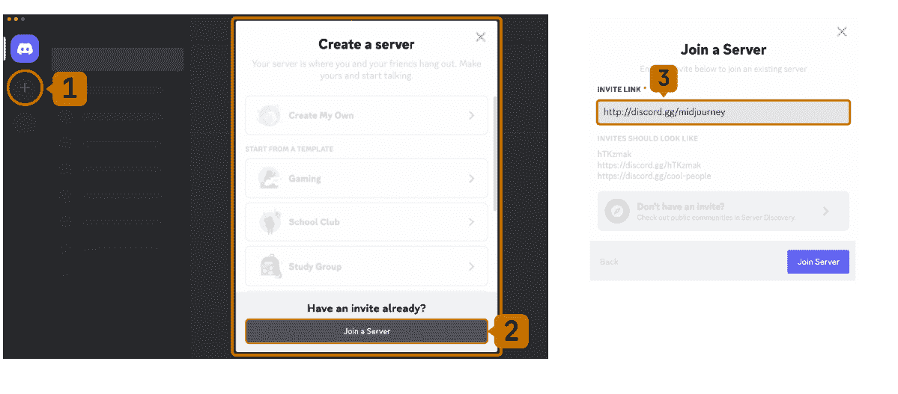
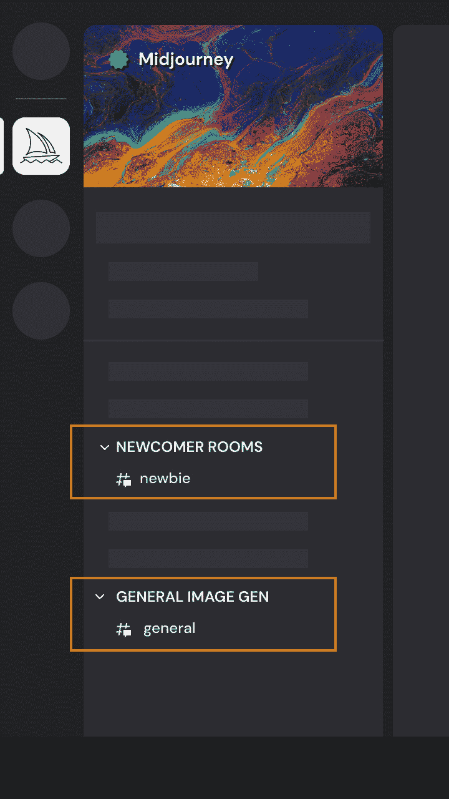
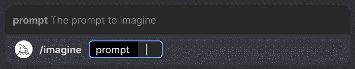
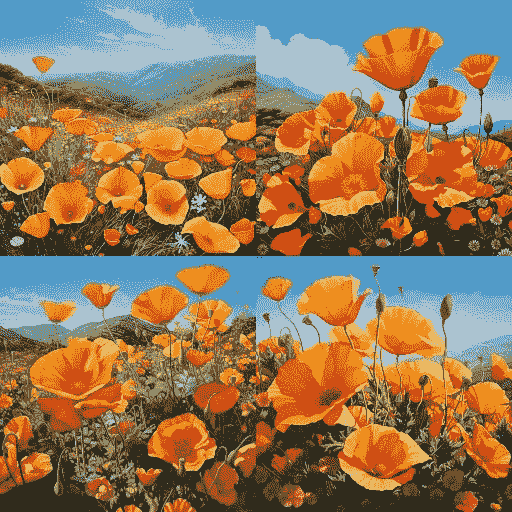
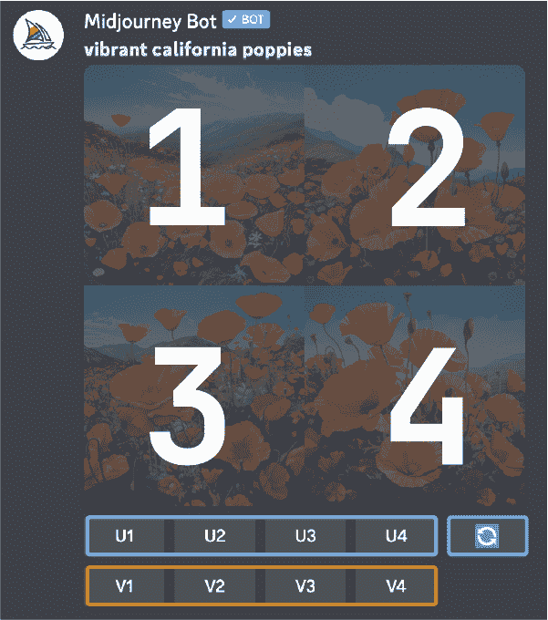
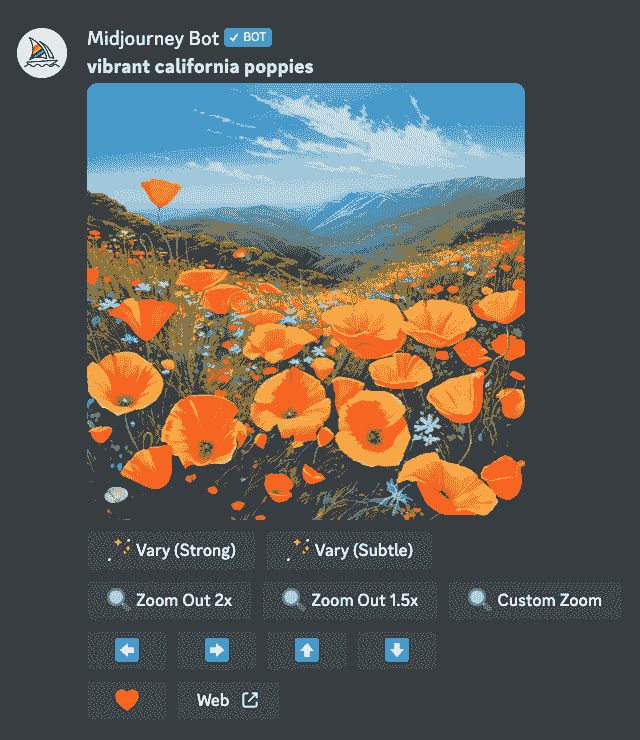
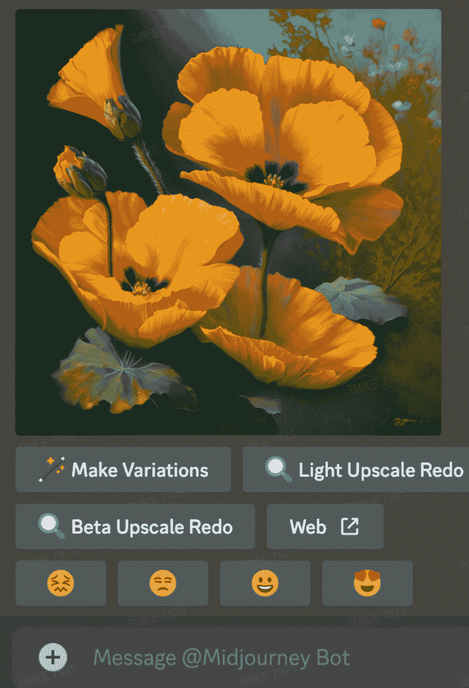
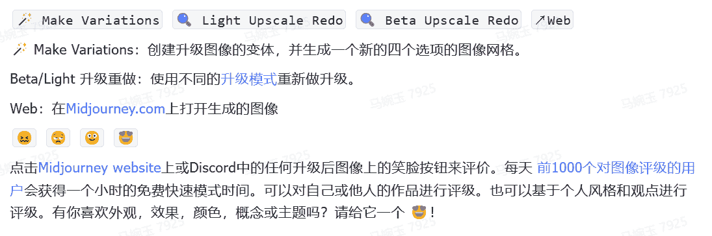

# AI绘图——Midjourney

> 来源：[https://bluefocus.feishu.cn/docx/LqSWdFDNboWHabxfiyVcizZpnmh](https://bluefocus.feishu.cn/docx/LqSWdFDNboWHabxfiyVcizZpnmh)

# **快速入门指南**

使用Midjourney机器人通过简单的文本提示在几秒钟内生成惊人的图像。直接在Discord中操作。不需要任何专门的硬件或软件。

**行为守则**

1.  不要做讨厌的事情。

1.  不要使用我们的工具制作可能激怒、引起不安或制造争议的图像。这包括血腥和成人内容。

1.  尊重他人和团队。

# 使用Midjourney制作图像

## 1.登录Discord

通过网络浏览器、移动应用或桌面应用访问Discord中的Midjourney机器人。确保在加入Midjourney Discord服务器之前，你拥有一个已验证的Discord账户。 按照以下指南创建或验证你的Discord账户：

**F**ollow these guides to create or verify your Discord account:

+   [创建Discord账户](https://support.discord.com/hc/en-us/articles/360033931551-Getting-Started)

+   [验证Discord账户](https://support.discord.com/hc/en-us/articles/6181726888215-Verification-Required-FAQ)

### 加入Midjourney服务器

1.  打开Discord并在左侧边栏找到服务器列表。

1.  在服务器列表底部按下 + 按钮。

1.  在弹出窗口中点击“加入服务器”按钮。

1.  粘贴或输入以下URL并按加入：http://discord.gg/midjourney

## 2.进入#General或#Newbie频道

加入Midjourney服务器后，你会在侧边栏看到多个频道列表。

+   在Midjourney服务器上：

定位并选择任何标记为general-#或newbie-#的频道。这些频道专为初学者使用Midjourney机器人而设计。Midjourney机器人不会在其他频道生成图像。

+   在其他服务器上：

你可以在任何邀请了Midjourney机器人的Discord服务器上生成图像。查看你所在服务器的说明，了解在哪里使用机器人。

## 3.使用/imagine命令

关于Discord命令：

1.  通**过命令与Midj**[ourney机器人互动。](https://docs.midjourney.com/docs/prompts)命令用于创建图像、更改默认设置、监控用户信息以及执行其他有用的任务。/imagine命令从简短的文本描述（称为prompt）生成唯一的图像。了解更多关于提示的信息。

如何使用**/imagine**：

1.  在消息字段中键入** '/imagi**ne prompt:'。你也可以从输入'/'时弹出的可用斜杠命令列表中选择/imagine命令。

1.  在提示字段中输入你想创建的图像描述。

1.  发送消息。机器人将解释你的文本提示并开始生成图像。

1.  遵守社区指南。无论Midjourney机器人在哪里使用，社区指南都适用。

## 4.图像生成过程

提交文本提示后，Midjourney机器人会处理你的请求，在一分钟内生成四个独特的图像选项。此过程利用先进的图形处理单元（GPU），每次图像生成都会计入你的Midjourney订阅包含的GPU时间。

生成图像会激活Midjourney免费的试用。试用用户可以在需要订阅之前进行大约25次任务。

所谓任务指的是使用Midjourney Bot的任何操作。包括使用/imagine命令创建图像、升级图像或创建图像变体，所有这些操作都会消耗您的免费试用时间。

您可以使用/info命令进行检查，以确定您剩余的试用时长。

## 5.选择图像或创建变体

一旦生成了初始图像网格，图像网格下方会出现两行按钮。

U1 U2 U3 U4 图像选择：

在较早版本的Midjourney中，U按钮用于放大图像。使用最新模型时，图像立即生成1024 x 1024像素大小。现在，'U'按钮帮助你从网格中分离出选择的图像，便于下载并让你访问额外的编辑和生成工具。

🔄 **重新运行或重新滚动一个任务：**

🔄按钮重新运行一个任务。在这种情况下，它会重新运行原始提示，生成一个新的图像网格。

V1 V2 V3 V4 图像变体：

V按钮用于创建所选图像的变体。每个按钮生成一个新图像网格，保持所选图像的一般风格和构图。

## 6.增强或修改你的图像

在单独选择一个图像后，会有一组扩展选项可用。

🪄 Vary (Strong) 🪄 Vary (Subtle)：

创建所选图像的强变体或微妙变体，生成新的四个选项网格。

**🔍 Zoom Out 2x 🔍 Zoom Out 1.**5x 🔍 Custom Zoom：

缩小图像，扩展画布的原始边界而不改变原始图像的内容。新扩展的画布将根据提示和原始图像进行填充。

⬅️ ➡️ ⬆️ ⬇️

Pan按钮允许你在不改变原始图像内容的情况下向所选方向扩展画布。新扩展的画布将根据提示和原始图像进行填充。

**❤️ 收藏：**

标记你最好的图像，以便在Midjourney网站上轻松找到它们。

**Web ↗️**：

在midjourney.com上打开图像画廊。

## 7.图片评价

## 8.保存你的图像

点击图像以全尺寸打开，然后右键点击并选择保存图像。在移动设备上，长按图像，然后点击右上角的下载图标。

所有图像可立即在midjourney.com/imagine上查看。

## 9.其他

### 直接消息Midjourney机器人

在与其他用户一起在Midjourney服务器上工作时有困难吗？你可以在直接消息中一对一地与Midjourney机器人互动。在直接消息中创建的图像仍需遵守内容和审核规则，并在Midjourney网站上可见。

### [了解更多关于提示的信息](https://docs.midjourney.com/docs/explore-prompting)

了解如何编写有效和有创意的提示， 探索艺术媒介、地点和时间描述如何改变图像。

### [混合你自己的图像](https://docs.midjourney.com/docs/blend)

了解如何使用/blend命令上传和混合自己的图像。

### Midjourney机器人帮助

需要帮助或有问题？尝试这些命令：

+   /help 显示关于Midjourney机器人的有用信息和提示。

+   /ask 提供关于Midjourney机器人的问题答案。

你也可以访问Midjourney Discord上的#support频道寻求额外帮助。

### 账单和订阅问题

对于账单和订阅问题，请访问help.midjourney.com。

####