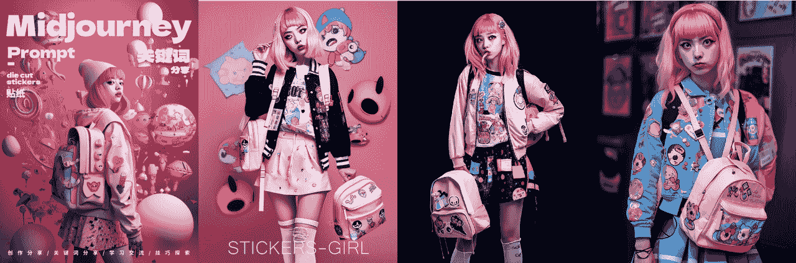
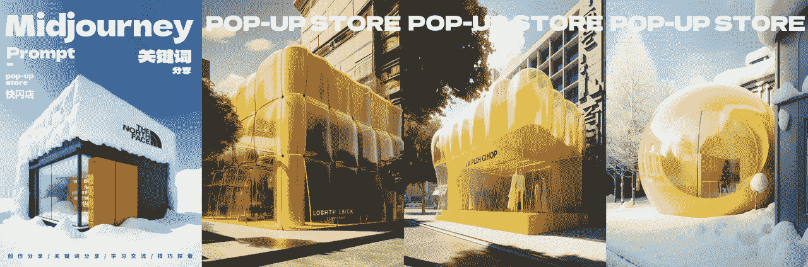
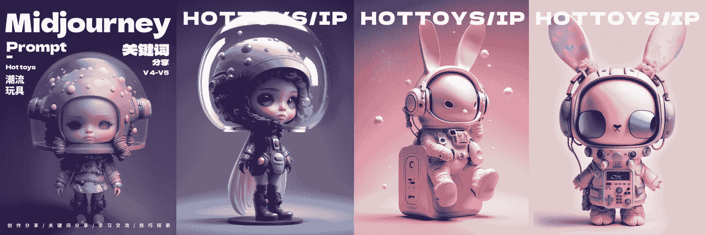

# Midjourney Prompt分析第一期-人像、空间、IP

> 来源：[https://bluefocus.feishu.cn/docx/PfsQdwAHYoEUm4xGdLEctGhgnyf](https://bluefocus.feishu.cn/docx/PfsQdwAHYoEUm4xGdLEctGhgnyf)

> 为了方便小伙伴们的学习和体验，我们找到了这个文档，以系列的方式，通过以内部分享的方式帮助大家练习。

> 关键词只是一个参考，最重要的还是大家需要理解MJ的算法逻辑和如何学习关键词的技巧。

> 大家可以复制关键词，然后理解，拆解，二创或者修改。

> 希望大家能够掌握写词的方法和技巧，可以帮助大家解决实际工作中创作的问题，完成MJ真正意义上的落地。

> 大家加油！

---

> 应用场景：人像/服装/书包/主题概念海报等。

##### （一）人像系列prompt分析（思路）

**主题设定——贴纸女孩**** **

> 镜头+人物描述+形容词+万能词+输出定量

Full-body shot,Portrait photography,Girl, face, sticker, big eyes, pouty mouths, pink hair, colorful clothes, Pink jacket, pink schoolbag, light blue shorts, pink long skirt, black big-toed leather shoes,long legs,color, artwork, vitality, creativity. die cut stickers on face,Colorful stickers,Japanese subculture.on the stree,HDR，16K，ultra detailed , --ar 3:4

全身照,人像摄影,女孩,脸,贴纸,大眼睛,翘嘴,粉色头发,五颜六色的衣服,粉色夹克,粉色书包,浅蓝色短裤,粉色长裙,黑色大头皮鞋,大长腿, 色彩、艺术品、活力、创意， 脸上贴纸，彩色贴纸，街头日本亚文化，HDR，16K，超详细，--ar 3:4

> **Prompt解读**

> 这组Prompt的核心关键词是"贴纸女孩"。

> 这个Prompt是经过了十几次关键词的调整,来权衡权重最终得到的一个结果产出。

> 特别是将"人像摄影"这个关键词归纳为人物描述部分,是因为多多次实验MJ迟迟无法抓取到核心,一直输出贴纸,各种女孩子的贴纸。这明显是权重问题,所以在人物勿关键词前面加了一个"人像属性"的标签,终于得到了一个想要的结果。

> 后续有不错的图出来,就可以选一张玩点新花样,比如尝试去叠图,再给一段新的描述,就会有新的惊喜。

> Pink background, fantasy, stickers flying, wrap around,HDR,16K, ultra detailed , --ar 3:4

> 粉色的背景,梦幻场景,飞舞的贴纸,围绕在身边,给你一一个梦幻世界。

##### （二）空间系列prompt分析（思路）

> 应用场景：快闪店/概念店/橱窗设计/主题概念店等。

主题设定——The NorthFace 概念快闪店

> 镜头+主体描述+形容词+万能词+输出定量

extreme long shot,The North Face pop-up store,glass walls,outdoor snowscape,flagship store, pop-up store,  creative store design, conceptual design, imaginative, vibrant, minimalist, Organic/ECO architecture,Neo-futurism,8K ,ultra detailed, photorealistic --ar 3:4

超长镜头,The North Face 快闪店,玻璃墙,户外雪景,旗舰店,快闪店,创意商店设计,概念设计,富有想象力,充满活力,极简主义,有机/ECO建筑,新未来主义,8K ,超详细,逼真 --ar 3:4

> **Prompt解读**

> 这组Prompt的核心关键词是"快闪店"。

> 首先这个Prompt在关键词的结构上是有调整的,同样是权重影响向,把行业属性的媒介(万能词)调到了前面,而行业中的设计风格部分还是放在后面。

> 但是有些同学反馈说为什么按照这个Prompt生成的东西会不一样,这应该源自于这个描述还是过于的简单,随机性偏大,所以当Midjourney在创作的时候会有很多发挥的空间。

> 同样关于The North Face快闪店我在这里给大家补充一个Prompt,大家也可以再试一下,调整的点在于你是否加入一些更加细节的对主题的刻画描述词,可以自行调整玩一下。

> "extreme long shot, The North Face pop-up store,outdoor snowscape, Cubic structure, Blue sky, snow-covered roof, black walls, partly orange walls, glass walls, flagship store, pop-up store,

> snow-covered, creative store design, conceptual design, imaginative, vibrant, minimalist,

> Organic/ECO architecture,8K, ultra-detailed, realistic. --ar 3:4" .

##### （三）IP系列prompt分析（思路）

> 应用场景：卡通形象/IP设计/盲盒设计/潮玩设计/虚拟头像等。

**主题设定——太空女孩**

> 镜头+主体描述+形容词+万能词+输出定量

Space girl, transparent helmet, purple gradient hair, super big eyes, pouty mouth, small body, long legs, bubble skirt, POPMart style, cute, dreamy, simple, girly, sci-fi, by Kenny Wong, trendy toys, IP design, blind box, resin material, PVC, 3D rendering, Blender,octane render, Maxon Cinema 4D ，high detail，sophisticated，8K，HDR, --ar 3:4

太空女孩，透明头盔，紫色渐变头发，超级大眼睛，嘟嘟嘴，小身材，长腿，泡泡裙，POPMart风格，可爱，梦幻，简单，少女，科幻，作者Kenny Wong，潮流玩具，IP设计，盲盒，树脂材料，PVC，3D渲染，Blender，辛烷渲染，Maxon Cinema 4D，高细节，复杂，8K，HDR，--ar 3：4

> **Prompt解读**

> 这组Prompt的核心关键词是"太空女孩"。

> 这组Prompt开始是没有设置镜头的,比如全身full-body,当然加上的话是没有问题的,原因是在主体描述中详细的描述了人的整个体形,是可以被MJ识别的。

> 将"Popmart"这个关键词归纳为主体描述部分,在第一部分"万能/常规句式解读"中有提到,将明确的品牌风格提前,会把这个风格权重加强,甚至于把设计师归到了能词汇(媒介描述)里面,也是因为是

> 设计师的风格比较特别,比较明显,可以在这个行业或者产品项域里面加强更加细分风格的一个权重。

> 另外一条Prompt:

> "Full-body, Space Rabbit IP by Kidrobot, glasses, pink clothes,earphone, pastel color,luster clean background, blind box, toys, 3D render,Soft focus,orc,blender,ultra high definition, high detail,8k,--ar 3:4"