# Midjourney Prompt分析第三期-室内、包装、插画

> 来源：[https://bluefocus.feishu.cn/docx/CaeXdz3TGoo2JSxFCTdcpQZVnCe](https://bluefocus.feishu.cn/docx/CaeXdz3TGoo2JSxFCTdcpQZVnCe)

> 为了方便小伙伴们的学习和体验，我们找到了这个文档，以系列的方式，通过以内部分享的方式帮助大家练习。

> 关键词只是一个参考，最重要的还是大家需要理解MJ的算法逻辑和如何学习关键词的技巧。

> 大家可以复制关键词，然后理解，拆解，二创或者修改。

> 希望大家能够掌握写词的方法和技巧，可以帮助大家解决实际工作中创作的问题，完成MJ真正意义上的落地。

> 大家加油！

##### 3.1 家居/室内系列prompt分析（思路）

> 应用场景：家居摄影/家具摄影/室内设计/空间效果图/装修风格参考图等。

> 镜头+主体描述+形容词+万能词+输出定量

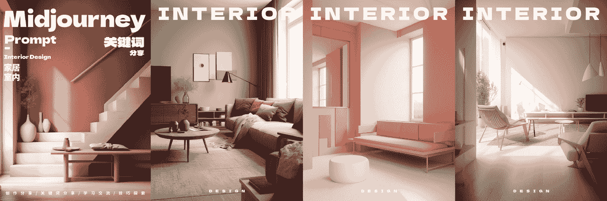

######## 1,家居摄影类

A medium shot of an industrial-style living area， in concrete, brick and black steel. in minimal .A touch of urban chic. Featuring a Tom Dixon slab coffee table and Fritz Hansen leather sofa in black. Colour palette of black, grey and brass. Photographed with natural light and high contrast.ultra-detailed, Photorealistic, 16K, unreal engine， --ar 3:4

中景，一个工业风格的生活区,由混凝土、砖块和黑色钢材的极简主义风格，带点时尚都会的风情。汤姆迪克森厚板咖啡桌和黑色弗里茨汉森皮沙发，采用黑色、灰色和黄铜色的色调。在自然光和高对比度下拍摄，超高清晰、写实、16k分辨率,虚幻引擎,--ar 3:4

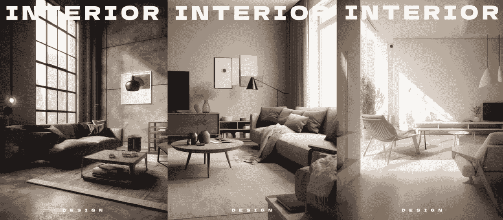

> Prompt 解读

> 这组Prompt是常规的室内设计或者说家居摄影的视觉呈现。

> 关键词也是在我们标准的范式上面去填词,主体描述的时候就可以把风格放在里面,因为涉及权重的问题,一

> 定要设计好。

> 知识点:工业风格--家居风格,极简主义风格--设计风村路,大家不要混淆这两个词汇,像极简风适用于所有

> 的设计领域,而工业风更加局限在具象的一类设计中,如果家居、产品啥的。

> 当然如果你很清楚家居类目或者家居品牌的时候,你就可以把具体的品牌产品放置进去,这样会显得更加的真

> 实,比如汤姆迪克森的咖啡桌。当然你只描述咖啡桌,也是没有问题的。

> 按照这个逻辑我们就可以输出一系列不同风格的摄影作品,分享另外两个prompt:

> "A medium shot of a cosy living room.by BoConcept, an eggshell grey fabric sofa, a brown leather armchair

> and a functional wooden coffee table, minimalism, Photorealistic,16K, unreal engine, --ar 3:4"

> "A medium shot, contemporary living room furniture, in the style of Clemens Ascher, organic minimalism

> soft atmospheric light, sculptural volumes, Japanese minimalism, Bjarke Ingels, minimalist outlines , ultra

> detailed, Photorealistic, 16K, unreal engine --ar 3:4 "

> 以此类推,全景,中景,近景甚至特写,全不在话下。

######## 2,室内渲染类

minimalist room with a bench and stairs, in the style of light crimson and light bronze, charming character illustrations, earthy organic shapes, spot metering, Georg Jensen, soft tonal range, precise detailing， ultra detailed, Photorealistic, 16K, unreal engine --ar 3:4

带有长凳和楼梯的简约房间，浅红色和浅青铜的风格，迷人的人物插图，朴实的有机形状，点测光，Georg Jensen，柔和的色调范围，精确的细节，超细节，照相写实，16K，虚幻引擎-ar 3:4

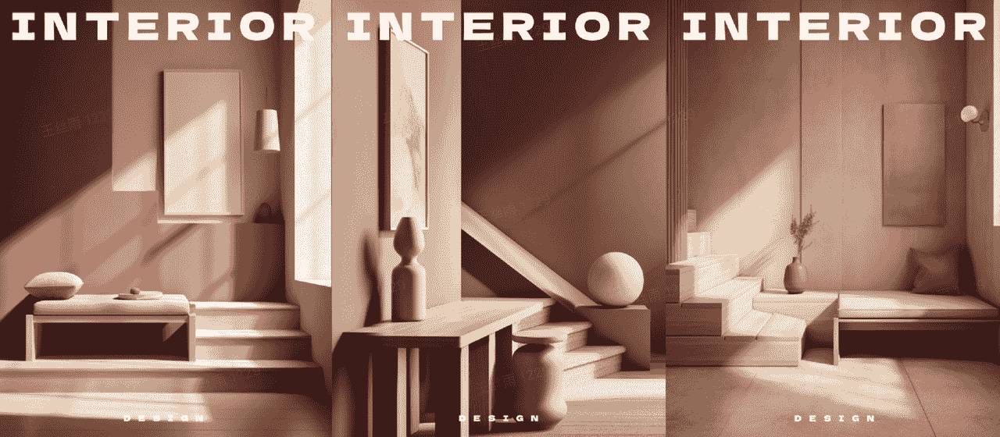

> Prompt 解读

> 这种偏效果图的一种呈现,在行业里面这种呈现一般主要存在于干风格说明,样式参考或者品牌调性之类,除了

> 一些网红店或者直播样板间以外,大概率不太会有人真的会这个么去复刻自己的家。

> 当然这是为大家呈现一种新的方式,大家完全可以根据自己的需求去填入一些更加准确量化的词,比如什么品

> 牌的家具,什么风格等等,让它更加的落地。

> 这组Prompt基本是把主体描述和形容词做了一个整合描述,除了主题细节还有一些抽象氛围和光线的描写,其

> 次就是设计师风格,然后加上后缀的标准词汇就可以。

######## 3,创意概念类

a room that has an interesting design, in the style of light pink and amber, minimalist line art, eco-friendly craftsmanship, shyper-realistic representation, bauhaus-inspired designs, norwegian natureealistic representation, ultra detailed, Photorealistic, 16K, unreal engine --ar 3:4

一个设计有趣的房间,采用淡粉色和琥珀色的极简线条艺术风格,环保手工,写实再现,受包豪斯艺术设计启发,挪威大自然的写实再现。超高清晰、写实、16k分辨率,虚幻引擎 --ar 3:4

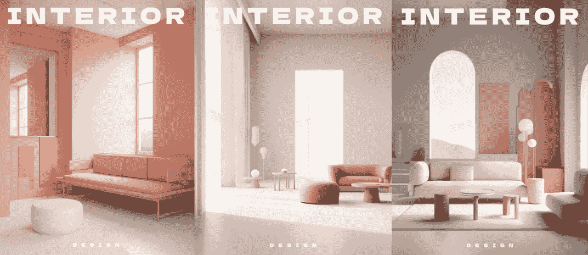

> Prompt 解读

> 这组Prompt同样是主体和形容词的整合描述,这样既可以考虑到权重,也可以让词组变成逻辑性很强的句子。

> 当前家居行业存在一个新的趋势,尤其指新晋家居品牌,打破了家居行业视觉的沉稳,开始突破性的去尝试各

> 种风格,比如林氏木业致力于和年轻人打成一片,用更加年轻化的语言来传递家居设计的概念,所以家居已经

> 不再拘泥,而是打破行业风格壁垒,去出圈,去吸引流量。

> 所以这一组范例就是在这一逻辑上的一个范式案例,当前更适合合作为一些网红商业空间的落地方案风格参考。

##### 3.2 包装概念系列prompt分析（思路）

> 应用场景：包装概念/包装设计/礼品设计等。

> 镜头+主体描述+形容词+万能词+输出定量

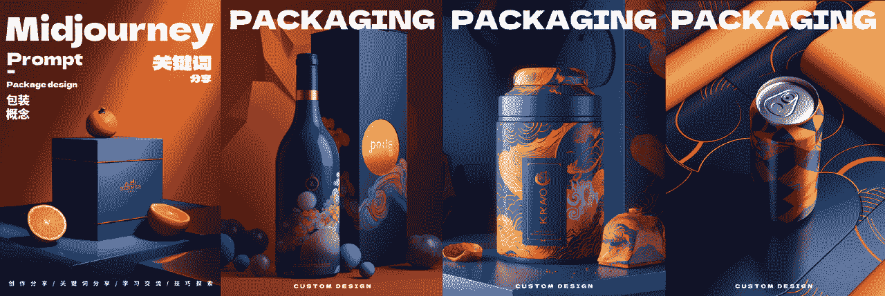

######## 1,包装摄影类

In-studio shooting，Package Design,hermes，a branded box with blue lettering and orange , in the style of firmin baes, bo chen, minimalistic lines, bryce 3d, realistic rendering, monochromatic color scheme, toyen，HDR，8K，octane render, display lighting， --ar 3:4

棚内拍摄，包装设计、hermes，一个有蓝色字体和橙色的品牌盒子，firmin baes和bo chen的风格,极简主义线条, bryce 3d、逼真的渲染，单色方案，Toyen，HDR，8K，octane渲染，显示照明，--ar 3:4

> Prompt 解读

> 这组Prompt是常规的包装摄影的视觉呈现。

> 关键词也是在我们标准的范式上面去填词,主体描述的时候就可以把风格放在里面,带上品牌可以拉高调性,

> 也不会完全给你生成品牌内容,还是不错的一个小技巧。其他部分就是基础描述,什么样子,盒子还是罐子,

> 复杂还是简约,然后一些量化的内容。

> 知识点:不过在做这一风格的时候我确实也遇到了问题,给大家分享一下,其实也不是这个个案的问题,而是

> 一个近似词导致MJ算法混淆的一个问题,但凡你涉及到这个个词,你就会直接遇上这个问题,所以让我们现在就

> 解决掉。

> orange.....让人头疼,这不是单词问题,这是权重问题5.5

> 大家其实都发现了,这一组画面中都多了很多大橙子,其实真不是有意为之,只是因为涉及了"橙色",MJ就慷慨的给了橙子,也给了橙色。所以在第一组的时候我们毫不避讳的放了出来。

> 言归正传,但是橙色而不是橙子的时候,我们该怎么办?

> 权重!!!一开始用了::,想尽可能的把颜色比重大一些,比如:color::orange,加强颜色的属性,感觉会好很多,出现橙子的概率小了很多,或者你可以color::2试一下。

> 用--no,no organe就一切都灰飞烟灭了,所以想到了no fruit,不得不说,也还是有点成效的。

> 这是一个技巧的思路,大家有兴趣可以试一下,有更好的办法一定要分享出来啊

######## 2,包装设计类

（图3）wine packaging design，in the style of unique yokai illustrations, bold typography, soft and rounded forms, chinapunk, light purple and light navy, yellow and white, advertisement inspired,Package Design,a box with characters, in the style of graphic design-inspired illustrations, expressive linework, color:: dark-orange and sky-blue, vray ,8K，octane render, display lighting， --ar 3:4

酒包装设计,采用独特的妖怪插画风格,大胆的字体,柔和圆润的形式,chinapunk,淡紫色和淡海军蓝,黄色和白色,受广告启发,包装设计,一个带有字符的盒子,以平面设计启发的插画风格,富有表现力的线条,颜色:深橙色和天蓝色,Vray,8K,octane渲染,显示照明,--宽高比3:4。

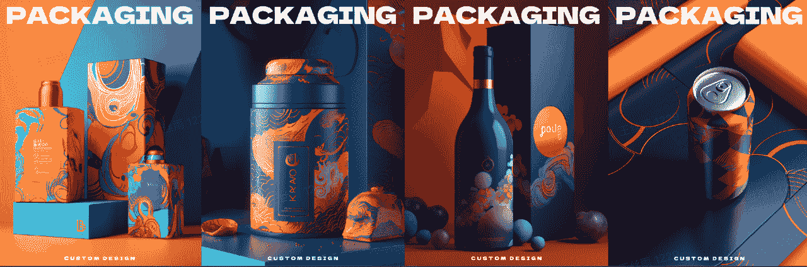

> Prompt 解读

> 这组Prompt是不是大橙子不见了,哈哈哈。

> 关键词案例给大家呈现的是酒包装的,最后给大家补上其他的几几个,逻辑和结构是一样的。

> 这组很明显省去了我们框架中的一些要素,但是核心的关钱健词都是在的,扩充了一些描述,呈现出来的视觉依

> 旧还是蛮精致的,描述集中在了包装的呈现方式上,所以产出细节也就集中在了包装细节上。

> 给大家附上另外几组prompt:

> (图1): Package design, a plastic box ,in the style of unique yokai illustrations, bold typography, soft and

> rounded forms, chinapunk, light purple and light navy, yellow and white, advertisement inspired, Package

> Design, a box with characters, in the style of graphic design-inspired illustrations, expressive linework,

> color:: dark-orange and sky-blue, vray,8K, octane render, display lighting, --ar 3:4

> (图2) : Package Design, a box with characters, in the style of graphic design-inspired illustrations, m29

> expressive linework, color:: dark orange and sky-blue, vray,8K, octane render, display lighting, --ar 3:4

> (图4): high angle view, a can is featured on a background with abstract artwork, in the style of

> geometry-inspired, vray, yellow and navy, realistic usage of light and color, silver and orange, scoutcore,

> accurate and detailed, 8K, octane render, display lighting, --ar 3:4

######## 3,标签设计(全过程拆解一权重之争)

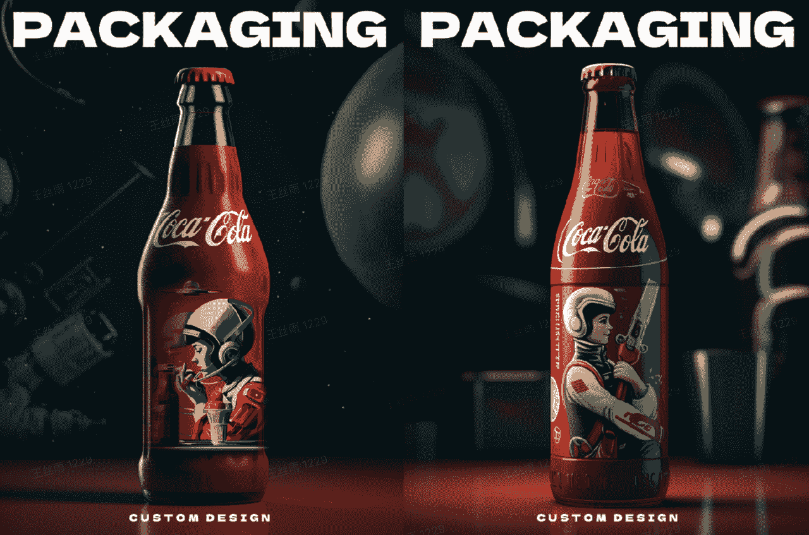

命题:给经典瓶装可口可乐设计一款复古主题标签,标签内容:一个女航员在喝可乐。

这节课的重点不在于做标签,而是在于一个东西与另一个东东西的合成思路,是权重的battle,大家要注意挖掘本质方法。

第一步:复古标签设计

Waist-up shot, retro travel poster style, minimalist style flat illustration, an elegant aristocratic woman drinks

coke from a goblet in her hand, wears an astronaut helmet on her head, has a good mood, a bottle on the

table Coca-Cola, 1950s, muted color palette, symmetrical framing, quirky props and costumes, soft lighting

details inspired by Edward Gorey's artwork, sci-fi literature, cyberrpunk, show lighting, --ar 3:4

半身镜头,复古旅游海报风格,极简主义平面插画风格,一位优雅的的贵族女士举手喝着她手中的酒杯中的可乐,头戴宇

航员头盔,心情很好,桌上有一瓶可乐,上世纪50年代,柔和的色调对称的构图,古怪的道具和服装,柔和的灯光,细节灵

感来自爱德华·戈里的艺术作品,科幻文学,赛博朋克,展示照明,一宽高比3:4。

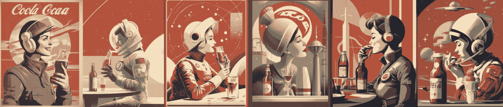

第二步:合适的可乐瓶,需要把复古的标签贴上去,可以用photoshop辅助简单P一下(帮助MJ抓取权重,后面

就知道了)

Photography studio shot, Coca-Cola drink bottle, package design, label design, vray ,8K, octane render,

display lighting, --ar 3:4

摄影棚拍摄,可口可乐饮料瓶,包装设计,标签设计,Vray,8K,octane渲染,显示照明,--宽高比3:4。

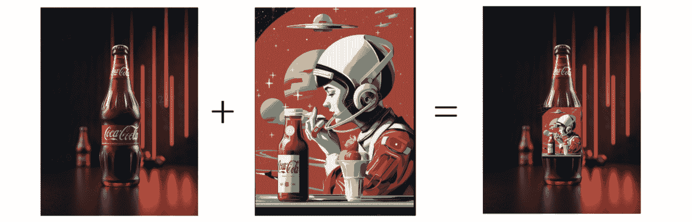

第三步:省略过程上干货:

(瓶+标签合成图)3:4(标签图)a classic Coca-Cola bottle::2 the illustration content:: on the label, --iw 2 --ar

(瓶+标签合成图)(标签图)一个经典的可口可乐瓶::2插图上的内容::标签.--iw 2--ar 3:4

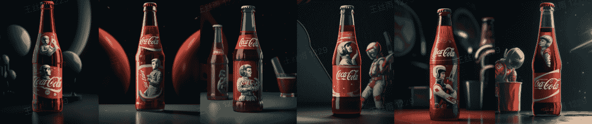

> Prompt解读(核心知识点)

> 这组Prompt最核心的是第二和第三步。

> 之所以一定要合成,就是让MJ去抓取我们的意图,明白我们们要做的是什么。

> 然后就是合成,合成的时候就是要控制权重的时候,瓶子的占比要重,标签的比重要轻,然后再加上iw2,来极端控制相似度,这个稳定的效果基本就出来了,多刷一些图,基本都可以直接用了。

> 知识点:有些同学可能会质疑觉得是不是用不着这么麻烦,直接关键词输出也可以做出来。那我想说那就试试看吧,哈哈哈。

> 我其实实验了大量的样本,直接关键词压根是无法识别关键词的意思,即便加上权重,因为描述过多,对于权重大小也是混乱的,要么宇航员在外面,要么没有宇航员,要么宇航员一半在瓶子上一半在外面,可能你刷50次有一个宇航员标签,还是个男的。

> 我也尝试过叠一张图,自然也逃不出权重不明确的厄运,简直惨不忍睹。

> 所以说这将会是一个有效的控制权重的方式,大家一定不要把这个知识点局限在这个瓶子上面,一通百通的逻辑。

> 掌握了这个逻辑可以解决很多事情。

> 至于说有人看见过一张和生成标签一模一样的标签贴在瓶子上,那是photoshop的功劳,这里我就不多说了,超纲了。

##### 3.3 插画/绘本概念系列prompt分析（思路）

> 应用场景：图书绘本/插画/插图/海报等。

> 镜头+主体描述+插画师+类型+输出定量 （常规模板范式）

> 类型+插画师+镜头+主体描述+输出定量

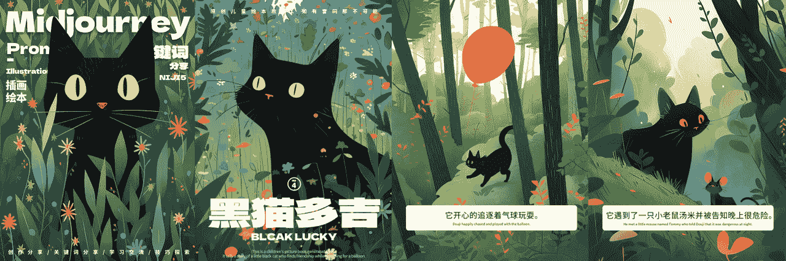

######## 1,封面设计/角色/风格/场景设定

Illustration, children's picture book, by Asaf Hanuk and Akira Toriyama, the lonely little black cat is in the forest, looking up at the starry sky in the grass, close-up, symmetrical thecomposition --ar 3:4 --niji 5 --style expressive

插图,儿童图画书,作者Asaf Hanuk 和 Akira Toriyama,小黑猫独自在森林里,躺在草地上仰望星空,特写镜头,构图

对称。

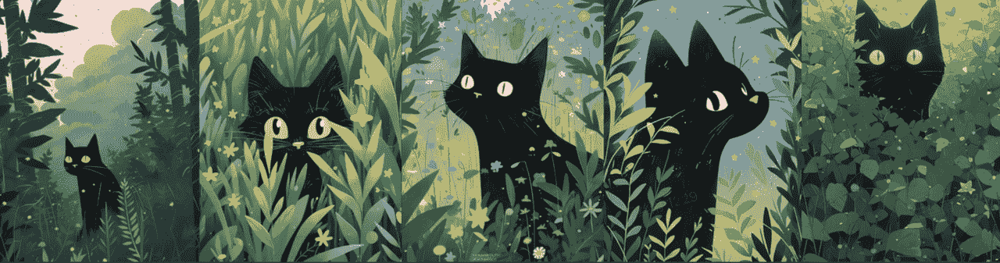

> Prompt解读

> 这组Prompt是整个绘本的一个基础,当然也可以作为插画的一个基本句式。

> 创作形式+插画师风格放在最前面是为了强化和框定整体的画面风格走向,比如插画师也可以加在后面,但

> 是风格会根据画面描述的调整和权重关键词的混淆,产生跑偏于为。

> 这个绘本的小故事我也是仰仗了我们前面的Al助手Claude,通过过给它一个基础的线索,来给到了这一篇内容框架。

> 当你需要文字部分的支持的时候,chatGPT或者Claude都会会是一个不错的助手。

> 知识点:

> 为了保证整体的一致性,首先我们需要保持基础句式结构的一致性。

> 其次就是对于主要角色描述的一致性,比如我们这个主要角色是是"the lonely little black cat",不同场景的变化中就要保持这个主体描述,而环境设置的是森林。

> 所有整个结构中有几个节点是不变的,括号里面是需要调整的,这样可以保持多个画面的基础稳定性,但不是绝对。

> 插画,儿童绘本+插画师+the lonely little black cat+(在做的事事情)+森林环境+(镜头构图)

> 这是第一步,在尝试中难免还会有一些不确定性的画面产出,女好在第一张,我们是可以控制的。

######## 2,单角色/风格/场景设定

一 场景和镜头转变(特写主体,交代空地,偏中景)

illustration, children's picture book, by Asaf Hanuk and Akira Toriyama, the lonely little black cat play a red

balloon, In the open space outside the small house, happy, close-up --ar 3:4 --niji 5 --style expressive

插图,儿童图画书,作者Asaf Hanuk和Akira Toriyama,小黑猫独自快乐地玩耍着一只红色气球,在小房子外的

开阔空地上,特写镜头。

二 场景和镜头转变(森林,天空,环境转移,拉远镜头)

Illustration, children's picture book, by Asaf Hanuk and Akira Torriyama, the lonely little black cat chases a

red balloon floating in the air in the forest, asymmetricaI composition, golden ratio --ar 3:4 --niji 5 --

style expressive

插图,儿童图画书,作者Asaf Hanuk和Akira Toriyama,小黑猴猫独自在森林里追逐一只漂浮在空中的红色气球,

不对称镜头,黄金分割。

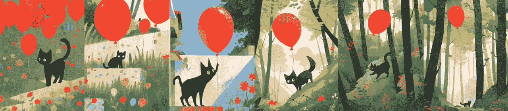

> Prompt解读

> 这里有3组Prompt,小黑猫在家玩气球(近景);去森林追气球求(中远景);追丢了气球(远景),最后一张的镜头我设置成了long shot,风格还是相对稳定的。

> 故事相对粗糙,范例只是展示解题思路和方法,所以在衔接上有有一个转场逻辑即可,大概率你是可以从出的图里面选出来的。

> 不过在这里我也尝试用第一张定调的图去叠图来控制风格,风林路是出来了,但是权重会受到极大的干扰,所以能靠关键词框定就尽量不要去叠图。

> 比如我用了这一张去做叠图,那小黑猫追气球就被第一张中的元素收到了极大的干扰,本来追一只就很难了,漫山遍野的气球直接懵掉。

######## 3,双(多)角色/场景设定(难点)

(叠图) Illustration, by Asaf Hanuk and Akira Toriyama, the lonely little black cat meets a mouse in the

forest, chatting happily, children's picture book, POV --ar 3:4--seed 801398808 --niji 5 --style

expressive

插图,作者Asaf Hanuk和Akira Toriyama,小黑猫独自快乐地玩耍着一只红色气球,在小房子外的开阔空地

上,儿童图画书,第一人称视角。

> Prompt解读

> 这里有三个权重的点,我需要挨个讲一下

> 1,叠图。我叠了一张中景的黑猫图,来给出场景和角色的风格参考和比例参考。

> 2,把儿童绘本放在了后面,因为在出现2个及以上角色的时候,感感觉MJ就有点模糊,恍恍惚惚的都给我生

> 成出了儿童和猫,老鼠一起玩耍。这个就是权重的问题,尝试之后放在前面,效果会好很多。

> 3,seed值。同样是叠图的那张图,用双重权重加强,还是会有效果的。

> 4,PS后期,最后的最后,好在这些乱出的图成了很好的素材,只需要把小卡乐咪换成老鼠,基本就完事

> 了,所以很多时候,photoshop也是相当靠谱的。

> 我展示下过程图就能理解MJ的随机性有多么的任性了。

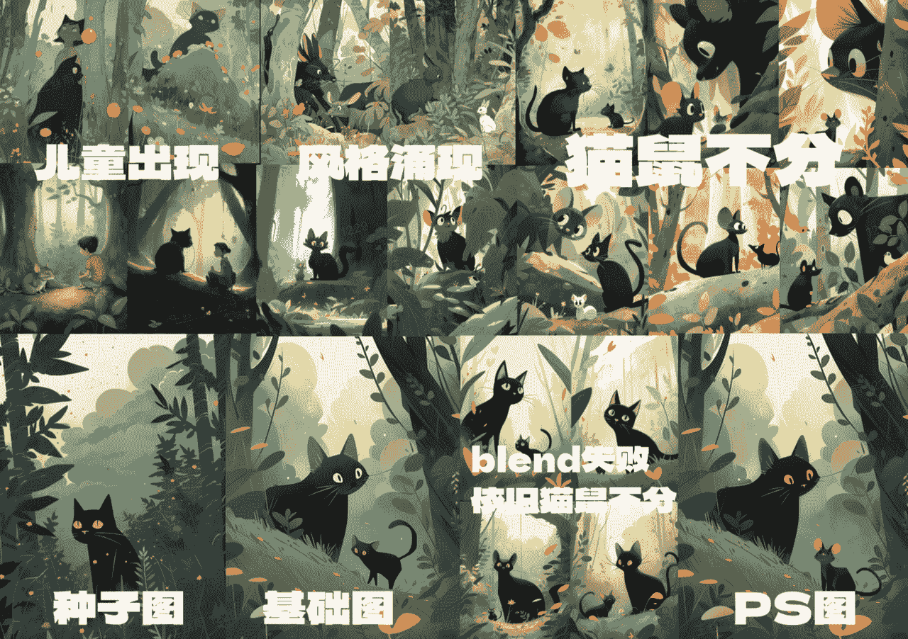