# Midjourney Prompt分析第四期-电影海报、矢量插画、LOGO

> 来源：[https://bluefocus.feishu.cn/docx/VyypdSteuoZ2RlxeqjgcRyNgnUh](https://bluefocus.feishu.cn/docx/VyypdSteuoZ2RlxeqjgcRyNgnUh)

> 为了方便小伙伴们的学习和体验，我们找到了这个文档，以系列的方式，通过以内部分享的方式帮助大家练习。

> 关键词只是一个参考，最重要的还是大家需要理解MJ的算法逻辑和如何学习关键词的技巧。

> 大家可以复制关键词，然后理解，拆解，二创或者修改。

> 希望大家能够掌握写词的方法和技巧，可以帮助大家解决实际工作中创作的问题，完成MJ真正意义上的落地。

> 大家加油！

# 4.1 海报（电影类）概念全流程prompt创作分析（思路）

> 应用场景：海报/摄影等。

> 镜头+主体描述+万能词+输出定量

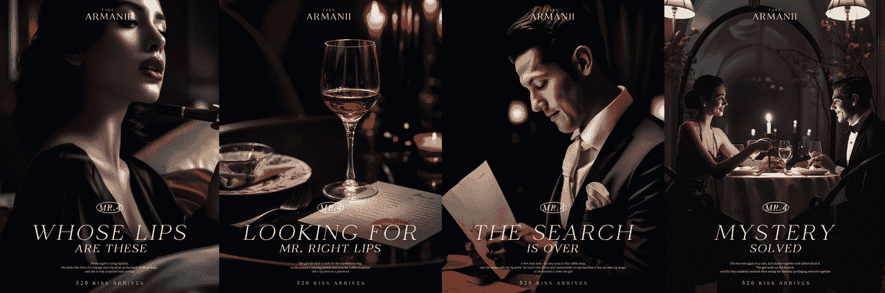

back shot,overshoulder shot,POV,up view , foucs on Armani's tube lipstick products,A girl takes out a lipstick from her handbag，black hair, chanel suit，the bed room,close-up，DOF ,cinestill 50 film, master photography, cinematic lighting，best quality,realitic,HDR,16K --ar 3:4

背后拍摄、过肩拍、POV、仰视、 镜头聚焦在阿玛尼的口红产品上、一个女孩从她的手提包里拿出一支口红，黑色的头发，香奈儿的套装，在卧室里、特写，背景虚化 ,cinestill 50 电影级镜头、 大师级摄影、电影灯光，最好的质量，写实，HDR,16K --ar 3：4

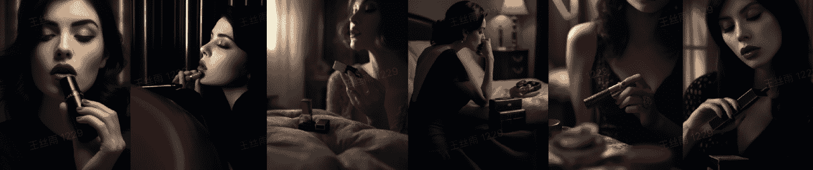

> Prompt解读

> 其实，这套Prompt是不错的，大家可以根据中英对译细品一下，画面表现的一个权重是什么样的。

> 但是我不是很满意，那就是我刷了好久，都没有找到我想要的那个姿势，或者说接近的姿势总会有瑕疵。那我总想掌控它的欲望就上来了，那不行!我不答应，我一定要搞!

## 步骤拆解

### 1， 接到brief需求，拆解分析

设定:A玛尼需要在520推出节日限定男女通用唇膏，需要做一系列品宣海报进行推广

要求:A-风格需要符合品牌调性，要大牌，而且还要带有复古情调。

B-需要讲一个浪漫的爱情故事，通过一个贯穿始终的线索，来展现画面

分析:讲故事的话，系列海报更符合表达的逻辑，可以让视觉更有趣味性，还可以设定互动。对于这个奢侈的美妆品牌，用一个罗曼蒂克的复古电影镜头的方式去表达会更加的有味道。

结论:先写一个脚本讲故事，做一套电影风格的海报。

工具:Claude/c、Chatgpt(写作小能手)+Midiourney(画面创作)+(手绘草图+PS后期、只要能解决，什么工具都是好工具)

### 2，Claude协助分镜脚本及文案

Claude可以，ChatGPT可以，文心一言也可以，自己拍脑瓜写也可以，总之我们学会擅用工具。

> 1.标题为“Whose Lips Are These”--这是谁的唇印?设置悬念第一画面:女生在使用唇膏时,发现包装背面居然印有一个陌生男生的唇印,感到十分诧异与好奇。

> 2.标题为“Looking for Mr.Right Lips”--寻找我的唇膏先生。推进情节第二画面:女生决定寻找这个神秘男生,于是在咖啡店张贴寻人启事,并留下唇印作为暗号。

> 3.标题为“The Search is Over”--真相浮出水面。真命天子出现第三画面:几天后,男生来到咖啡店,看到启事和唇印后心跳加速，莫名微笑,于是决定与女生见面。

> 4.标题为“Mystery Solved”--解开的谜团。故事高潮第四画面:两人的第一次约会,女生的唇色耐人寻味,男生主动吻上女生的唇,在唇膏的作用下变得意乱情迷(画面不允许)

> 5.标题为“Meant to Be,After Al!”。--毕竟是有目的的。一语双关最终画面:直接推出那个爱情发生的导火索--节日限定款男女通用唇膏。

### 3，草图绘制，火柴人/灵魂画手皆可

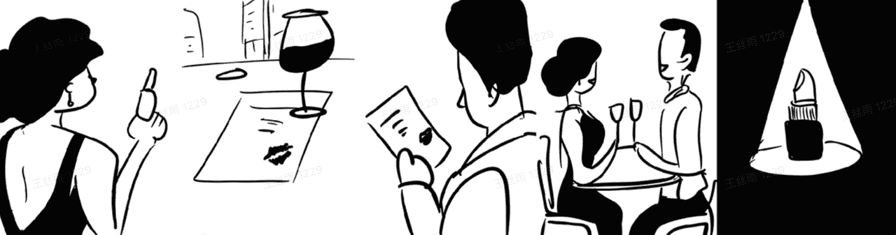

> 叠图1, sketch,close-up, back shot overshoulder shot POV, A girl takes out a( Armani's tube lipstick products) from her handbag, black hair, chanel suit, the bed room, --ar 3:4

> 叠图2, sketch,POV, Shot focused on invitation paper , close-up, Michelin restaurant glass window,brightly lit night --ar 3:4 --v 5.1 --iw 1.5

> 叠图3, sketch, close-up, back shot overshoulder shot POV, A handsome man, looking at a piece of paper, smiling, black hair, suit, background of Michelin restaurant --ar 3:4 --iw 0.5

> 叠图4, sketch, Symmetrical composition, woman and man having dinner, Michelin restaurant --ar 3:4

> 叠图5, sketch, Symmetrical composition,Shot focused on Armani Lipstick, Spotlight(效果不好,pass)

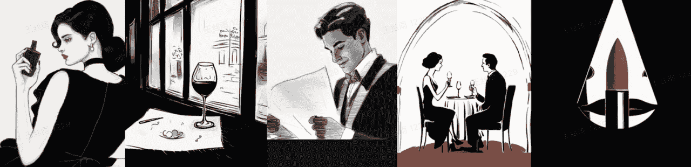

> 这组Prompt的关键词是“SKetch”，草图。

> 描述的话只需要表达清楚画面就可以，大家可能注意到我在用iw控制权重，数值都不太一样，这个需要尝试，自行调整，不是绝对值。

### 4， Prompt叠图输出

> 镜头+主体描述+万能词+输出定量

> 注意:直接由草稿生成的画面在画面的细节，光影各方面都会显得略有单薄，不过无需担心，我们可以再来一遍，把生成的图再叠进去，用关键词重新生成一遍。

(叠图) close-up, back shot overshoulder shot POV,A girl takes out a ( Armani's tube lipstick products) fromher handbag, black hair, Chanel suit, the bedroom,DOF ,cinestill 50 film, master photography, cinematic lighting, best quality,realitic, HDR,16K --ar 3:4

(叠图)特写，仰拍、过肩拍、POV、一个女孩从她的手提包里拿出一支(阿玛尼的口红产品)，黑色的头发，香奈儿的套装，在卧室里、特写，背景虚化,cinestil 50 电影级镜头、大师级摄影、电影灯光，最好的质量，写实HDR16K--ar3:4

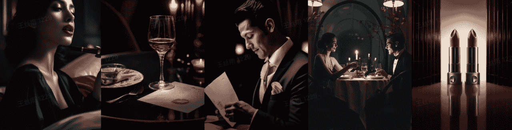

> Prompt解读

> 经验分享:

> 通过草图生成的画面约束性还是不错的，包括构图和细节，当然，这里面有两部分在起作用，一个是草图，一个是关键词。准确的描述，合理的使用权重会事半功倍，

> 其他的几组关键词也分享出来:

> 2, (叠图) POV. Shot focused on an invitation card on a Michelin restaurant glass, A lipstick imprint on,paper, brightly lit night, DOF ,cinestill 50 film, master photography, cinematic lighting, bestquality,realitic,HDR,16K --ar 3:4

> 3, (叠图) close-up, back shot POV,A handsome man, looking at a piece of paper, smiling, black hair, suit, backaround of Michelin restaurant, DOF fashion, master photography, cinematic lighting. bestquality,realitic,HDR,16K --ar 3:4 --iw 0.5

> 4, (叠图)Symmetrical composition, young woman and man having dinner, Michelin restaurant, romantic atmosphere, smile, happiness, black hair, suit, background of Michelin restaurant, DOF .fashion, master photography, cinematic lighting, cinestill 50 film,, best quality,realitic,HDR,16K --ar 3:4 --iw 0.5

> 5,(无叠图) Symmetrical composition,Shot focused on Armani Lipstick, Spotlight,Armani lipstick, spotlights，couple snuggling background, DOF .fashion, master photography, cinematic lighting, cinestill 50 film, best quality,realitic,HDR.16K --ar 3:4

### 5，Photoshop(或其他软件排版)

图片做出来其实基本就可以搞定了，剩下的PS也好，PPT排版也罢。设计师小伙伴可以依靠自己的软件优势，非设计的小伙伴也可以在一些美图的软件上找到一些模版进行排版。

# 4.2 矢量插画prompt分析（思路）

> 应用场景：电商设计/海报/插画等。

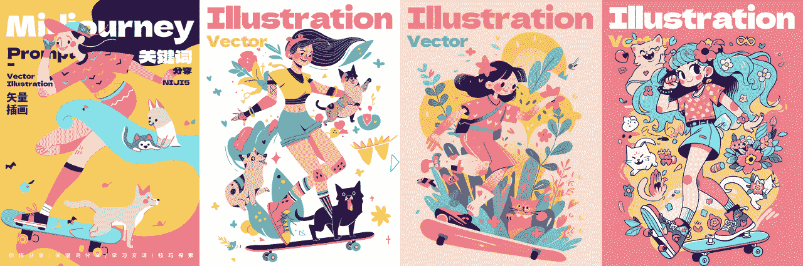

> 类型+插画师+镜头+主体描述+输出定量(增强权重范式)

Memphis style illustration by Dan Hipp ,low angle shot, a girl happily skateboarding, flowers, cats and dogs, happy, bright colors, clean background, children's illustrations, trendy illustration, partial geometric line draft, behance, pinterest, simple line draft --ar 3:4 --niji5 --s 25 --style expressive

孟菲斯插画风格，插画师Dan Hipp、低角度拍摄、一个女孩开心地滑着滑板，花，猫和狗，快乐、儿童的插画、潮流插画，部分几何线稿，behance，pinterest，简单线稿 --ar 3：4 --niji5 --s 25 --style expressive

## Prompt解读

> 做到这一个范式的时候，我觉得我们已经可以灵活的去运用给予我给到的一个标准范式的结构去调整，灵活运用。比如权重高，要强调的关键词的位置。所以这个就是基础的内容，接下来我们就开始来点真正的干货。当然，这个不是只针对于矢量插画，只是恰巧在这里用到了。

> 重点:本部分是基于方法论而不是单纯结果，所以大家要关注技巧和方法。时间关系，我并没有做出自己比较满意的风格，但是作为教程目的是达到了。

## 测词(通用方法)

当我们对一些词汇概念模糊或者MJ一直没有办法给到我们想要的方向的时候，不要浪费时间调整了，你需要直接做-个测词的动作，来测试你的词汇的准确性。当然，这里的准确性是指Midiournev是否有学习过，是否能给予准确的视觉。

比如:当下矢量插画风格比较火的孟菲斯扁平插画风格，MJ是没有准确反馈的。有两种可能性，

格的定义不是特别严谨，另一种可能是MJ并没有学习到这种风格。我们就只能尝试去测词。

-开始我用的是V5模式，是可以出来一些风格的，但是过于传统，是老派孟菲斯风格，那作为潮流方向的话，我们需要去尝试Nii风格,事实证明nii会好很多。

## 测风格，Nii优于V5，色彩和造型都会更加的潮流。

Memphis style flat illustration-V5

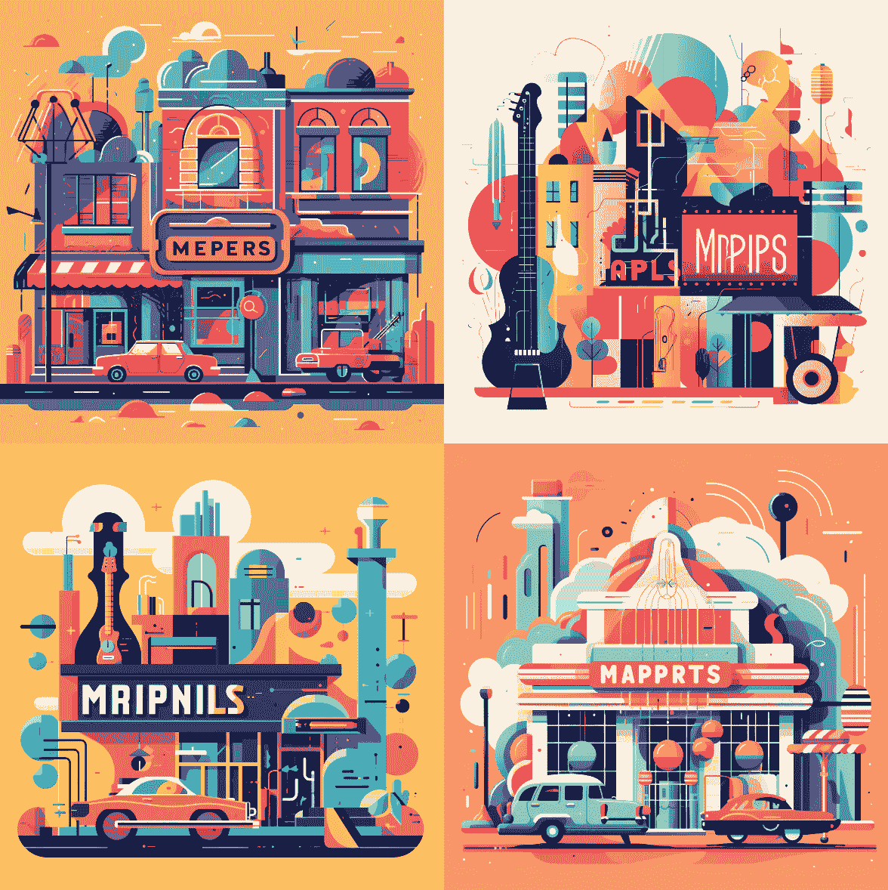

Memphis style flat illustration-Nii5

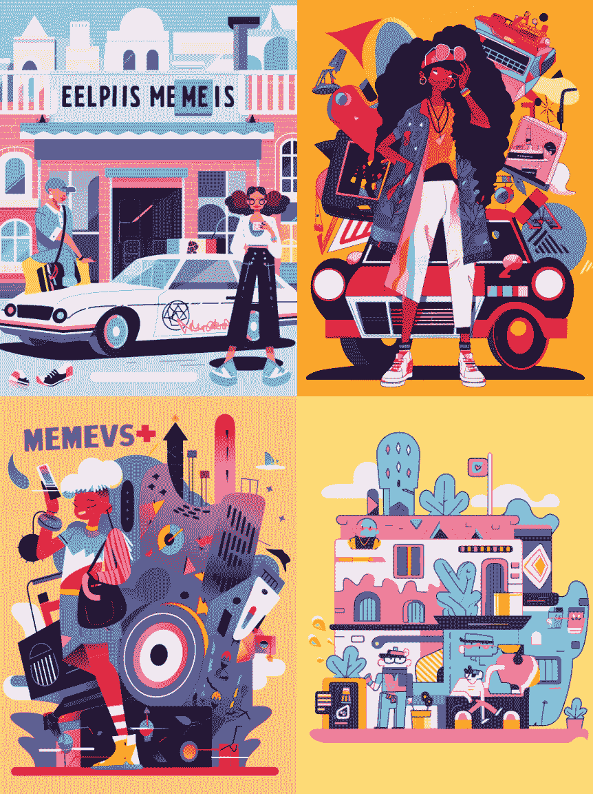

Memphis style flat illustrations, children's illustration, simplicity, geometry, children are running happily, minimalist lines, bright color blocks -- V5

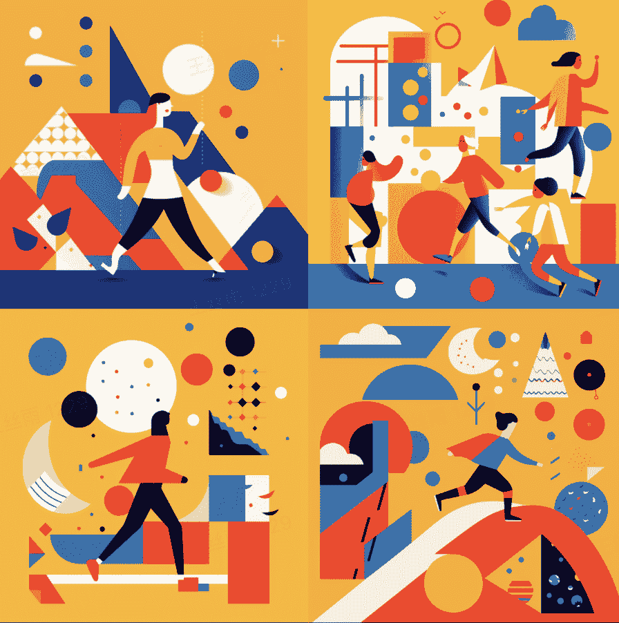

Memphis style flat illustrations, children illustrations, simplicity, geometry, children are running happily, minimalist lines, bright color blocks -- niji5

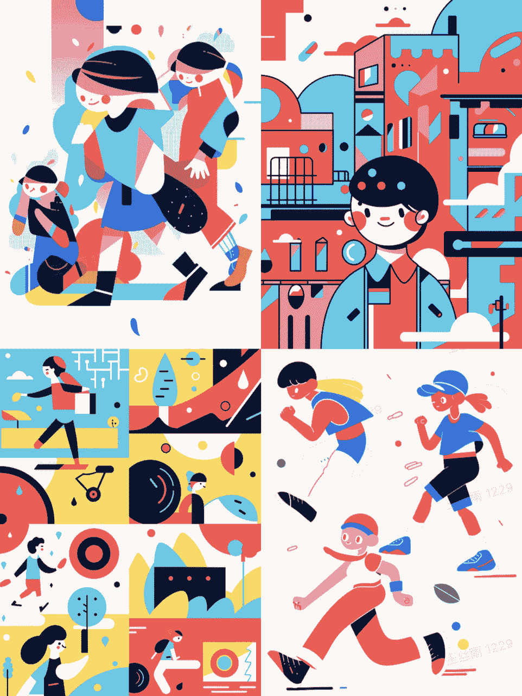

## **测插画师，首先我们可以去艺术家库选择画风还**不错的比较接近的插画师前来测试，还不错。

> 艺术家入口:https://www.midlibrary.io/categories

> 我们准备的一些辅助的工具或者网站还是比较有用的，可以帮我们去拓展一下词汇量。比如我就挑了三位擅长画潮流涂鸦类的艺术家，风格上也有可取之处，当然也有不行的，比如Seii Matsumoto，当下极简线稿风的开创者，MJ居然没有他的痕迹，小红书上这类风格还是挺火的，不过我发现大家基本用的都是常规的细节描述关键词，这也给我们证明一点，有些代表性风格是需要我们定义的。

illustration by Jon Burgerman

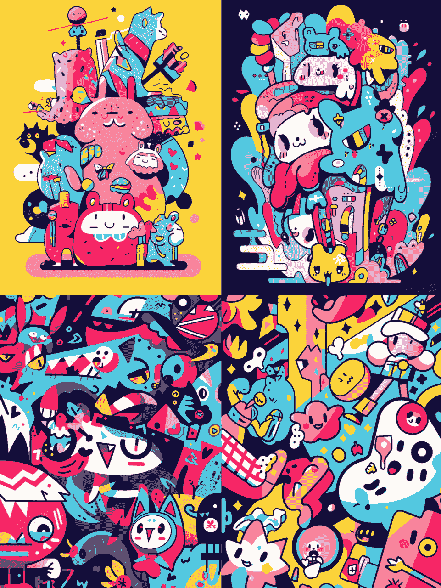

illustration by Tim Lahan

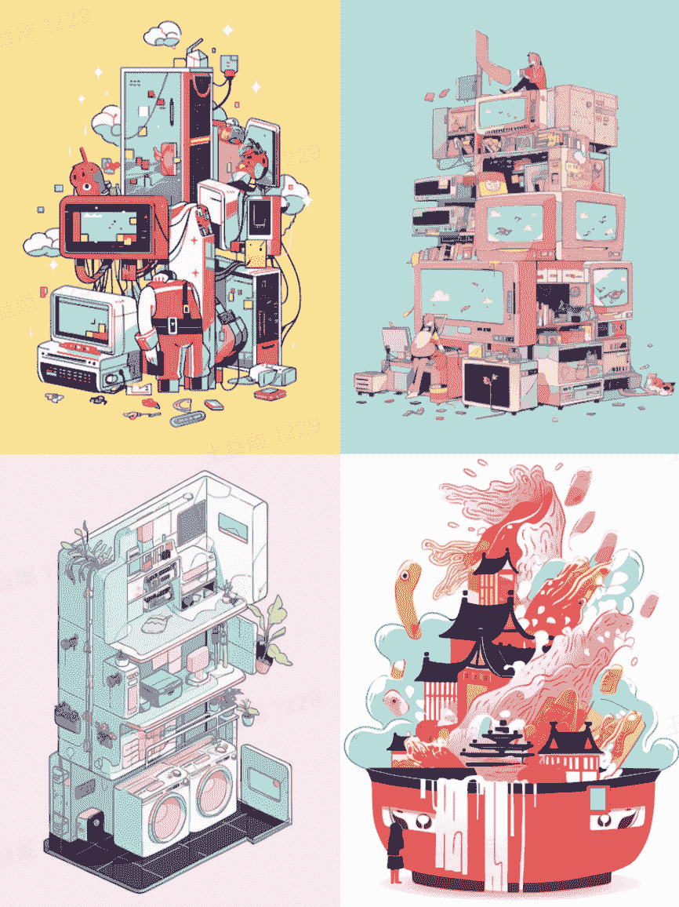

illustration by Dan Hipp

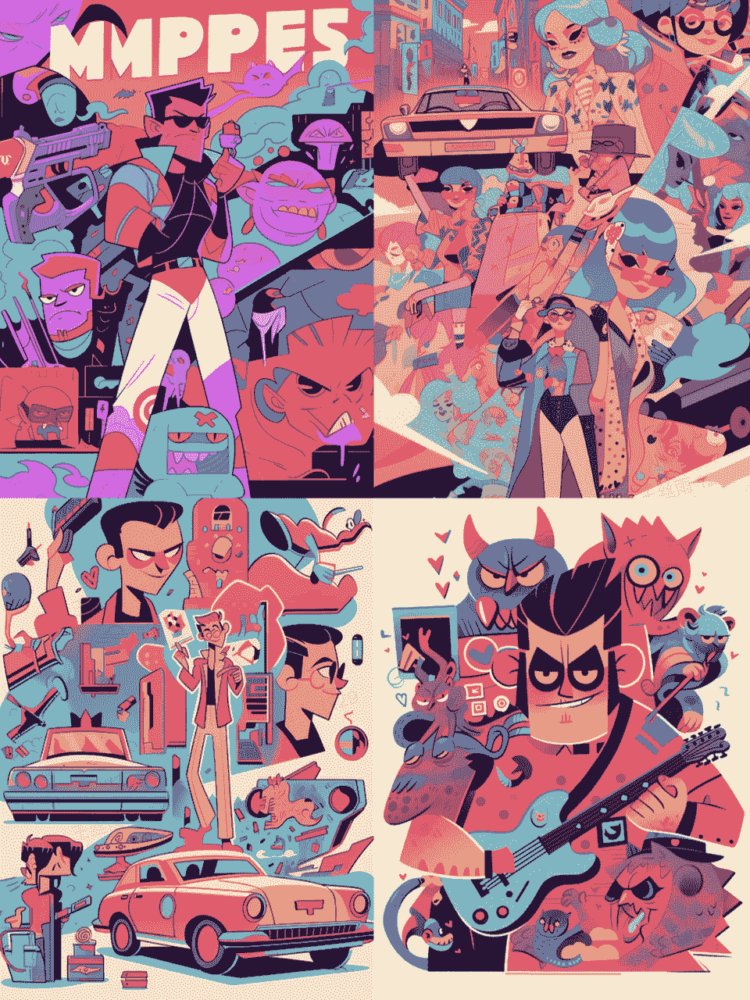

## 测Prompt，风格有谱了，目测是可以刷的出自己想要的结果的。

> 大方向有了，就可以通过调整优化关键词，以及部分关键词的前后关系，来控制画面的产出。不过，风格关键词描述多了，设计师自己的风格就会弱化，甚至趋同。所以我们可以理解为插画师的风格标签是可以框风格的，但是如果混淆风格的词汇比较多，就会弱化标签风格。其实我在后面加了很多关于极简，线描，几何，扁平之类的属性词，所呈现出来的就是下面这个样子。ilustration by(插画师), Memphis style illustration, trendy illustration, low angle shot, perspective composition, children happily skateboarding, flowers, cats and dogs, happy, bright colors, partial geometric line draft, Behance, Pinterest, flat illustration, simple line draft, clean background --ar 3:4 -style expressive

illustration by Jon Burgerman

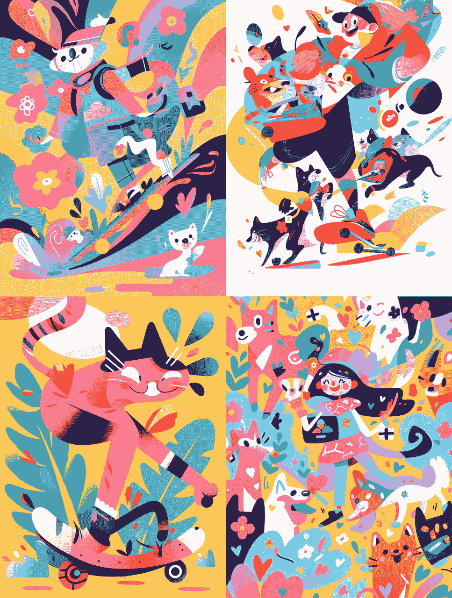

illustration by Tim Lahan

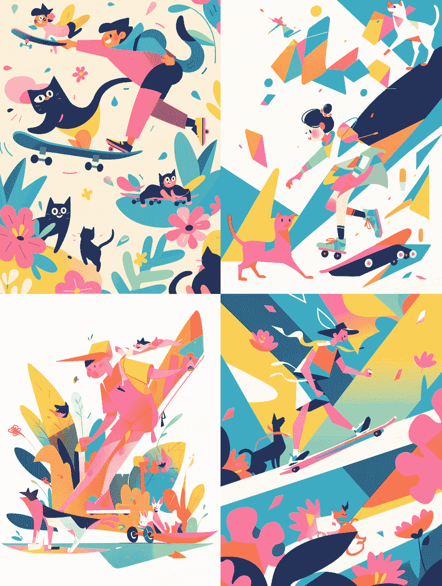

illustration by Dan Hipp

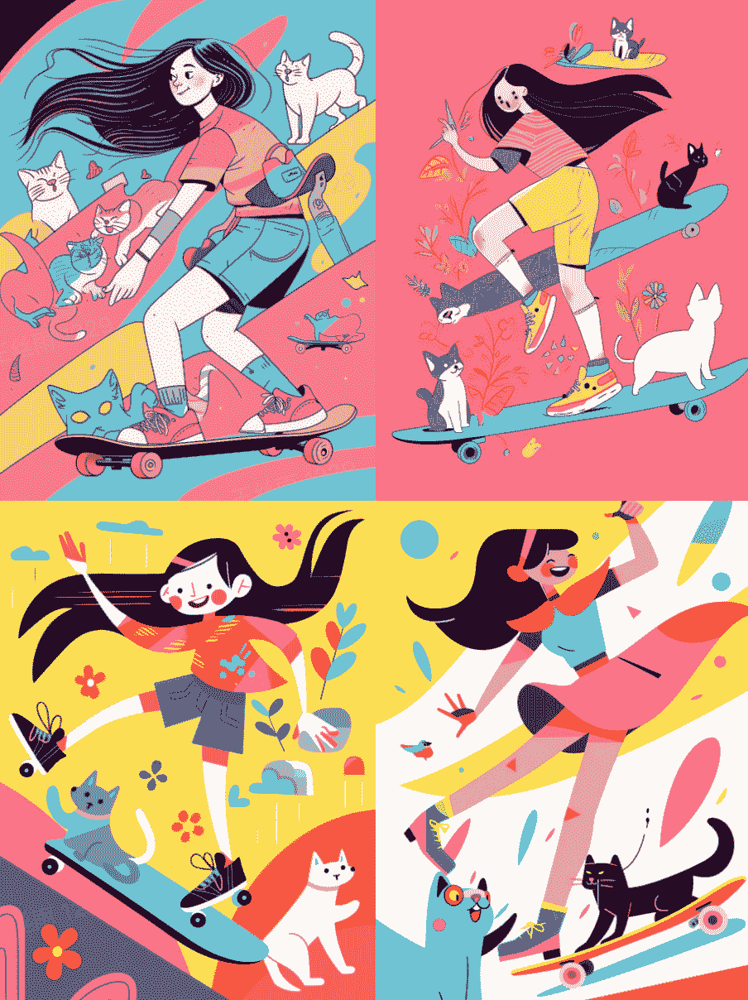

# 4.3 logo设计prompt分析（思路）

> 应用场景：logo/图标icon/简约头像等。

> 类型(强化权重)+主题+描述+设计师+类型+万能词

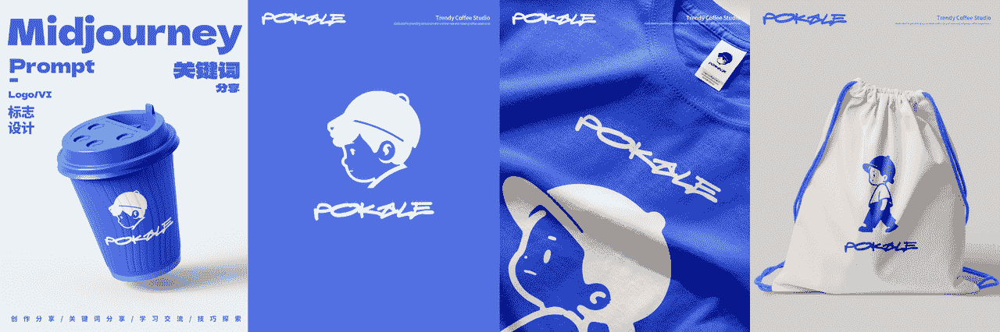

Simple line logo, flat logo, minimalist logo, minimalist logo of Skateboard boy, in rough klein blue outline style,cartoon man avatar icon vector design, Koji Morimoto style, Adrian Tomi, childlike innocence, 1970 , cute avatar, single continuous doodle, simple line art, clean lines, logo, icon, trend --style expressive

简单的线条标志，平面标志，极简主义标志，滑板男孩的极简主义标志，粗旷的克莱因蓝色轮廓风格，卡通人头像图标矢量设计，Koji Morimoto 风格，Adrian Tomi，童心，1970，可爱的头像，单个连续涂鸦，简单线条艺术，简洁的线条，标志，图标，趋势

## Prompt解读

> 这个范式不是专门针对logo的一个prompt，而是针对简约线稿风格的。只不过非常适合做logo，但你把logo的属性权重强化在前面的时候，整体的感觉会更倾向于图标icon。

> 自然他也不局限在一个类别里面，如果你描述是个插画，是个头像，都是OK的。

> 那既然提到logo，常规的一个logo的Prompt应该是这个样子的，当然我们在分享的板块也给到了几个范式的例子：logo of a Skateboard boy, minimal, style of in rough klein blue outline

> 这种呢，就是相对不会太准确，当然描述词足够多，刷图足够多也不妨碍大力出奇迹。

## MJ的磁力框(通用知识点)

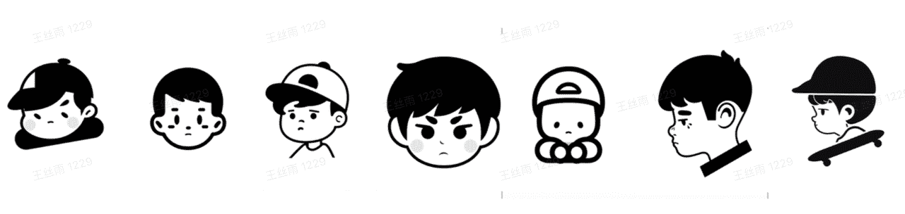

Simple line logo, flat logo, minimalist logo, minimalist logo of Skateboard pouting boy,cartoon man Avatar iconvector design, Koji Morimoto style, Adrian Tomi, childlike innocence, white and black,1970 , cute avatar, singlecontinuous doodle, simple line art, clean lines, logo, icon, trend --style expressive

### Prompt解读

> 挺神奇的。

> 就**一个词，就把**logo框死在了脑袋上，即便是滑板男孩，最多MJ就是敷衍的把滑板安排在了男孩的脖子下面大家要注意，我要开始讲通用的技巧干货了!

> 我用的是“Pouting”，撅嘴。一个很细节的表情词汇。也正是因为足够细节，在没有这个词汇的时候，全身的，半身的各种各样的都会供你挑选，加上的时候就框死了。

> 当然有个大前提，那就是整个prompt要足够的概括简洁，只有这么一个细节关键词，且权重靠前的时候

### 干货来了

> 为什么我明明写了full body，为啥MJ出来的图还是半身或者头像?

> **磁力框效应。**

> 全身像的描述里面，不可以单独出现一个突出的细节描述词。突出的意思是:全都是概括词:一个男人，一个pose，一条街道，一缕阳光，然后加个墨镜或者留着胡须，半身和头像出现的概率就会大于全身，因为这种细节词会打破描述的均衡表现。

> 那我想描述的细致一点，但又想全身展示，怎么办?

> 均衡描述。磁力框吸附是MJ的特点，不是缺点，用不好会头疼，但是抓住规律用得好，表现力是很值得期待的。

> 全身展示的时候，你什么程度描述的头，你就什么程度去描述脚。大大的卡姿兰眼睛，丰满的红色嘴唇，你就需要描述时尚的白色老爹休闲鞋，来支撑这个磁力框的范围。

> 当然，借助细节描述，还可以起到聚焦的效果。

> 比如你想设计一个模特的大视角仰视拍摄，你就可以多描述一下鞋子的细节，当然什么low angle view这种视角描述也不可以少，当时会更好的去帮助MJ理解这个画面的镜头是从脚开始向上拍摄的。

这个是经验，不是绝对

这个可以对冲MJ的随机性，但是无法完全抵消，

给大家的建议就是，借助我的一些经验基础上，再去多尝试，最起码我摸索的这么久的时间帮大家省下了，

还有一组关键词，在这里也给大家分享一下:

Simple line logo, flat logo, minimalist logo of Rapper's dreadlocks, pouting, anger boy, cartoon man avatar iconvector design, Koji Morimoto style, Adrian Tomi, childlike innocence, white and black, cute avatar, singlecontinuous doodle, simple line art, clean lines, logo, icon, trend --style expressiv

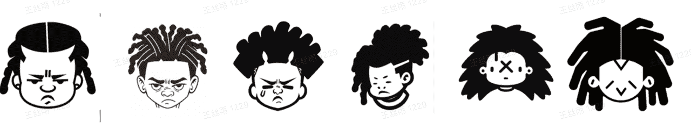

同样的范式架构和风格描述，只是主体换成了一个hiphop的脏辫潮流小子。

## Logo效果辅助神器-高质量free的样机网站

我呈现了logo的一些应用的样机效果图，这个是我们日常在做logo设计提案的时候为了帮助客户更好的理解和感受logo的创意，来展示的一种虚拟的效果方案。

当然现在很多头部的设计机构都开始用3D软件为客户定制应用的效果方案了，当然这就算是大的项目了，因为成本关系，那对于小项目或者单纯效果展示的话，我们就会用样机来表达。

当然，这里的硬性条件是要会使用photoshop,然后我们就可以去下载合适的样机，一键智能贴图

https://mockups-design.com/

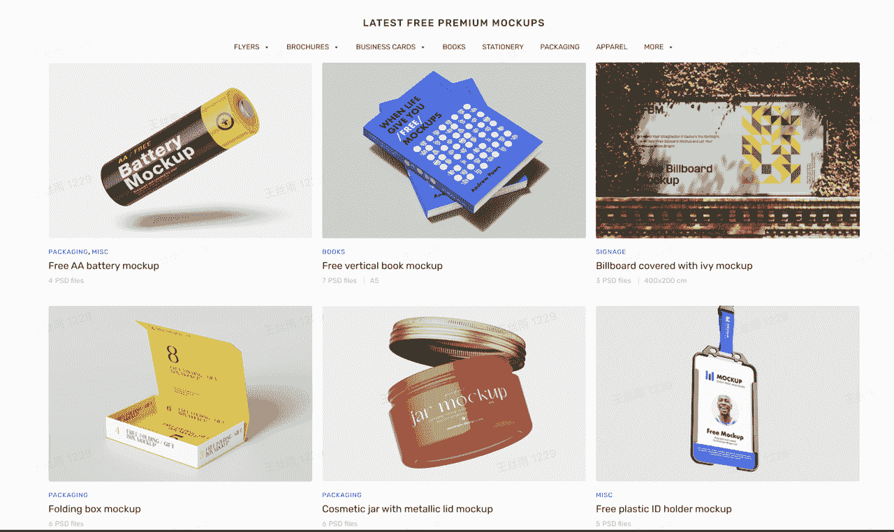

https://www.mockupworld.co/

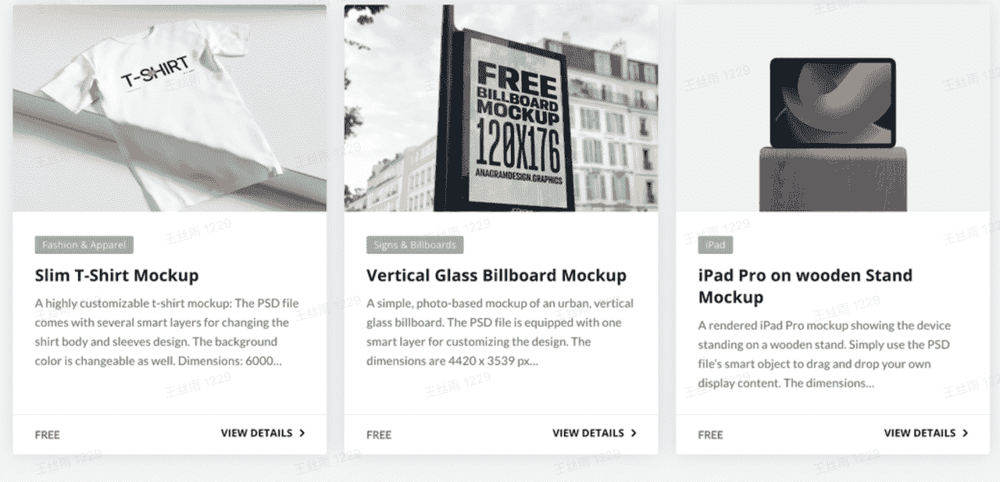

https://www.graphicpear.com/

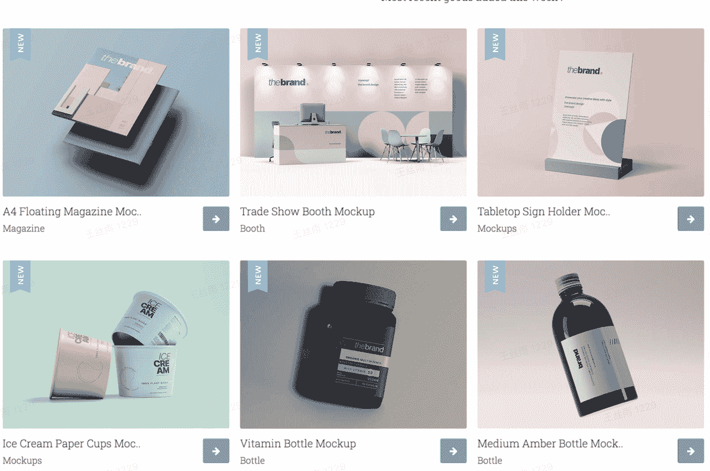