# Midjourney Prompt分析第五期-电商海报、职业人物海报、三视图

> 来源：[https://bluefocus.feishu.cn/docx/VW7GdzbF9oFFWDxCRfuc0boanfh](https://bluefocus.feishu.cn/docx/VW7GdzbF9oFFWDxCRfuc0boanfh)

> 为了方便小伙伴们的学习和体验，我们找到了这个文档，以系列的方式，通过以内部分享的方式帮助大家练习。

> 关键词只是一个参考，最重要的还是大家需要理解MJ的算法逻辑和如何学习关键词的技巧。

> 大家可以复制关键词，然后理解，拆解，二创或者修改。

> 希望大家能够掌握写词的方法和技巧，可以帮助大家解决实际工作中创作的问题，完成MJ真正意义上的落地。

> 大家加油！

# 5.1 电商海报素材prompt分析（思路）

> 主题描述+风格+类型+艺术家

> 应用场景：电商海报/其他海报等。

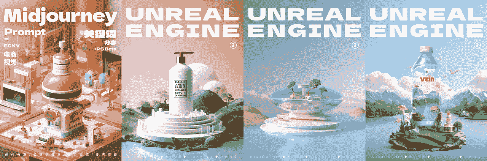

> 到了这一篇，想必大家已经对关键词的结构，范式技巧了然于胸，那我们就趋于实战的去讲点知识点，当

> 然，操作逻辑还是通用的。

> 因为实战讲究的不再单纯是美感，效果和质量，还有效率，快节奏。

> 比如电商海报。

> 那这个时候我们不再有那么充分的时间去推敲，去调整我们的关键词，怎么办？

> 这个时候我们需要做的就是测词+叠图，当然我们一定要尊重版权，再次声明。

> MJ的文生图和图生文是两套算法相互配合，这就是为什么大家会发现喂的图和用describe出来的图完全不

> 一样，4组里面有一组类似就已经很好了。

> 但是我们可以学到的是：MJ describe出来的关键词呈现出来的是它学习的内容，我们可以从原图近视的一组图中找到精准的描述关键词或者风格，以及整个范式的表达方式和结构，权重顺序。

> 我们就可以总结出自己的关键词。

通过反推出来的关键词去生成图不是最终目的，而是在此基础上进行叠图会更加的精准。

简单的一些背景素材，MJ是很好理解的，并且可以给出还不错的prompt.

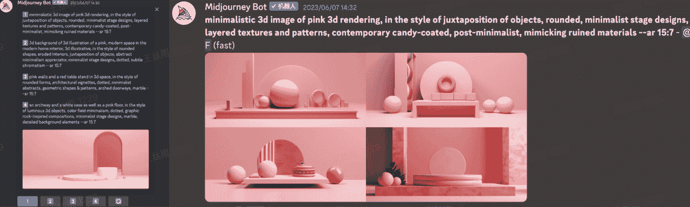

复杂的场景感比较强的画面，MJ能抓住个大概，但是具体的就会有所差异，这个时候就需要我们去挑选接近的一组

或者两组进行优化，快速测图，然后进行叠图输出。

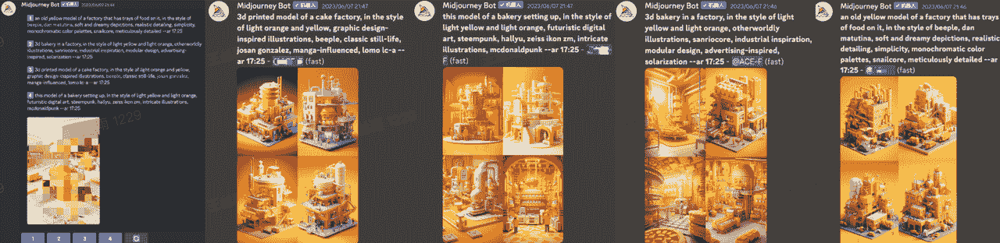

(选出两组相对不错的关键词，进行简单优化。)

this model of a bakery setting up, in the style of light yellow and light orange, futuristic digital art, steempunk, hallyu, zeiss ikon zm, intricate illustrations, mcdonaldpunk

面包店模型，浅黄色和浅橙色的风格，未来派数字艺术，蒸汽朋克，韩流，蔡司图标zm，复杂的插图，麦当劳朋克

3d printed model of a cake factory, in the style of light orange and yellow, graphic design-inspired illustrations, beeple, Josan Gonzalez, classic still-life,  manga-influenced, lomo lc-a

蛋糕工厂的 3D 打印模型。浅橙色和黄色风格，平面设计灵感插图，beedle.Josan Gonzalez，经典静物，漫画影

响，lomo lc-a

> 主题描述+风格+类型+艺术家

我们可以看到MJ反推出来的关键词在范式结构和逻辑上也是符合我们总结的通用范式的。

挑选两组合适的prompt之后，我们不需要额外的去编写关键字，直接在此基础上进行叠图，即可快速输出相对精准

的素材。

(参考就是那张参考，为了保护别人的版权，我进行了遮挡，因为我们只是为了说明方法而已。)

httes://s-mi-run/NCoR07tPWNU-3d printed model of a cake factory, in the style of light orange and yellow.

graphic design-inspired illustrations, beeple, classic still-life, josan gonzalez, manga-influenced, lomo lc-a --ar

17:25 --iw 2

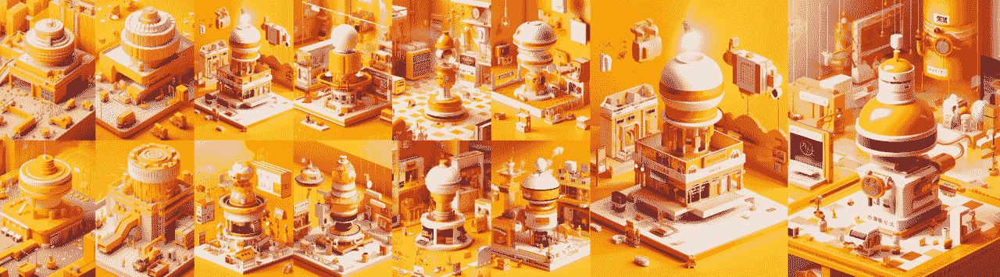

> Prompt解读

> 叠图参考提供了精准的构图，配色和方向，对于电商来说，还是很高效的。

> 不过主体关键词还是很重要的，主体描述，风格还是需要非常的清晰

另一个例子:

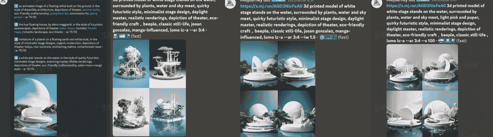

1，找一张参考，describe一组，生成看看

2，四组都不理想，但这

个最接近

3，直接叠原图进去+选择

的这组关键词，效果有了

4，给自己需要的一个颜色，基本满意

关键词分享:

httes:fs.mjfun/60D3NiefeA0-3d printed model of white stage stands on the water, surrounded by plants

water and sky meet, light pink and puper, quirky futuristic style, minimalist stage design, daylight master,

realistic renderings, depiction of theater, eco-friendly craft,beeple, classic still-life , lomo lc-a --ar 3:4 --s

100

这个地方，就选了相对合适的一张图，然后我就拖进了PS Beta，用了智能生成，画面就有了。

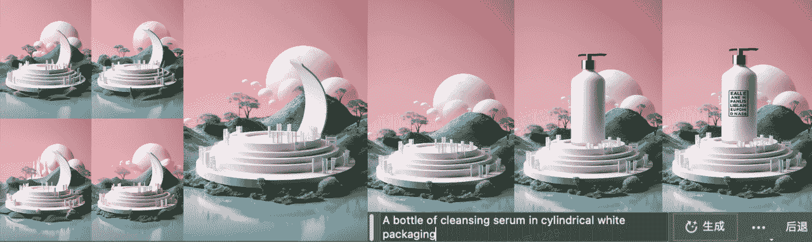

其他的反推出来效果不错的关键词也给大家分享一下，梦幻简约风格，有种C4D的调调:

long shot, wide angle, apple-phone on a pedestal an ocean,on pink mkx series, in the style of nature-inspired

shapes, light white and light azure, frank loyd wright, rich and immersive, made of glass, luxurious opulence.

metropolis meets nature , nature-inspired installations, tranguil serenity, vibrant illustrations, classica

balance, minimalist stage design, beeple, classic still-life , lomo lc-a, C4D, blender,octane render, HR

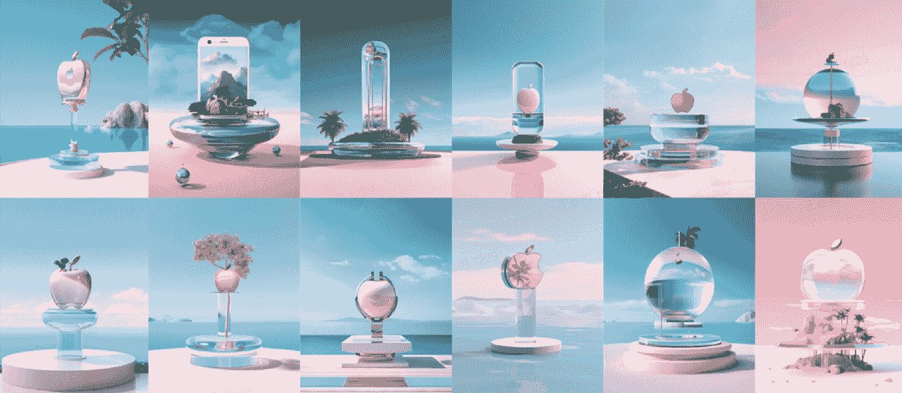

######## 传统范式写词（词汇积累）

> 主题描述+风格+艺术家+类型+万能词

这个没啥好说的，华丽的词藻，丰富的描述，堆出来，大力出奇迹。

而且视觉效果还是很不错的，可以用来做创意海报了，不仅是电商。

当然，做到这个程度，我们还是可以去叠图的，你懂得。

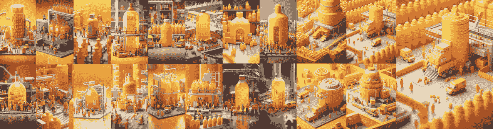

3D rendering miniature scene design, 3d printed model of juice miniature production factory, transparent material pipeline transports juice, there is a huge bottle model of beverage bottle in the center of the factory, there are many workers around, in the style of light orange and yellow, graphic design- inspired illustrations, classic still-life, beeple, josan gonzalez, manga-influenced, miniature dioramas, in the style of playful and whimsical designs, graphic design-inspired illustrations, minimalism, hyperrealism, lomo lc-a, e-commerce C4D style, e-commerce poster UI, UX, octane render, blender, unreal engine,HDR, HD, best quality

3D 渲染微缩场景设计,3D 打印果汁微型生产工厂模型,透明材料管道输送果汁,工厂中央有一个巨大的饮料瓶模型,周围有许多工人,风格轻橙黄色,平面设计启发插图,经典静物,beeple, josan gonzalez, 漫画风格影响,微型展示间,轻松怪异的设计风格,平面设计启发插图,极简主义,超现实主义,lomo lc-a,电子商务C4D风格,电子商务海报UI, UX, OC 渲染,Blender,虚幻引擎,HDR,高清,最佳质量

写词+PS合成+写词+PS Beta 优化

根据命题去产出一张方向明确的图，比如一瓶维生素或者矿泉水的中式唯美创意。

这个Prompt其实源自于我的一次diescribe，反推出来的一组是很有感觉的，所以我就记录了下来作为了一个素材。

后面在做矿泉水的创意的时候就直接用上了，大家也可以积累收集自己的一些过程关键词，以后说不定会帮你完成什

么东西。

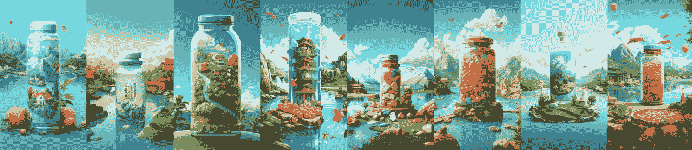

> 主题描述+类型+万能词

Vitamin b6 future product, 3D model, traditional Chinese landscape style, super realistic water,  realistic blue sky, cartoon realistic, illustration advertisement,multi-layer collage, color comics, C4D, Blender

Vitamin b6未来产品、3D模型、传统的中国山水风格，超级写实的水、  cartoon realistic、插画广告，多层拼贴，彩色漫画， C4D, Blender

接下来的步骤就比较夸张了，即便大家后期需要合成一个真实的产品，前期最好也生成一个矿泉水瓶为佳接下来就给大家呈现一下我是怎么变废为宝，做一张矿泉水的创意的。

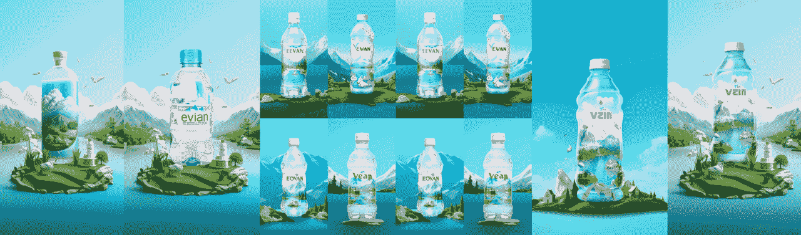

httes://s mjrunkwuP 024 httes:/fs.mjrun/D-42DSPNHKU evian mineral water bottle future product, 3D

model, cartoon realistic, super realistic water, illustration advertisement, realistic blue sky, multi-layer collage

color comics, C4D, Blender --ar 9:16 --iw 2

骚操作就在这里，反反复复碍于MJ目前的随机性，搞不定的时候就来回稿。

> Prompt解读

> 1，选中了这张之前生成的素材，作为合成的底图，草草的丢进PS，草草的摆了一个矿泉水瓶。

> 2，把摆了矿泉水瓶的图叠进去，写词，出图，不满意，继续养图、写词。

> 3，后来我发现这样过于消耗时间，放大招了，在来来回回的图中选一个不错的的背景，把产品合在一起。

> 了事画面的一些拼接生硬的地方，PS Beta的智能填充是可以解决的

# 5.2** **职业人物海报素材prompt分析（思路）

> 应用场景：人物形象海报/职业写真人像等。

> 摄影师+构图+主题+风格+摄影定语+万能词汇

> 这篇教程是比较针对性的一个内容，解决人物海报没有充分的人物形象照片素材的问题。

> 基本上每个行业都会涉及到这类需求，当然尤其是一些直播或者教育类，但涉及到一些人物出场，形象展示

> 或者人物介绍的时候，是需要一个视觉上很专业，有力量的一个形象。

> 我之前也是亲身亲历了很多此类需求，有些是品牌和KOL联动，需要一些网红IP的出场，各路经纪人给到了

> 一批五花八门的人物照，放在一起简直是牛鬼蛇神。还有一类是总裁驾到，有些领导是有自己的豪华素材

> 的，但是不保证所有领导都有，着实是一大痛点。

> 现在MJ虽然可能还会面临随机性的一点瑕疵，但是这个方法，或者这个技巧，是可以解决这类内容的基础

> 需求的。

> 案例适合:明星巡演、娱乐互动、课程培训、IP形象、总裁驾到等涉及到人物主体素材产出，另可应用职业

> 照、形象写真等。

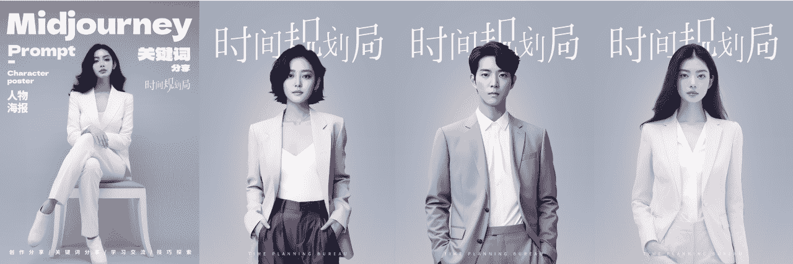

photography by Renhang and sandara tang,half body shot, a woman in a purple blazer, white dress, short black hair for a photo call, in the style of subtle monochromatic tones, shiny/glossy, pure color, classic academia ,pure white background, unique beauty, thin face, business picture, beautiful and novel shooting angle, professional portrait lighting, studio lighting, business sense, professional photography, extremely detailed, ultra hd, max detail, hyperdetailed, sharpen, sharp details, amazing quality, super detail, incredibly detailed HDR,16K,best reastic

摄影由Renhang 和 sandara tang拍摄，半身像，一个穿着紫色西装外套、白色连衣裙、黑色短发拍照的女人，风格微妙的单色色调，闪亮/光泽，纯色，经典学院派，纯白色背景, 独特之美, 瘦脸, 商务图片, 美丽新颖的拍摄角度, 专业人像照明, 影棚照明, 商业感, 专业摄影, 极其细致, 超高清, 最大细节, 超详细, 锐化, 锐利细节, 惊人品质, 超细节，令人难以置信的详细 HDR，16K，最佳真实

> 摄影师+构图+主题+风格+摄影定语+万能词汇

## 1，词汇多与少

> /shorten 评测

> 我在写这篇教程的时候/shorten还没出来，所以词汇还是蛮多的。建议大家可以去精简尝试一下，不过这个

> 大量词汇的prompt有个好处，就是我已经尽可能的把一些呈现这类摄影风格的描述词汇写清楚，大家可以去精简。

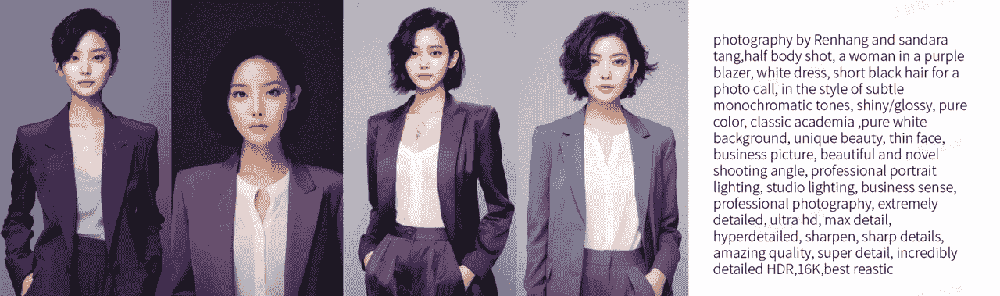

我觉得是有区别的，我们先说结论

MJ定制化的输出，详尽准确的词是可以优化画面质量的,

我整体上生成了一下缩减后的关键词，一共5组，最后两组没法看。前面三组之间相比反而大同小异，没太大区别。

和原图相比，原图的细节更丰富，光影更立体，肤质，布料的感觉更加清晰，词汇中的一些概念或者细节是真实的给

予增加了一些画质的。

反观精简后的关键词输出，整体感觉会有些油腻，光线对比也不协调，真实感是打折扣的。

大家可以自己去尝试，去感受下。

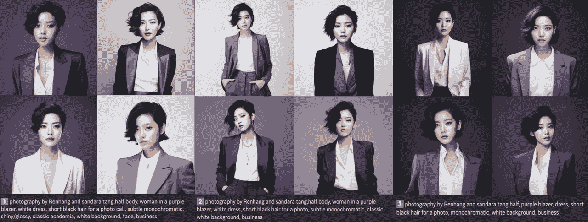

## 2，形象设定和换脸

这个我们可以通过一个举例，来给大家解答这个问题。

首先，活动/事件的性质决定了我们人物的服化是什么样的职业PK，比如卖保险的，那你就必须西装革履，领带皮鞋，职业微笑，神采奕奕随和，就比如我们这个“时间规划局”的感受。商业娱乐，比如一场秀，一场演出，那就放飞自我就可以了，夸张个性都可以的,

学术分享，比如一场沙龙讲座，那你可以设定休闲一点的西装，甚至给一些大牌的属性，高级但不失优雅，庄重而又

我们做这种不同行业的梳理，其实也就一两句描述而已，目的就是为了更有效的做好风格定性，当然还要考虑的一点

就是人物形象的统一性，如果是一撮人要放在一张海报上，整体的服装元素和配色尽量避免过于突元。

换脸的重点

> Insightface Swap换脸保持极高相似度和质量的重点在于2点:

> 1，换脸需要的素材要尽可能的高质量，清晰，五官要端正，最好不要有遮挡。

> 2，我们在生成的换脸模型本身，尽量保证形象，脸型，发型和年龄相仿，这样换上去会更加的贴合

> 3，如果还不满意，可以在换完脸的素材基础上，继续再换一换。

> 本身这个插件非官方设置，所以在模型材质以及匹配度上会有兼容容错率的，所以高质量的素材和配型的人

> 物模型就是相似度的关键。

> 换脸步骤我这里不过多赘述，因为第5部分就是一个具体的换脸方案，大家下滑浏览即可

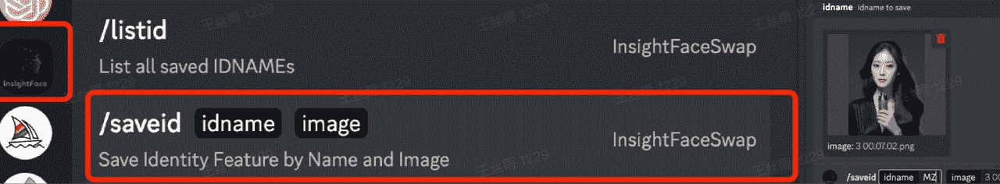

比如:一个美妆博主，

一个IT大佬，一个生活美学博主集聚一堂，来分享他们的“时间规划局”的内容，视觉表达上形

免应该是什么样的呢?

喜欢短发干练，我们就直接换短发，喜欢韩国欧巴的威猛帅气，我们就换欧巴，喜欢文静大牌，我们就换品牌时装

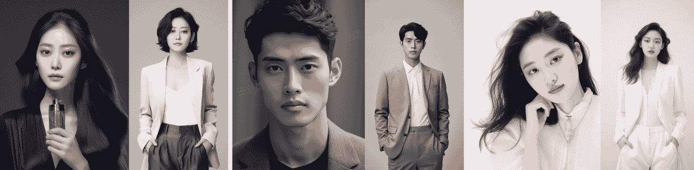

人物设定的描述关键词:

1, a woman in a purple blazer, white dress, short black hair for a photo call

2, the man posing in a gray suit, in the style of gongbi, for a photo call

3，a woman in a white suit poses for a photo call

因为素材都是MJ生成的，所以在换脸的相似度上还是比较满意的。

> Prompt解读

> 整体的关键词核心就是三部分:

> 1，摄影师: 不知道大家有没有发现，涉及到人物的时候，我用的比较多的就是Renhang,Guojingna,sandra Tang,不是我个人对他们情有独钟，而是这几个摄影师对于我们国人面孔的呈现是有标签的，MJ可以轻松的识别，即便你不去描写中国面孔，亚洲面孔，东方面孔，也可以给到你一个正常的，标准的国人面孔，这一点还是不错的。

> 2，构图就很直观了，你是全身，半身，还是特写，一定要写清楚放在前面，因为还会涉及到“磁力框”，这个概念大家可以重新翻一下《十二logo设计prompt分析》有重点讲。

> 3，人物描述，如我们上面所讲，在设定的时候，着装，性质，还有整体的统一性需要注意

> 4，摄影，特别是职业装，写真的一些描述词的应用

# 5.3 三视图设计prompt分析（思路）

> 构图+三视图+主体描述+类型+万能词

> 应用场景：IP/卡通形象/吉祥物/游戏立绘/虚拟人像/产品设计等。

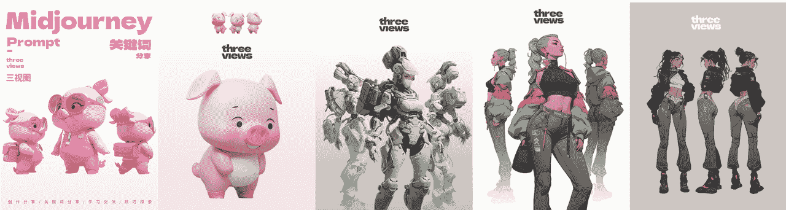

full body, three views, namely the front view, the side view and the back view,pink piggy, fashion one-piece sportswear, chibi,   blind box, clay, 3D, C4D, Blender, OC renderer, ultra HD, 3D rendering，Natural lighting, 16K , best quality, ultra-detail,  --style expressive

全身，三视图，即前视图，侧视图和后视图，粉红小猪，时尚连体运动服，Q版，盲盒，粘土，3D，C4D，Blender，OC渲染器，超高清，3D渲染，自然光，16K，最佳画质，超细节

> Prompt解读

> 这个句式可以理解为固定的，根据这个范式框架和各部分的内容，三视图描述保持不变，其他都可以根据相应的属性进行切换。在这里我多说一句，这个prompts是生成三视图的一个有效的稳定的输出范式，但不是绝对且唯一的范式，大家可以用来提高效率，也可以自行尝试或开发新的句式。

## 1，做三视图用什么模式好?

我直接告诉大家我测试的结果:Niji模式

MJ不太能很好的识别三视图的概念从而去表达，而做测词的时候，我发现Nj的表现是非常好的。

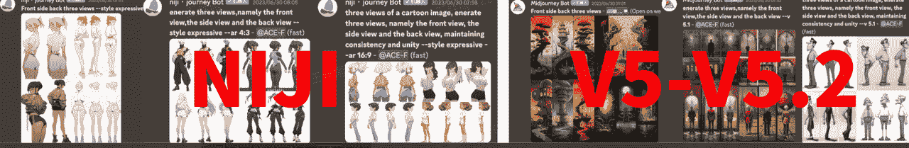

## 2，如何控制三视图的稳定性

> 关键词描述很重要:

> 1，Front side back three views (发挥空大，随机性更高)

> 2, three views,namely the front view,the side view and the back view (推荐)3, three views of a cartoon image, enerate three views, namely the front view, the side view and theback view, maintaining consistency and unity(词汇多，容易对其他描述产生干扰)

> 尺寸的重要性:

> 1，Q版，2-3头身一-16:9的尺寸比较合适

> 2，常规尺寸或者九头身--4:3，16:9，1:1都可以

## 3，全身出不全咋办?

以前这个问题很难解决，现在这个都不叫啥问题了。扩图啊!伙伴们!Zoom! (大家可以去看下第二部分介绍MJ版本5.2模式的新功能-一扩图)

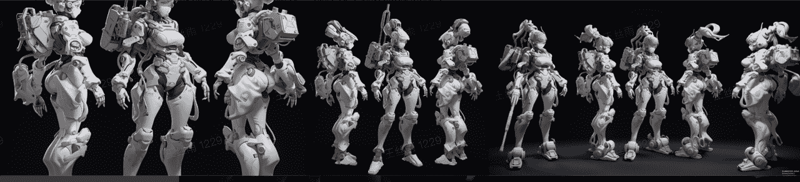

## 4，产品三视图

做了一波测试，发现产品类的也是完全没有问题的，只不过可能要多刷些，不过产品的话大家可以去V5模式里面也感受下。

我只在原范式上换了一把椅子:

Full-body shot, long shot, three views, namely the front view, the side view and the back view,armchair withvelcro straps, weatherpoof bottom and transparent cushion, 3D, C4D, Blender, OC renderer, ultra HD, 3Drendering Natural lighting, 16K , best quality, ultra-detail, --ar 4:3 --style expressive

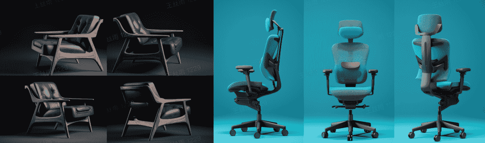

这就有点香了