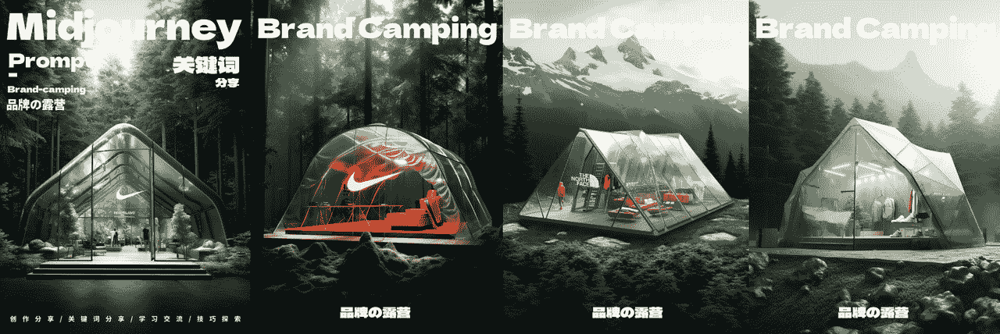
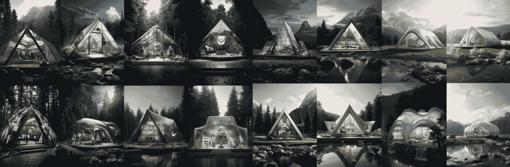
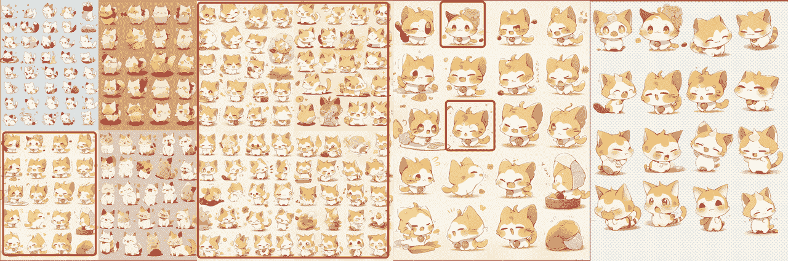
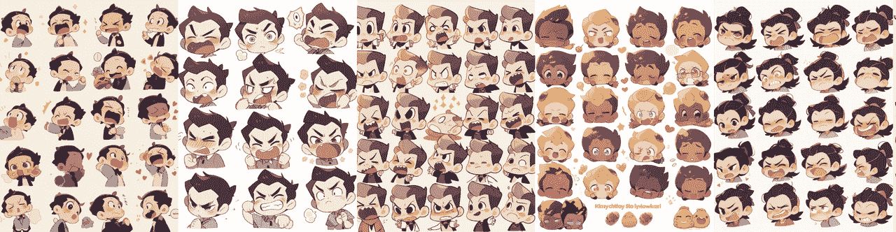
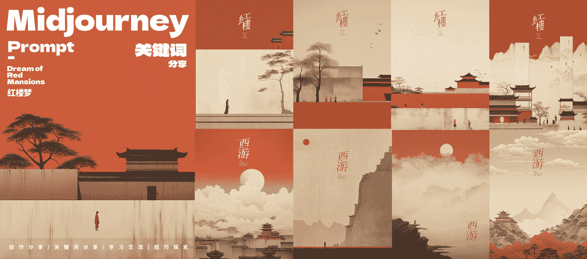
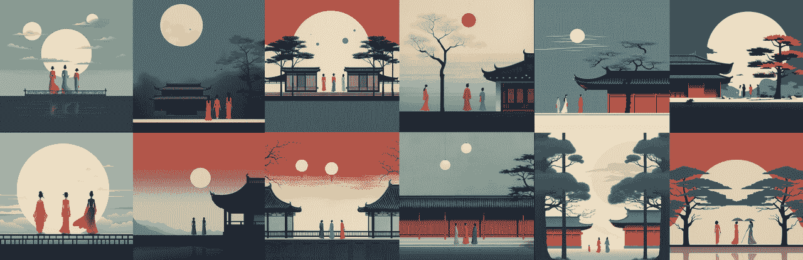
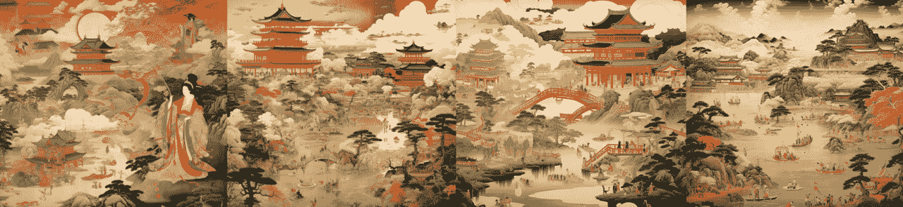
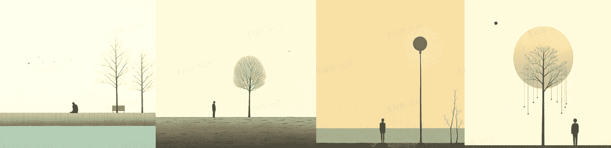
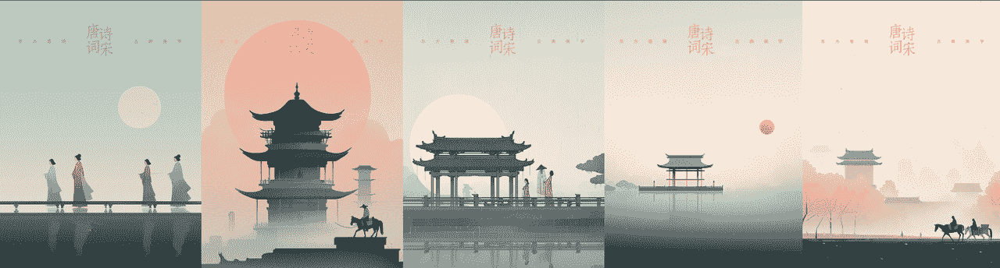
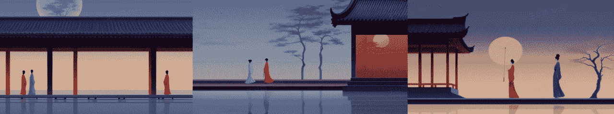

# Midjourney Prompt分析第六期-品牌+露营、表情包、国风极简插画

> 来源：[https://bluefocus.feishu.cn/docx/XEK8d12nRovAg5xAX5TcclPwn7b](https://bluefocus.feishu.cn/docx/XEK8d12nRovAg5xAX5TcclPwn7b)

# 6.1 品牌+露营营销视觉prompt分析（思路）

> 应用场景：海报/创意方案/快闪店等。

> 设计形式+主体描述+形容词+万能词+输出定量

Concept design, pop-up store, display space made of transparent glass, tent, camping, mountain forest, field, creek, futuristic space art architecture,  window design, store design, minimalism, UE5 rendering engine, 3D rendering, best quality, HD, 16K, HDR

概念设计,快闪店,由透明玻璃制成的展示空间,帐篷,露营,山林,田野,小溪,未来主义太空艺术建筑,橱窗设计,店面设计,极简主义,UE5渲染引擎,3D渲染,最佳质量,高清,16K

> Prompt解读

> 关键词范式还是老规矩，结构上没有什么玩出花的地方，但是视觉效果是真不错的。事实证明只要大家按照这个范式去填词，没毛病。而输出的关键所在在于内容，除了基础的描述，就是一些主导画风走向和创意的点比较重要。

> “概念设计”会让快闪店变得更加具有创意，给到MJ的发挥空间。

> 透明玻璃一帐篷”，这是一个主体成型的关键描述。“露营”交代了背景，后续描述都是具像化的加持。

> “未来主义/极简主义”设计风格，“橱窗/店面设计”是对快闪店的一个权重增强。

> 在做课题或者拿到一个命题创作的时候，我们一定要先想清楚关键词的结构，不要盲目的一阵输出，很有可能词不达意，词汇多也不见得是好事，而是要精准，话说回来，套用范式结构，肯定是错不了的起手式。

### 关于露营这个主题

对于品牌来说，如何保持品牌的年轻势能，更好的和年轻人打成一片，那就是做热点营销。

比如露营是当下年轻人社交的一种表达形式，这种生活方式带爆了周边各个维度相关的行业品牌的业绩。

所以在这个节点上，把品牌和露营做一个结合，我个人觉得也是很好的一种营销方式。

所以我们就设定一下，如果一个品牌做露营的概念快闪店，它应该怎么表现?

如果是一个服装品牌做，应该怎么表现?如果是Nike或者Northface，那我们的关键词应该怎么写，会有变化吗?

在这里我也给大家呈现加上品牌名称的prompts，可以感受一下MJ输出和不加有什么不同。Concept design, Nike (Northe Face) , pop-up store, display space made of transparent glass, tent, campingmountain forest, field, creek, futuristic space art architecture, window design, store design, minimalism, UE5rendering engine, 3D rendering, best quality, HD, 16K, HDR --ar 3:4

# 6.2 表情包设计范式拆解及prompt分析（思路）

> 应用场景：表情包/IP形象等。

> 设计形式+主体描述+形容词+万能词+输出定量

emoji pack, cute Barbie girls ,Disney style, happy, laughing, angry, running, jumping, sleeping, crying, shouting, various cute expressions and poses, various emotions, chibi, anthropomorphic style, the best quality, 16K

表情包，可爱的芭比女孩，迪士尼风格，快乐，大笑，生气，跑，跳，睡觉，哭，喊，各种可爱的表情和姿势，各种情绪，Q版，拟人风格，最好的质量，16K

> Prompt解读

> 这是一个很稳定的表情包出图范式，但是有一点需要注意，那就是出图模式要选择 Niji cute style如果一定要一个必须的理由，那就是其他模式我都试验过，如果你还想浪费时间再摸索一遍也是可以的。

> 正经的知识点如下:Niji模式是动漫相关数据集成的算法，虽然现在已经迭代到很多效果与MJ模式无差，但是卡通、漫画、动漫、IP类是Niji的基础。所以涉及到这类题材的创作，首选niji.

> 其次，cute style是可爱/Q版风格模式，此类风格的画作选这个模式再合适不过了。(建议大家回头再去把V模式和Niji模式的内容再去复习一遍。

> 还有，在这个模式下，Niji对人物表情特征抓取要优于动物表现，应该是算法有学到人设IP相关的训练。

> '表情包”第一权重告诉MJ你想要什么。

> “可爱的芭比女孩，迪士尼风格”，直接塑造主体是什么，并加持了常规的风格属性动作和表情的具体描述，来确保出图过程中内容的丰富性和多样性。其他常规量词，不多赘述。

## 动物表情包设定解读

在做动物表情包的过程中，会出现一个问题:同质化形象出现频率会比较高。

小猫小狗小兔小猪，确实可可爱爱。但是一张图里面可用的独特性的表情出现率会有偏差。当然这不代表不可以操作，只是在产出过程中我们需要多出一些图，在一些表现不错但有瑕疵的表情上继续V一下

prompts示例:

emoji pack, 16 emoticons, emoii sheet, chubby cute cat ,happy, laughing, coquettish, angry, running, jumping, sleeping, crying, shouting, various cute expressions and poses, various emotions, chibi, anthropomorphic style, the best quality,16K--style cute

这就类似于一个海选的过程，通过多遍刷图，去寻找最合适的你需要的表情，最后集合在一起成为一个系列。

当然大家也可以在此基础上去尝试优化总结更加高效稳定的关键词。

## 人物表情包设定解读

人物的话显然就会高效很多，出图精准，也比较稳。不管你用什么描述，效果都还不错。

prompts示例:

emoji pack, 16 emoticons, emoji sheet, chubby cute cat ,happy, laughing, coquettish, angry, running, jumping, sleeping, crying, shouting, various cute expressions and poses, various emotions, chibi, anthropomorphic style, the best quality, 16K --style cute

# 6.3 国风极简插画范式技巧及拆解及prompt分析（思路）

> 应用场景：海报/插画/壁纸等。

> 通过这一节给大家分享如何产出一个具有个人鲜明风格，别人拿不到关键词很难复制的创作方法。

> 核心学习点:

> 1，极简东方美学/新中式

> 2，如何自己有效写词

> 设计形式+主体描述+形容词+万能词

Minimalist Song dynasty mural by Alessandro Gottardo,Dream of Red Mansions， Heian period, Zen, dark orange and light beige style, enigmatic figures, elegant cityscape, historical painting, super fine detail, monumental mural --ar 3:4

Alessandro Gottardo 的极简宋代壁画，红楼梦，平安时代，禅宗，深橙色和浅米色风格，神秘的人物，优雅的城市景观，历史绘画，超精细的细节，纪念性壁画 --ar 3:4

> Prompt解读

> 这组关键词花了两天时间,起初只是做选题的时候,喜欢上了一组国风极简插画,但是我在猜词的过程中盲目自信,做了两个小时的时候,我心态有点崩。

> 我发现虽然我可以做到一定程度的相似度,但是人家那种感觉始终差点味道,虽然这个时候再加上叠图是可以还原的,但是我们是教程,叠图是解决问题的效率方法,但是不是大家掌扣屋真正技巧的方法。

> 所以我就准备了这个系列,来给大家解读这组"极简东方美学"Prompt的奥妙

> 关键词本身还是比较简单的,在这里给大家诠释下每一部分的意义和功能

> "Alessandro Gottardo的极简宋代壁画"只有一种可能性,那就是壁画本身解决不了。依靠这个外国

> 艺术家的风格来拉我们想要的那种壁画权重。(这里大家需要多认识一些外国艺术家的绘画风格)

> "红楼梦,平安时代,禅宗,"这三个词貌似很难联系在一起,但是在一起有什么化学反应呢?

> 大家可以去做一下测词,去感受下后面两个词的作用。日本的平安时代艺术风格很好的承袭了唐宋时期的绘画风格,恰巧的是MJ学习的这个词要比唐宋绘画的大部分词要深刻到,禅宗的概念要比极简东方意境的概念更能清晰表达。

> 好,最关键的两组词解释清楚了,后面就是常规的画面描述和画质描述了,不多赘述。

## **如何去表达极简的东方美学**

最近东方美学蛮火的，各大平台都相继推出了很多国风AI软件，掀起了国风潮。

如何写出具有很高美学价值的国风作品呢?

我们一步一步的来看:

### **1，跟着感觉先写词。**

Chinese animation, Japan, Heian era, minimalism, Alessandro Gottardo and Postminimalism style, oriental aesthetics, fun, Chinese red and classical blue gradient, transparent classical and elegant color scheme, three ladies walking, Chinese porch, moon, Shang Dynasty

中国动画、日本、平安时代、极简主义、Alessandro Gottardo和后极简风格、东方美学、趣味、中国红和古典蓝渐变、透明古典优雅的配色、三位女士行走、中式玄关、月亮、商朝

> 这组词也不是我简简单单写出来的，因为这里面已经有了一些概念词是我们说不熟知的，这个是需要做功课的，比如极简东方美学里面为什么会有日本平安时代和外国人，当然我前面在关键词解读了已经简单说了这两组词的作用，至关重要的知识点。

### **2，如何有效写词**

之前在电商系列的时候我们就讲过describe反推的意义所在，有些小伙伴可能猜到了，平安时代是我们反推出来的

“平安时代”有着很浓厚的唐宋绘画风格，虽然是小日子的，当也是在我们这里学过去的。那你可能有疑问，那唐宋的风格也可以写出来啊，没错。但是，在组装的句子里面，这个词明显MJ更容易理解。接着我们再说一下那个外国人艺术家，这个也很简单，但是需要花点时间，就是去筛选近似艺术家风格。找对一个艺术家，他自带的风格属性要比你写多少词都要有用。所以我在这个艺术家库里https://midlibrary.io/categories找了三个候选人，经过测试，这个Alessandro Gottardo成功入围

太极简了，还能说什么呢?

这两组词加在一起，这个关键词就已经成功了80%。

还有一个词比较重要，“禅宗”--这个词有两个权重支撑，第一个是意境的营造，另一个是构图的营造，都是很有水平的。

### **3，有的放矢**

所以，在这三个核心权重词的加持下，我写出了来的比较满意的是这一系列的词。

minimalism, Heian era, Chinese animation, Alessandro Gottardo and Postminimalism style, Song Dynasty, landscape painting style, oriental aesthetics, fun, Chinese red and classical blue gradient, transparent classica and elegant color scheme, three ladles walking, Chinese porch, water retlection ,moon, Shang Dynastv

当然，叠个图，我也可以轻松输出一些大佬的风格，比如这种

**4，结果只是方法论的实践**

大家一定要掌握方法，这个系列所呈现的方法和技巧是综合性的，希望大家要认真的反复的研究

下。

> 为了方便小伙伴们的学习和体验，我们找到了这个文档，以系列的方式，通过以内部分享的方式帮助大家练习。

> 关键词只是一个参考，最重要的还是大家需要理解MJ的算法逻辑和如何学习关键词的技巧。

> 大家可以复制关键词，然后理解，拆解，二创或者修改。

> 希望大家能够掌握写词的方法和技巧，可以帮助大家解决实际工作中创作的问题，完成MJ真正意义上的落地。

> 大家加油！