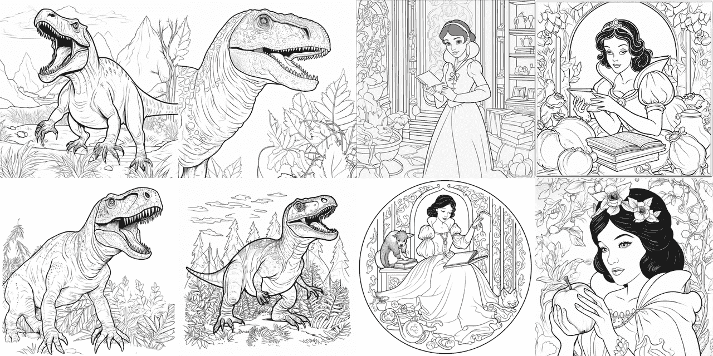

# 场景4：插画

> 来源：[https://bluefocus.feishu.cn/docx/W3CTdiNApoAVeMxlylHcGf7nnbh](https://bluefocus.feishu.cn/docx/W3CTdiNApoAVeMxlylHcGf7nnbh)

## 我们一起总结下所学

通过前面的学习，你应该或多或少都临摹了几个图片。如果没有，我建议你多练练，纸上得来终觉浅。

稍微总结下我们所学：

+   撰写 prompt 核心是「描述清楚你想要的画面」，「越详细」生成的图片就约符合你的要求。

+   要想提高 prompt 撰写能力，最好的方法是临摹别人的作品，然后自己尝试写一写，最后再看看别人的 prompt。

+   要想描述清楚画面，可以从以下几个角度进行解构：

+   在风格这块，有两个小技巧，可以使用艺术运动，以及艺术家名字。

## 水彩

从本章开始，我们会进行一些更复杂的设计。水彩插画相对来说，应该会是小朋友比较喜欢的风格。

我们按照之前所学的模板来一步步写一下：

然后再写一个带场景的：

以下是生成的图片：

## 百科插画

除了水彩外，我很喜欢的另一种插画是百科全书手绘插画。我们一起画一副玫瑰：

再画一组恐龙：

以下是生成的图片，看起来，Midjourney 并不知道霸王龙只有两只脚，哈哈哈，不过第一张真的非常像 Andrey 的风格：

## 绘本插画

我个人觉得绘本插画只要用好技巧五：增加风格——艺术家，基本上就能做出一些不差的插画。我绘本看得不算多，但应该不少人知道彼得兔，我们试试画一副和彼得兔类似风格的小猫：

另外我们也试试小熊维尼的插画师 E.H. Shepard 的风格（右边四张）。这里要额外说明下，为了让生成的结果更倾向于该作者的风格，我没在 prompt 里加入太多背景信息：

## Behance 风科技插画

坦率说来，这个并不是一种插画风，但作为互联网行业从业人士，我觉得这个还挺刚需的，但需要注意，经过我的测试，只要在最前面加入 tech illustration 也能生成类似的风格插画，但效果比较一般，当我加上 behance style 后（Behance 简单理解是一个设计师分享作品的网站，分享的作品多与科技产品有关，如 App 设计等），就变得精致和漂亮了：

另外，我还做了一个大家比较熟悉的咖啡馆场景：

最后的结果：

最后，这里面还有一个神秘参数，就是加上一些公司（比如 by Microsoft），我目前测试过像 Slack、Dropbox、Microsoft、Apple 感觉是有一点点差异，但我不知道 Midjourney 是怎么理解或处理这个词的，下面是两组案例，左边是微软的，右边是苹果的，除了苹果的第四个有个苹果 logo 外，我是看不太出来还有什么地方体现苹果的，个人觉得可能是在用色上会用该品牌的品牌色？

感兴趣的朋友可以去探索下。🆘 征集案例

## 填色插画

最后一个要介绍的也不知道是不是插画，但可能不少朋友见过，就是那种可以让你在上面用蜡笔，或水笔填色的填色插画。我觉得非常适合让小朋友自己生成填色插画，然后打印出来，让小朋友上色。以下是霸王龙的例子：

白雪公主的版本只要将主体改成「Snow White」即可，以下是生成的图片：

