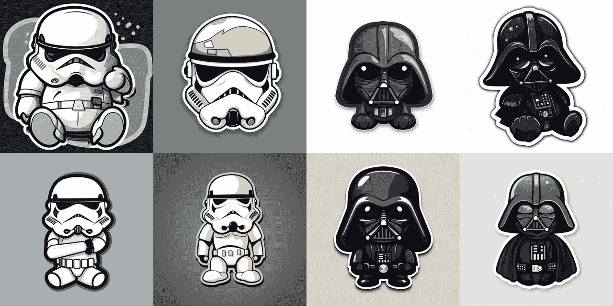
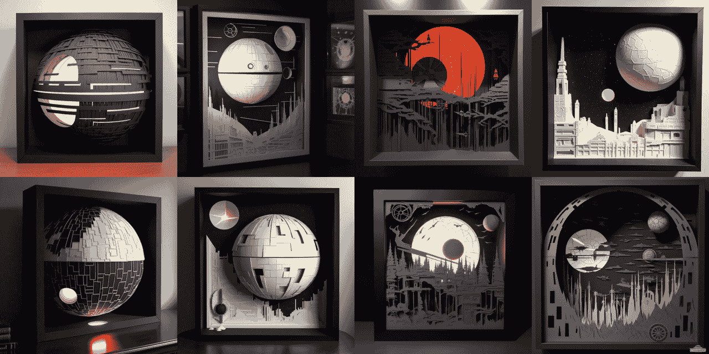
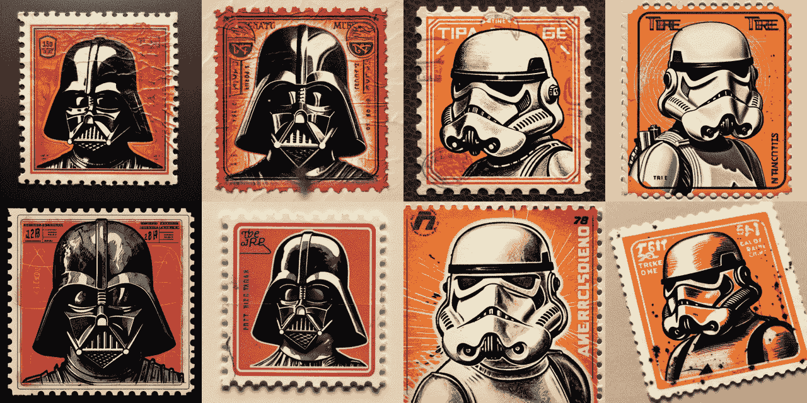
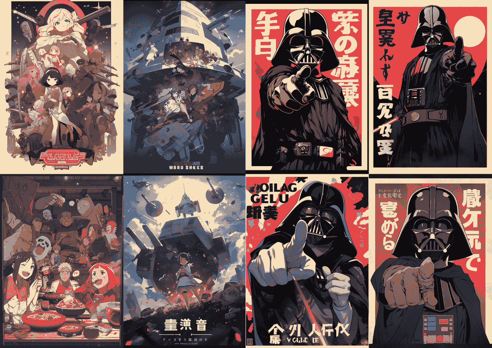
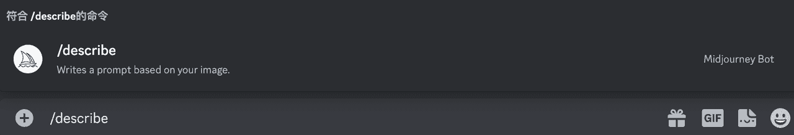
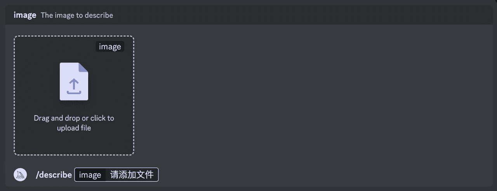
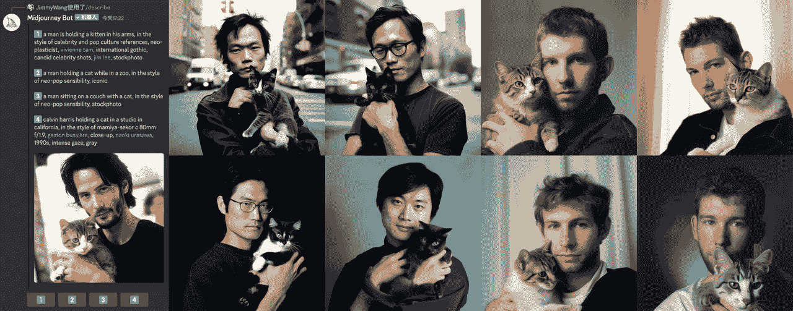

# 场景11：其他

> 来源：[https://bluefocus.feishu.cn/docx/XvQhdZaMUoFw3IxPsxccOTu8ndb](https://bluefocus.feishu.cn/docx/XvQhdZaMUoFw3IxPsxccOTu8ndb)

本章节主要是介绍几个我很喜欢，但不知道如何归类的场景。

不过我写完这一章，我发现他们都很适合变现，比如制作实体货物啥的 😂

## 贴纸

不知道有没有人和我一样有喜欢买贴纸贴笔记本电脑的习惯。某宝虽厉害，但我希望的东西比较非主流，有一些无法满足我的需求，所以就想到让 AI 帮我画一些，以下用风暴兵和达斯维达为例，写一组 prompt：

生成的结果是这样的，你会发现就是多了一个白边，并且是矢量图风格（我觉得很适合某宝的朋友用）：

## 剪纸

我非常喜欢那种有层次的剪纸风格（中文应该叫啥呢？我只知道英文叫 layered paper art）但这种要画出来，还挺困难的，于是想着用 AI 试试：

用上述的 prompt 生成的结果还挺不错的，但如果你看下图左边 4 张图中的第 3 张，会觉得框里的球很不现实，也不是我想要的那种 2D 堆叠的剪影，第 2 张和第 4 张更像是我想要的，修改一下，加个 diorama（二维平面图）。

voilà~ 加上后效果好很多（右边 4 张），太漂亮了，希望某宝有卖：

## 邮票

不知道各位是否还知道邮票这种东西，2023 年了，我还有集邮的习惯，所以我在想用 AI 生成邮票估计也很有意思，所以就试了下，让 AI 做几张星球大战的复古邮票：

最后生成的图片，简直就是艺术：

## 海报

最后介绍一些海报的做法：

海报并不仅仅指电影海报，你还可以用它来做广告海报。广告海报则把类型换一下即可。但需要注意，广告海报里需要其他元素来体现「广告」，并不是说加了 advertising 就是广告了。

## 技巧十七：看到别人的图，想知道它的 prompt 是啥

最简单的方法，当然就是直接问。

如果问不到，倒是可以借助一些工具，Midjourney 支持图片转 prompt 功能。方法很简单。第一步在输入框输入 /describe：

点击 describe 后，会弹出一个添加文件的入口，上传文件，并点击回车。

Midjourney 就会返回结果，点击图片下方的 1、2、3、4 按钮，可以直接发 prompt 给 bot，让其生成图片，右边是分别用 #1 和 #4 prompt 生成的图片，我觉得用它来探寻原图的构图、主体、风格应该都不错，但不要预期能生成一个完全一样的图：

