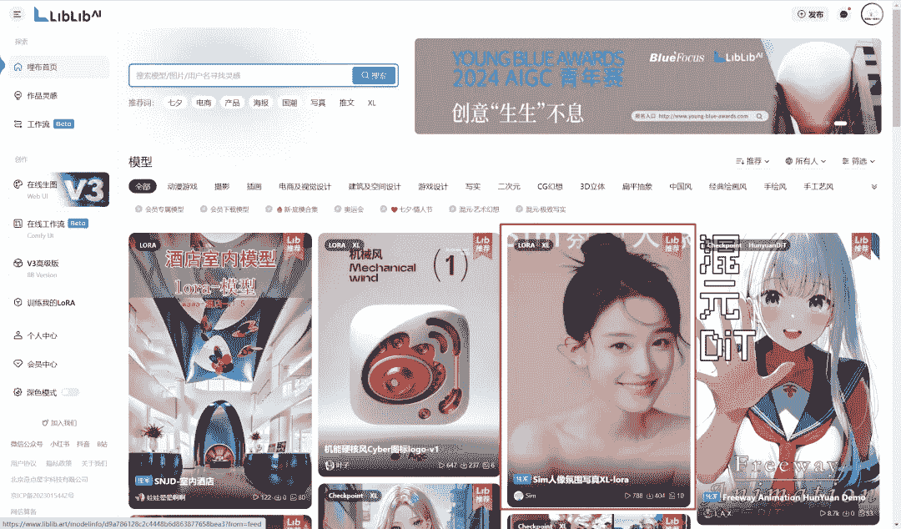
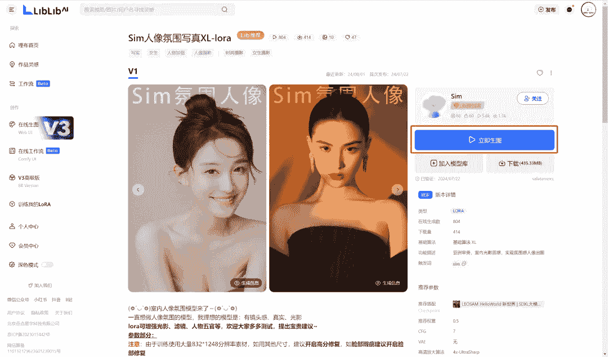
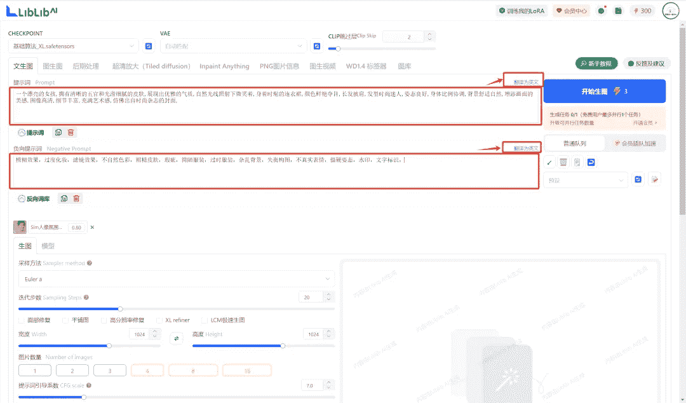
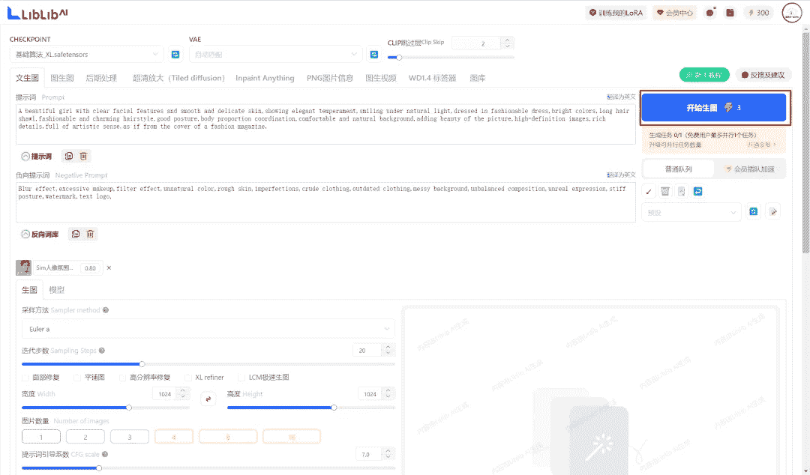
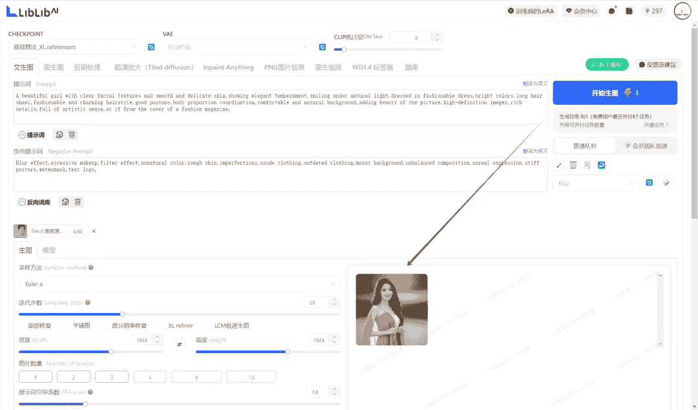
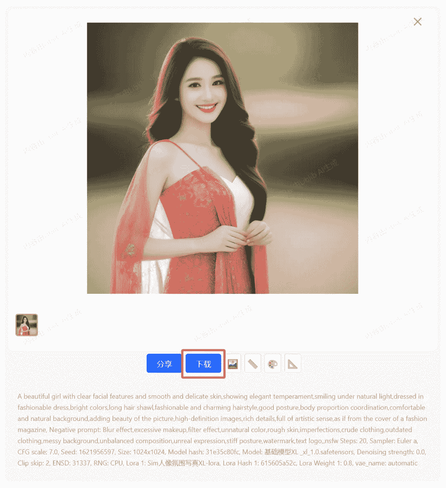
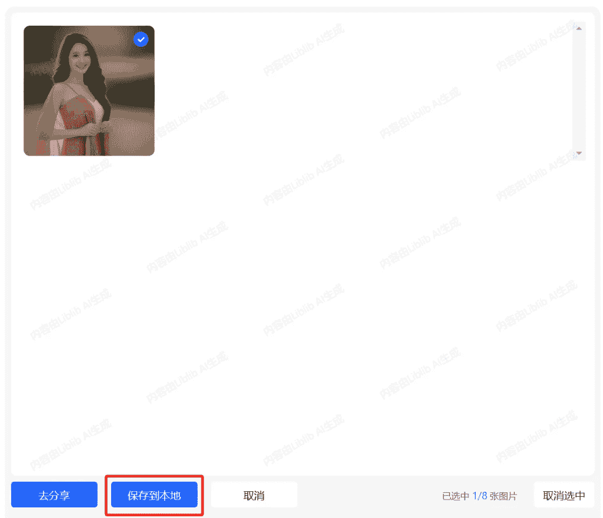
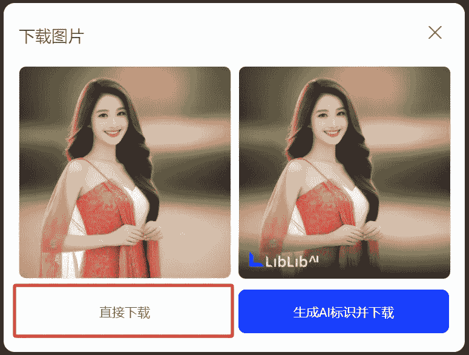

# 10万+模型免费下载&使用的作图网站——liblib(内附网址）轻松代替SD

> 来源：[https://bluefocus.feishu.cn/docx/Co4Dd9T2EotBQtxXBfGctLcrnOe](https://bluefocus.feishu.cn/docx/Co4Dd9T2EotBQtxXBfGctLcrnOe)

最近使用了国内一个专业的作图网站，LiblibAI·哩布哩布AI。网站文生图底层技术为全球领先的Stable Diffusion。分享社区有10万+模型免费下载或者在线使用。

**对于初级尝鲜用户，打开网站**

**即可体验**

# 月之暗面和 MiniMax 的投资人，联手投的 AI 图像赛道的最大笔融资

> AI 图像生成平台「LiblibAI 哩布哩布 AI」（以下简称「LiblibAI」）在一年内已完成三轮融资，总金额达数亿元人民币。据悉，此融资规模为国内 AI 图像赛道的最大融资金额，由数家顶级风险投资机构联合参与：天使轮由源码资本、高榕创投和金沙江创投投资；第二轮由战略投资方领投；最新一轮由明势资本领投；老股东持续多轮加持。远识资本担任多轮融资的独家财务顾问。

其中，源码资本和高榕创投均投资了月之暗面，明势资本则投资了 MiniMax。两家头部大模型公司的投资方鲜少同时出手同一家 AI 应用公司。据了解，融资将主要用于三个方面：构建大规模算力中台，支撑海量用户推理和训练算力需求；基于图像模型的插件、微调模型和控制能力的研发；开发者生态和原创模型作者的支持和运营。LiblibAI 于 2023 年 5 月创立，是一家 AI 原生应用公司，致力于 AI 内容的创作和分享，目标是彻底改变设计师、画师、自媒体创作者的原有创作方式，成为内容创意行业的 AI 新质生产力。2024 年 2 月，LiblibAI 通过了国家互联网信息办公室第四批深度合成服务算法备案；同年 3 月，成为国内首家通过国家《生成式人工智能服务管理暂行办法》备案的 AI 社区。在短短一年时间内，LiblibAI 已经积累了近 1000 万专业的 AI 图像创作者，用户量位居国内第一；社区的原创模型数超过 10 万，生产并分享了超过 2.3 亿张 AI 图片，成为中国最大的 AI 图像生成平台，并构建起了涵盖 AI 内容创作、分享、版权、售卖的完整生态链。

下面将介绍liblib功能：

# **功能**

LibLibAI图像生成平台的核心功能包括：

+   在线Stable Diffusion WebUI图片生成：

文生图：用户可以输入文字描述，AI根据描述生成相应的图像。图生图：用户上传一张图片，AI在此基础上生成新的图像，保持原有图片的风格或元素。图像后期处理：提供对生成图像的编辑和优化功能，如调整风格、尺寸、分辨率等。

+   丰富的作品灵感和模型社区：

平台上汇集了10万+的AI模型和创作作品，涵盖多种风格和领域，为用户提供丰富的创作灵感和资源。

+   个人专属自定义LoRA模型训练：

用户可以上传图片来训练专属的LoRA模型，提供多种预设模式，以满足个性化的创作需求。

+   社区互动与分享：

用户可以在平台上分享自己的作品和模型，与其他创作者交流心得，共同探索AI绘画的无限可能。

+   版权和售卖生态链：

平台不仅提供创作和分享服务，还构建了包括版权保护和作品售卖在内的完整生态链，支持创作者的权益。

接下来为大家带来教学

# 如何使用LibLibAI生成图片？

进入LibLib AI官网主页（http://b.mrw.so/2lD2sK），平台目前拥有的模型很多，找到自己喜欢的模型。例如在这里点击列表图片中的【Sim人像氛围写真XL-lora】。

进入【Sim人像氛围写真XL-lora】详情页面，点击【立即生图】。

进入基于该模型生图的页面，输入提示词和负向提示词。由于Stable diffusion模型对英文识别较友好，因此，咱们先点击提示词右上方的【翻译为英文】。提示词：一个漂亮的女孩，拥有清晰的五官和光滑细腻的皮肤，展现出优雅的气质，自然光线照射下微笑着，身着时髦的连衣裙，颜色鲜艳夺目，长发披肩，发型时尚迷人，姿态良好，身体比例协调，背景舒适自然，增添画面的美感，图像高清，细节丰富，充满艺术感，仿佛出自时尚杂志的封面。负向提示词：模糊效果，过度化妆，滤镜效果，不自然色彩，粗糙皮肤，瑕疵，简陋服装，过时服装，杂乱背景，失衡构图，不真实表情，僵硬姿态，水印，文字标识。

提示词和负向提示词翻译为英文成功后，根据自己需求调整对应的生图参数，锅头在这里直接使用官方默认参数配置，不做调整。点击【开始生图】。PS：如果想要更好生成符合自己预期的图片，需要花费更多时间去了解更多参数的用法，这里暂时不展开说明。

生图完成，很快得到一张图片，点击图片的【缩略图】可放大查看。

看到放大后的图片，可以点击【分享】和【下载】，锅头在这里点击【下载】。

选中图片，点击【保存到本地】。

弹出下载图片窗口，点击【直接下载】。

下载成功，图片已保存至电脑本地文件夹。到这里，咱们通过LibLib AI完成了一次图片创作，你学会了吗？

> LiblibAI对于创造出 AI 时代真正激发与保护创作者的平台有巨大热情，且能敏锐洞察用户需求，敢想敢干，快速迭代社区和工具产品，非常符合当时我们寻找AI Native年轻团队的画像。LiblibAI在行业比较喧嚣的时候，就坚定围绕模型创作者打造和维护更好的社区氛围，无论是前期模型供给的差异化策略，还是长期构建更具想象力的设计师生产力工具的产品路线图，都给我们留下了深刻印象。我们很期待公司未来借助模型生态的力量，提供更多元的审美选择，用全新的AI交互形式赋能更多创作者。

官方群聊

智能体搭建交流群

bot互助群

> 如果您想与高手切磋，与AI爱好者一起热烈**讨论，发**表观点，分享作品，欢迎加入我们的官方群聊

> **智能体搭建交流群**：智能体搭建的互助交流群，群里有coze、扣子等各路技术流大佬实时解答技术问题，想交流的欢迎进群

> 如果您想与更多让自己制作的智能体冲上热门推荐页，获得更多曝**光，欢迎加入**由bot创建爱好者自发建立的bot互助群