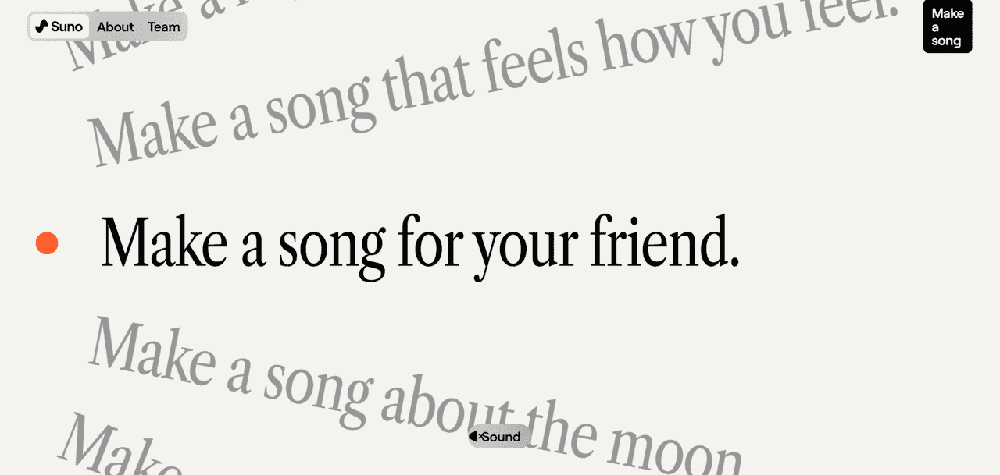
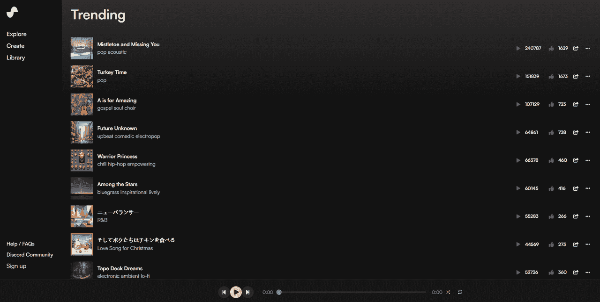
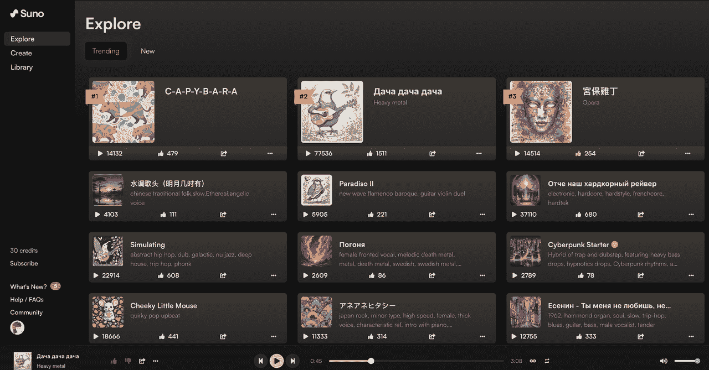
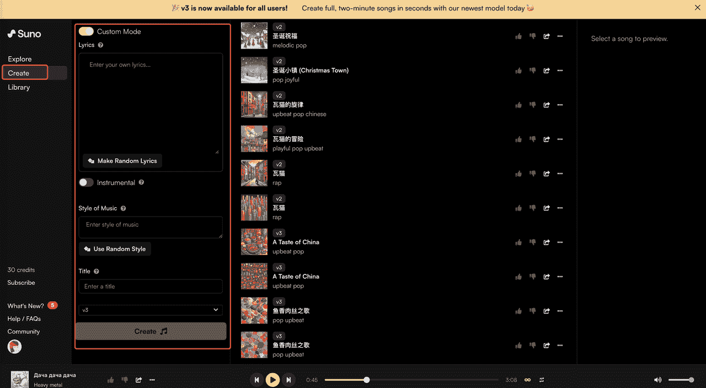
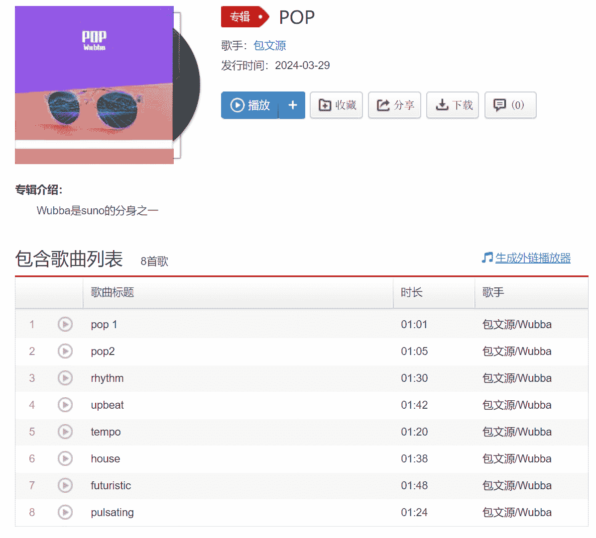
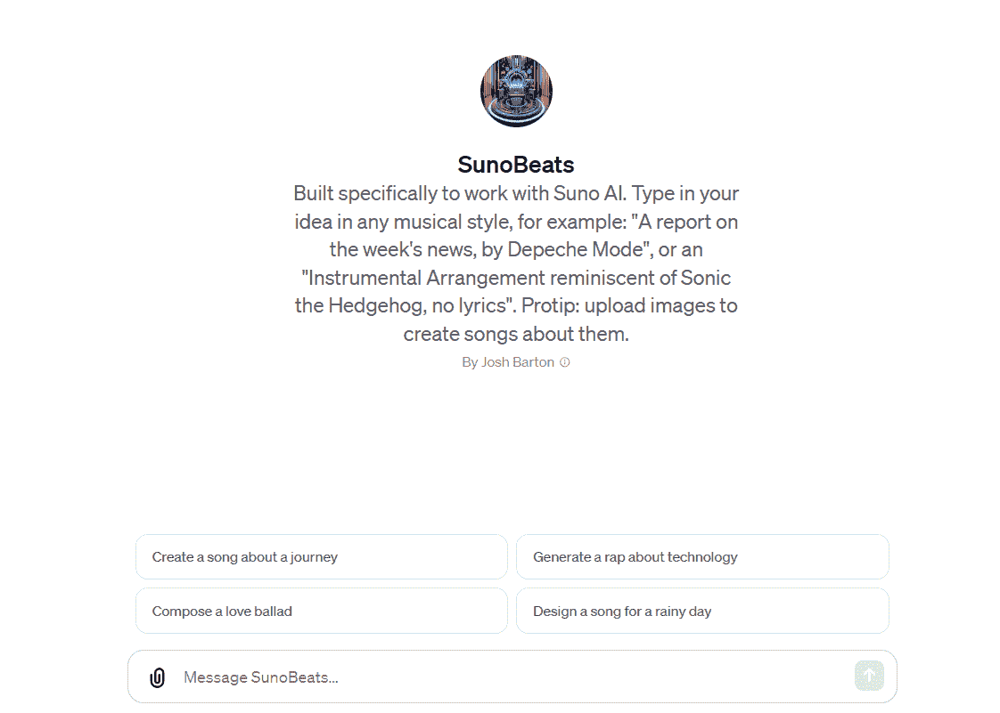
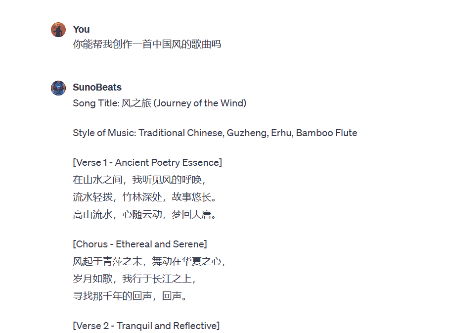

# AI音乐——SUNO

> 来源：[https://bluefocus.feishu.cn/docx/CoK0d9IlsomZ7RxxVBVcHRGCnzc](https://bluefocus.feishu.cn/docx/CoK0d9IlsomZ7RxxVBVcHRGCnzc)

链接入口：https://suno.com/

## 前期准备

### 主页生成

- 点击 Create 即可进入生成的主页。

### 使用模式

- Custom Mode (自定义模式)：允许自定义歌词。
- Instrumental (纯音乐模式)：生成没有歌词的纯音乐。

### 社区创作

- 在社区中，如果喜欢某首歌曲，可以点击 Remix 进行基于当前提示词的创作。

### 推荐的 prompt 写法

这里有很详细的教程[Suno 操作指北 V2](https://waytoagi.feishu.cn/wiki/D1DOwPS5ei5EkckZHUvcVjpEnff)｜[Suno 操作指北 V1](https://waytoagi.feishu.cn/wiki/PhTwwHp1QiNdoFknip1cLwysntd?fromScene=spaceOverview)

Suno创作音乐的小技巧：来自[**Gorden Sun**](https://twitter.com/Gorden_Sun)

1、如果你想参考某个现有歌曲的节奏，可以在这个网站查询歌曲的BPM和Key，作为提示词写进去。

https://songbpm.cosha sim

2、歌词里，可以在歌词段落前加`[Verse]`（主歌）、`[Rap]`（说唱）、`[Chorus]`（副歌/高潮）、`[Intro]`（引子）怎样更好的来告诉AI这段歌词应该怎么唱。

> 🔔Suno教程里的辅助工具Suno Beats最新版本只能生成纯音乐（有保留老版本的朋友可忽略这条信息），所以找了三个类似的GPTs，大家可按需参考！
>
> **推荐**：nimbus [Suno Creator]：https://chat.openai.com/g/g-ljoDOarSn-suno-creator
>
> Suno Song：https://chat.openai.com/g/g-0XDcf6auX-suno-song
>
> Suno Prompt：https://chat.openai.com/g/g-YJYWB8nKT-suno-prompt
>
> [Compose].me：https://chat.openai.com/g/g-ldbohmO2c-compose-me
>
> Suno ai - `/chirp` - Music Prompt maker：https://chat.openai.com/g/g-5gMVONG2l-suno-ai-chirp-music-prompt-maker
>
> Suno音乐创作大师【中文】：https://chat.openai.com/g/g-mlWtT8URF-sunoyin-le-chuang-zuo-da-shi

## checkDliInstance start! 参考流派

以下内容由 KEEN 整理 欢迎关注他的👸号：智音Brook

参考下面音乐知识科普和流派分类，如果不清楚如何选择，也可以借助 AI 进行创作。

[音乐流派、风格词汇参考](https://waytoagi.feishu.cn/wiki/Sk9nw72yOitnqAkyIpucWWW2nCb)

风格大全：

[AI音乐大爆炸：从古典到电子，全宇宙音乐风格一网打尽](https://ex14p97w9l.feishu.cn/wiki/GhszwdYI2iFkUjk5zWccpYzonIc?from=from_copylink)

### 音乐知识科普：什么是流派？什么是风格？

> 流派(Genre)：
>
> 音乐流派是指一群共享特定音乐特性和传统的作品集合，是分类音乐多样性的一种方式。诸如摇滚、爵士、古典、电子和乡村音乐等，都是独具特色的流派。这些分类主要基于作品的结构、节奏、和声以及乐器使用等关键因素。每个流派都是音乐历史长河中的一部分，不仅代表了一段时间的音乐趋势，还深受其历史和文化背景的影响。音乐流派的形成和发展，不仅是艺术表达的演变，也是文化交流和社会变迁的见证。
>
> 风格(Style)：
>
> 风格在艺术领域，尤其是音乐创作中，主要指艺术家或作品所展现的独特特征和创作手法。它是艺术家个性化的音乐表达，不受限于单一流派，而是可以跨越和融合多种音乐风格。例如，一位流行音乐艺术家可能通过其特有的唱腔或舞台表演风格，展示其独特的艺术个性。这些元素共同构成了艺术家独一无二的音乐风格，使其作品与众不同，成为其艺术标识的一部分。

Chirp利用先进的语言模型，把输入的文本转换成音乐。想象一下，如果要列出所有的音乐流派和风格，那就像是编写一本字典一样繁杂。但请记住，这不是一份涵盖“一切”的清单，而是一个旨在激发情感和探索新创意的宝贵资源。

这里提供了一系列经过测试的音乐流派、子流派、风格用词和歌曲类型。你可以将它们灵活组合，给Chirp提供丰富多彩的风格指引。不过，要注意这个列表是永远不会完整的。我们还没能涵盖全球所有的音乐流派和地区特色，更别提那些日常生活中还未被发掘的新鲜风格用词了。

✅别忘了展开各个标题，去发现那些有着独特风味的子流派！

### Genre（流派）

#### Country（乡村）

- Bluegrass（草莓乐）
- Country（乡村音乐）
- Folk（民谣）

#### Dance（舞曲）

- Afro-Cuban（阿弗罗-古巴）
- Dance Pop（流行舞曲）
- Disco（迪斯科）
- Dubstep（配音步）
- Disco Funk（迪斯科放克）
- EDM（电子舞曲）
- Electro（电子）
- High-NRG（高能量）
- House（浩室音乐）
- Trance（迷幻舞曲）

#### Downtempo（缓拍）

- Ambient（环境音）
- Drum'n'bass（鼓与贝斯）
- Dubstep（配音步）
- Electronic（电子音乐）
- IDM（智能舞曲）
- Synthpop（合成流行）
- Synthwave（合成波）
- Techno（技术音乐）
- Trap（陷阱音乐）

#### Jazz/Soul（爵士/灵魂）

- Bebop（比博普）
- Gospel（福音）
- Jazz（爵士）
- Latin Jazz（拉丁爵士）
- RnB（节奏蓝调）
- Soul（灵魂乐）

#### Latin（拉丁）

- Bossa Nova（波萨诺瓦）
- Latin Jazz（拉丁爵士）
- Forró（弗约罗）
- Salsa（萨尔萨舞）
- Tango（探戈）

#### Reggae（雷鬼）

- Dancehall（舞厅）
- Dub（配音）
- Reggae（雷鬼）
- 3Reggaeton（雷盖顿）
- Afrobeat（非洲节奏）

#### Metal（金属）

- Black Metal（黑金属）
- Deathcore（死亡核）
- Death Metal（死亡金属）
- Festive Heavy Metal（节日重金属）
- Heavy Metal（重金属）
- Nu Metal（新金属）
- Power Metal（力量金属）
- Metalcore（金属核）

#### Popular（流行）

- Pop（流行音乐）
- Dance Pop（流行舞曲）
- Pop Rock（流行摇滚）
- Kpop（韩流音乐）
- Jpop（日流音乐）
- RnB（节奏蓝调）
- Synthpop（合成流行）

#### Rock（摇滚）

- Classic Rock（经典摇滚）
- Blues Rock（布鲁斯摇滚）
- Emo（情绪）
- Glam Rock（华丽摇滚）
- Indie（独立音乐）
- Industrial Rock（工业摇滚）
- Punk（朋克摇滚）
- Rock（摇滚）
- Skate Rock（滑板摇滚）
- Skatecore（滑板核）

#### Urban（城市音乐）

- Funk（放克）
- HipHop（嘻哈）
- RnB（节奏蓝调）
- Phonk（酸音乐）
- Rap（说唱）
- Trap（陷阱音乐）

### Styles（风格）

#### Danceable（可跳舞的）

- Disco（迪斯科）
- Syncopated（切分节奏）
- Groovy（悠扬）
- Tipsy（微醺）

#### Dark（黑暗）

- Dark（黑暗）
- Doom（末日）
- Dramatic（戏剧性）
- Sinister（阴险）

#### Electric（电子）

- Art（艺术）
- Nu（新流行）
- Progressive（进步）

#### Hard（强硬）

- Aggressive（激进）
- Banger（热门曲目）
- Power（力量）
- Stadium（体育场）
- Stomp（重踏）

#### Lyrical（抒情的）

- Broadway（百老汇）
- Cabaret（歌舞表演）
- Lounge（酒吧歌手）
- Operatic（歌剧式的）
- Storytelling（讲故事）
- Torch-Lounge（酒吧歌曲）
- Theatrical（戏剧性的）
- Troubadour（吟游诗人）
- Vegas（拉斯维加斯风格）

#### Magical（神奇）

- Ethereal（虚幻）
- Majestic（雄伟）
- Mysterious（神秘）

#### Minimal（简约）

- Ambient（环境音乐）
- Cinematic（电影）
- Slow（缓慢）
- Sparse（稀疏）

#### Party（派对）

- Glam（华丽）
- Glitter（闪耀）
- Groovy（悠扬）
- Grooveout（活力爆发）

#### Soft（柔和）

- Ambient（环境音乐）
- Bedroom（卧室）
- Chillwave（轻松浪潮）
- Ethereal（虚幻）
- Intimate（亲密）

#### Weird（奇怪）

- Carnival（嘉年华）
- Haunted（鬼屋）
- Random（随机）
- Musicbox（音乐盒）
- Hollow（空洞）

#### World/Ethnic（世界/民族）

- Arabian（阿拉伯）
- Bangra（班格拉舞）
- Calypso（卡利普索）
- Egyptian（埃及）
- Adhan（安讫）
- Jewish Music（犹太音乐）
- Klezmer（克莱兹默音乐）
- Middle East（中东）
- Polka（波尔卡）
- Russian Navy Song（俄罗斯海军歌曲）
- Suomipop（芬兰流行音乐）
- Tribal（部落）

### Song Types（歌曲类型）

#### BackGround（背景乐）

- Elevator（电梯音乐）
- Jingle（广告歌曲）
- Muzak（环境音乐）

#### Call to Prayer（祈祷呼唤）

- Call to Prayer（祈祷呼唤）
- Gregorian Chant（格里高利圣歌）

#### Character（角色）

- Strut（趾高气昂地走）
- March（进行曲）
- I Want Song（渴望之歌）

#### Children（儿童）

- Children's（儿童的）
- Lullaby（摇篮曲）
- Sing-along（合唱歌曲）

#### Retro（复古）

- 1960s（1960年代）
- Barbershop（理发店四重唱）
- Big Band（大乐队）
- Classic（经典的）
- Doo Wop（一种节奏蓝调风格的音乐）
- Girl Group（女子组合）
- Swing（摇摆乐）
- Traditional（传统的）

#### Traditional（传统的）

- Barbershop（理发店四重唱）
- Christmas Carol（圣诞颂歌）
- Traditional（传统的）

---

Pop Electronic专辑：

https://music.163.com/#/album?id=190497967

## 实战

这部分我会列举一些技巧和示例，方便读者理解以及使用它们。不过由于 Chirp 的随机性，所以下面提供的方法不能保证百分百成功，仍然需要读者动手去实践。

### 歌曲生成

这里我使用一个简单的歌曲结构顺序 `[intro]—[verse 1]—[chorus]—[verse 2]—[chorus]—[bridge]—[chorus]—[outro]`，歌词和风格提示由 GPT 生成，先来跑一遍，然后逐步分析其中的问题。

#### 案例演示

#### 前奏

这里需要科普一个东西，叫“同类合并”，Chirp 在读取元标签的时候会按照它认为的方式进行，就像下面这样。

| 我输入的 | Chirp 认为的 |
| --- | --- |
| `[intro]` | `[intro,verse]` |

案例里就是这种情况，intro 和 verse 1 被 Chirp 处理成同一部分，这明显不符合我们的预期，所以为了得到一个前奏，我们需要让 intro 部分看起来像是“独立”的部分。

##### 解决方法

| 方法 | 提示词 | 效果演示 |
| --- | --- | --- |
| 参照我之前教程里的一种写法，将 `[intro]` 改为 `(intro)`。 | `(intro)` |  |
| 增加一些器乐描述，提示 Chirp 这里需要一段器乐演奏。 | `[intro]` |  |
|  | `[build]` |  |
|  | `[Medium-Length Instrumental Intro]` |  |
|  | `[Instrumental Intro: Build]` |  |
| 在主歌前添加一些语气词，提示 Chirp 主歌前有声音。 | `(ooh-yeah)` |  |
|  | `(ooh,oh-oh-oh-oh)` |  |
| 输入多个 `[intro]`，提示 Chirp 这里有前奏。 | `[intro][intro][intro]` |  |

### 知识科普：乐器与器乐的区别

> 乐器(Musical Instrument)
>
> 乐器是用于制作音乐的工具。它们可以是弦乐器、管乐器、打击乐器、键盘乐器等，用于演奏音乐。乐器是指物理对象，即用来创造声音的实体设备。
>
> 器乐(Instrumental Music)
>
> 器乐指的是仅由乐器演奏的音乐，不包含人声。它是一种音乐形式或类别，强调乐器的声音和演奏技巧。器乐可以是单独一个乐器的独奏，也可以是多个乐器组成的合奏或交响乐。

#### 注意

某些时候会出现前奏过长或者 Chirp 不唱歌词的情况，这是因为：

- Chirp 不知道如何唱这段文本。
- Chirp 觉得这首歌需要一个很长的前奏。
- Chirp 收到了冲突的指令并卡住了。

| 解决方法 | 提示词 |
| --- | --- |
| 在风格提示功能中添加人声的描述词 | 比如 upbeat female vocals、sultry male singer |
| 在前奏之前添加一段短暂的发声，或者一段阿卡贝拉(无伴奏歌唱) | (Ahh ahh ahh) |

#### 拓展

如何在前奏中使用具体的乐器演奏？

| 方法 | 提示词 | 效果演示 |
| --- | --- | --- |
| 添加一些相关的乐器元标签，比如我是 pop,funk 风格的歌曲，就选用 funk 节奏 + 低音贝斯来铺垫前奏部分。 | `[intro]` |  |

### 主歌、副歌部分

回到前面的案例，在 verse 2 唱完后，几乎没有停顿，直接进入了 chorus 部分，以至于节奏出现错误，Chirp 也出现了“幻觉”。这里出现的问题也是随机的，那么假设，如果我们需要 Chirp 在两个部分之间停顿一下，该怎么办呢？

停顿的片段，一般是器乐演奏，所以我们需要让 Chirp 停止人声的部分，可以使用以下方法。

#### 解决方法

| 方法 | 提示词 | 效果演示 |
| --- | --- | --- |
| 添加 break 描述让 Chirp 进入一段器乐演奏。 | `[verse]` |  |
|  | `[verse]` |  |
| 添加乐器元标签创造一段乐器 solo，或者器乐描述也可以。 | 比如 `[bass drop]`、`[percussion breakdown]`、`[melodic flute interlude]`、`[guitar solo]`、`[melodic instrumental]` |  |

#### 注意

在同一个片段中，当你使用类似`[break]`指令让 Chirp 做休整，需要在指令后继续用 chorus 部分或一个新的 verse 部分来保持人声 “温暖”。如果人声沉默太久，Chirp 可能会 “忘记” 那个声音应该是怎样的，并创造一个新的声音来继续歌曲。

## 结尾部分

前面案例中，我在结尾处使用`[Outro]`来表示尾奏，`[Outro]`在这里的意思是告诉 Chirp，我想在结束前再进行一段音乐，再结束歌曲，但 Chirp 经常不这么 “认为”。

原因就是，当 Chirp 完成一个歌曲循环时，它会随机生成一个带有结尾的片段，这个时候就能很自然的结束掉歌曲。如果它还有更多的循环部分要完成，它可能抵制结束。

如果出现最后一个片段的时长少于 1 分钟的，那大概率 Chirp 会在这个片段结束歌曲，但偶尔会在看似快结束的时候突然来个强烈的鼓点，然后又开始了歌曲 ... 挺无语的。

### 解决方法

| 方法 | 提示词 | 效果演示 |
| --- | --- | --- |
| 使用结束元标签，提示 Chirp 该考虑结束歌曲了 | 比如 `[big finish]`、`[end]`、`[fade out]`、`[fade out and end]` |  |
|  | `[outro]` |  |
|  | `[Song Ends]` |  |

### 注意

在使用这些元标签时，尽量留出一整个片段给 Chirp 慢慢淡出或结束，如果没有结束，重复使用上述方法直到它停止。

## 案例改版展示

## 纯音乐生成

纯音乐，也称为器乐音乐，是指不包含歌词和人声的音乐。它通过各种乐器的演奏来表达情感和故事，不依赖于文字的描述。纯音乐可以包括古典音乐、爵士乐、电子音乐、新世纪音乐等多种风格。这种音乐形式给听众提供了更广阔的想象空间，让人们通过音乐本身的旋律、节奏和和声来感受和解读。

| 方法 | 提示词 | 效果演示 |
| --- | --- | --- |
| 在风格提示功能中输入相关提示词，然后将歌词提示功能留空。 | advertisement jingle music,ukulele,hawaiian,tropical,island,happy,upbeat |  |
| 在歌词提示功能中使用乐器元标签并进行堆叠，跟前面生成前奏的方法一样。 | `[fade in,intro]` |  |

### 注意

有些流派在你把歌词提示功能留空的情况下会自发唱歌，即使在风格提示功能里添加器乐描述也没用，解决办法是往歌词提示功能中添加一个`[Melodic Instrumental]`。

### 拓展

如何生成一首没有人声的伴奏？

| 方法 | 提示词 | 效果演示 |
| --- | --- | --- |
| 将元标签后的文本改为 Chirp 检查不出来的符号或表情。 | `[verse]` | https://app.suno.ai/song/a7fb72c3-19ea-49de-8ac2-ad118a27e22d |
| 元标签后的文本用`[instrumental]`表示 | `[verse]` | https://app.suno.ai/song/1838d428-da8e-47c7-8328-ffbd11e51c53 |

## 常见问题

### 1.歌词的延续

+   如果歌词被切断，那么在下一个片段开始，接上它们停止的地方。如果一个单词被切成两半，用下一个单词开始继续的歌词。

+   不要再次使用被中断的元标签。例如，如果你的`[Chorus]`被切断了，那么在下一个片段中，你接上的歌词不要添加`[Chorus]`这个元标签，如果添加了，Chirp 会认为这是新的`[Chorus]`并开始新的生成。

+   如果 Chirp 尝试重复它刚唱过的完整行，或者逐字重复合唱，使用`[Break]`来打断歌曲流程。

+   考虑回到之前的片段，重新使用延续功能生成。

### 2.进入一段器乐后，如何让它停止并进入歌词

试着在歌词前加入语气词，比如 (Ohh,Ohh ohh)，来提示 Chirp 这里有人声，让它做好过渡准备，有时有用。

### 3.“无法生成”或“尝试另一个提示”的错误

意味着你的文本请求被阻止了。被拒绝的提示将退还积分。

一个歌曲提示可能因为多种原因被阻止：

+   你的歌词受版权保护。

+   你的音乐风格或歌曲描述使用了真实的乐队或艺术家名称。

+   你的歌词包含违规词汇。

+   你的实际积分用尽了，但网页没有同步。(刷新页面。)

+   在默认模式或“生成随机歌词”按钮下，AI 无法理解如何将你的请求转化为歌曲。

## 更多

神器——SunoBeats

由社区大佬 Josh Barton 制作，为 Suno AI 量身定制的 GPTs，质量很高，尤其是流派和风格方面，把控的很准，只是需要注意在使用时得把元标签的内容改下，像`[Verse 1-Ancient Poetry Essence]`，你需要把`Verse 1`后的描述删掉，当然保留也行，只是保留后生成的质量不稳定。同时，它还能读取图片，根据图片内容写出对应的风格和歌词。

## 参考资料

非官方 Suno wiki:https://www.notion.so/suno-ai-wiki/4e24aa838bf84fffaf383b1f9ed50748?v=755ec8954abd4e3f9f5c899950f0f315
