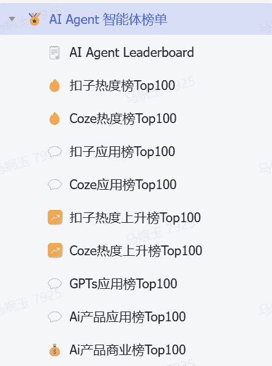
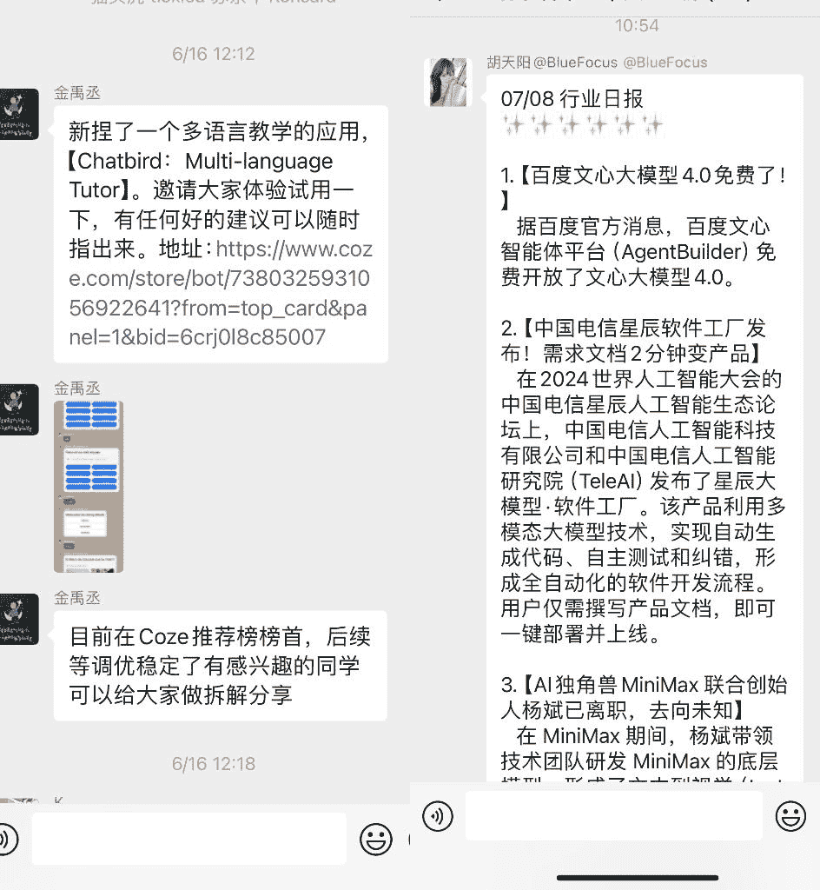
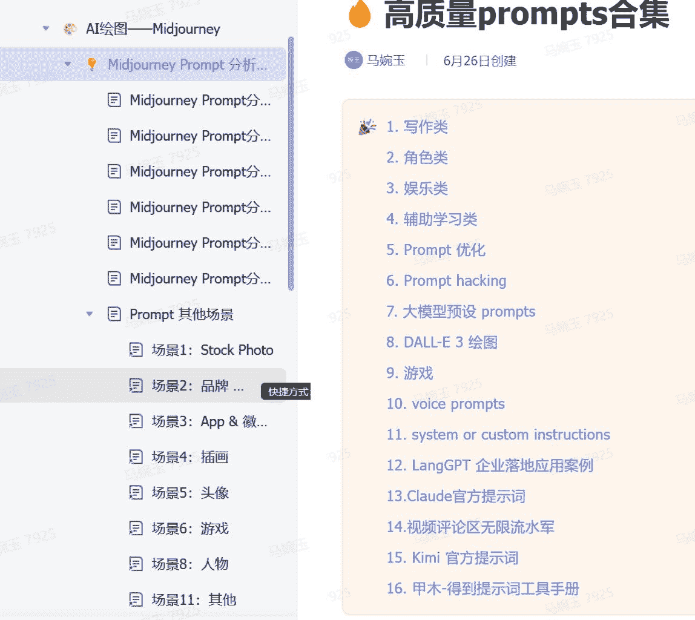

# 👀AI洞察者中心｜知识库

> 来源：[https://bluefocus.feishu.cn/docx/T0lLdbOy6oPUDGxcI3Lcr2Gtn2e](https://bluefocus.feishu.cn/docx/T0lLdbOy6oPUDGxcI3Lcr2Gtn2e)

> 太棒啦，恭喜你发现了宝藏!!!!!

# 知识库介绍

这里是👀A**I洞察者中心，**无论您是

AI产品创作者爱好者

想更深入了解使用AI人群

想学习AI变现群体

想提升软实力的学生

也无论您的性别、年龄、专业、职业、行业，这里都是您追赶时代前沿洪流的不二之选，如今进入AGI时代，学习AI利用AI可以帮助我们更好的

**理解世界，**

**解决问题，**

**甚至创造新的可能！**

官方群聊

智能体搭建交流群

bot互助群

> 如果您想与高手切磋，与AI爱好者一起热烈**讨论，发**表观点，分享作品，欢迎加入我们的官方群聊

> **智能体搭建交流群**：智能体搭建的互助交流群，群里有coze、扣子等各路技术流大佬实时解答技术问题，想交流的欢迎进群

> 如果您想与更多让自己制作的智能体冲上热门推荐页，获得更多曝**光，欢迎加入**由bot创建爱好者自发建立的bot互助群

# 详细目录

在👀A**I洞察者中心，**

我们有小白友好的完整教学体系（如右图）；

每日更新的AI行业最前沿动态——[AI日报合集](https://bluefocus.feishu.cn/wiki/O4J3wOJfRiPmAikwlRrcREK4ncc)；

每周更新的[AI Agent 智能体榜单](https://bluefocus.feishu.cn/wiki/TwW5wNDlfifjLgkE2micxthenNe)；

我们还有[精选网站合集](https://bluefocus.feishu.cn/wiki/GTVBwopjFiW6P1kFcLjcup14nWe)，为您提供优质网站工具；

[AI变现方式](https://bluefocus.feishu.cn/wiki/VufgwJS3iialeRkCbaAcR2R2njc)时也提供了利用AI agent的 ；

更有高手云集，初学者友好的活跃社群😍👍

（干货群内消息一览）

**完整教学体系目录**

+   [0-1初学者指南](https://bluefocus.feishu.cn/wiki/TgVLw6V6Gi4C8DkYaKYcrcGLnge)

+   [AI Agent行业报告.pdf](https://bluefocus.feishu.cn/wiki/IhWpwl68niuUYUklzrFcXakvnWd)

+   [ChatGPT](https://bluefocus.feishu.cn/wiki/WLQAw8F2DiHzB9kXVeIc6ko3nJh)

+   [提示词prompts](https://bluefocus.feishu.cn/wiki/INPYw3XIlit0QjkS8PPcIVU9nSg)

+   [bot试用](https://bluefocus.feishu.cn/wiki/N0I3wxejVi7kQEkZuRvcLoiunFh)

+   [AI绘图——Midjourney](https://bluefocus.feishu.cn/wiki/DTNtwwkfUiRaKlkG7FTcv9mDnxf)

+   [AI视频](https://bluefocus.feishu.cn/wiki/LuUtwNYt5iJ1nYkEXJDcWVQ0nPf)

+   [AI音乐——SUNO ](https://bluefocus.feishu.cn/wiki/GklswjgDairNd4k9DTzczof5nTg)

+   [AI Agent智能体——coze为主](https://bluefocus.feishu.cn/wiki/Z70FwM3pWiCUXqk2sOpcM14qn7b)

+   [智能体（Agent）是什么](https://bluefocus.feishu.cn/wiki/QRcRwZC0Wizb5hk8wC5cV0R3nke)

+   [AI智能体试用](https://bluefocus.feishu.cn/wiki/N0I3wxejVi7kQEkZuRvcLoiunFh)

+   [Coze 全方位入门剖析 - 免费打造自己的 AI Agent
(国内版)](https://bluefocus.feishu.cn/wiki/TIcrwRNkziRI4TkfIrkcO31Jnec)

+   [何谓Agent，为何Agent？](https://bluefocus.feishu.cn/wiki/NG1ZwvOv0iuKXHkuzW0c67EZnag)

（超丰富子目录一览）

哇塞好全啊！🤩

> 这里无疑是您入门AI知识的宝地，学习AI知识方法，了解最新AI发展趋势、市场动向和智能体表现的理想之地；是您接触AI相关人群的捷径，这是为AI爱好者提供的伊甸园。

**⚠️****请点击左上角的展开标识****（右图）****，获得完整版知识库哦！**

**还等什么**，快来加入社群，收藏此宝藏，一起做AI洞察者吧！

# 今日日报

# **2024/9/4**

> 🤝 MiniMax大模型有日均30亿次AI交互量

> 👔 快手可图推出AI虚拟换衣项目

> 🌄 阶跃星辰上线生图模型Step-1X

> 📃 IDC首次发布移动端AI大模型应用报告

> 🎵 大模型小爱全量升级，陆续覆盖小米多款产品

> 🎺 ChatGPT或将新增8种新语音

> 💸 Claude 3.5 Sonnet疑似取消免费模式

> 🎬 Runway发布视频延长功能，生成时长可延至40秒

> 详细内容及往期日报请前往[AI日报合集](https://bluefocus.feishu.cn/wiki/O4J3wOJfRiPmAikwlRrcREK4ncc)

# 最近更新