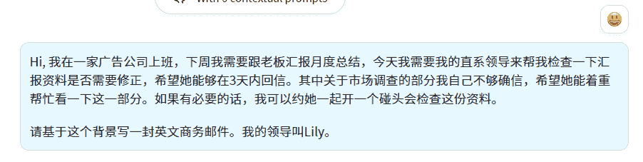
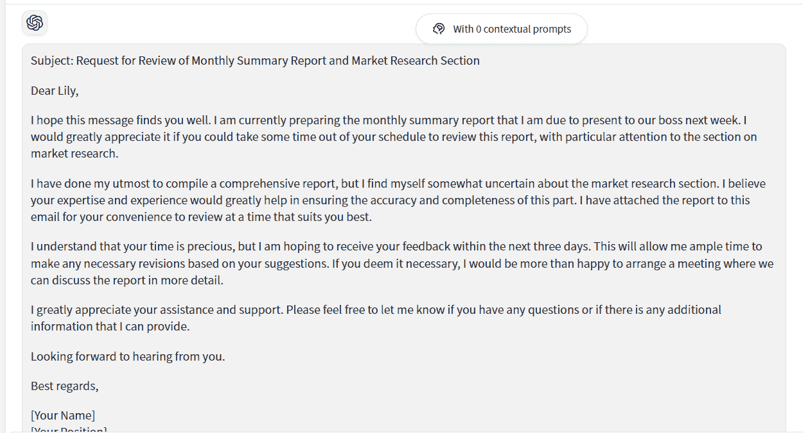
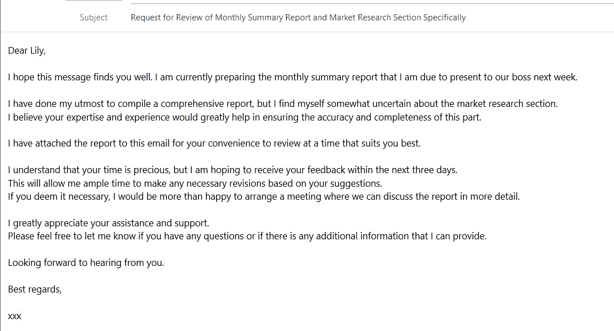
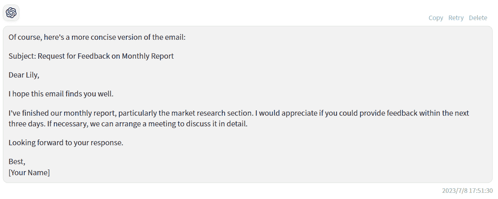

# 使用GPT撰写商务邮件：外企资料Review与会议预约

> 来源：[https://jalicvoygc0.feishu.cn/docx/Wn10dSQinonaFqx7YbacNRvjn3d](https://jalicvoygc0.feishu.cn/docx/Wn10dSQinonaFqx7YbacNRvjn3d)

**工作场景：**外企商务邮件

**节约时长：**15分钟/每封

**原则：**

+   外企职场新人在码商务邮件时总是会纠结用词和表达，还需要斟酌翻译的是否地道和准确。灵活运用prompt将需要表达的邮件信息告知GPT，提升工作效能的同时还能跟GPT学一波语言表达。

+   可以通过prompt调教GPT调整语气的正式程度，生成不同版本的邮件。

**网络：**魔法

**寻找网络友好的****AI****工具：**[🤖AI工具导航](https://jalicvoygc0.feishu.cn/wiki/PgzAwa3XoiEB5xk3XJNcUORvnpi)[🤖即点即用的ChatBOT](https://jalicvoygc0.feishu.cn/wiki/OagnwWk9diGw0dkX2czcbKBEnVh)

**举例场景：**

+   下周我需要跟老板汇报月度总结，今天我需要我的直系领导来帮我检查一下汇报资料是否需要修正，希望她能够在3天内回信。其中关于市场调查的部分我自己不够确信，希望她能着重帮忙看一下这一部分。如果有必要的话，我可以约她一起开一个碰头会检查这份资料。

+   prompt[使用GPT-4]：

扒下来的内容稍微调整一下分段、把觉得啰嗦的地方删掉就可以直接粘到邮箱里了。

+   如果要是觉得太长风格不对，也可以让GPT调整。如：

扫码加入AI Flow Genius社群，探讨使用AI来提升生产力的方法，成为超级个体

超过200需手动拉人 **备注：加群**

