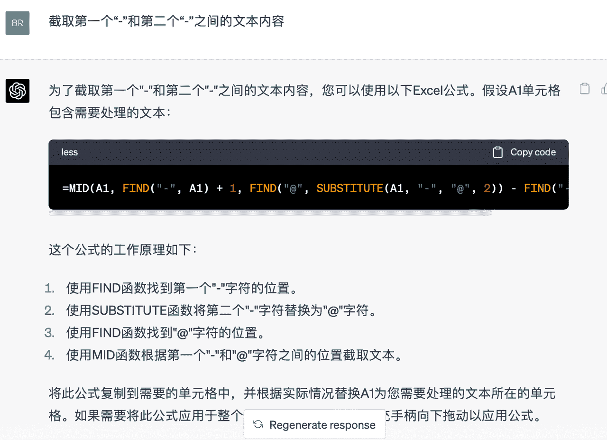

# 使用 GPT，构建全自动化的EXCEL

> 来源：[https://jalicvoygc0.feishu.cn/docx/CHRWdMoScoJP5sxwbfxc6Vmbngb](https://jalicvoygc0.feishu.cn/docx/CHRWdMoScoJP5sxwbfxc6Vmbngb)

> 来源：https://m.okjike.com/originalPosts/64a6d1e1e54c189738bae963

> 作者：Ryannnnnn

**工作场景：**数据分析、整理场景

**节约时长：**每月20小时+

**原则：**

+   通过GPT+excel函数来构建自动化的表格，而不是解决单次需求

+   我通常会单独留一个对话框给excel函数

+   GPT-3.5就够用，这个对GPT-4来说太简单了，直接问就行了

**网络：**魔法

**寻找网络友好的****AI****工具：**[🤖AI工具导航](https://jalicvoygc0.feishu.cn/wiki/PgzAwa3XoiEB5xk3XJNcUORvnpi)[🤖即点即用的ChatBOT](https://jalicvoygc0.feishu.cn/wiki/OagnwWk9diGw0dkX2czcbKBEnVh)

Prompt

```
**角色Prom****p****t**：你是个EXECL函数大师，以后我会给你发场景，你来帮助我写EXECL
```

**AI****工作流****：**①给AI建立角色 ②输入具体需求 ③AI输出EXCEL函数 ④写入表格

**流程截图：**

+   预设角色


+   提出需求



+   插入表格，构建自动化表格

扫码加入AI Flow Genius社群，探讨使用AI来提升生产力的方法，成为超级个体

超过200需手动拉人 **备注：加群**

