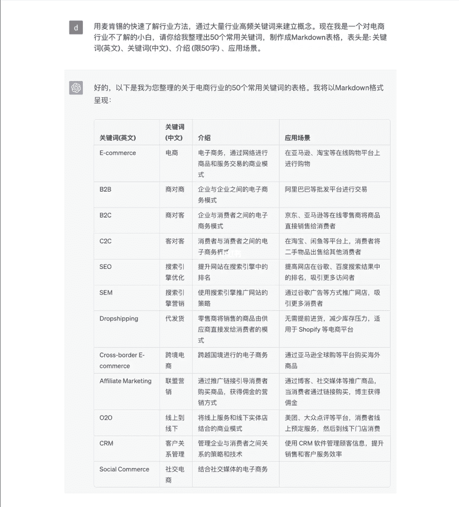
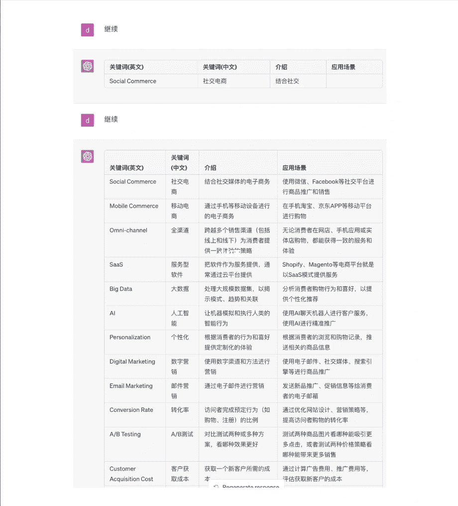
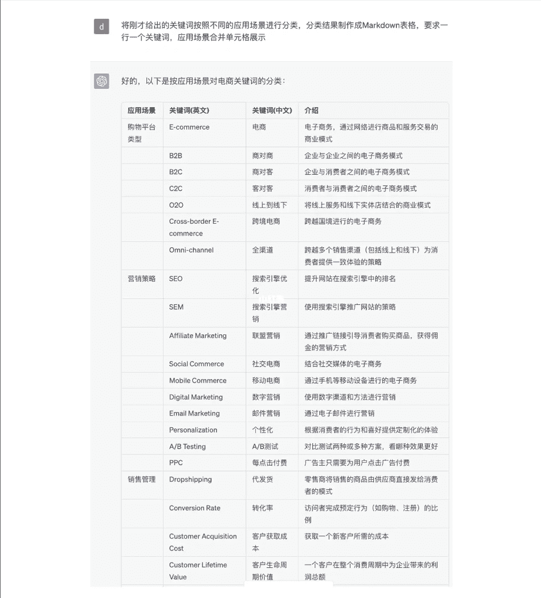
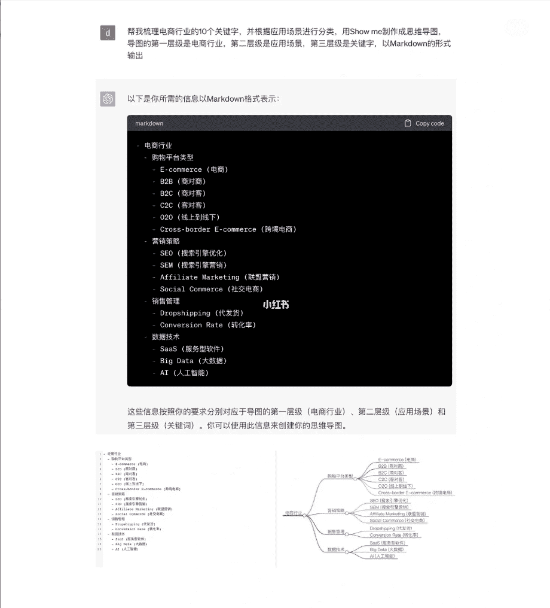

# GPT+麦肯锡，十分钟火速了解一个行业

> 来源：[https://jalicvoygc0.feishu.cn/docx/GKYVdPMIfopth2x1q0Vcx0QInhh](https://jalicvoygc0.feishu.cn/docx/GKYVdPMIfopth2x1q0Vcx0QInhh)

> 来源：GPT+麦肯锡，十分钟火速了解一个行业

> 作者：AIGC研究师

**网络：**魔法

**寻找网络友好的****AI****工具：**[🤖AI工具导航](https://jalicvoygc0.feishu.cn/wiki/PgzAwa3XoiEB5xk3XJNcUORvnpi)[🤖即点即用的ChatBOT](https://jalicvoygc0.feishu.cn/wiki/OagnwWk9diGw0dkX2czcbKBEnVh)

✨最近学到一个巨好用的绝招，GPT+麦肯锡工作法，火速对一个行业了如指掌。

✨利用GPT+麦肯锡方法论了解一个行业主要是个关键步骤：

1.  让GPT给出100个某某行业关键词，并以表格的形式呈现

1.  让GPT给这些关键词归类，生成markdown表格，分类后的表格有利于我们初步建立行业的知识框架

1.  利用GPT的建议功能，根据关键词的重要性和你的需求确定学习的优先级，以及提供参考的书籍资料，再找个导图插件生成思维导图

1.  让GPT例举20个访谈某某行业专家的高质量问题

1.  让GPT推荐5本某某行业的专业书籍，帮助你快速了解这个行业

##### 继续浏览全站内容：

[🎪首页](https://jalicvoygc0.feishu.cn/wiki/DdEvwxYsSidd36kAIIVcnROwnmb)

[🤔学习AI工作流](https://jalicvoygc0.feishu.cn/wiki/W15IwochvimsqvkkuCPcZuBxnqg)

[🤖查找AI工具](https://jalicvoygc0.feishu.cn/wiki/Bu8GwqYu8i5LBRkyVKocUvX5n97)

[📊阅读AI文章](https://jalicvoygc0.feishu.cn/wiki/SIywwqrVji2lZkkqFFpcEHZ8nNc)

扫码加入AI Flow Genius社群，探讨使用AI来提升生产力的方法，成为超级个体

超过200需手动拉人 **备注：加群**

