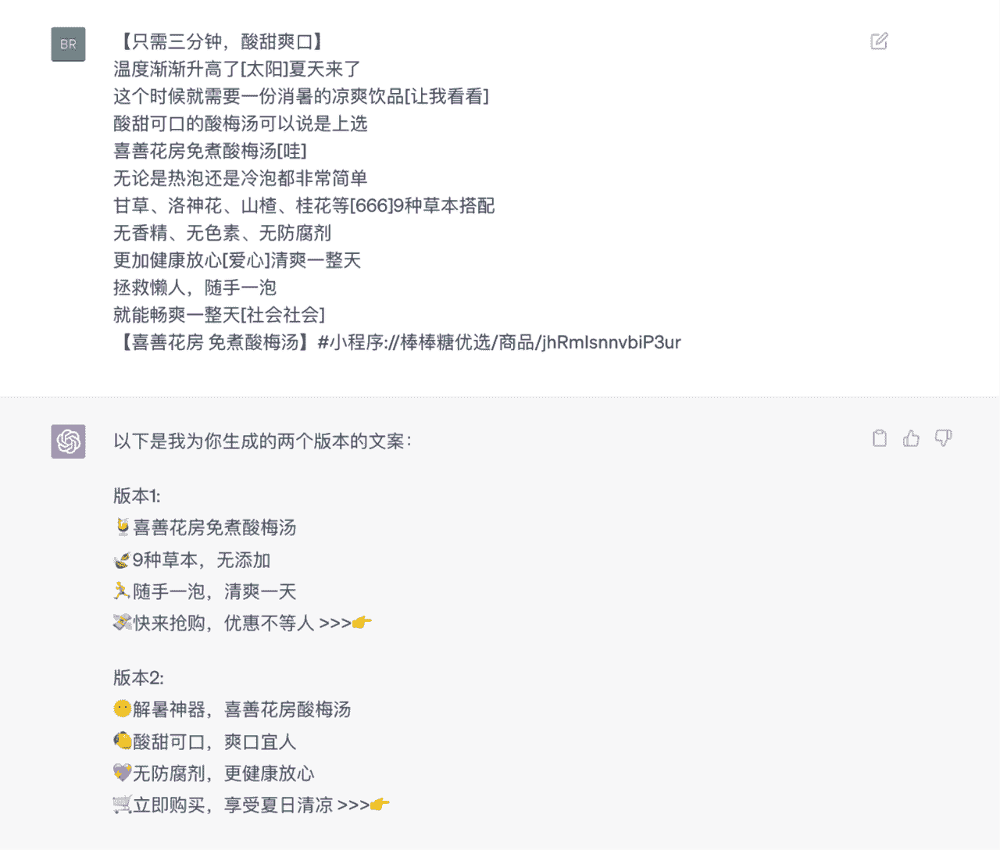

# 使用GPT-4，优化任何文案

> 来源：[https://jalicvoygc0.feishu.cn/docx/OE5edMHUMoLxELxMjbLcR8C3n4b](https://jalicvoygc0.feishu.cn/docx/OE5edMHUMoLxELxMjbLcR8C3n4b)

**工作场景：**文案编辑、自媒体运营

**节约时长：**每天20分钟

**原则：**

+   建议选用4，对4来说，这种事情太简单了

+   一次生成2版文案。这里的考虑是

+   GPT作为生成式模型，偶尔会有出错的情况，但概率很低。生成2个，一定有一个能用。

+   因为他有出错的概率，所以必须有人审核。一次出2个，也是为了从交互角度，引导人来审核。

**网络：**魔法

**寻找网络友好的****AI****工具：**[🤖AI工具导航](https://jalicvoygc0.feishu.cn/wiki/PgzAwa3XoiEB5xk3XJNcUORvnpi)[🤖即点即用的ChatBOT](https://jalicvoygc0.feishu.cn/wiki/OagnwWk9diGw0dkX2czcbKBEnVh)

**AI****工作流****：**①预设文案格式 ②输入原料

+   预设文案格式：

+   输入原料并产出

[使用GPT，写小红书文案](https://jalicvoygc0.feishu.cn/wiki/RIIQwGYIpiQt17kCoB7cyGwWnVc)篇中的Propmt，也是用了这个2版方案技巧。

可以进群直接玩：

扫码加入AI Flow Genius社群，探讨使用AI来提升生产力的方法，成为超级个体

超过200需手动拉人 **备注：加群**

