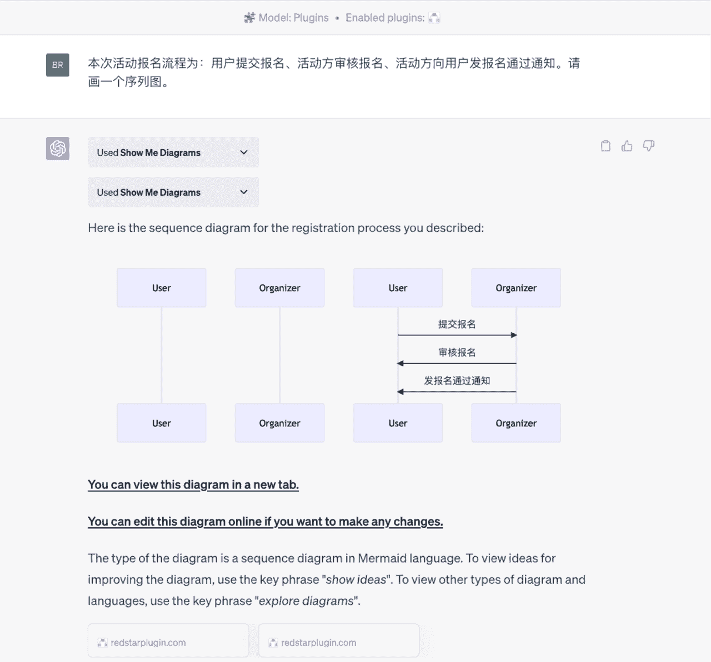
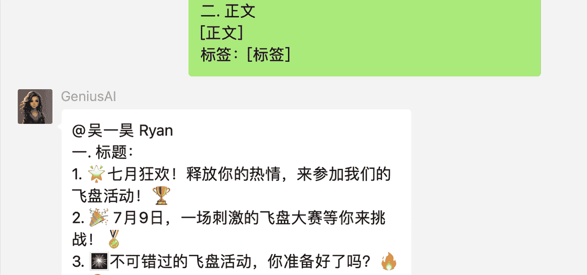

# 使用Plugin Show Me，画交互交互图

> 来源：[https://jalicvoygc0.feishu.cn/docx/C9fadp6EMozog1xVaAacyVoanHc](https://jalicvoygc0.feishu.cn/docx/C9fadp6EMozog1xVaAacyVoanHc)

**工作场景：**产品经理、软件开发工程师

**节约时长：**每周3小时

**原则：**

+   Prompt说清楚需求，注意结构化

```
第一步，环境A的xx角色与环境B进行某某交互
第二步，环境B的xx角色与环境A进行某某交互
第三步...
```

**网络：**魔法

**AI****工作流****：**①输入需求 ②出图 （这个示例图的Prompt不严谨，请按照上述Prompt来提问）



[使用GPT，写小红书文案](https://jalicvoygc0.feishu.cn/wiki/RIIQwGYIpiQt17kCoB7cyGwWnVc)篇中的Prompt，也是用了这个2版方案技巧。

可以进群直接玩：



扫码加入AI Flow Genius社群，探讨使用AI来提升生产力的方法，成为超级个体

超过200需手动拉人 **备注：加群**

