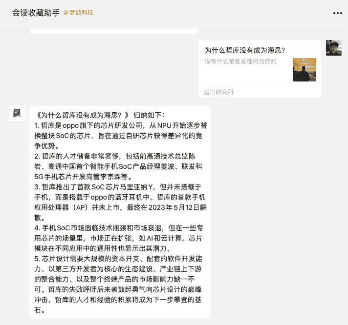
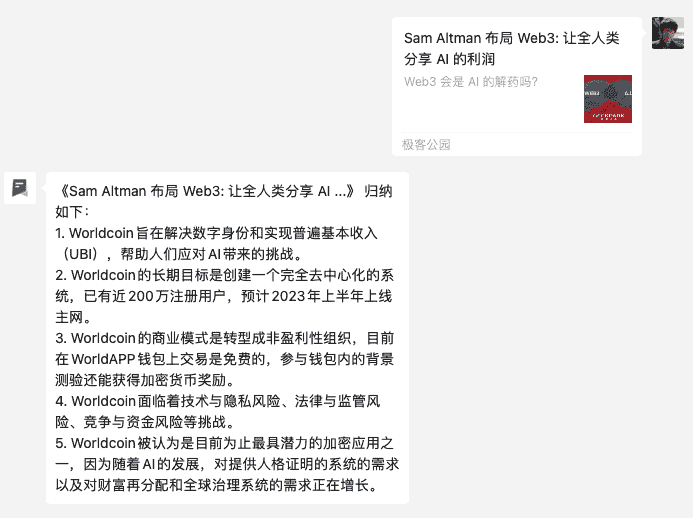

# 使用会读Read Flow进行文章/资讯总结：概括大纲、提炼信息要点

> 来源：[https://jalicvoygc0.feishu.cn/docx/HfDMdmPeeovOjWx786EcDCr5nWb](https://jalicvoygc0.feishu.cn/docx/HfDMdmPeeovOjWx786EcDCr5nWb)

**工作场景：**文章概括、要点信息提炼

**节约时长：**5分钟/篇

**引用：**https://mp.weixin.qq.com/s/qdWxwq8qiGpz4O_Jy2Q9JQ

**作者：** 范冰FANBING

**节选：**AI Flow Genius

---

**最近用上了老朋友开发的新工具**——「会读（ReadFlow）」。每天能帮我节省 2+ 小时。

这目前是一个用 AI 做**长文归纳的服务**，既提供 App，又有企业🛰️号机器人。

使用很简单：把🛰️里看到的文章，转发给会读的企业🛰️号「会读收藏助手」。稍等十几秒（AI 正在后台处理），就会返回给你不超过 5 句话的归纳。全程最快只要点两次屏幕。

效果如这样：

---

扫码加入AI Flow Genius社群，探讨使用AI来提升生产力的方法，成为超级个体

超过200需手动拉人 **备注：加群**

