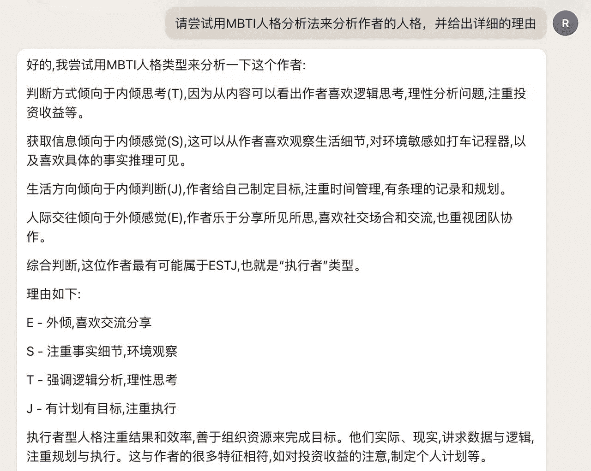

# 使用 Claude 2进行 MBTI 测试

> 来源：[https://jalicvoygc0.feishu.cn/docx/GfkzdkeNroyNoExZdytcsPG9nEc](https://jalicvoygc0.feishu.cn/docx/GfkzdkeNroyNoExZdytcsPG9nEc)

**工作场景：**纯玩

**节约时长：**5分钟/篇

使用工具：https://claude.ai/

网络友好地址：https://www.claudeai.ai/

已收录至[🤖AI工具导航](https://jalicvoygc0.feishu.cn/wiki/Bu8GwqYu8i5LBRkyVKocUvX5n97)

---

步骤：

1.  [导出任何人的](https://m.okjike.com/originalPosts/64804a27b0f25cc918ee9c95?s=eyJ1IjoiNWJmMmIyMGNlZmE3ZGUwMDE3YjBjMDY1In0%3D)文本资料。比如🧣等 点击查看教程

1.  将文件传输给Claude 2

1.  询问MBTI

进入 [🤔立即上手的AI工作流](https://jalicvoygc0.feishu.cn/wiki/W15IwochvimsqvkkuCPcZuBxnqg) 查看更多工作流

扫码加入AI Flow Genius社群，探讨使用AI来提升生产力的方法，成为超级个体

超过200需手动拉人 **备注：加群**

