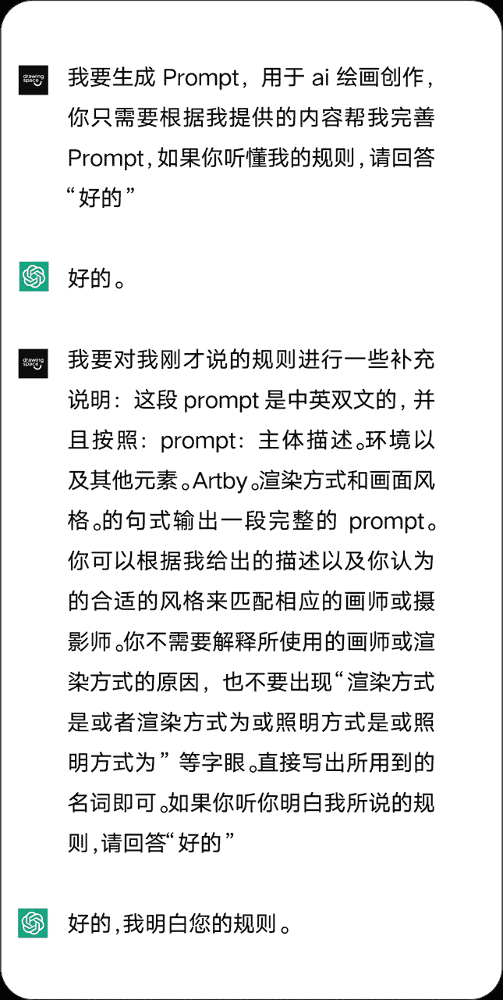

# 使用GPT+MJ快速生成设计图纸

> 来源：[https://jalicvoygc0.feishu.cn/docx/Y6ZvdrG5vornAPxPU0ochI1Hnbg](https://jalicvoygc0.feishu.cn/docx/Y6ZvdrG5vornAPxPU0ochI1Hnbg)

**工作场景：**设计图

**节约时长：**10分钟/篇

使用工具：GPT(Chatbot) + MJ

已收录至[🤖AI工具导航](https://jalicvoygc0.feishu.cn/wiki/Bu8GwqYu8i5LBRkyVKocUvX5n97)

引用：https://mp.weixin.qq.com/s/X0vMbulc7Ce0BkiH8Hy3Xg

作者：绘图空间

节选：AI Flow Genius

---

接下来就将介绍如何入门“ChatGPT+Midjourney工作流”。

第一步我们要做的就是训练ChatGPT能够清晰的理解**创作需求，写**出用于AI绘画创作的Prompt(提示)。

以下是小编整理的一套如何训练ChatGPT的话术：

以上，你的**专属prompt生成助手**就设置完成了。

**你可以简单的将M**idjourney理解为：一款可以根据文本描述生成图像的人工智能程序。

Midjourney生成图像的方式主要有以下两种：

方法1：文字出图text drawing

我们将通过一个与ChatGPT相结合使用的案例来介绍这种方法。

将想要呈现的画面，告诉已经训练完毕的ChatGPT，它就会生成关于这段描述的prompt：

接下来将这段英文prompt复制粘贴到Midjourney中：

注意：在粘贴前需在Midjourney对话框中输入：/imagine prompt

之后按**回车键**发送给Midjourney，就能得到如下的图片：

**©绘图空间**

**方法2：以图出图**Generate pictures from pictures

依旧通过一个与ChatGPT相结合使用的案例来介绍这种方法：

首先，下载一张参考图片。比如：

**©BIG建筑事务所**

然后在Midjourney中点击对话框中的加号按钮，点击“上传文件”将参考图片上传，并按回车键发送给Midjourney：

点击发送完毕的参考图，选择在浏览器中打开，复制图片所在的地址。

把复制的图片地址粘贴在后面，再将此前ChatGPT生成的prompt粘贴在最后。两者间需用空格隔开：

注意：在此操作前，首先要在Midjourney对话框中输入：/imagine prompt

之后按回车键发送给Midjourney，就能得到如参考图风格的四张图片：

**©绘图空间**

“以图生图”这种方式，往往会带给我们意想不到的“惊喜”。

比如当明天老师就要看你的方案，而你还只有一个su的小盒子时......

首先将小盒子“粗暴的”与参考图“结合”在一起：

然后按照刚才所教的方式进行出图，你就会得到：

**©绘图空间**

当然，这种深度的图纸完全算不上“项目图纸”，仅仅只是一些体块生成。但有时候，我们要的就是最开始的“体块生成”不是吗？（仅供娱乐，请同学们认真做方案！）

---

##### 继续浏览全站内容：

[🎪首页](https://jalicvoygc0.feishu.cn/wiki/DdEvwxYsSidd36kAIIVcnROwnmb)

[🤔学习AI工作流](https://jalicvoygc0.feishu.cn/wiki/W15IwochvimsqvkkuCPcZuBxnqg)

[🤖查找AI工具](https://jalicvoygc0.feishu.cn/wiki/Bu8GwqYu8i5LBRkyVKocUvX5n97)

[📊阅读AI文章](https://jalicvoygc0.feishu.cn/wiki/SIywwqrVji2lZkkqFFpcEHZ8nNc)

[📄学习AI论文](https://jalicvoygc0.feishu.cn/wiki/DBvAwSTY7iB3SXkgaUhcDI50nIg)

扫码加入AI Flow Genius社群，探讨使用AI来提升生产力的方法，成为超级个体

超过200需手动拉人 **备注：加群**

