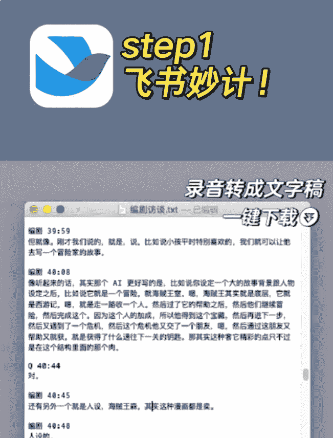
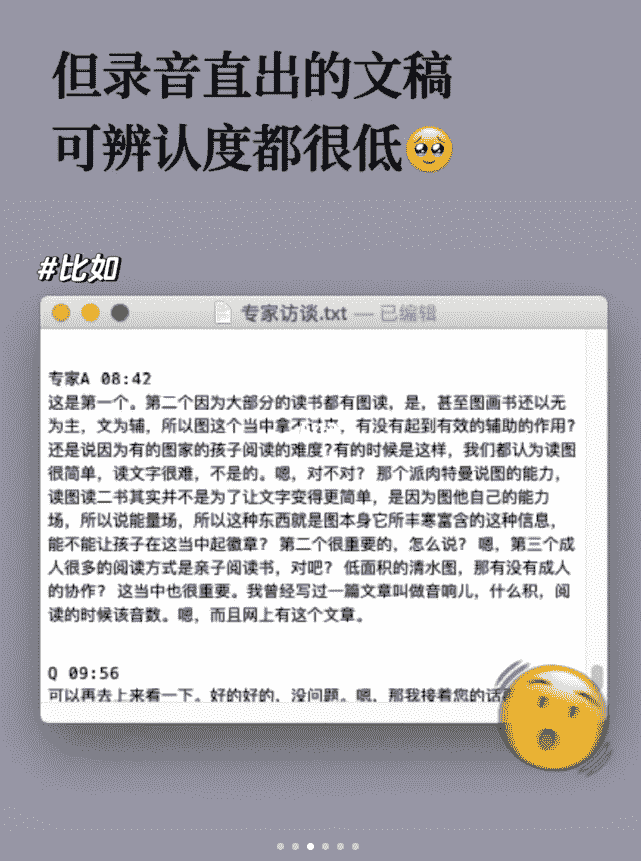
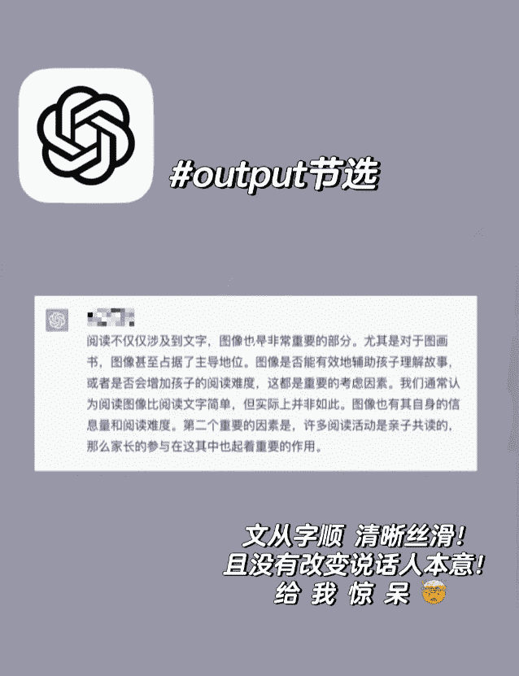

# GPT宝宝，你真应该来给我当实习生

> 来源：[https://jalicvoygc0.feishu.cn/docx/YeuRd0BZbo61JkxieEwcFhElnBg](https://jalicvoygc0.feishu.cn/docx/YeuRd0BZbo61JkxieEwcFhElnBg)

**工作场景：**会议纪要转写

使用工具：GPT(Chatbot) + 飞书妙计

已收录至[🤖AI工具导航](https://jalicvoygc0.feishu.cn/wiki/Bu8GwqYu8i5LBRkyVKocUvX5n97)

引用：GPT宝宝，你真应该来给我当实习生🥺

作者：床前的鹅

节选：AI Flow Genius

---

周工作原因做了几场高信息量的访谈

一般来说做好会议纪要即可

但是！

受访老师们专业度很高的时候就连呼吸都有它停顿的意义！贪心如我当然一句话都不想放过。

所以借此机会试出来一组非常实用的工作流

很简单哈哈哈！

step1:飞书妙计：录音音频转成文字稿。

step2: GPT ：投喂文字稿，改写通顺。

本来只是想随便试一下……

结果过于地丝滑了！

晚上加班倒饬这个的我，看着G老师一个一个蹦出来的字感动得想抱住电脑显示屏狂亲谁懂。

🧩 拿1个句子作为例子

飞书：对，就整体。对，现在还是比不上人血了。肯定，哈哈，差的。

GPT：对，整体来看，现在的AI还是比不上人类的创作能力。

然后一口气收拾完一小时的录音

生成的文稿就像杂志里那种Q&A

坠吊的是用比说话人更简洁结构化的句式，表达了他说话时的本意

---

##### 继续浏览全站内容：

[🎪首页](https://jalicvoygc0.feishu.cn/wiki/DdEvwxYsSidd36kAIIVcnROwnmb)

[🤔学习AI工作流](https://jalicvoygc0.feishu.cn/wiki/W15IwochvimsqvkkuCPcZuBxnqg)

[🤖查找AI工具](https://jalicvoygc0.feishu.cn/wiki/Bu8GwqYu8i5LBRkyVKocUvX5n97)

[📊阅读AI文章](https://jalicvoygc0.feishu.cn/wiki/SIywwqrVji2lZkkqFFpcEHZ8nNc)

[📄学习AI论文](https://jalicvoygc0.feishu.cn/wiki/DBvAwSTY7iB3SXkgaUhcDI50nIg)

扫码加入AI Flow Genius社群，探讨使用AI来提升生产力的方法，成为超级个体

超过200需手动拉人 **备注：加群**

