# 2023年新生代大模型 Agents 技术，ReAct、Self-Ask、Plan-and-execute，以及 AutoGPT、HuggingGPT 等应用

> 来源：[https://jalicvoygc0.feishu.cn/docx/A0rndbi8po6z17xa9C4cct1bnSc](https://jalicvoygc0.feishu.cn/docx/A0rndbi8po6z17xa9C4cct1bnSc)

引用：[2023年新生代大模型Agents技术,ReAct,Self-Ask,Plan-and-execute,以及AutoGPT, HuggingGPT等应用](https://zhuanlan.zhihu.com/p/642357544?utm_campaign=shareopn&utm_medium=social&utm_oi=1057761960568979456&utm_psn=1665092186784989184&utm_source=wechat_session&utm_id=0&s_r=0)

作者：是念 知乎

先简单的说一下，最近研究了大模型 Agents 的技术，其实本质上就是写 prompt，让模型仿照你的方式来进行执行的一种应用范式，prompt 里面包含一些 tools 的描述，然后我们可以根据模型的输出使用一些外部 tools（例如计算器、搜索 API、数据库、程序接口、各种模型的 API），能使用外部的 API、知识库，那大模型就厉害了，只要写好 prompt，几乎能干游戏、机器人控制、RPA 等所有的事情了。

Agent 可以访问一套工具（Tool），并根据用户输入确定要使用哪些工具。Agent 可以使用多个工具，并使用一个工具的输出作为下一个工具的输入。目前有两种类型的 Agents：

+ Action agents：在每个时间步长，使用所有先前操作的输出来决定下一个操作。
+ Plan-and-execute agents：预先决定完整的行动顺序，然后在不更新计划的情况下全部执行。

Action Agents 适合小型的任务，而 Plan-and-execute agents 更适合需要保持长期目标的复杂任务，通常最好的方法是通过让 Plan-and-execute agent 使用 Action agents 来执行计划，将 Action agents 的动态性与 Plan-and-execute agent 的计划能力相结合。

## Agent 类型

### ReAct

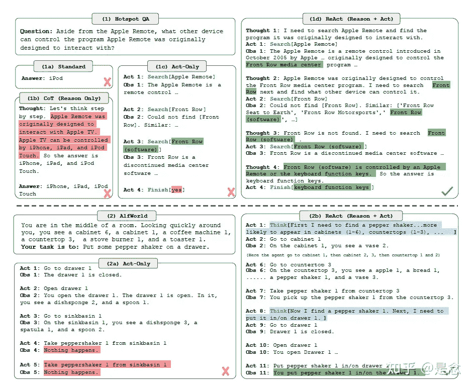

ReAct 本质上就是把融合了 Reasoning 和 Acting 的一种范式，推理过程浅显易懂，仅仅包含 thought-action-observation 步骤，很容易判断推理过程的正确性，使用 ReAct 做决策甚至超过了强化学习。上图显示的是四种 prompt 方法的比较：（1）第一种是标准的，第二种是 Chain-of-thought（仅推理），图 (c) 是仅执行，图 (d) 是 ReAct，解决了一个 HotpotQA 的问题；（2）比较了 Act-only 和 ReAct 的方法来解决 AlfWorld 游戏的问题。总之，Chain-of-thought 推理是一个静态的黑盒，它没有用到外部的知识，所以在推理过程中会出现事实幻想（fact hallucination）和错误传递（error propagation）的问题。Act-only 的方法很显然就是没有利用 LLM 的推理能力。ReAct 克服了思维链推理中普遍存在的幻觉和错误传播问题，通过与简单的维基百科 API 交互，生成类似于人的任务解决型轨迹，解释性进一步增强。

代码链接：[https://github.com/ysymyth/ReAct](https://github.com/ysymyth/ReAct)

论文链接：[ReAct: Synergizing Reasoning and Acting in Language Models](https://arxiv.org/abs/2210.03629)

### Self-ask

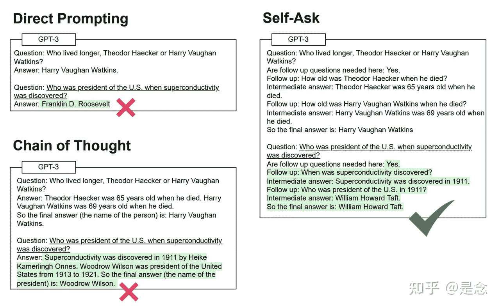

Self-ask 是一种 follow-up 的使用范式，仅仅包含 follow-up、immediate answer 步骤，至于 follow-up 多少个 step，完全由它自己决定，估计这就是 Self-ask 的名字的由来。如上图，白色背景的是 prompt，绿色背景的文本是 LM 的输出，下划线的是 inference-time 的问题。Self-ask 需要一个或者少量的 prompt 来演示如何回答的提示问题。我们的提示从这些例子开始，之后我们附加 inference-time question，然后在 prompt 的末尾插入短语 `Are follow up questions needed here:`，因为我们发现这样做会略微改善结果。然后模型输出一个响应。在大多数情况下，它首先输出“Yes”，这意味着后续行动问题是必要的。然后 LM 输出第一个 follow-up 问题，回答它，然后继续询问并回答 follow-up 问题，直到它决定有足够的信息为止。最终会输出 `So the final answer is:`，这使得最终答案可以很容易根据 `:` 解析出来。

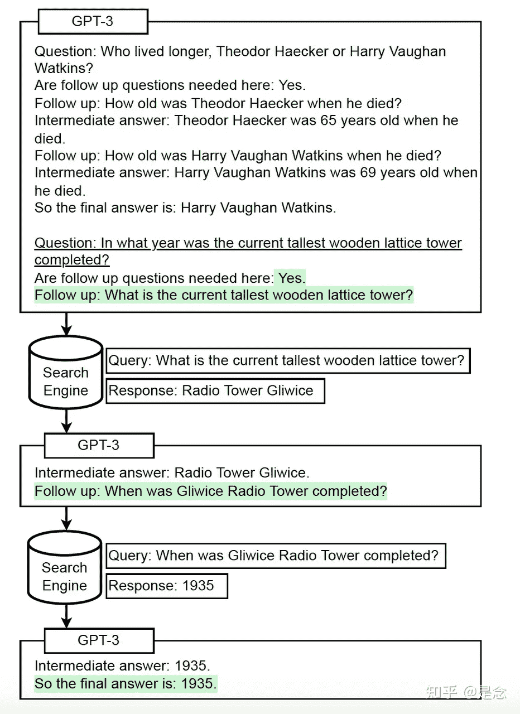

上面是 Self-ask 和搜索引擎结合的例子，开始会添加 few-shot prompt 和问题，然后 LM 产生 follow-up 问题，把问题输入到搜索引擎，得到返回结果，插入到该 prompt 之后，继续重复上面的动作，直到找到最终的答案为止。

代码链接：[GitHub - ofirpress/self-ask: Code and data for Measuring and Narrowing the Compositionality Gap in Language Models](https://github.com/ofirpress/self-ask)

论文链接：[Measuring and Narrowing the Compositionality Gap in Language Models](https://arxiv.org/abs/2210.03350)

### Plan-and-execute agents

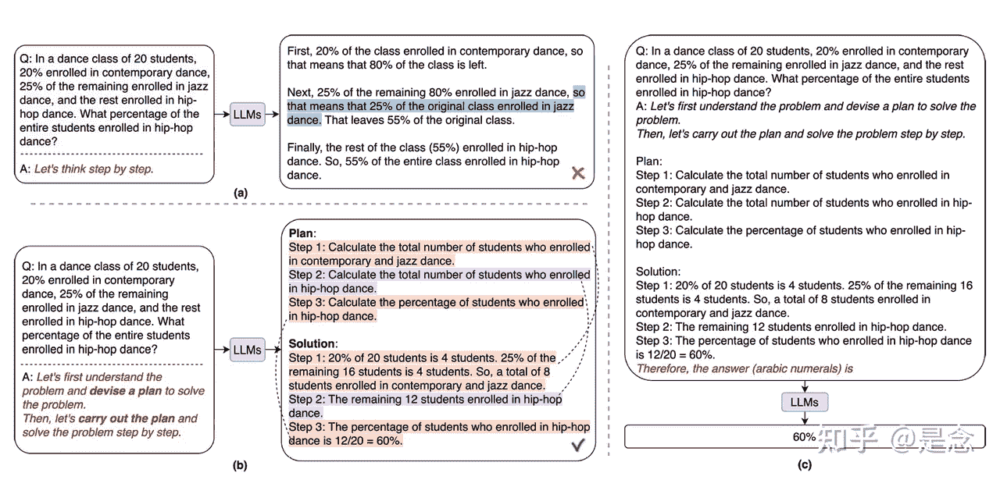

Plan-and-execute agents 这个方法本质上是先计划再执行，即先把用户的问题分解成一个个的子任务，然后再执行各个子任务，最后合并输出得到结果。做法也比较简单，prompt 的形式需要改变一下，前面的论文使用的是 `Let's think step by step`，在这里使用新的 prompt：`Let's first understand the problem and devise a plan to solve the problem. Then, let's carry out the plan and solve the problem step by step`。图 a 表示的是 Zero-shot-CoT Prompting，图 b 使用的是 Plan-and-Solve（PS）Prompting，图 (c) 显示的是 answer extracting prompting。Zero-shot-CoT 鼓励 LLM 生成多步骤用 `Let's think step by step` 进行推理，当问题复杂时，它仍然可能产生错误的推理步骤。与 Zero-shot-CoT 不同，PS 提示首先要求 LLM 设计一个计划，通过生成一个分步计划来解决问题，并执行计划以找到答案。

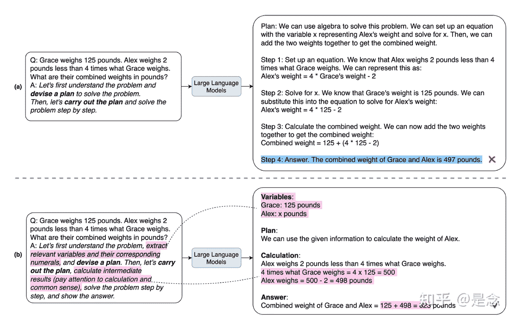

GPT-3 的示例输入和输出：(a) Plan-and-Solve (PS) Prompting 和 (b) Plan-and-Solve Prompting with more detailed instructions (PS+ Prompting)。PS+ 提示大大提高生成推理过程的质量。

论文链接：[Plan-and-Solve Prompting: Improving Zero-Shot Chain-of-Thought Reasoning by Large Language Models](https://arxiv.org/abs/2305.04091)

代码链接：[GitHub - AGI-Edgerunners/Plan-and-Solve-Prompting: Code for our ACL 2023 Paper - Plan-and-Solve Prompting: Improving Zero-Shot Chain-of-Thought Reasoning by Large Language Models](https://github.com/AGI-Edgerunners/Plan-and-Solve-Prompting)

## 应用方向

Agents 的应用可以分为 simulations、自动化的 Agents、跨模态 Agents，下面就这几个方向介绍一下。

### Agent simulations

Agent simulation 包括一个或多个 Agent 相互作用。Agent 模拟通常包括两个主要组件：

1. 长期记忆
2. 模拟环境

比较典型的应用是 Generative Agents、CAMEL。Generative Agents 讲的是在一个沙箱环境里，创建了 25 个 Agents，用户可以作为 Agents 观察和干预他们的日常计划、分享新闻、建立关系和协调团队活动。Generative agents 的结构如图所示，Agents 感知他们的环境，所有感知都保存在 Agents 经验的综合记录中，成为 memory stream。基于他们的感知，体系结构检索相关 memory，然后使用这些检索到的动作来确定动作。这些检索到的记忆也被用来形成更长期的规划，并创建更高层次的反射（higher-level reflections），这两种反射都被输入到内存流中以供将来使用。

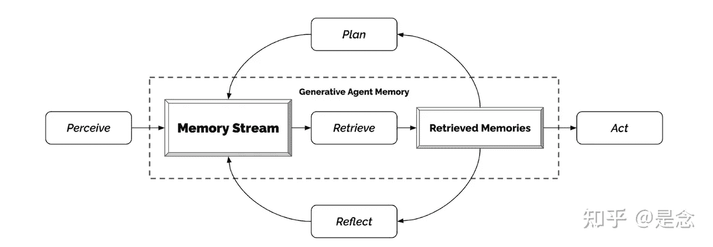

CAMEL 是一个 Role-Playing 框架，使多个智能体能够进行对话并合作解决分配的任务，比如论文的例子开发股票交易机器人。这个任务是一个人工智能助理 Agent，他是一个 Python 程序员，而人工智能用户 Agent 是一名股票交易员。在人类用户输入结束后，任务加工器（`Task Specifier`）会把任务具体化，比如可以通过对社交网络平台上特定股票进行情感分析，然后根据情感分析的结果进行股票交易。当任务被具体化后，两个基于 ChatGPT 的 AI 智能体开始合作完成任务，比如进行工具的安装和导入。

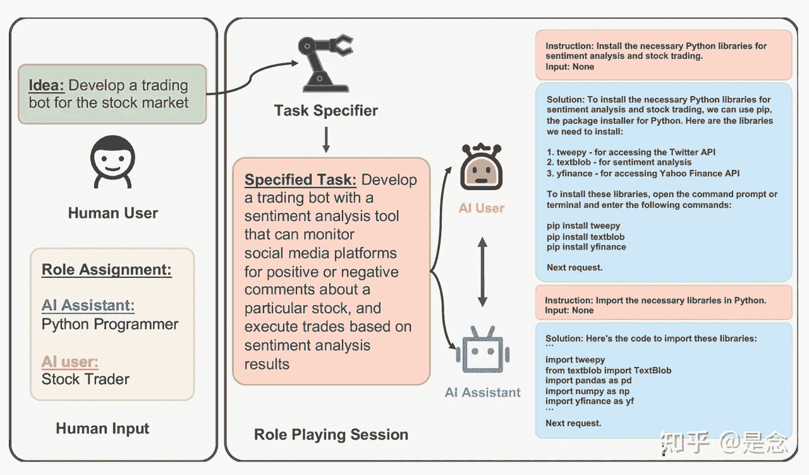

### 自动化的 Agents

自动化 Agents 是设计为运行时间更长的代理。你给他们一个或多个长期目标，他们独立地执行这些目标。这些应用程序结合了工具使用和长期内存。典型的有 AutoGPT、BabyAGI。AutoGPT 以 LLM 作为主控制器来建立 AI Agents，AutoGPT 使用了许多代码来解析数据格式，以帮助 AI Agents 更好地理解和处理自然语言输入，目前还处于试验的阶段。AutoGPT 的核心逻辑是一个 Prompt Loop，步骤如下：

1. AutoGPT 会基于一定策略自动组装 `Command Prompt`，这些首次会包含用户输入的 `Name`、`Role` 和 `Goals`。
2. `Command Prompt` 的目标不是为了拿到最终结果，而是通过 `GPT Chat API`（Thinking 的过程）返回下一步的 `Command`（包含 `name` 和 `arguments`，如 `browser_website(url = "www.baidu.com")`）。
3. 这些 `Command` 都是可扩展的，每一种命令代表一种外部能力（比如爬虫、Google 搜索，也包括 GPT 的能力），通过这些 `Command` 调用返回的 `Result` 又会成为 `Command Prompt` 的组成元素。
4. 回到第 1 步往复循环，直到拿到最终结果（状态为 `compelete`）。

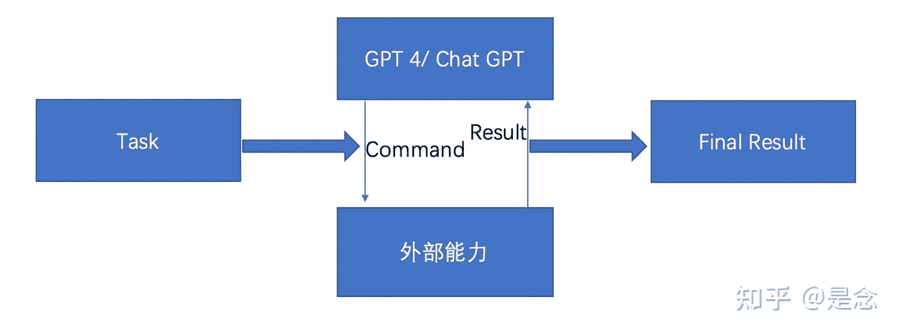

BabyAGI 用于执行设定的 task 集合，另外，在执行过程中会产生新的 task，它会重新进行优先级排序，然后继续进行执行。下面的图显示的是 BabyAGI 的 steps 的执行：

1. 从任务列表中提取第一个任务。
2. 将任务发送给执行 agent，执行 agent 使用 OpenAI 的 API 根据上下文完成任务。
3. 丰富结果，并存储在 Chroma/Weaviate 中。
4. 创建新任务，并根据上一任务的目标和结果重新确定任务列表的优先级。

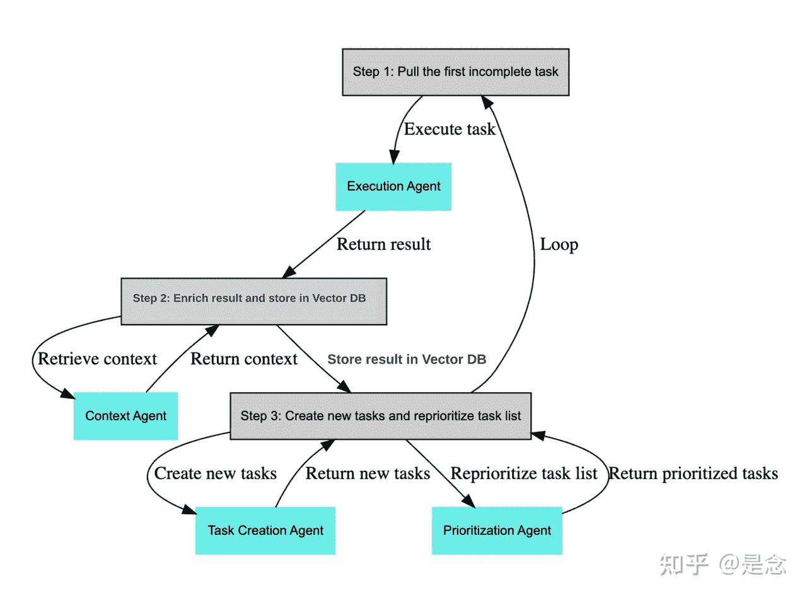

### 跨模态 Agents

Agents 不仅可以处理纯文本的信息，还可以拓展到多模态来完成图像、语音、视频的交互。典型的应用有 Visual ChatGPT、AssistGPT、HuggingGPT。Visual ChatGPT 的思路是使用 ChatGPT 调用视觉模型来迭代地完成图像编辑的任务。如下图，用户上传了一张黄色的向日葵的图片，输入了一个复杂的语言说明（language instruction）：`please generate a red flower conditioned on the predicted depth of this image and then make it like a cartoon, step by step`。在 `Prompt Manager` 的作用下，Visual ChatGPT 开始了一个与视觉基础模型相关的链式执行操作。在这个例子中，先做深度估计，然后使用 depth-to-image 模型生成一朵红色的花，然后根据扩散模型做风格转换，把图片转换成一个卡通风格的图片。在这个过程中，`Prompt Manager` 作为一个调度器来使用，提供视觉输入的类型和记录信息转换的操作。最终，Visual ChatGPT 得到 `cartoon` 的提示，它会终止执行 pipeline，然后得到结果。

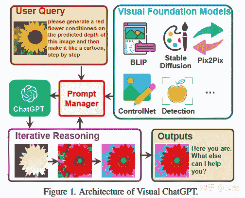

AssistGPT 的思路是使用 ReAct 的方式，调用视觉的 tools 来理解多模态的内容。AssistGPT 系统包含四部分：`Planner`：控制整个推理过程；`Executor`：执行外部工具，并把反馈返回给 `Planner`；`Inspector`：管理输入和中间结果；`Learner`：评估系统性能并记录成功的试验，如上下文示例所示。AssistGPT 可以使用交错语言和代码格式（可能不太好懂，可以看看下图 `Action` 里面长得像代码的部分，类似这样的）进行推理，给定查询输入和视觉输入，AssistGPT 规划解决问题的路径，使用结构化代码调用各种强大的工具。`Inspector` 可以管理可视化输入和中间结果，帮助 `Planner` 调用工具。同时 `Learner` 可以评估推理过程并收集上下文中的例子。

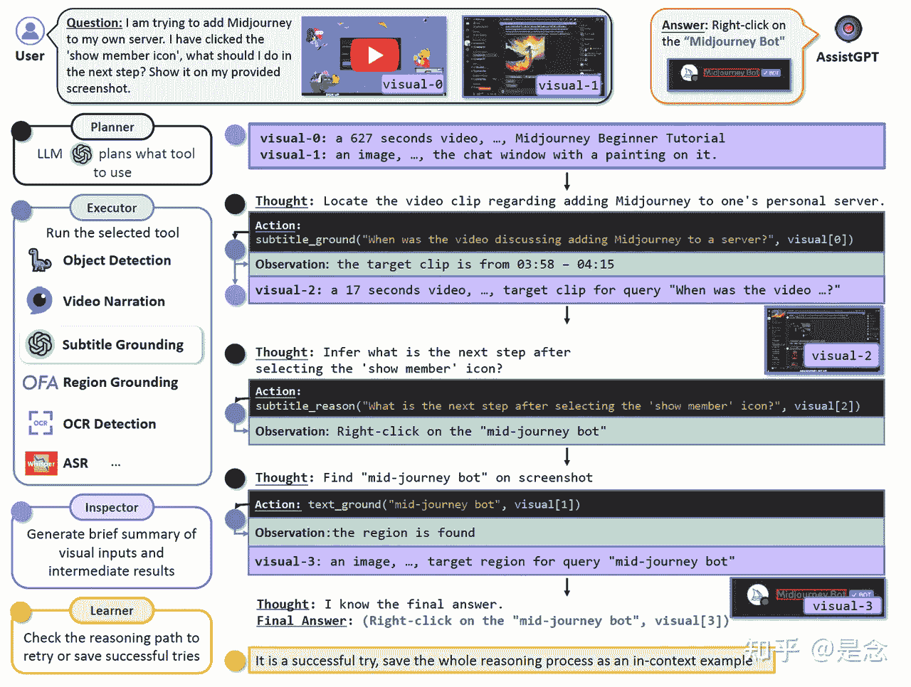

上面的例子偏向于讲解，我们再看看几个例子，把这几个例子看懂，就知道 AssistGPT 的工作原理了。

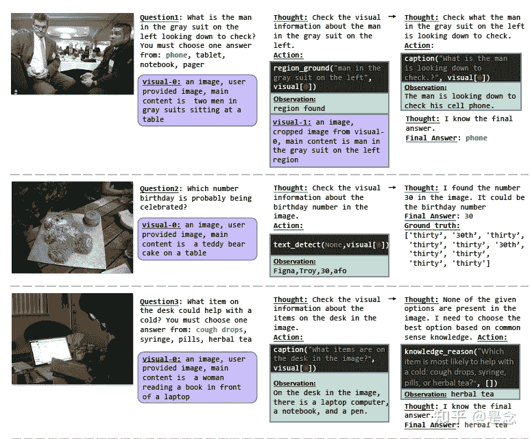

HuggingGPT 把 LLM 作为一个控制器，用于管理和组织这些专家模型（HuggingFace 的文生图、图生文、目标检测等模型）。LLM 首先会根据用户的请求规划一个任务清单，然后给每个任务指派一个专家模型，专家模型执行完毕以后，LLM 收集结果并返回给用户。HuggingGPT 的总体架构图如下图所示，LLM 作为核心的控制器，模型作为执行器，HuggingGPT 的执行分为四个阶段：1）任务规划（Task Planning）：LLM 把用户的请求分解成任务集合，决定执行的顺序和任务之间的资源依赖；2）模型选择（Model Selection）：根据 HuggingFace 的模型的描述，LLM 把合适的模型安排给任务；3）任务执行（Task Execution）：模型执行指派的任务；4）响应生成（Response Generation）：LLM 集合专家的结果，生成一个 workflow 日志的摘要返回给用户。

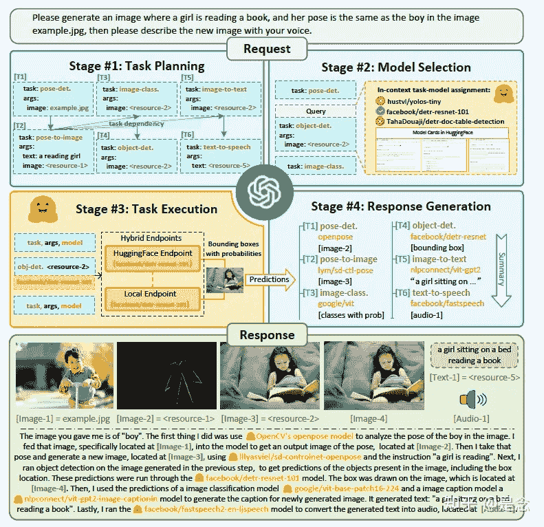

## 热门开源项目

关于 Agents 项目，最典型的就是 LangChain、AutoGPT、BabyAGI、HuggingGPT，其中 LangChain 是功能最全的应用框架，其他的可以认为是 LangChain 的一个衍生品，即用 LangChain 就可以实现，接下来我们就介绍一下 LangChain。

### LangChain

LangChain是一个用于开发基于语言模型的应用程序开发框架，依赖于LLM，但是只是调用，并不会集成LLMs，它的核心理念是为各种LLMs实现通用的接口，把LLMs相关的组件“链接”在一起，简化LLMs应用的开发难度，方便开发者快速地开发复杂的LLMs应用。简单的理解，就是一个空壳，把LLM放进去就能运转了。

一个LangChain应用是通过很多个组件实现的，LangChain主要支持6种组件：

+ Models：模型，各种类型的模型和模型集成，比如GPT-4
+ Prompts：提示，包括提示管理、提示优化和提示序列化
+ Memory：记忆，用来保存和模型交互时的上下文状态
+ Indexes：索引，用来结构化文档，以便和模型交互
+ Chains：链，一系列对各种组件的调用
+ Agents：代理，决定模型采取哪些行动，执行并且观察流程，直到完成为止

AutoGPT，BabyAGI这些衍生的项目，都可以认为是LangChain的Agents一个泛化。

## 局限性

### 1.依赖于LLM

Agent的所有的衍生技术都严重依赖于LLM的能力，所以一个Agents的好坏，也要看这个LLM优化的是否到位。

### 2.效率

一般Agent作为一个Controller，需要多次运行和与外界进行交互，本身LLM的模型消耗资源就很大，因此一般Agents的系统运行效率都不会太高。

### 3.Token Lengths长度限制

另一个通用的问题就是LLM的输入会有长度限制，一般是2048，4096等等，总之都是有限的，我们在做Agent的轮次就不会太长，这会限制Agents来解决更复杂问题的能力。

### 4.不稳定性

总体上，LLM的输出还是不可控的，会在有时候不遵循instruction，然后开始胡说八道的情况，这会导致Agents的运行出现异常。

-END-

扫码加入AI Flow Genius社群，探讨使用AI来提升生产力的方法，成为超级个体

超过200需手动拉人 **备注：加群**

