# GPT现状终于有人讲清楚了！OpenAI大牛最新演讲爆火，还得是马斯克钦点的天才

> 来源：[https://jalicvoygc0.feishu.cn/docx/B5XIdhui9o919lx0To2cmIS7nO3](https://jalicvoygc0.feishu.cn/docx/B5XIdhui9o919lx0To2cmIS7nO3)

引用**：****https://mp.weixin.qq.com/s/m7**07JQtGtdIdCOqW3fN8eA

**作者：西风**

**继Win**dows Copilot发布后，微软Build大会热度又被一场演讲引爆。

前特斯拉AI**总监An****drej**** Karpathy在演讲中**认为思维树（tre**e of thoughts**）与AlphaGo的蒙特卡洛树搜索（MCTS）有异曲同工之妙！

网友高呼：这是关于如何使用大语言模型和GPT-4模型的最详尽有趣的指南！

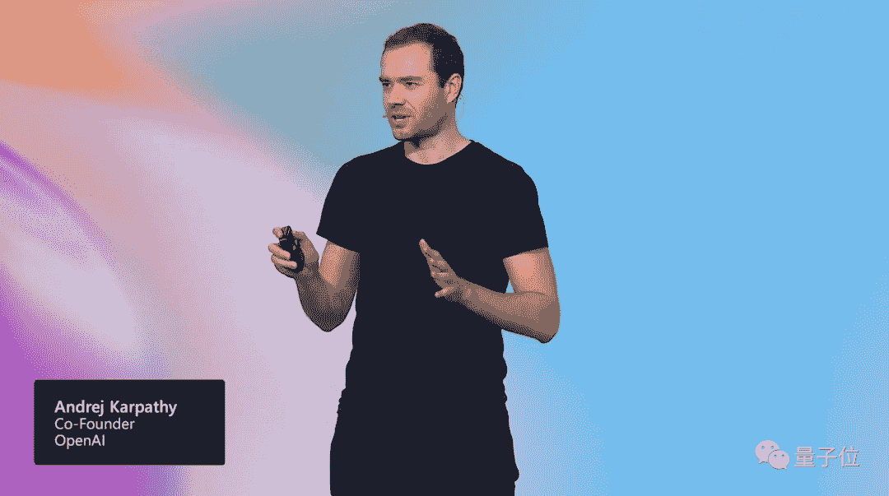

此外Karpathy透露，由于训练和数据的扩展，LLAMA 65B“明显比GPT-3 175B更强大”，并介绍了大模型匿名竞技场ChatBot Arena:

> Claude得分介于ChatGPT 3.5和ChatGPT 4之间。

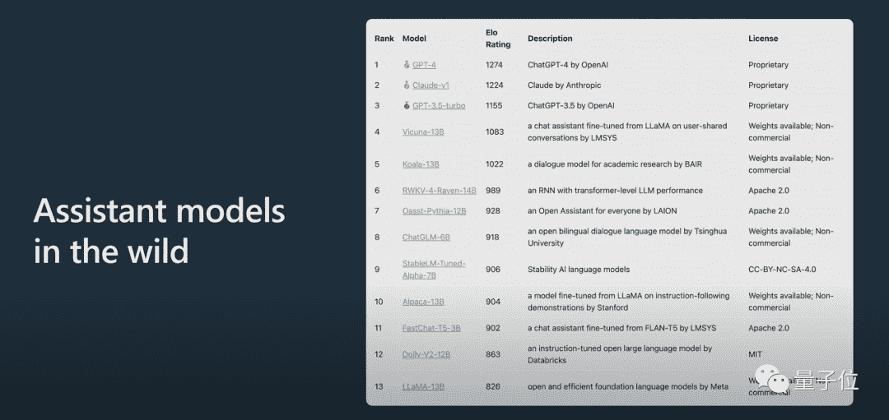

网友表示，Karpathy的演讲一向很棒，而这次的内容也一如既往没有令大家失望。

随着演讲而爆火的，还有推特网友根据演讲整理的一份笔记，足足有31条，目前转赞量已超过3000+：

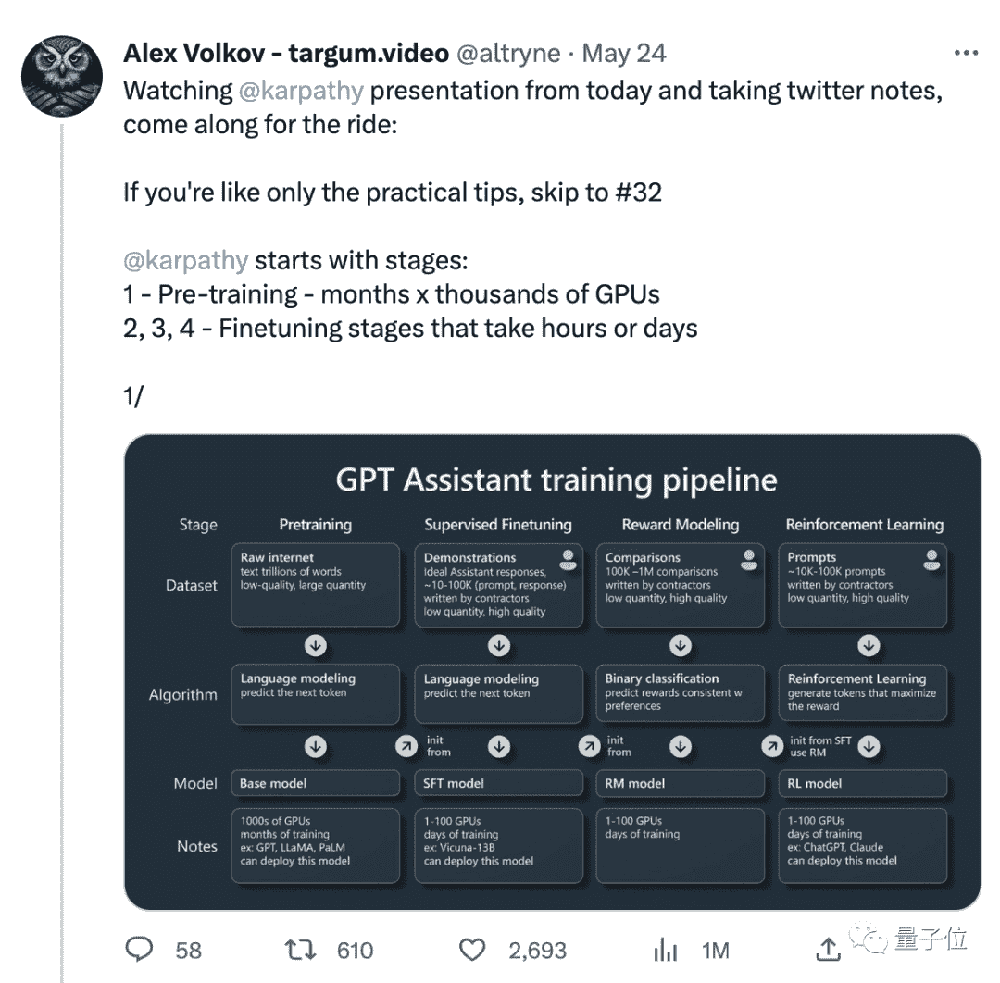

所以，这段备受关注的演讲，具体提到了哪些内容呢？

## **如何训练****GPT****助手？**

Karpathy这次的演讲主要分为两个部分。

**第一部分**，他讲了如何训练一个“GPT助手”。

Karpathy主要讲述了AI助手的四个训练阶段：

预训练（pre-training）、监督微调（supervised fine tuning）、奖励建模（reward modeling）和强化学习（reinforcement learning）。

每一个阶段都需要一个数据集。

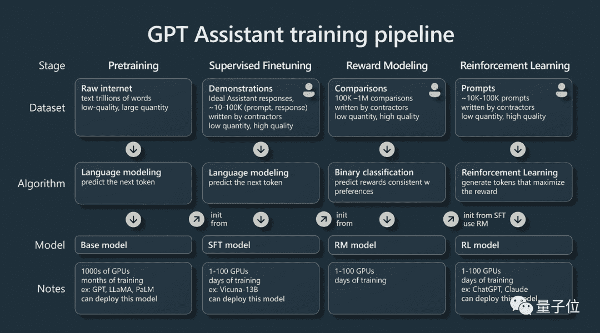

在预训练阶段，需要动用大量的计算资源，收集大量的数据集。在大量无监督的数据集上训练出一个基础模型。

Karpathy用了更多例子作补充：

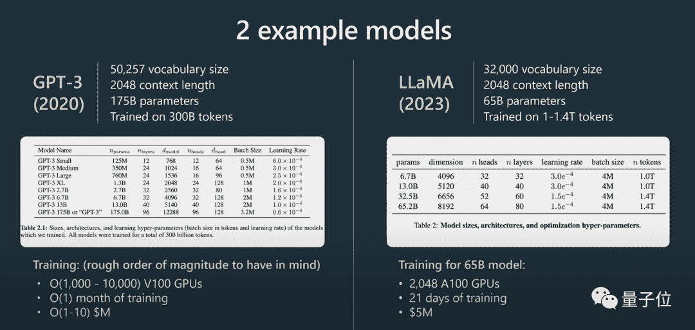

接下来进入微调阶段。

使用较小的有监督数据集，通过监督学习**对这个基**础模型进行微调，就能创建一个能够回答问题的助手模型。

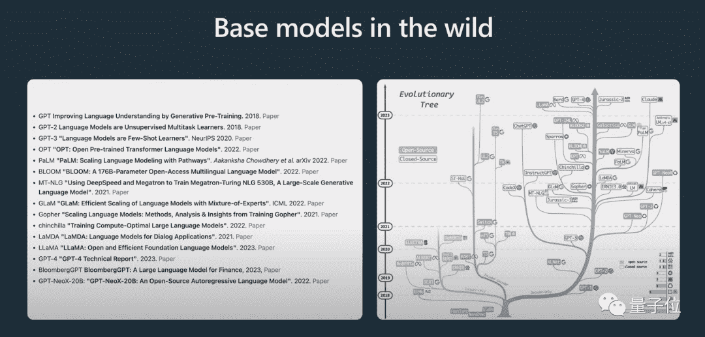

他还展示了一些模型的进化过程，相信很多人之前已经看过上面这张“进化树”的图了。

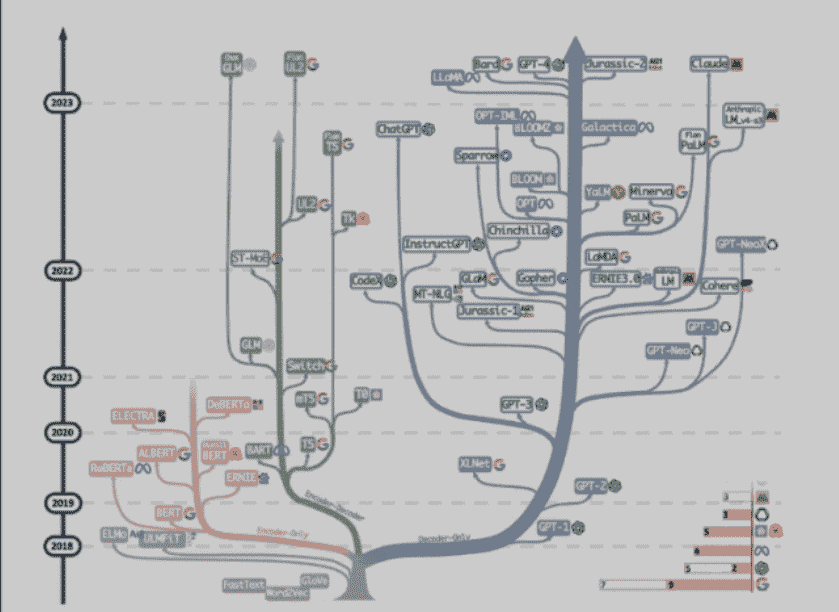

Karpathy认为目前最好的开源模型是Meta的LLaMA系列（因为OpenAI没有开源任何关于GPT-4的内容）。

在这里需要明确指出的是，**基础模型不是助手模型**。

虽然基础模型可以回答问题，但它所给出的回答并不可靠，可用于回答问题的是助手模型。在基础模型上进行训练的助手模型，通过监督微调，在生成回复和理解文本结构方面的表现将优于基础模型。

在训练语言模型时，强化学习是另一个关键的过程。

通过用人工标记的高质量的数据进行训练，可以使用奖励建模来创建一个损失函数，以改善其性能。然后，通过增加正向的标记，并降低负面标记的概率，来进行强化训练。

而在具有创造性的任务中，利用人类的判断力对于改进AI模型至关重要，加入人类的反馈可以更有效地训练模型。

经过人类反馈的强化学习后，就可以得到一个RLHF模型了。

模型训练好了，接下来就是如何有效利用这些模型解决问题了。

## **如何更好地使用模型？**

在**第二部分**，Karpathy主要讨论了提示策略、微调、快速发展的工具生态系统以及未来的扩展等问题。

Karpathy又给出了具体示例来说明：

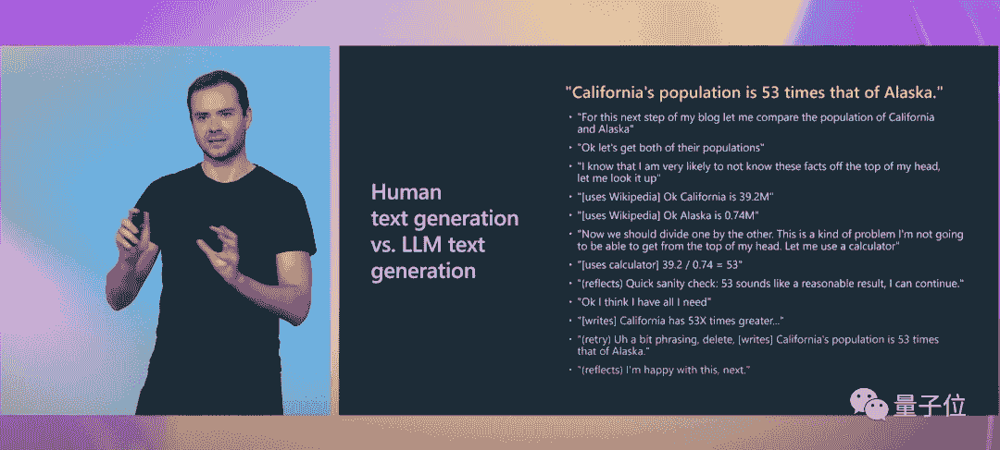

> 当我们在写文章时候，我们会进行很多的心理活动，需要考虑自己的表述是否正确。而对于GPT来说，这只是一个序列标记（a sequence of tokens）。

而**提示（prompt）**可以弥补这种认知差异。

Karpathy进一步解释了**思维链**提示的工作方式。

对于推理问题，要想让自然语言处理中Transformer的表现更好，需要让它一步一步地处理信息，而不能直接抛给它一个非常复杂的问题。

> 如果你给它几个例子，它会模仿这个例子的模版，最终生成的结果会更好。

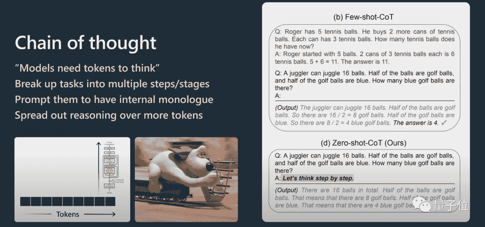

模型只能按照它的序列来回答问题，如果它生成的内容是错误的，你可以进行提示，让它重新生成。

> 如果你不要求它检查，它自己是不会检查的。

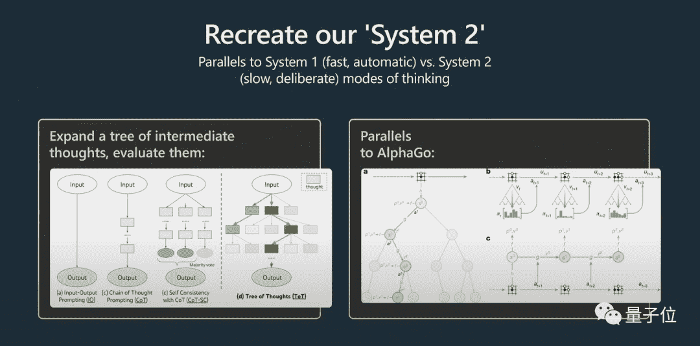

这就涉及到了System1和System2的问题。

诺贝尔经济学奖得主丹尼尔卡尼曼在《思考快与慢》中提出，人的认知系统包含System1和System2两个子系统。System1主要靠直觉，而System2是逻辑分析系统。

通俗来说，System1是一个快速自动生成的过程，而System2是经过深思熟虑的部分。

这在最近一篇挺火的论文“Tree of thought”（思维树）中也有被提及。

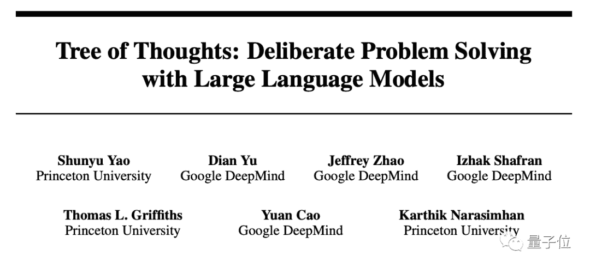

深思熟虑指的是，不是简单的给出问题的答案，而更像是与Python胶水代码一起使用的prompt，将许多prompt串联在一起。模型必须要维护多个提示，还必须要执行一些树搜索算法，来找出要扩展的提示。

Karpathy认为这种思路与AlphaGo非常相似：

> AlphaGo在下围棋时，需要考虑下一枚棋子下在哪里。最初它是靠模仿人类来学习的。

> 但除此之外，它还进行了蒙特卡洛树搜索，可以得到具有多种可能性的策略。它可以对多种可能的下法进行评估，仅保留那些较好的策略。我认为这在某种程度上相当于AlphaGo。

对此，Karpathy还提到了AutoGPT：

> 我认为目前它的效果还不是很好，我不建议大家进行实际应用。我只是认为，随着时间的推移，我们或许可以从它的发展思路中汲取灵感。

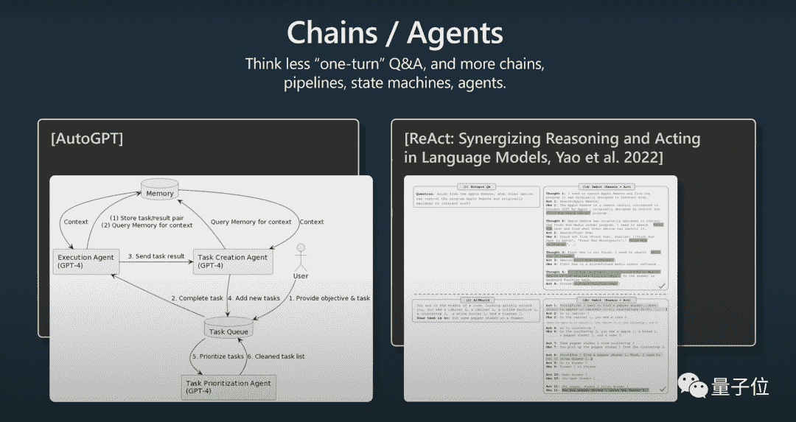

其次，还有一个小妙招是检索增强生成（retrieval agumented generation）和有效提示。

窗口上下文的内容就是transformers在运行时的记忆（working memory），如果你可以将与任务相关的信息加入到上下文中，那么它的表现就会非常好，因为它可以立即访问这些信息。

简而言之，就是可以为相关数据建立索引让模型可以高效访问。

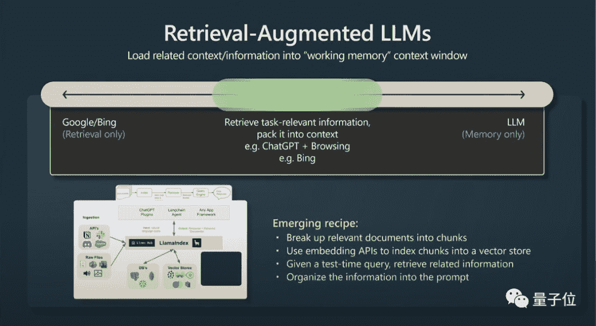

如果Transformers也有可参考的主要文件，它的表现会更好。

最后，Karpathy简单讲了一下在大语言模型中的约束提示（Constraint prompting）和微调。

可以通过约束提示和微调来改进大语言模型。约束提示在大语言模型的输出中强制执行模板，而微调则调整模型的权重以提高性能。

> 我建议在低风险的应用中使用大语言模型，始终将它们与人工监督相结合，将它们看作是灵感和建议的来源，考虑copilots而不是让它们完全自主代理。

## 关于Andrej Karpathy

Andrej Karpathy博士毕业后的第一份工作，是在OpenAI研究计算机视觉。

后来OpenAI联合创始人之一的马斯克看上了Karpathy，把人挖到了特斯拉。但也因为这件事，马斯克和OpenAI彻底闹翻，最后还被踢出局。在特斯拉，Karpathy是Autopilot、FSD等项目的负责人。

今年二月份，在离开特斯拉7个月后，Karpathy再次加入了OpenAI。

最近他发推特表示，目前对开源大语言模型生态系统的发展饶有兴趣，有点像早期寒武纪爆发的迹象。

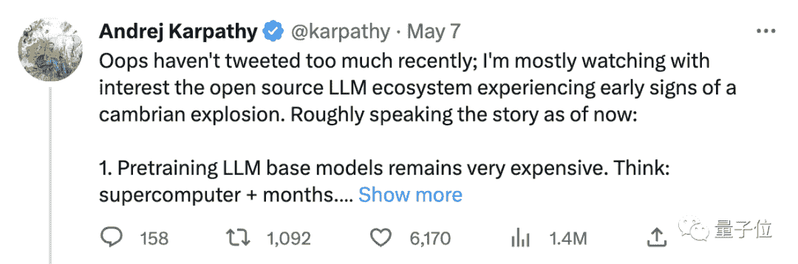

传送门：

[1]https://www.youtube.com/watch?v=xO73EUwSegU（演讲视频）

[2]https://arxiv.org/pdf/2305.10601.pdf（“Tree of thought”论文）

参考链接：

[1]https://twitter.com/altryne/status/1661236778458832896

[2]https://www.reddit.com/r/MachineLearning/comments/13qrtek/n_state_of_gpt_by_andrej_karpathy_in_msbuild_2023/

[3]https://www.wisdominanutshell.academy/state-of-gpt/

— **完** —

扫码加入AI Flow Genius社群，探讨使用AI来提升生产力的方法，成为超级个体

超过200需手动拉人 **备注：加群**

