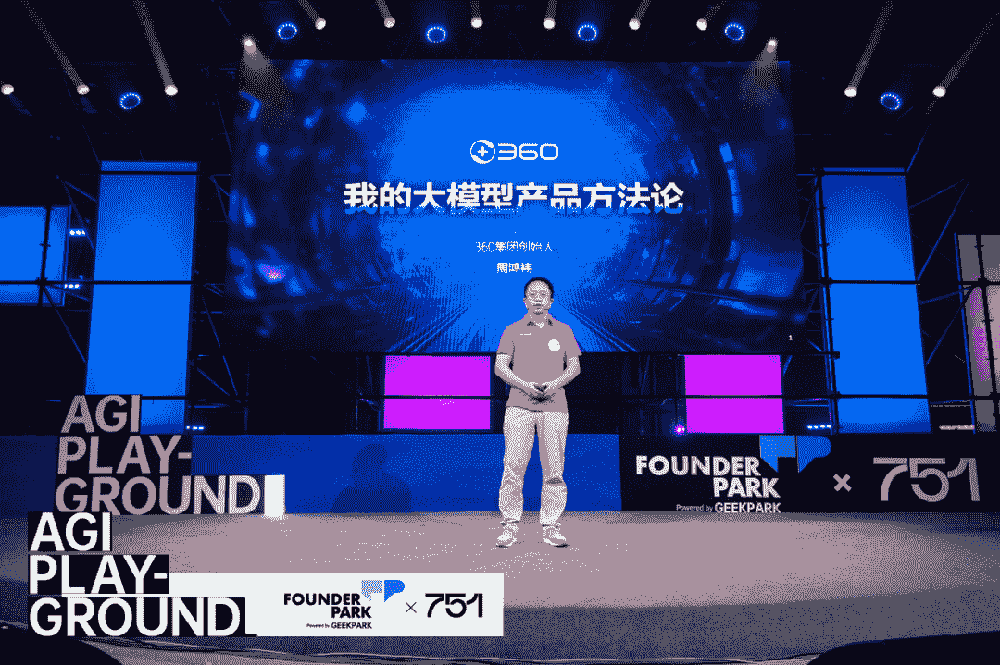
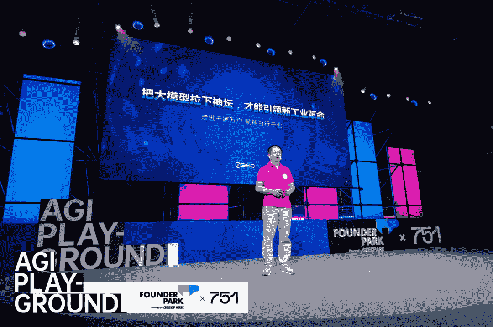
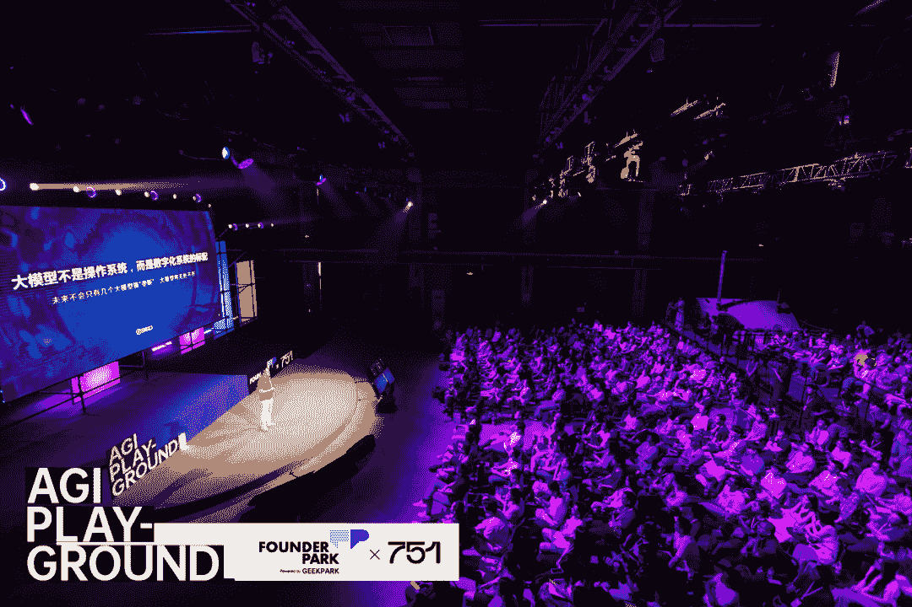
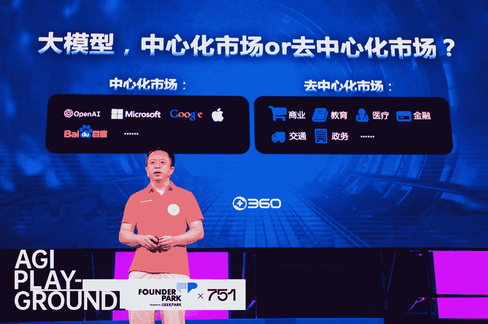
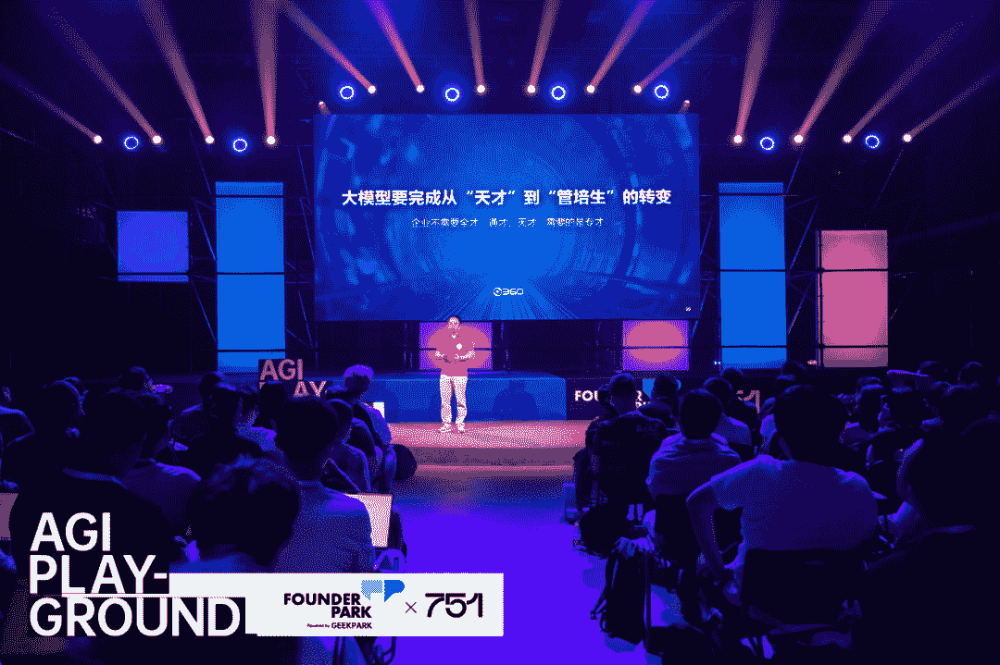
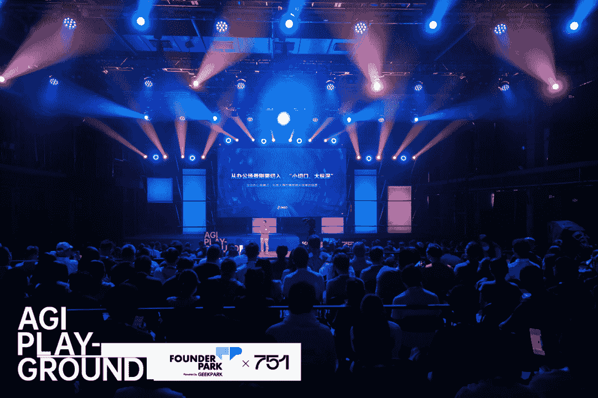
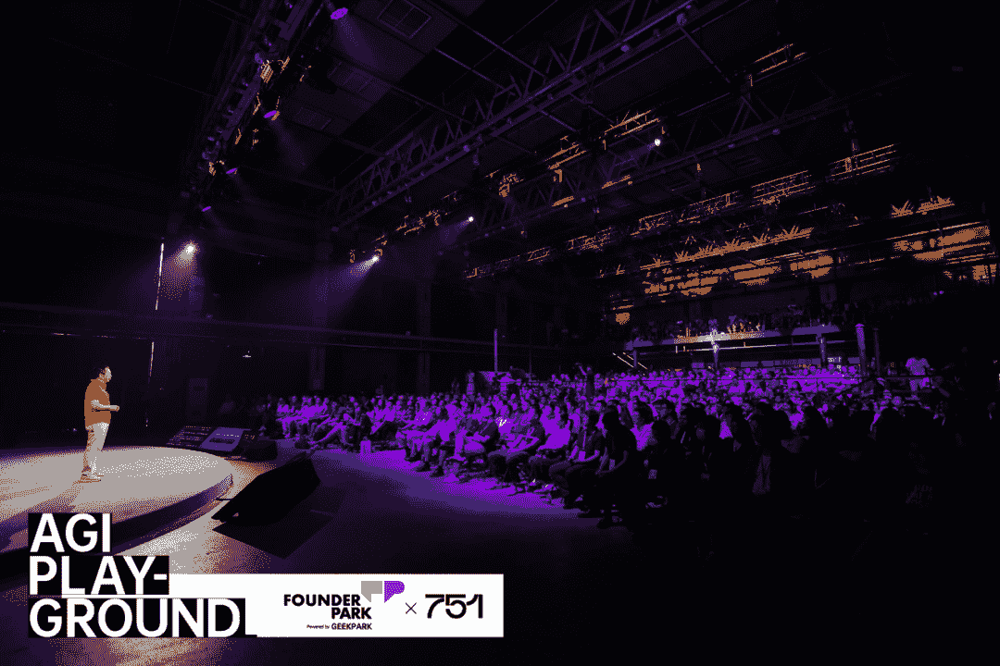
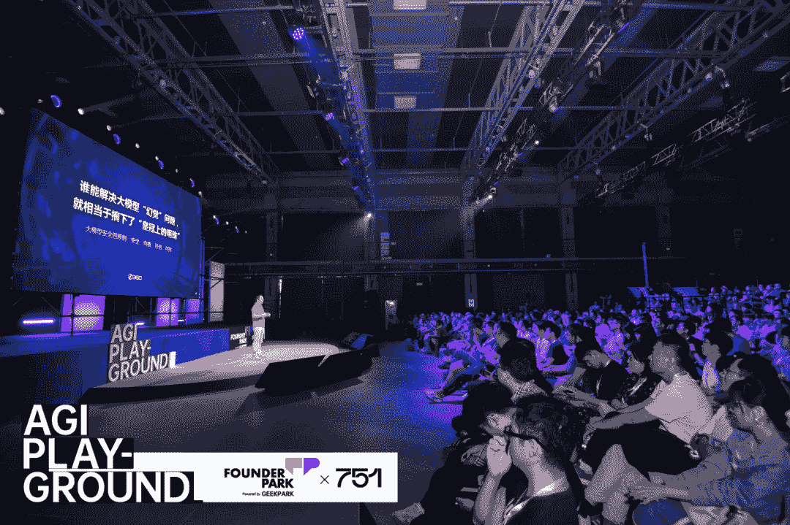

# 360 周鸿祎：大模型不是「原子弹」，而是「AK47」

> 来源：[https://jalicvoygc0.feishu.cn/docx/A6WCdF4ANoGLlkxqkeBcDYYBnnb](https://jalicvoygc0.feishu.cn/docx/A6WCdF4ANoGLlkxqkeBcDYYBnnb)

引用：https://mp.weixin.qq.com/s/aVBIwY4DnPdfel76ofwj8w

作者：周鸿祎、Li Yuan、siqi（整理）

垂直大模型，是创业者的「金光大道」。

**

作者 |**** L****i Yuan、siq****i

编辑 | **靖宇

大模型是短暂的风口还是工业革命？是操作系统还是个人电脑？是原子弹还是 Ak47？

自大模型去年强势进入人们的视野以来，人们在试图理解大模型的过程中，不断为大模型添加不同的比喻。不同的创业者对此也有着不同的答案。7 月 23 日，在极客公园主办的 AGI  Playground 大会上，360 集团创始人，也是通过自研通用大模型「360 智脑」亲自下场，参与了本场大模型创业浪潮的周鸿祎给出了自己的答案。周鸿祎一向以十分敢说而著名，本场演讲中更是金句频出：「创业需要把大模型拉下神坛。」「不要等到大模型无所不能才开始做，只要想清楚了就可以开始干了。」「在企业里面做大模型，我们要忘掉 ChatGPT 这个榜样。」周鸿祎在演讲中表示，大模型是一场五到十年的风口，有引发一场新的工业革命的潜质。而大模型的未来绝对不像曼哈顿计划，是尖端科学家和几亿人民币才能训练出的原子弹，而一定像是 AK47，价格便宜，火力足，分量够。而在周鸿祎眼中，创业者目前最好的「瞄准技巧」就是面向 B 端市场。周鸿祎谈到，「现在创业者应该做什么？做垂直大模型。我们讲创业方法论，创业团队要算力没算力，要钱也不够多，要人才也不够厚。跟这些巨头竞争相比，你唯一的机会是把你所有的资源聚焦在一根针上，才能形成非常大的压强。垂直大模型，是创业者的『金光大道』。」以下是周鸿祎在 AGI Playground 大会上的演讲全文，经极客公园节选整理：

# **01**

**大模型****没有垄断**

今天的演讲题目叫「我的大模型产品方法论」，是我自己的一些经验和体会。最近有人开始唱衰大模型，但我觉得作为创业者，一定要站在现在看未来。如果站在现在看过去，我们能挑出大模型的很多毛病，但如果用发展的眼光来看，我相信大模型代表了未来一次工业革命的机会。曾经有人说风口来的时候猪都在天上飞，我们也经历了 AI、元宇宙、web3，但是我可以肯定：这次大模型不是风口和泡沫。即使是风口，我觉得这个风怎么也得吹五年到十年。所以对在座的创业**者**来说，我觉得应该还有十年的红利期。大模型有引发工业革命的潜质。我们以电脑的发展为例：电脑在 1946 年被发明的时候，也没有立刻引发工业革命。当时，它只被气象局、研究核物理的军方等少数单位使用。电脑真正引发工业革命，应该是比尔·盖茨、乔布斯等人躬身入局，发明了个人电脑。虽然当时大公司的人看不上个人电脑，但 PC 最大的好处就是每个人都用得起，每个公司都买得起。而且在通用的硬件架构上加上不同软件，就使得它能解决每个人生活工作中方方面面的问题，这才产生了电脑带来的信息革命。所以我认为，大模型现在还很「高大上」，我们的目标是要把它拉下神坛。让大模型真正的走进千家万户，影响百行千业，这才是大模型引发工业革命的道路。

作为行业里的先入局者，过去半年我们经历了 3 个过程：第一个阶段充满了怀疑和震惊，第二阶段是焦虑和等待——中国能不能也做出来大模型。我记得有投资人当时认为这是一件长期的工程，结果过了不到 3 个月，国内很多大模型都面世了。很快，「孩子出生」不到三个月，投资人的期望已经来到了第三个阶段：大模型究竟能不能赚钱。所以今天，你发现没有太多人去关注大模型的技术，大家更关心大模型的产品化、场景化和商业化。关于大模型，有一种说法是「大模型是操**作系统」，我觉得这是一种谬论。大模型的未来不会**成为操作系统，而是会成为个人电脑，成为数字化系统的标配。因为操作系统往往是被大公司垄断的，全世界不太可能有超过 3 套的操作系统；而在今天，在座每个人的兜里都揣着一台甚至更多台「电脑」。所以，我觉得大模型的发展路径会更接近电脑的发展历程。以后每个家庭、每个企业、每个政府部门可能都有至少一个或多个大模型。最近苹果在尝试让大模型在电脑上跑起来，高通在尝试让大模型在手机跑起来。而在未来，我认为大模型还会出现在每一台智能汽车上，它不仅要解决智能座舱和交互控制的问题，甚至会从认知层面解决自动驾驶和辅助驾驶的问题。这是我今天一个非常极端的观点，但这的确是我认知的未来大模型在中国的发展之路：不会有垄断，不会只有 3-5 个大模型，大模型将无处不在。所以像 OpenAI 这样，做一个极端的遥遥领先的大模型的商业模式，也许不一定是我们各位创业者喜欢的模式。只有市场可以完全的去中心化，并且切成非常多碎片，才会有创业者的机会。大模型刚出来的时候，有人把它描述为「曼哈顿计划」。但如果这是「曼哈顿计划」，就没有创业者的机会了。ChatGPT 刚出来的时候，我的人也很慌。我说慌什么，让子弹再飞一会。因为我有两个东西会有突破。第一，OpenAI 做大之后，就会有很多人离职创业。很多的训练方法、训练技巧被慢慢会出来。第二，就像《让子弹飞》的剧情里一样，安卓当初在追赶 iOS 的时候，用了一个方法就是开源。我觉得这种开源非常好，就像是 AK47：价格便宜，火力足，分量够，能够实现「科技平权」。

所以今天我们要感谢开源，感谢对大模型越来越开放的讨论和公开，特别是 Facebook（Meta）。我原**来以为小扎（Meta 创始人扎克伯格）都陷入到元宇宙的****泥潭里****不能自拔，没想**到他们贡献了 LLaMa，LLaMa 会让很多公司不那么需要 OpenAI。免费的开源带来了科技平权，也降低了大模型的创业门槛。LLaMa 开了这个先河，产生了寒武纪生物大爆炸的那样的效果。

# **02**

**企业市场里**

**的机会和痛点**

我今天没有能力给大家发 AK47，但可以教授一些射击的方法，也就是对于创业者来说，在大模型领域应该关注什么市场？市场分为中心化和去中心化。如果把中心化理解为科技巨头、互联网平台公司，那么在已有的业务上，它们用 AI 把握住现有的存量市场，那么这一块不会有创业者大多的机会，除非别人做到 60 分，你能做到 200 分。所以巨头们，会把自己已有的场景，特别是 to C 的场景都占住。为什么腾讯不慌不忙？因为谁做出一个聊天机器人，最大的聊天场景都是在🛰️和 🐧 里；字节跳动也不慌不忙，如果将来它有一个大模型，在每个抖音场景里给你放一个，那不用都很难。我觉得，巨头一定会用全家桶的思路，把自己的全家桶产品装上它们的大模型。用户又很懒，很多用户会就近使用。所以这个存量市场，或者叫中心化市场，我预估在未来在大模型市场里，很难有大的改变。我觉得在 80% 去中心化的企业级市场，蕴含着巨大的机会。也就是我刚才提到的，每个政府部门、每个行业、每个企业可能都需要结合自己业务使用的大模型。因为大模型就像一个发动机，这些企业都关心怎么把发动机买来，放在自己造的「车」上，和现有的业务进行紧密的结合。张鹏前段时间去美国做了一系列调研。我这几年也一直在转型做 to B 和数字安全，我发现我们的调研结果是一致的，就是很多企业对大模型非常神往，但是他们又有非常多的顾虑。大模型不是云计算，企业不会选择直接接入大模型的 API，通用大模型在企业级场景中没办法直接用。周鸿祎总结主要是以下几个方面的问题：第一个痛点：目前的大模型是万事通，但不是行业通。如果你真的用过 chatGPT，在震惊完它什么都会之后，你会发现一旦问它一些行业的问题，它就会说很多概念性的正确废话。也就是说，ChatGPT 对行业理解的深度还远远不足。我经常夸奖创业者，「你可能是一个天才，但你一定不是一个全才。」反过来，如果把自己定义成一个通才、全才，那么在某一个方面要想达到天才的深度，我认为也是很难的。第二个痛点：不懂企业，不懂企业内部的知识。而我们每个成功的企业，都有点自己的「小九九」，有点自己的 know-how。比如说 360，在数字安全方面积累了全球最多的攻击样本。我会愿意把这个贡献给行业吗？我会愿意把它训练到公有的大模型里吗？不可能。所以这就形成了一个巨大的矛盾。即：企业有独特的知识，希望能够训到模型里面去，这样这个模型才能更加的结合企业的业务，但同时，企业又不愿意把这些知识放到公有云上去。顺道说一下，中国和美国的市场有很大的不一样。在美国，基本上都是公有云的天下。哪怕 IBM 收购了红帽公司 Red Hat，但是私有云市场在美国还是不成气候，甚至美国的很多军方情报机构都会接受和使用微软或者亚马逊的公有云。但是在中国，你会发现我们的企业老板、政务部门对服务器的位置是非常在意的。所以在国内，混合云、专有云、私有云的市场，机会要比美国要大很多。

**第三，存在数据安全隐患。**三星曾经犯过这个**错误，****360** 也**给程序员开了 ChatGPT 的账号，让**他们试用一下。还真有程序员，把刚写的代码整个上传，让 ChatGPT 给他看一下有没有 bug，这是不被允许的。第四，大模型无法保证生成的内容完全可信，或者说大模型能产生知识模糊、制造知识幻觉。我觉得这是既是优点也是缺点。对于一个帮助别人写剧本、写小说的大模型来说，能编出「林黛玉三打白骨精」、「贾宝玉倒拔垂杨柳」的故事，可以看成创造力的展现。因为在这个出现之前，世界上所有的动物只有人类会瞎编，我们每个创业者都要学会描绘不存在的事情来激励自己的团队，这是产生意识和智力的基础。大模型有了这种能力，让我们看到它有机会产生真正的智能。但问题是，在企业里面，如果这种不可信和企业的业务系统融合在一起，就可能产生悲剧的结果。举个例子，如果有人要做一个中医大模型，准备把本草纲目、黄帝内经全部都灌进去了。但是它给你开了一方子，敢不敢照方抓药呢？怎么解决内容不可信的问题，我觉得是一个非常大的挑战。幻觉问题是一个大模型的普遍问题，谁能解决幻觉问题，相当于摘下了「皇冠上的明珠」。目前看到有人在用向量数据库解决，其他的解决方案还包括使用企业全文检索，企业外部数据库，但即使这样，你会发现它依然不能全部解决这一问题，所以我们也在研究如何训练一个大模型，来保证大模型的内容输出。第五，大模型的模型训练和部署，现在的普通企业无法承担。传说 OpenAI 训练一次 GPT-4，需要 2000 万美元的成本。中国什么样的客户能承受这样的价格？所以，如果不把大模型拉下神坛，让它像 PC 一样变得简单好用、成本低廉，企业是很难接受的。就算有一些企业和单位现阶段买得起大模型，它也雇不起训练大模型的人——现在训练大模型的人比大模型还要贵。最后一个问题，无法保证大模型的所有权。我们的企业和政府，对所有权都非常在意，因为大模型一旦把企业的核心知识训进去了，它的安全性、重要性就无比重要。把中石化的数据拿到，然后去给中石油服务，或者把协和医院的数据拿到，去给 301 医院服务是不现实的。to B 和 to C 的市场完全不一样。另外，我们要考虑国家对大模型的政策法规对创业的影响。我觉得国家大战略是产业数字化。互联网企业要甘当配角，顺势而为，把数字化能力和大模型能力赋能传统企业，特别是制造业，帮助他们实现数字化、智能化。网信办近期公布了一个《生成式人工智能服务管理暂行办法》，它明确了如果你是为企业、行业提供生产力的工具服务，数字化转型的赋能服务，用大模型给中国的产业数字化做赋能，国家是支持的，这对我们很多做 to B、To G 的创业者来说是一个非常好的消息。在我和极客公园张鹏讨论的时候，我们谈到会不会有行业大模型的机会。对这个问题，我现在还处于思考之中，我觉得行业大模型可能是一个幻觉。不会出现公有服务的行业大模型，但很多企业仍然会做私有的行业大模型。可以想象一下，我是一家医院，我有无数的病例知识做训练，训练结束后我会一定拿这个医疗大模型加强我的行业竞争力，但我不会把它开放出去共享给其他医院，所以做公有的行业大模型的机会是不是存在？我们打一个问号，这也是值得各位创业者去思考的问题。

# **03**

**创业者的机会：**

**垂直****大模型****的六大方向**

所以从前面这些，我们推出一个结论，现在创**业****者应该**做什**么？做垂直大模型。**我们讲创业方法论，创业团队要算力没算力，要钱也不够多，要人才也不够厚。跟这些巨头竞争相比，你唯一的机会是把你所有的资源聚焦在一根针上，才能形成非常大的压强。垂直大模型，是创业者的金光大道。我认为在这个下面，有**六个垂直的趋势：行业垂直化、企业垂直化、专业垂直化、小型垂直化、分**布式垂直化、专有垂直化。第一个是行业**垂直化，即在通用大模****型的基础之上，做行**业数据的训练。这就像你把一个本科生训练成研究生或者博士生。我最近刚考上博士生，博士生都是在特别专、特别垂直的领域里培养，要这样才能在某个领域有所突破。第二个是企业垂直化。做大模型一定要跟某个企业的技术诀窍、商业秘密的知识管理紧密地融合在一起。第三个，也是非常重要的，是专业垂直化。在企业里面，我觉得从训练的难度来说，最好是用一个模型解决一类问题。ChatGPT 给了大家一个幻觉，觉得应该用一个模型解决所有的问题，实际上如果大家训练过大模型就会知道，它跟人非常像，会出现学物理学多了，数学能力就有点下降的问题。大家对 GPT-4 为什么这么强有一个猜测，说是它不是一个大模型，而是由 8 个专业模型共同支持的，一个模型解数学，一个模型解编程，一个模型定安全，我认为这种猜测是合理的。事实上，在企业信息化管理上，到今天也没有一个统一的业务系统。HR 有 HR 的管理系统，管理客户有 CRM 管理系统，管理生产有 ERP 管理系统，不会用一个业务系统去做。如果我们把大模型看低一点，它就是企业业务系统的智能化的升级。那么企业业务系统现在分成很多垂直的部分，那么大模型也应该做到专业垂直。第四是小型垂直化。现在的趋势，GPT-5 号称据说要往 100 万亿的参数做，那需要一台超级电脑进行支持，据说英伟达一年的显卡供给它用都不够，这个肯定不是我们创业者该走的道路。那么现在还有一个趋势，是 LLaMa 的生态里有一家公司专门研究怎么往边缘设备上部署 LLaMa，模型小型化其实是 OpenAI 这种模式的逆向操作。小型化之后虽然能力会降低，但是我给企业做一个大模型，专门解决企业文书写作的问题，需要会唱歌吗？需要会解奥数题吗？事实上奥数题也就是这些国内的大模型，用来互相攻击对手的一种测试案例，在生活中使用的都非常少，在企业市场里，使用的场景更是非常少。王小川的百川智能和 LLaMa 都做了 7B（70 亿参数）的模型，还做了 13B（130 亿参数）的模型，它为什么要做这样的参数？因为小模型无论是训练、部署还是调试，成本都特别低。可能，比如说你用大概 80 张 A100（英伟达 GPU 产品）能够调试一个百亿的模型，这对很多企业的来讲成本就非常低。第五个是分布式垂直化，就是将来在企业里面云管边端结合部署，既可以在云端也可以在终端上部署。第六个是专有垂直化，或者叫私有垂直化，私有化的部署保证安全可控。

所以在企业里面做大模型，我们要忘掉 ChatGPT 这个榜样。ChatGPT 在 C 端使用，从奥数到物理，从天文到地理，**从**医疗到法律，无所不能。你的目标如果是打造一个天才，那我觉得这个挑战会非常难，但是我们在企业里，通常雇不到也雇不起天才，常见的方法是用管培生——受过通识教育的优秀本科生，根据公司业务进行专门的培养。所以企业里面不一定需要 GPT4 这样的全才、通才或者天才，而是需要有垂直领域经验和技能的人才，这就是我们垂直模型要干的事情。我还有一个观点，我觉得创业者现在就能立即行动起来，我们不需要等到大模型无所不能，等到它超越了 GPT-4 的能力之后才开始做。只要想清楚了产品应用的场景，现在就能做。因为我们划定的这个企业化、行业化、垂直化、专业化的一个市场，今天你只要达到 GPT-4 的 70 分或者 80 分，我认为就够用了，所以对创业者的要求也降低了很多。最后谁能成功，我觉得就看谁能先找到场景，快速行动，first move，just do it。

# **04**

**创业实战：**

**用最成熟的能力**

**寻找小切口，解决用户痛点**

最后简单分享一些我们关于如何让大模型在企业**去**落地**的实战的想法。第一个，虽然大模型无所不能，我建议大家仔细的把大模型的能力好好做一个筛选，把它最通用的、最**成熟的能力先拿出来。你像现在有很多人很痴迷于研究 agent 模式，就是代理模式，但是这是国外最前沿的研究。用大模型来做规划，为什么干着干不下去了？规划不稳定，有时会陷入死循环，而且让大模型做规划，控制资源还有很多安全问题。我觉得大模型最常用的功能只有两个：一个是知识问答，一个是写作生成。所以我觉得应该先把大模型这两个功能找到各种细化的垂直场景应用。第二个，要选择用户的痛点和刚需切入，「小切口、大纵深」。实际上目前讨论大模型跟生产业务系统连接的，我认为现在都是浪漫主义行为，我非常的不赞同。我的建议还是先回到办公的场景。我把它划分为四个需求：上下内外。对上，就是对领导，需求有信息决策、舆情分析。对下就是对普通员工来说，需求包括企业的知识搜索、知识管理和新员工培训。对内，需求有办公协作，办公生成。对外，智能客服。这些目前的场景都是企业客户比较能接受的，也是大模型比较擅长的。第三个，这个观点会很有争议，一些创业者希望用大模型来做主驾驶驱动业务系统。我倒是跟客户都这么讲，大模型不是万能的，那么你现在的很多业务系统是不能被取代的。创业者千万不要介入旧系统的改造之中，陷入其中可能长期无法交付。大模型要跟现有的系统做一定的隔离，尽量少发生 API，函数调用的联系，它们看起来很强大，但和已有业务融合在一起很难交付。做一个相对独立的人工智能的公文系统、问答系统、知识管理系统，那么它相对容易落地，容易交付。

第四点，人工智能应当作为副驾驶。微软做的产品叫 Copilot，想想还是很有道理。现阶段人工智能还是有一些不稳定和不确定的情况，不要让它来做出不可撤销的决定。我举一个例子，比如我们可以专**门做一个系统，就叫客户邮件生成，给客户写邮件。**系统可以生成文本，可以帮助修改用户的邮件，但是千万不能接管用户的邮箱。你想有一天我的机器分身接管了我的邮箱，自己就给别人发了一些信件，也太可怕了。第五点是坚持 AI 普惠的原则，大模型发展要以人为本。我们做大模型的创业，不要给企业宣扬有了这个东西就会裁员。过去很多信息化系统在落地之后，跟普通的企业的基层员工没有关系。但人工智能的办公系统的用户实际上是单位里的很多普通员工、中层干部，当然也包括领导。如果中层骨干和基层员工都讨厌你的系统，你的系统一定不会成功。这件事表面看起来是 to B 的模式，最后实际上你的产品的使用终端是 to C 的，最终的用户还是企业里的个人。第六点，也是和它相关的一个观点，因为我们需要让企业里的每个人都能使用，我们做 to B 产品时需要考虑产品体验。我认为现在有些人宣扬 LUI，也就是用自然语言作为交互界面，现在有点走火入魔了，我也不认同我们每个人都要变成 prompt 专家。网上有人研究写 prompt 写到那个令人发指的程度，那 prompt 你说它是中文吗？说它是自然语言，它写得又很有格式化，说它是编程序语言吗？它比编程语言还复杂。写 prompt 对于我们的观众来说可能不是很难，但是对一个企业的普通员工来说，基层员工来说，这个东西比搜索还要门槛要更高一些。所以我在内部讲，能用程序解决的问题千万不要用自然语言去解决问题。不要去迷信 LUI，我认为未来 CUI、GUI 将成为主流。CUI（Conversational User Interface 对话式用户交互界面），是指可以把一些功能定义成数字人。数字人绝不仅仅局限于直播中，我们在政府里面做了一些尝试，提供数字顾问。当员工面对一个法律顾问时，他只会问跟法律相关的问题，更适合专业的垂直大模型。GUI（Graphical User Interface）是图形化交互界面。很多场合下，比如点餐，在图形化界面上快速的点选其实还是最方便的交互方式。如果拿语言说，「我要一个葱姜肉丝，多加点葱，不要姜。」虽然机器能理解，但是它依然很繁琐。大模型很好，但大家不要走极端，总说要把 GUI 都消灭。将来的应用，背后可能是大模型的 API，但是前端依然会是各种应用软件的界面，这样也能更好地和企业的业务系统融合。所以我建议三条路并行，LUI 满足高级用户，CUI 满足领导，GUI 满足普通员工。

所以最后总结一下，在我想象里，如果今天你有幸给一个企业做一个行业或者垂直的大模型，你不要试图去解决万能的问题，你不要试图去解决所有的问题，你也不要跟它原来的业务系统糅合地特别紧密，你就是挑一个领域说，我帮你做一个知识管理，或者知识问答的应用。不过知识管理，大家不要狭隘地理解为回答问题。举个例子，有一次我听百度的 Robin 在台上讲，说他们进入了造车领域。我一开始有些不解，他和我解释说，一个车厂有上万种零件，有几千种工艺。创造一个工具，使大家可以及时地找出来应该用什么零件，这本身是知识搜索的范畴可以解决的。你会发现，在很多场景下，本质的逻辑都是知识搜索。我建议大家去选小的切口，小的场景。比如我了解到，山东省想推文旅大模型，让外地的人知道山东不仅有淄博的烧烤，还有其他的旅游项目。这用知识问答就可以解决，知识问答的方向可能是文旅知识，面向的是全国各地的旅游者。选这种小的接口、小的场景，特别容易成功。现在很多甲方对于大模型依然还是一个半信半疑的态度，他们不是我们这行业里的人，他们也被无数新技术骗过。每次出来一个新技术都有公司找到他们，劝说他们花钱做个新技术，所以客户希望的是我能不能花点小钱，快速地一两个月、两三个月能出一个成果。如果这个成果出来之后，他的客户，他的员工都能用一下，像我们第一次用 ChatGPT 一样，有一个「哇」的感受，我认为你就获得了第一步的成功。所以这个模式的验证可能比你第一次要挣用户一个亿可能更为重要。

# **05**

**守住安全底线，**

**迈出****大模型****创业坚实一步**

最后，构建企业级大模型，我认为应该遵循安全、向善、可信、可控。安全指的是网络安全、数据安全、算法安全，这也是 360 核心要解决的方向。向善的原则，主要是内容安全，要注意不要让 AIGC 成为诈骗者的工具。可控，是如何把大模型关在笼子里边，保证它变得非常 powerful（强大）的时候不会危害人类。这边有两个原则，一个是说永远让人在决策的回路上，而不能让大模型决策。第二个我觉得做垂直大模型也是一个很好的解决思路。垂直大模型出错的概率比一个天才大模型出错的概率要低很多。

**大模型****的进化刚刚开始，百模大战才是第一波浪潮，有了开源之后，万「模」乱舞都是有可**能的。我觉得企业级市场具有无限的创业可能性，而且这个市场不会被垄断，不会被统一。360 也做了自研通用大模型「360 智脑」，我们希望能够与许多创业者合作。如果你愿意做行业**市场，那 360 可以提供 to B 方向很多的经验和算**力。我们也愿意把很多原来是我们安全的客户分享给大家，因为每一个行业都需要有大模型的深度结合。光有 foundation model（基础模型）是不够的，与 B 端结合的技术和经验非常重要。我们目前的服务已经落地了。我们和中税集团合作做了一个税务大模型，在注册税务师考试里面，我们比 ChatGPT 还高 5 分。那么我们也跟黑马创业联合做了一个企业服务大模型，帮企业写各种评高新企业的报告，人写报告大概花几个月，大模型写报告效率比人能够提升 20 倍。我们也发起了 GPT 产业联盟。许多创业者希望说我像 OpenAI 一样做一个大模型，我就等着卖 API 赚钱了。这个想法我觉得对创业者是很难的。还有人希望说我做一个大模型，我就卖给企业，企业直接采购了去自己用。真正做过 to B 的人都知道这个想法很不切实际。即使是 Oracle（甲骨文），在中国还有很多增值服务商，帮助它能够和企业的行业理解，企业的具体的业务领域相结合。所以，现在要说在大模型的 to B 方向能够形成一个产品方法论，我的建议就是：深度垂直，重度垂直。不能太贪心，上来之后就选择多个行业铺开。你可以在某一个行业，比如说教育，比如说医疗，选择行业中的一个顶尖的，有数据有知识的企业进行深度合作，我觉得这可能是大模型创业最坚实的第一步。谢谢大家。

-END-

扫码加入AI Flow Genius社群，探讨使用AI来提升生产力的方法，成为超级个体

超过200需手动拉人 **备注：加群**

