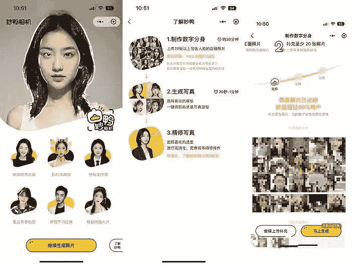
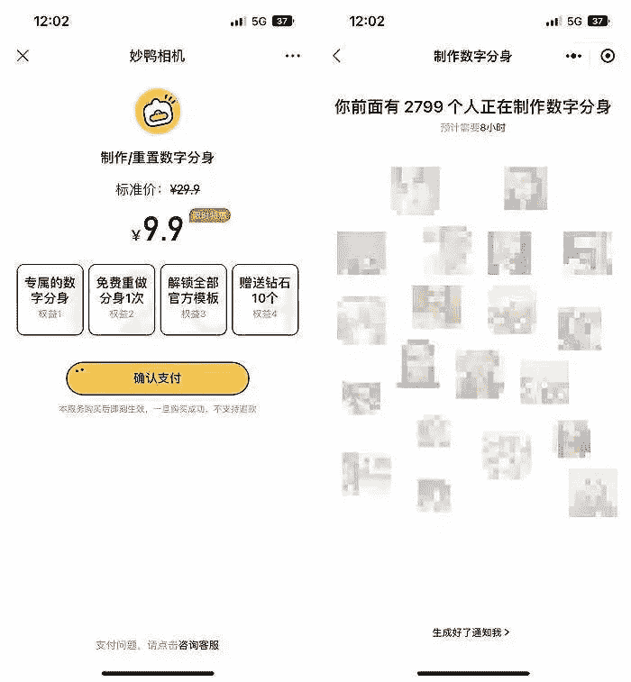

# 服务器被挤爆的妙鸭相机，戳中了谁的心巴？

> 来源：[https://jalicvoygc0.feishu.cn/docx/KkJAdNZPgooe8DxjhiKc8K5VnDg](https://jalicvoygc0.feishu.cn/docx/KkJAdNZPgooe8DxjhiKc8K5VnDg)

引用**：****https://www.jiemian.com/**article/9784840.html

**作者：**[**伍洋宇**](https://a.jiemian.com/index.php?m=user&a=center&id=116115463)** **

图片来源：unsplash

> 界面新闻记者 |伍洋宇

互联网好久没有遇到一款出圈的应用了，妙鸭相机大概率可以填补这个空缺。简单理解，这是一款基于AI人脸识别的相机类应用，用户上传自己数张不同角度的人像之后，就可以制作数字分身，并自动生成不同类型的照片，包括商务写真、时报海报、证件照，以及校园、怀旧、旅游等不同场景和风格下的个人写真。

其中，制作数字分身目前需要充值9.9元，生成写真则为免费。不过用户如果需要高清化和下载写真，就需要额外充值钻石。据了解，高清化和下载操作每次需2钻石，在充值比例中等价于0.2元人民币。妙鸭相机的爆火在于它的出图效果对标了海马体、天真蓝等连锁摄影机构，后者的写真风格精美华丽，提供全流程的妆造和修图服务，但定价通常在100-500元不等。如果妙鸭相机能做到几乎持平的效果，同时观感自然，吸引大量用户并不奇怪。

事实上，自7月17日妙鸭相机上线后，幕后团队并没有为其做过系统化的宣发工作。据界面新闻记者了解，这款小程序最初只是在小红书等内容平台冷启动，引发了一些“自来水”用户测试，并在即刻等平台引发讨论，随后引起了更大范围的关注。截至目前，“妙鸭相机”微博官方账号粉丝量仅有83人。不过，妙鸭相机想要成为一款现象级应用还不太容易，这背后主要的门槛在于它目前的服务器能力。界面新闻记者在第一环节提交照片时，就被提示“服务器被挤爆了”，在成功上传20张基础照片后，也还需要等待10分钟左右识别时间。真正进入数字分身制作环节后，你会发现自己身处2800名的队列之中，需要等待8个小时。

随着团队后期的扩容**和技术****优化，等候时间也许还可以大幅缩短，但在初期启动阶段，这样的表现可能已经劝退不少用户**了。 外界对这款极具爆款潜力的应用开发团队同样充满好奇。据界面新闻记者了解，这款应用由一个创业团队开发，阿里大文娱参与投资。天眼查App显示，妙鸭相机背后运营主体为“未序网络科技（上海）有限公司”，法人为张龙，后者同时担任优酷视频（西安）传媒科技有限公司的法人。尽管上线不超过一周，妙鸭相机已经在用户隐私和数据安全方面出现了争议。 此前，有用户发现，妙鸭相机在用户服务协议的“4.1.4授权许可”中写道：“为了使我方能够提供、确保和改进本服务（包括但不限于使用Al生成内容作为再训练数据等），并且仅根据适用的《隐私政策》，除了本条款授予我方的任何其他权利外，您特此授予我方在全世界（包括元宇宙等虚拟空间）范围内享有永久的、不可撤销的、可转让的、可转授权的、免费的和非独家的许可，使得我方可以任何形式、任何媒体或技术（无论现在已知或以后开发）使用您的内容。此处我方的“使用”是指使用、托管、存储、修改、交流、发布或任何我方认为合适的使用方式。在您通过本服务向我方平台提交您的上传内容之前，您将确保您有必要的权利来授予我方许可。”此段协议内容被指颇为“霸道”。对此，妙鸭相机运营团队在微博很快回应，表示原协议内容有误，已第一时间根据妙鸭的实际情况进行了修改。“（妙鸭相机）在这里郑重地向大家承诺，您所上传的照片只会用于数字分身制作，不会提取也不会用于识别和其他用途，且分身制作完成后自动删除。”所以这样一款应用，你会想要花十块钱尝尝鲜吗？