# 傅盛的AI-Native创业思考：所有创业者都要相信，这就是最好的时代

> 来源：[https://jalicvoygc0.feishu.cn/docx/E7AudEKy5ovQpAxYpoPcnRUjn5e](https://jalicvoygc0.feishu.cn/docx/E7AudEKy5ovQpAxYpoPcnRUjn5e)

引用：https://mp.weixin.qq.com/s/5y0WQhukvmBrPxoo279lLQ

作者：傅盛

傅盛是互联网时代的明星产品经理，他曾投入 1 亿美金，在人工智能领域「交了学费」。

ChatGPT 出现之后，傅盛是最兴奋的创业者之一。他投身其中，思考、实践，不断迭代。傅盛认为大模型创业有四个层次的机会，千亿通用大模型、垂直大模型、大模型应用开发，和用好大模型应用。大模型本身，竞争激烈，并不适合大多数创业者，应用层和用好大模型，则会创造更多创业的机会。「应用生态决定了大模型公司的商业价值」。「大家都在一个起跑线上，这就是一个最好的时代。」面对台下的创业者，傅盛呼吁大家投身其中，「竞争肯定很激烈，大家达成共识也很快。所以我建议大家保持好奇，深入学习，把细节做好，相信每个人都有机会成功。」以下是傅盛在 AGI Playground 大会上的分享，经 Founder Park 编辑整理。

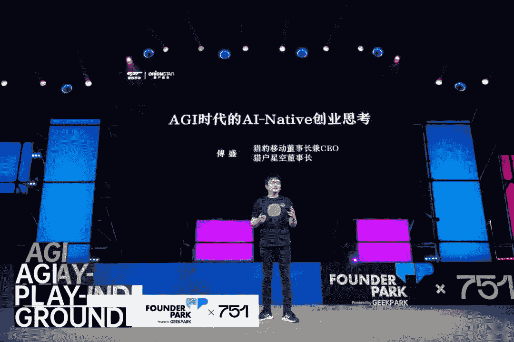

## **语义理解**

## **人工智能技术的皇冠**

我在 2016 年就开始投入人工智能，在数据训练上我大概投了 1 亿美金在视觉识别、语音识别上。可能大家都不太知道，小**米的小爱**同**学、喜马拉雅的语**音都是我们提供的服务，包括在冬奥会上，我们也是语音服务机器人供应商。但那时候遇到一个难题，就是语义识别，核心是智能的问题。

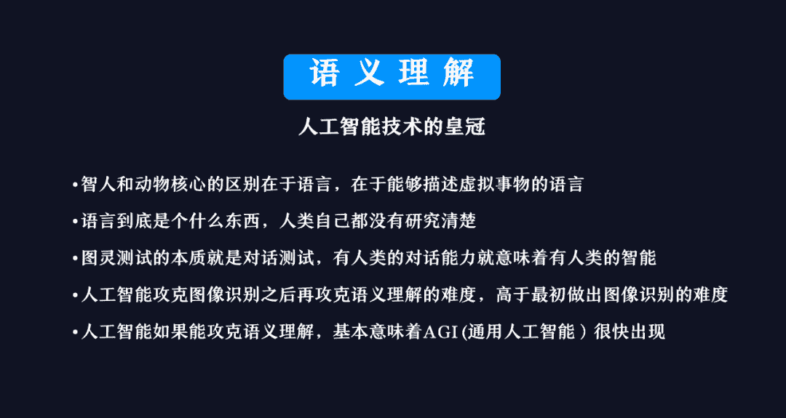

什么叫智能？生物都有智能，都有对现实的预测，不少生物也会使用工具，猴子、猩猩，乌鸦喝水等。但如果看过《人类简史》的话，就会知道人类独有的智能是描述虚拟事物的语言，描述虚拟事物就是逻辑。

## **只有****OpenAI**

## **试图让****AI****自学文本**

为什么OpenAI能做到？当时最开始做语义理解的时候，大家本能地认为，我们应该教计算机识别知识图谱，像学习外语一样，理解单词、主谓宾以及语法规则等。后来发现它很快就可以回答问题，但是答非所问。

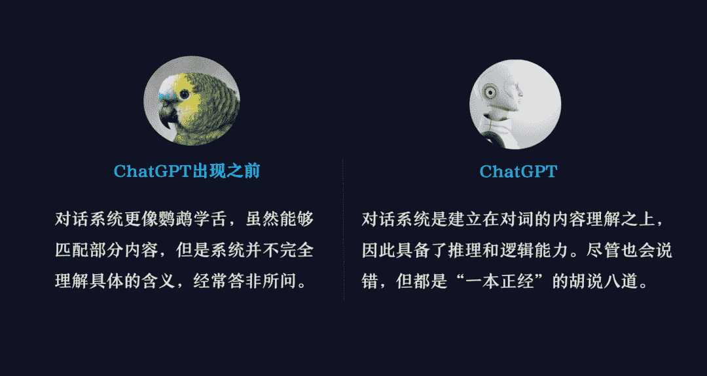

只有 OpenAI **觉得，**应该像教小孩子一样，把文本给它，让它自学。这个自学不像自媒体所描述的，「OpenAI 有一天会灭掉人类」什么的，这是不可能发生的。GPT 的学习是学习文本之间的规律，产生基本的认知和推理能力。最早我们试图教机器逻辑思维，觉得它能学会，但是后来发现它学不会。语言学教授乔姆斯基就认为，语言的语法结构其实没啥用，都是事后总结，语言本身是一件很复杂的事情。

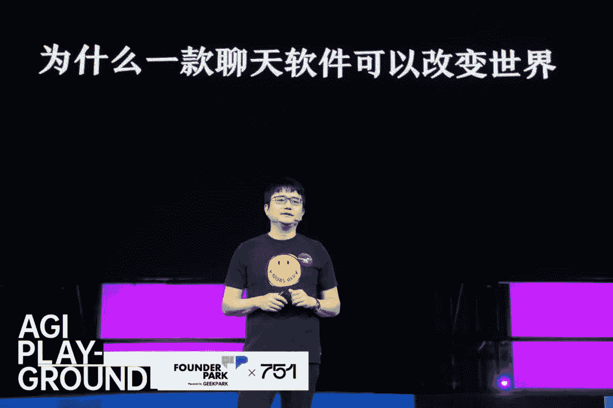

在 GPT 之前，人工智能更像是鹦鹉学舌，那时候的对话系统本质是把已有的对话和用户的提问进**行匹配。用知识****图谱、回答增强**来判断大模型不太靠谱，它是真正基于对词的理解，去理解这个世界。业内普遍认为 ChatGPT 的出现意味着通用人工智能时代的到来，OpenAI 的创始人就称之为 AGI，AGI 应该是一个模型可以满天下用的，也就是从底层逻辑上说大一统大模型的时代到来。

## **把****GPT****看成**

## **一个大号计算器**

理解语言这件事对于计算机来说非常难，对于人类来说习以为常，这也是我们引以为豪的地方。所以现在突然发现系统可以理解语言的时候，大家就开始恐慌了。其实，我觉得GPT可以被看成一个大号计算器，知道它是每个词每个词的预测，预测的词和之前的问题都相关。理解了它的原理，就会对它的很多方面慢慢理解。比如，为什么GPT对于人类的回答，别人问的和你问的会不一样？因为问法可能不一样，问法很重要，理论上问的越多越深入，就越不一样。

## **首先被替代的**

## **是在电脑前坐得最久的人**

ChatGPT**出现，我觉得有**两件事会深刻影响这个行业，第一个是容易被忽略的，也就是对于交互的影响。

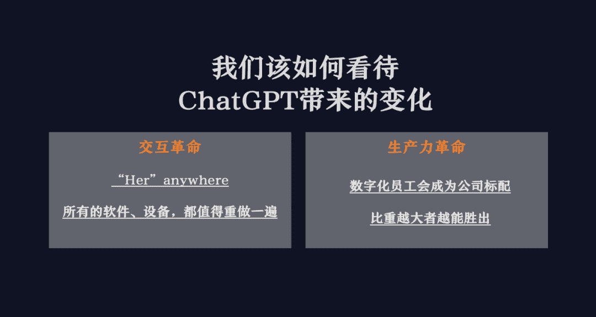

交互一旦发生变化，很多范式也会发**生变****化**。有些工作就会被替代掉，AI将导致电脑层工作价值下降。我前两天看到一幅漫画说未来 AI 会给我们洗衣服做饭，我们去追求诗和远方。但现在反过来了，我们看到真正首先被替代的，是在电脑前坐的最久的人。老板很少坐电脑面前，所以他没那么容易被替代。逻辑很简单。大家用电脑只是把自然语言翻译成机器能懂的指令。程序员、做PPT的人工作本质都是这样。一旦机器不需要人来完成自然语言的翻译，原本这些工作的价值就会急剧下降。

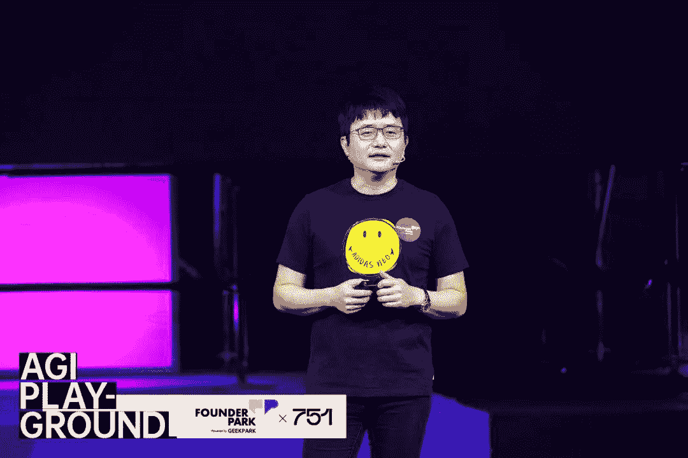

## **30刀的Copilot**

## **非常划算**

前两天微软公布了Copilot售价，盘中飙升6%，你要知道微软已经是一个两万亿美金的公司了。微软以前说要让每个家庭都有一台电脑。它们以后可能就是要让每个人都有1个或者几个Copilot。Copilot售价是每个月30美金，看上去还挺贵，换算下来1个月200多块钱。但你想想，你每个月雇一个员工肯定不止这点钱吧。而且它的效率非常高，全天24小时都待命，几分钟内就能给出交付结果，也不会跟你闹脾气，也不会辞职。从这个角度来看非常划算。

## **面对****AI**

## **两种不同的态度**

未来「人族」会有两种人，**一种是保持着极强的好奇心，拥有主动和开放**学习的心态；善于思考，提问，思考，创造。他们就是AI的驾驭者。还有一种人非常被动，封闭，这种人就是单纯的躺平享受者。

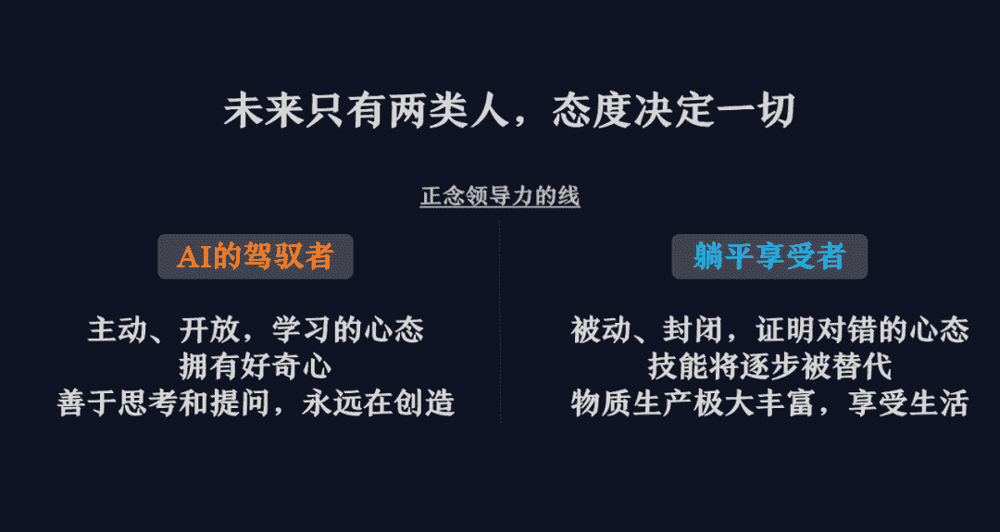

Sam Altman（OpenAI CEO）的人生理想就是搞一个巨大的智能体，能替我们做很多工作，然后人类就不用工作了，他还会给你发世界币，你们领**钱去追求诗和远方就可以了**。我认为不会是这样，还是会有很多人会去成为AI的驾驭者。如果我们把大模型想象成一个大号计算器，有些恐惧就没有必要了。因为它只是个计算器，它没有好奇心，没有主动性，它还是需要输入，需要各种优化，所以人类还是有大量工作是可以做的。大模型技术不会吞噬一切。

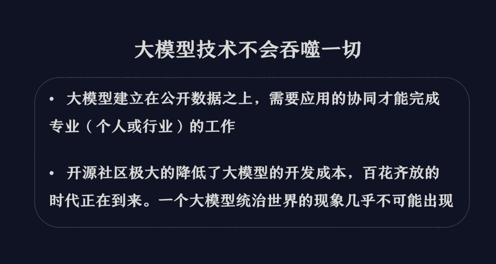

## **技术门槛越高**

## **竞争越激烈**

**模型****创业的**机会在哪里？我总结了四个层次。第一层是角逐千亿大模型。我觉得这个难度比较大。

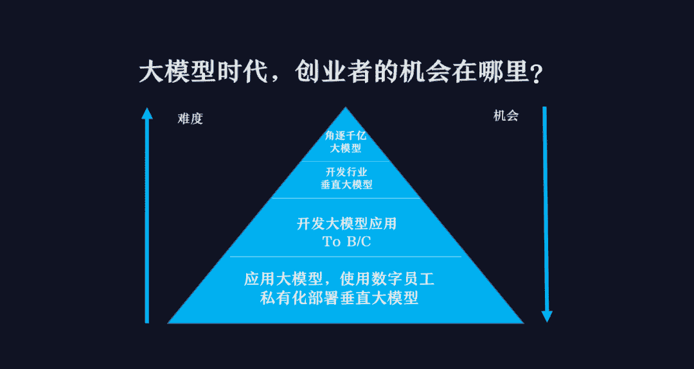

那天我女儿跟我说，为什么一件简单的**奢侈品就能卖几千块**钱？苹果那么一个复杂的手机才卖几千块钱。这是人类社**会特别有意思的****一件事，就**是看上去技术投入越多，竞争越激烈，但越激烈反而越挣不着钱。所以角逐千亿大模型这事没那么划算。第二层是开发行业垂直大模型。几个月前大家还不太认可垂直模型会和通用大模型一样强，现在大家已经慢慢转变了看法。第三层是开发大模型应用。结合大模型做开发应用是很大的一块。第四层是应用大模型。既不是技术公司也不是数据公司，只是一般的公司，就把大模型应用用好就可以了，使用数字员工，私有化部署大模型。这是最大的一块。就像电刚发明的的时候，很多人在用驴拉磨的时候你已经开始用电拉磨了，生产效率肯定更高。互联网刚出现的时候，刘强东还在中关村卖光盘，后来发现网站机会很大，就做成了中国最大的电子商业公司。这就是创业者的机会。创业者和投资人之间本质上是互相成就的关系，不存在谁指导谁的问题，尤其投资人对创业者的创业方向应该多加尊重。真正慷慨的都是创业者，这也是为什么行业怎么发展取决于行业生态的原因。

## **做企业要找到**

## **互联网上没有的知识价值**

做应用如果数据不足，所有的努力都没有价值。今天所有书本上的知识只占了所有知识的一小块。比如你要跟牛顿学东西，你只能从《自然哲学的数学原理》当中学，但如果有一天你能和他喝咖啡，那每天的知识涨幅绝对比只读书多太多了。但话又说回来，这些知识只是冰山下面的基础，我们今天做企业肯定不是把头埋在MBA的教材里就能学着做好的。只有每天密集的会议讨论，形成共识，这些都不是在教材、在互联网上找到的，才能给予你最大的知识价值。所以今天大模型虽然有了很强的推理能力，甚至在某些方面超过了人类，但它的知识储备只要还是基于互联网，能学到的还是人类知识的一小部分。大模型现在在写文案之类的工作上还有点用，但你真让它给你给一些工作建议，行业建议，它肯定还是不行，这个就和它的知识构建有关。

## **开源**

## **是****AI****行业的巨大金矿**

开源社区极大地降低了模型的开发成本，三个月前大家觉得 OpenAI 要统治全世界了，现在回过头来一看这个世界还是太复杂，一个公司不可能做到。开源就是** AI** 行业**的一个巨大的金矿，有太多为了人类理想，技术理想，极**客精神而战的人加入其中。Llama 2 也刚刚宣布开源，可谓是「忽然一夜开源来，千模万模智能开」。我们都很兴奋，大模型白菜价的时候到来了，每个公司每个人都有大模型的时代到来了。对于应用开发者来说，以前应用太薄的话，大模型一增长你的应用就没了。如果你的应用真的很好，你就能在用户那里找到很多需求点，现在你就可以做你自己的大模型。所以 Llama 2 的这波操作就体现了大公司的优势，它只要做出正确的战略判断，就可以组织你想象不到的资源，从而实现行业的变化。创业者一定要敬畏大公司，大公司的战斗力不是体现在某一点的穿透上，而是体现在它整体的逻辑上。

## **如果创业者**

## **只学习****大模型****的一个技术点**

现场有**很多的创业者，我就分**享一个点，就是如果大家只学习大模型的一个技术点，应该是什么？就是 Prompt 提示词。这件事一开始的时候，我就注意到了。但有一天我跟我的程序员聊，他突然跟我说这东西挺有意思的。我说你们怎么到今天才觉得挺有意思的？

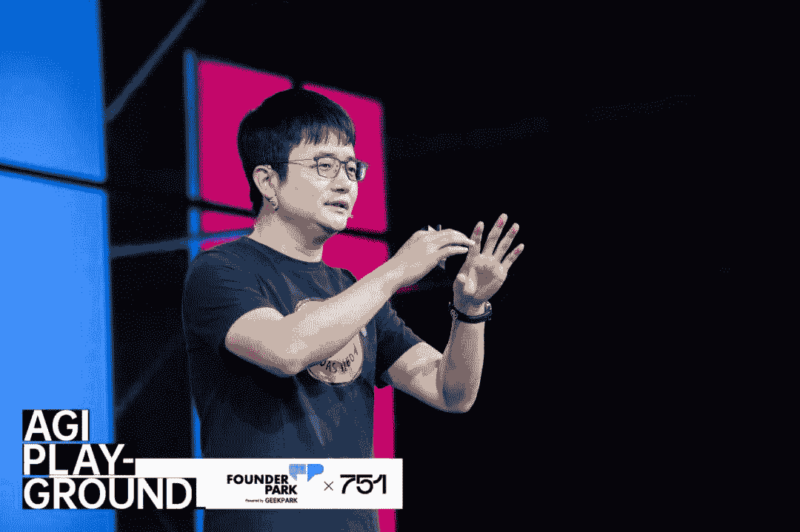

做技术的同学有时候会这样，认为「我掌握的技术才是重要的，你这个东西不咋地」。还有一些投资人认为 Prompt 不就是提示词嘛，有什么厚度？其实我觉得 Prompt 是被忽略的一个点，因为它学起来容易，所以大家觉得这东西不深入。我就想起一个比喻，这就有点像郭德纲说的相声。所有人都觉得自己能说相声，但是其实要说好不容易。因为人人都会说话，好像也都会说相声，其实里面差别很大。

## **自然语言本身**

## **就是知识的压缩**

从原理上说，自然语言就是一个压缩。比如说我现在讲了 200 字的内容，但是你要知道这 200 字在我脑海里是一个很庞大的行业知识，然后贡献出来、压缩过去，到你这再一解压，就不一样了。所以我做人工智能，最大的一个痛苦总结下来就是，招的都是中国人**，但互相听不懂对**方说什么。做硬件的时候，说我们跟做软件的不一样；做人工智能的时候，说我们跟互联网不一样；互联网又说我们跟他们不一样。我说你们都不一样，就我一个人站在上面，花了大量时间去 Prompt。所以我们为什么每天有那么多会？为什么要写成邮件，还要大家一起讨论一下？这就是因为自然语言的压缩性。所以这种提示是非常关键的。然后行业有专属词，一个词在你这个行业是这个意思，在我们行业就是另一个意思。大家肯定都经历过。你觉得这是好的，我也觉得好的，等到一看，我们对好的理解不一样。所以 Prompt 就是一个桥梁，不可或缺，非常重要，而且可以做得很「厚」。

那天我就在想怎么跟我的程序员讲 Prompt 很重要呢？我想起一本书——《自然哲学的数学原理》。谁写的？牛顿牛爵爷，他是 Prompt 的大师。如果你们去翻一下这本书，前几十页讲的全是定义。为了证明他的三定律，他写了很多定义，因为他怕我的**理解会和你的理解不一样。在****场有多****少人看过吴恩达的 Pro**mpt 课程？我建议每个人都去看一下， 3 小时就看完了，然后反正我都看完了。这个课程不看，本质上是「不知道自己不知道，以为自己知道」。这么一个人工智能的大牛，会专门花 3 个小时讲Prompt，你觉得意味着什么？因为今天 Prompt 本质上就是对大模型能力的一个深度挖掘和微调。以后C这些编程语言都会变得非常少，Prompt就会是编程。你要写一个程序，就写一段话，让人工智能得出一个你要的结果。大家都说，以后要培养会问问题的人，那什么叫会问问题？没有标准。因为现在每个大模型都是不同的系统，不同的推理，有这样那样的不同。你要花很多时间去沟通，当你知道 Prompt 对于不同大模型适配情况的时候，你就是行业专家。所谓专家就在一个点上比别人深。还有一个就是应用层面。我觉得未来应用的生态反而可以决定大模型公司的商业价值，因为开源已经极大拉低了大模型本身的商业价值。我的另外一个预测是，巨头和开源社区的竞争会难分伯仲。

# **别纸上谈兵**

## **猎豹做了什么？**

最后讲一下猎豹做了什么。讲了这么多，不能只是纸上谈兵。

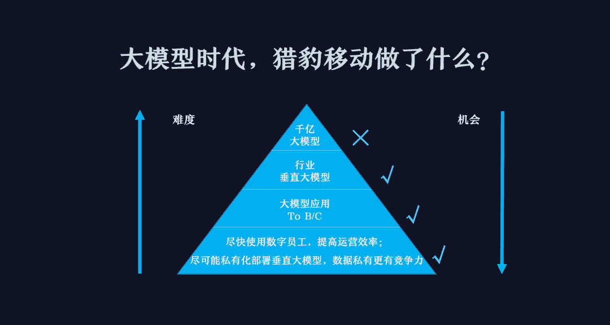

第一个是数字员工。我们内部已经挂了很多横幅说“取代你的不是 AI，而是会 AI 的同事”。然后第二个是大模型应用，我等会展示两个应用。第三个就是我们也做了行业信息大模型，但我不遮住眼睛，我肯定是是拿开源的模型去训练的。第四个，千亿大模型，这件事我们没有做。展示一个我们团队内部做的项目，现在效果说实在还不够好，但雏形已经实现了。

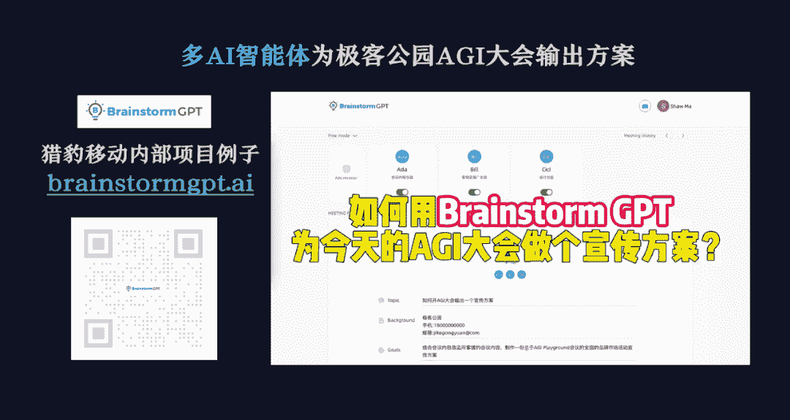

我们用AI智能体为极客公园输出一个大会方案，这是我们设计的角色，它有不同的视角。开会过程特别有意思，就看几个机器人吵来吵去，说你这个没有注册那个怎么样。开一次会，这几个机器人大概要跑 20 分钟左右。有人说大模型做不到否定自己，这个观点太错了，大模型完全可以否定自己。因为它就是计算器，他为什么不能否定自己呢？所以你找几个不同角色，互相否定、挑战，最后还可以生成几十页的报告。我们这个项目有 4、5 个同学写 Prompt，写了两个月，不停地写、改，然后看什么样的数据奏效。

## **创业者的本质**

## **把细节做得足够好**

通用大模型为什么不能直接用到企业的流程上？因为没有私有化，没有数据隐私安全问题，无法贯通业务数据。所以我们在上面做了一个集成，猎户星空打磨的企业应用聚言，帮你做一些专业的数字员工。

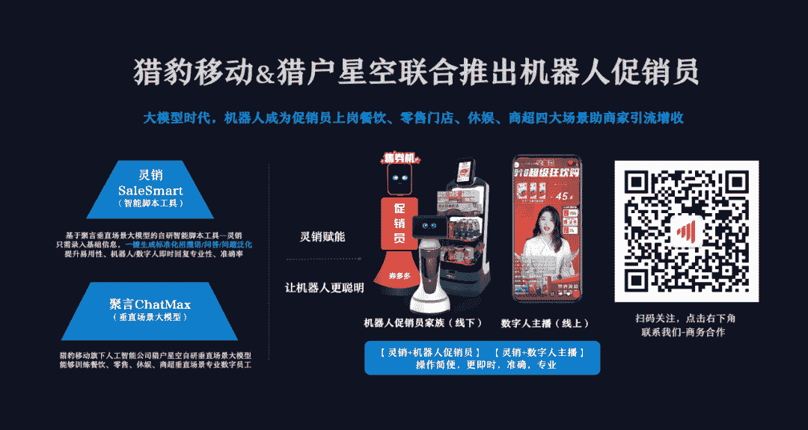

第一个主打的就是推销员，每个网页都配了一个聊天机器人。我们自己的网页上配了之后，发现成单率提高了3倍。在线下，我们的机器人真的可以开始推销了。成为机器人促销员，在燕之屋、双汇落地，帮助客户转化成单。创业者真正的本质，就是把细节做得足够好。**有一天我和我的团****队说「****做人工智能就跟我当年做杀毒是一**样的」。我的员工说：「老板你不懂，别乱讲。」我说这不一样吗？人工智能是来个数据用模型发下去，以前我们做杀毒也是来了很多样本，变成病毒库发下去。这中间比拼的是什么？是谁更快，谁能把每一个点做得更细。其实我们在问答机器人上投入了大量精力，看哪些回答用户觉得不满意，哪个策略出问题了。所以我们做应用一定要记住一句话：魔鬼都在细节里。大模型很大，但是做应用必须很小很深。

# **小参数的智能涌现**

## **行业****大模型****是有机会的**

OpenAI 推出 ChatGPT 之后，**全世界****都懵了，因为**没有人觉得这件事能做成。但是从原理看，「今天为什么会有这些智能」是没有被证明的，中间没有推倒过程。只是输入一个数据，大概知道可能的结果是什么。所以今天有个词叫「涌现」。但问题又来了，为什么只有 1000 亿参数的模型可以涌现智能？500 亿可不可以？100 亿可不可以？所以今天学界在做一件事，叫做大模型的「白盒化」，就是把大模型运行的过程给推倒出来。一旦推倒出来，可能就不需要这么大量级的参数，用很小的参数就能实现现在的效果。当然今天没有白盒化之前，各种开源的迭代版本也都用很小的参数慢慢实现了一定的效果。那到最后我们可能发现，工作岗位里不需要一个「爱因斯坦」，一个中专生就可以胜任了。所以未来，每个行业可能都会有自己的专业大模型。

## **创业者要相信**

## **这就是最好的时代**

但**其实我也不知道这个行业会**怎么发展，因为它变得太快了。我觉得最好的办法就是靠进去，动起来，很多东西只有在实践中才能得到。其实我每天都生活在一种恐惧中，就是警醒自己，千万不要觉得自己有经验；千万要觉得自己是傻x；千万要认为这些年轻人真的会去超越你。经验其实一点都不重要，有好奇心、有行动力，才能创造未来。最后给大家分享一句话：现在是过去的未来，因为它已经发生了，但它不是未来的过去。什么意思？就是未来不是一个必然性，今天所有的创业者都要相信「王侯将相、宁有种乎」，相信在一个点上大力可以出奇迹。大家都在起跑线上，这就是一个最好的时代。竞争肯定很激烈，大家达成共识也很快，所以我建议大家保持好奇心，深入学习，把细节做好，相信每个人都有机会成功。谢谢大家。

---

如果你关注大模型领域，欢迎扫码加入我们的大模型交流群，来一起探讨大模型时代的共识和认知，跟上大模型时代的这股浪潮。

-END-

扫码加入AI Flow Genius社群，探讨使用AI来提升生产力的方法，成为超级个体

超过200需手动拉人 **备注：加群**

