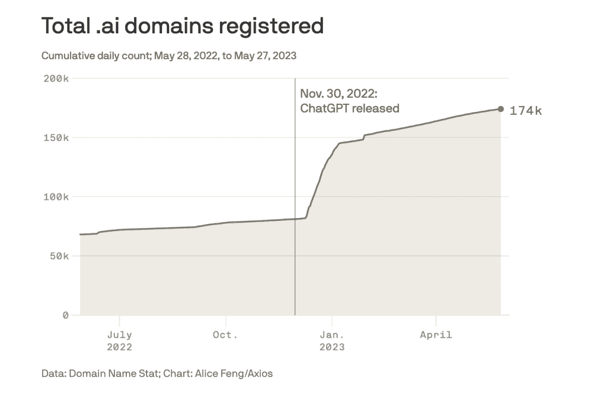
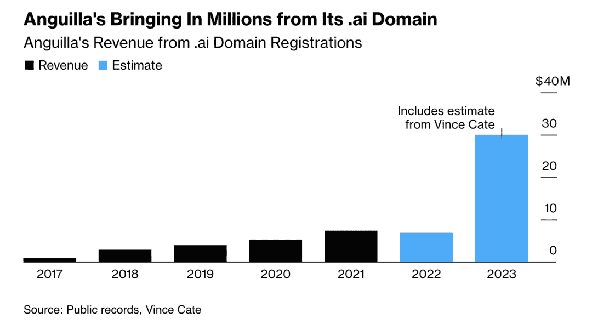
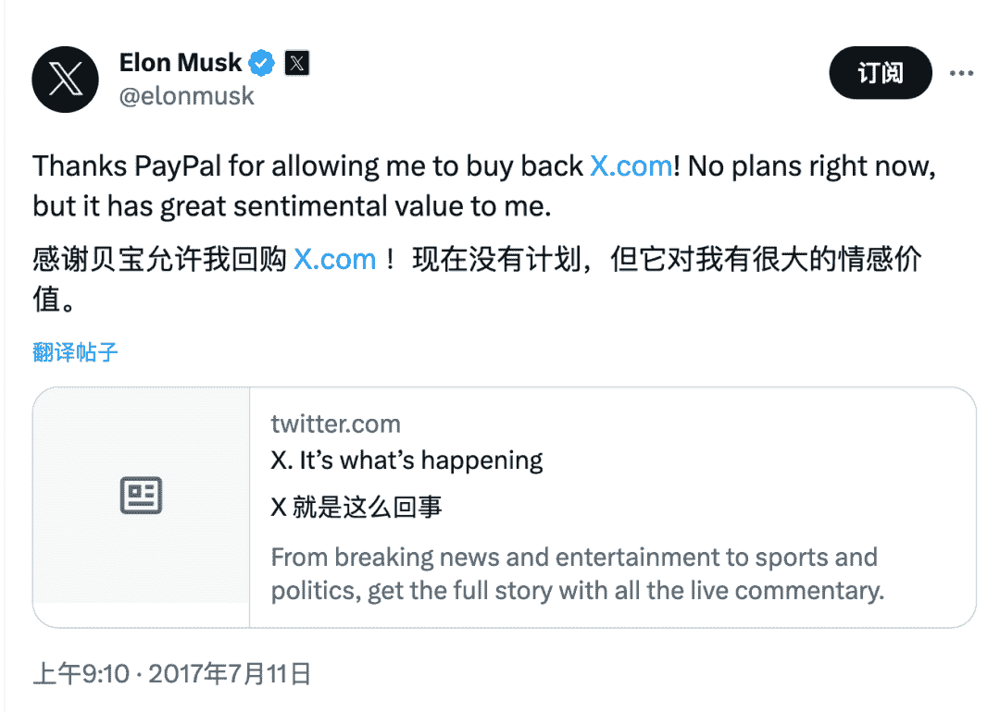
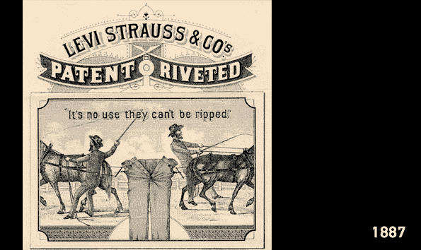

# 卖AI域名，一年血赚3000万

> 来源：[https://jalicvoygc0.feishu.cn/docx/NtrLdq63NokFY3xGgeHcDLHQnEe](https://jalicvoygc0.feishu.cn/docx/NtrLdq63NokFY3xGgeHcDLHQnEe)

作者：汤一涛 Founder Park

在今天 AI 淘**金热潮下，在阴差阳错间，**大西洋上的小岛安圭拉，成为了「卖铁锹的人」。

和所有的热带小岛一样，安圭拉的特产是阳光和海滩。这里土地干旱，农作物难以成活，几乎没有自然资源，旅游业是这里的支柱产业。自 90 年代以来，互联网的发展让这个小岛国凭空多出了一项虚拟资产——「ai」可以是人工智能 Artificial Intelligence 的缩写，也可以是安圭拉 Anguilla 的域名。AI 技术已经有很长远的发展历史，最早可以追溯到 1956 年的达特茅斯会议上，计算机科学家约翰·麦卡锡（John McCarthy）提出了「人工智能」这个概念。此后几十年 AI 技术一直处于缓慢而稳定的增长中，就像以「.ai」为后缀的域名一样。安圭拉可以收到一些钱，但是不多。

情况在 2022 年 11 月 30 日这天有了变化，OpenAI 发布了 ChatGPT。自那之后，所有的科技企业都在做一个动作——抢，抢数据、抢人才、抢显卡，以及抢域名。这其中的代表就是 Stable Diffusion 的母公司 Stability.ai、马斯克的 X.ai 以及 Character.ai。科技巨头们也都设立了自己的 AI 页面，例如 facebook.ai 和 microsoft.ai。

ChatGPT 发布后，.ai 注册域名开始成倍增长｜图片来源：axios文斯·凯特（Vince Cate）

**从 90 年代起就****开始**管理安圭拉的域名，他告诉彭博社，在过去的一年中，.ai 域名的注册数量几乎翻了一倍，**达到了 28 万多。像许多商品一样，域名的价格也是可**变动的。用户**每通过像 GoDaddy 或者 NameCheap** 这样的注册商注册一个.ai 域名，注册商就需要向安圭拉支付一笔费用。2023 年 4 月之前，这个价格还是每两年 120 美元，眼下已经上涨到了 140 美元。据凯特估计，安圭拉 2023 年从域名注册中获取的收益，将达到 2500 万至 3000 万美元之间。仅仅在两年前，这个数字还只有 830 万美元。这虽然与 AI 行业动辄几十亿美元的资金无法相比，但要知道，安圭拉仅仅是一个面积 91 平方公里、人口不足 2 万的小岛；疫情期间，其支柱产业旅游业还受到了影响。

安圭拉历年从域名注册中获得的收益，蓝色部分为估计值｜图片来源：Bloomberg

根据安圭拉发布的 2023 年财政预测，其全年经常性收入估计为 1.07 亿美元。也就是说，即使是凯特预测区间的低值 2500 万美元，也会占到安圭拉全年收入的 1/4。

**

真正****的元宇****宙地产**商另一个从这种互联网热潮中受益的岛国，是位于太平洋的图瓦卢 Tuvalu。图瓦卢比安圭拉更小，仅有 26 平方公里，在全球主权国家中排倒数第四。图瓦**卢的好运气在于，其顶级域名恰好与电视**的英文缩**写 TV ****相同。正**是凭借出租域名得到的第一笔 100 万美元，图瓦卢才得以在 2000 年支付加入联合国的费用。现在，图瓦卢政府每年可以从 GoDaddy 那里获得大约 1000 万美元的收入。根据图瓦卢 2019 的财政报告，这项收入占到了吐瓦鲁政府年收入的 8.4%。某种程度上，域名注册就像是一门互联网上的房地产生意。某些有远见的人看好某个域名，抢先注册了下来，并持续缴纳管理费，静静等待某一天时代的浪潮冲击到这里。通常转卖的价格在几美元至几万美元不等，但一些稀有域名的价格可以相当高。2017 年，马斯克就花了至少 500 万美元从 Paypal 手中买回了 x.com 的域名。同样是马斯克，如今特斯拉的域名 tesla.com 也是他花了 1100 万美元买到手的。

伊隆·马斯克发推庆祝拿回 X.com 域名｜图片来源：Twitter

眼下人工智能的热度有所下落，也有一些质疑声音冒出。但有一点是可以确定的，人类还处于人工智能的早期阶段，这也意味着，人类还处于.ai 域名注册的早期阶段。

**

100年的牛仔**裤1848 年，一个木匠在加利福尼亚州科罗马地区的一条河中偶然发现了金箔。尽管他曾试图保守这个秘密，但是金子不会说谎，一场席卷全美的淘金热就此开始，许多人怀揣着一夜暴富的梦想涌入加利福尼亚。1847 到 1870 年间，圣弗朗西斯科的人口从 500 暴涨至了 15 万，这个城市也被冠以了「金山」的称号。在野外艰苦环境中工作的掘金者常常会抱怨裤子不够坚固。犹太商人李维·斯特劳斯（Levi Strauss）洞察到了这个商机，并发明了第一条牛仔裤——一种用结实的防水布制作的罩裤，铆钉的设计增加了裤子的耐用性，口袋里额外的小口袋可以存放金子这种贵重物品。李维斯这个品牌，由此诞生。

为了证明牛仔裤的坚韧，斯特劳是设计了一场让两匹马拉扯牛仔裤的表演，双马皮牌也由此成为李维斯的标志｜图片来源：levistrauss

多数人没有挖到金子，即便挖到了，也很少有人能够把握住一夕而至的财富。新兴城市的有很多可以花钱的地方——酒吧、妓院、赌场……斯特劳斯没有参与到这场竞争，他做了一门稳赚不赔的生意：为竞争者们服务。据《洛杉矶时报》估计，到施特劳斯去世时，他的资产已经达到了 600 万美元，合今约 2000 万美元（约合 1.46 亿人民币）。正如那句著名的谚语所说：「淘金热期间，卖铁锹最赚钱。」对卖铁锹的来说，这或许是一门上百年的生意。

引用：https://mp.weixin.qq.com/s/HxBdOFlX7Cg4u4tp9BJQvA

##### 继续浏览全站内容：

[🎪首页](https://jalicvoygc0.feishu.cn/wiki/DdEvwxYsSidd36kAIIVcnROwnmb)

[🤔学习AI工作流](https://jalicvoygc0.feishu.cn/wiki/W15IwochvimsqvkkuCPcZuBxnqg)

[🤖查找AI工具](https://jalicvoygc0.feishu.cn/wiki/Bu8GwqYu8i5LBRkyVKocUvX5n97)

[📊阅读AI文章](https://jalicvoygc0.feishu.cn/wiki/SIywwqrVji2lZkkqFFpcEHZ8nNc)

扫码加入AI Flow Genius社群，探讨使用AI来提升生产力的方法，成为超级个体

超过200需手动拉人 **备注：加群**

