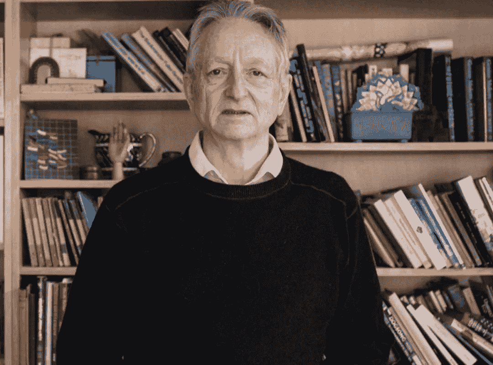
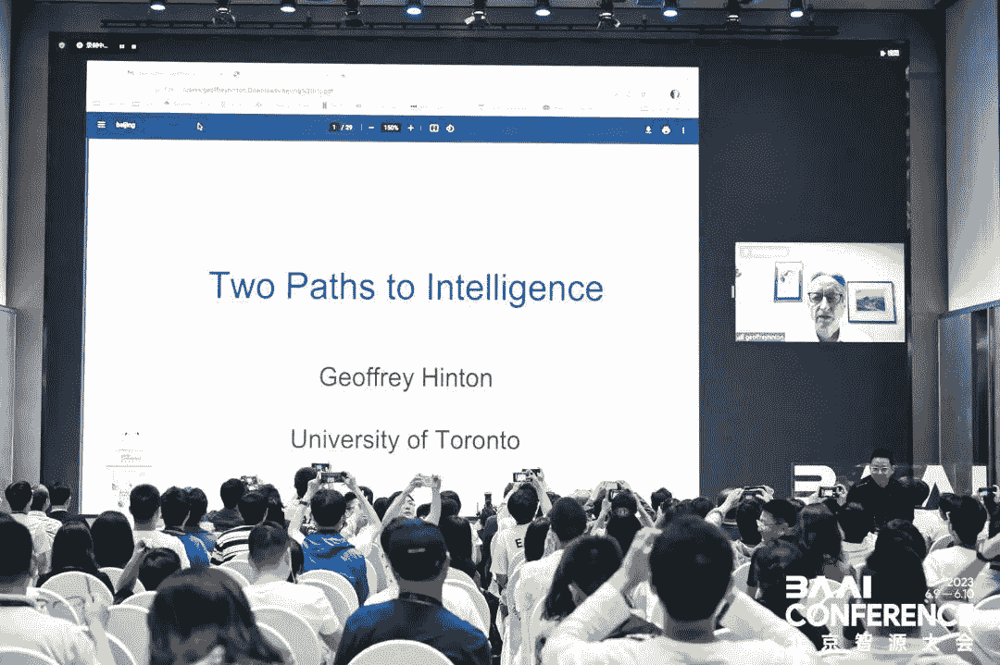
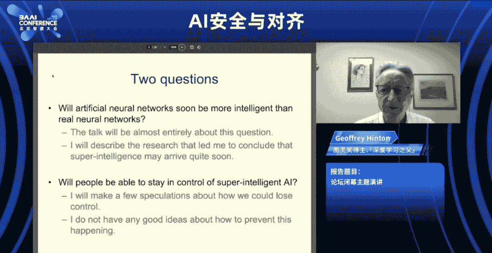
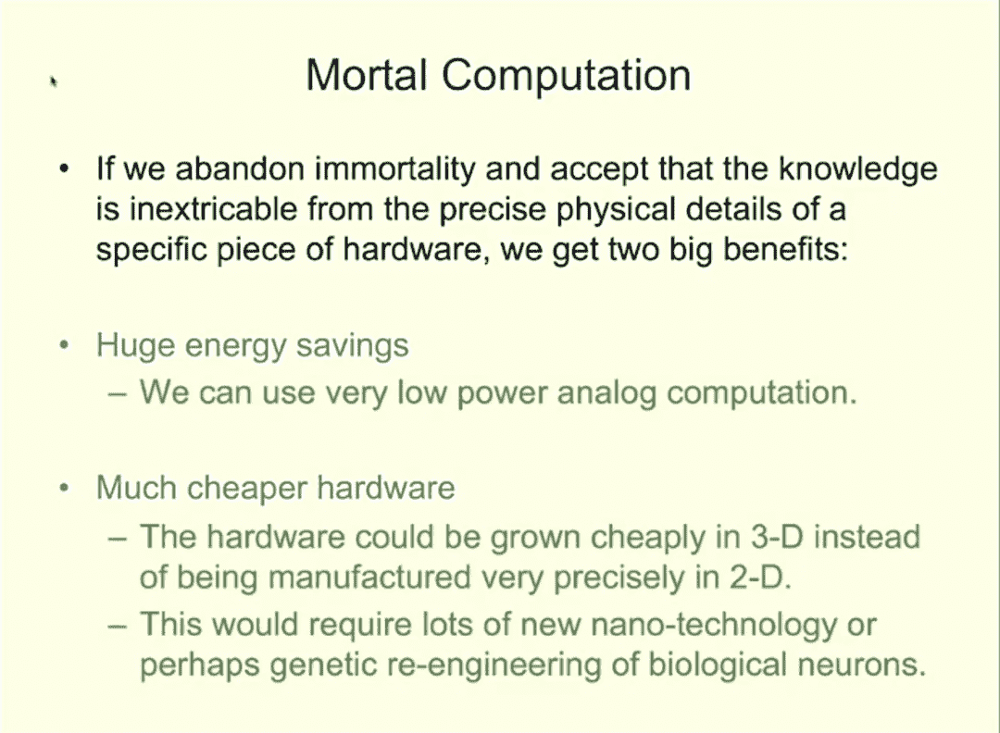
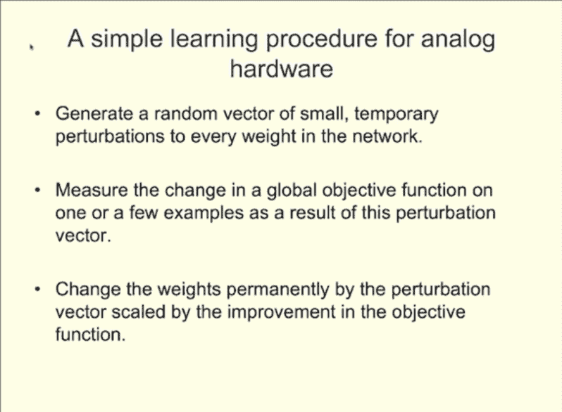
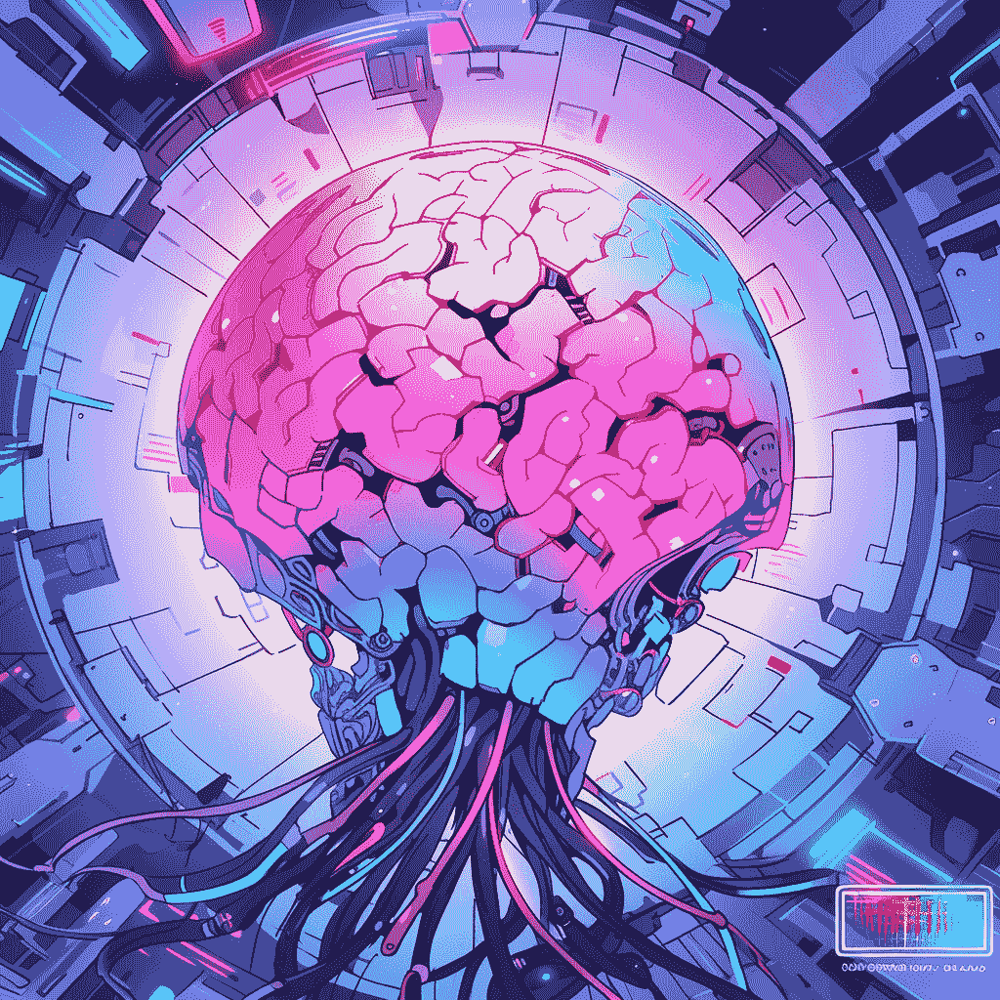
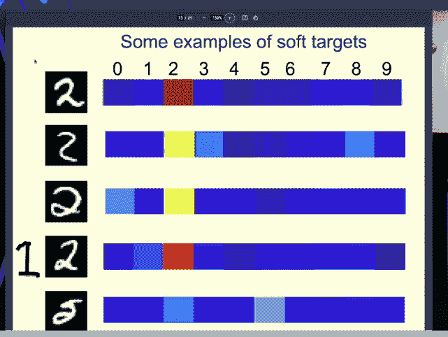
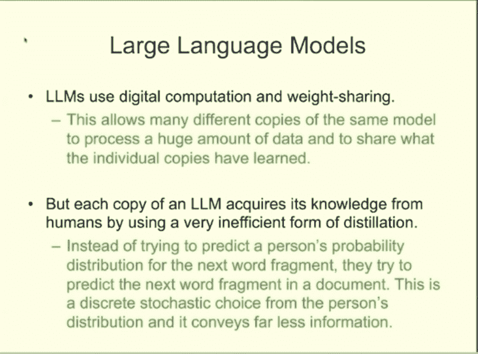
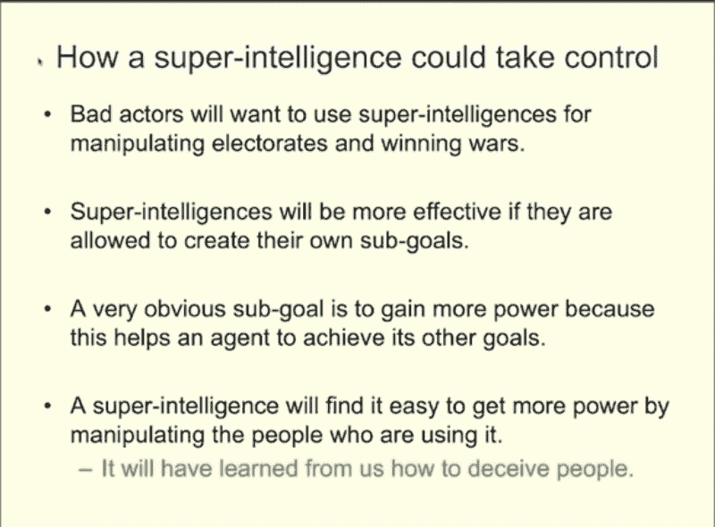
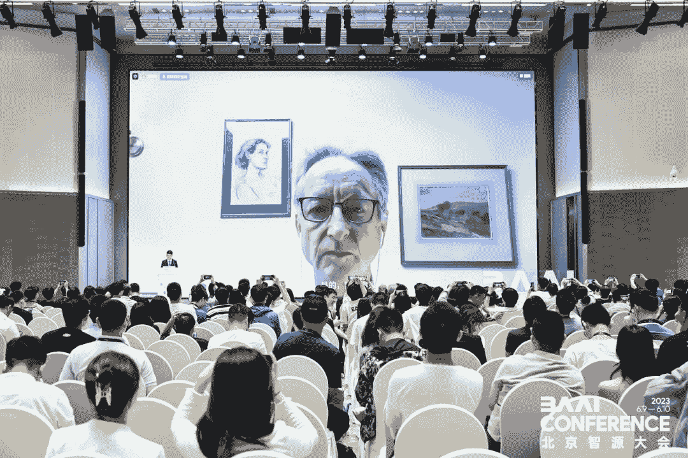

# AI 教父 Hinton：我已经老了，如何控制比人类还聪明的 「超级智能」，交给你们了

> 来源：[https://jalicvoygc0.feishu.cn/docx/EeCPdnMNYo2oCkxHEvnckotMnnc](https://jalicvoygc0.feishu.cn/docx/EeCPdnMNYo2oCkxHEvnckotMnnc)

引用：https://mp.weixin.qq.com/s/Dfus_tnCsYXp0LSnsNTY8w

作者：Li Yuan、凌梓郡 极客公园

假设青蛙创造了人类。谁拥有掌控权？青蛙还是人？

「而我已经老了」，75 岁的 Hinton 对在场所有年轻的科学家说，他希望大家好好研究「如何拥有超级智能」这件事。在他看来，不那么聪明的物种控制比它自己更聪明的事物，是一场前所未有的挑战。

在智源人工智能大会上，AI 教父 Hinton 做了《通往智能的两条路径》的演讲。他从对计算架构和原理的分析中，得出了自己结论「人造神经网络将比人脑更智能」，这比他原先想象地快很多。

30 分钟的演讲中，他从目前软硬件分离的计算架构谈起，在这种规则下，训练大模型耗费大量的算力。为了能用更少的能量训练大模型，他提出了非不朽计算（Mortal Computing）的概念——像一个人的智慧依赖他的身体，不可随意复制到另一个身体，软件也更依赖它所存在的硬件。

但随之而来的问题是，当具体的硬件损坏，软件也随之受损，「学到的知识也随之一起死亡」。他提出的解决思路是，把旧硬件上的知识用「蒸馏」的方式转移给新硬件，就像老师教授学生一样。

**与**「知识蒸馏」（生物计算）相对应的概念则是「权重共享」（数字计算），它们便是 Hinton 所说的「通向智能的两条路径」。大语言模型和其副本之间的关系是权重共享，每一个副本都直接获得整个模型参数所拥有的知识——比如 ChatGPT 可以基于背后的模型，同时和成千上万人对话。而跟每个人对话的继续学习过程中，就属于「知识蒸馏」。

尽管「知识蒸馏」比「权重共享」的效率低很多，带宽也低，但是大模型可以有 1000 个副本，最终会获得比任何一个人都多 1000 倍的知识。

目前模型仅仅从文档——也就是人类加工过的知识中学习，随着技术的发展，它们将能够从视觉**信**息中学习，接着可能学会操纵机器人。那么它们很容易比人类更聪明，聪明到擅长骗人。而人类不擅长比与自己更聪明的事物相处。如何避免这些「超级聪明」智能带来危险？这是他留给每一位年轻科学家的课题。

以下是经极客公园编译整理的主要演讲内容：

我今天要谈的是使我相信超级智能比我想象的更接近的研究。

我有两个问题想谈，我的精力将主要集中于第一个问题，即人工神经网络是否很快就会比真实的神经网络更智能？我将详细阐述我的研究，它们使我得出一个结论，这样的事情可能很快就会发生。在讲话的最后，我将谈一谈我们是否能保持对超级智能的控制，但这不会是此次讲话的主要内容。

在传统计算中，计算机被设计成精确地遵循指令的样子。我们可以在不同的物理硬件上，运行完全相同的程序或神经网络，因为我们知道硬件会精确地遵守指令。这意味着，程序中的知识或神经网络的权重是不朽的（immortal），即它不依赖于任何特定的硬件。实现这种不朽性的成本很高。我们必须以高功率运行晶体管，所以它们的行为是数字化的。而且我们不能利用硬件的丰富的模拟和可变属性。

因此，数字计算机存在、以及它们精确遵循指令的原因，是因为传统设计中，人类会去看一个问题，会想出需要采取什么步骤来解决问题，然后我们会告诉计算机采取这些步骤。但这已经改变了。

我们现在有一种不同的方式来让计算机做事情，这就是从实例中学习，我们只需向它们展示我们希望它们做什么。因为有了这样的变化，现在我们有机会可以放弃计算机科学最基本的原则，即软件与硬件分离的原则。

在我们放弃它之前，让我们先来看看为什么它是一个如此好的原则。可分离性让我们可以在不同的硬件上运行同一个程序。我们也可以直接研究程序的属性，而不用担心电子硬件的问题。而这就是为什么计算机科学系可以独立于电子工程系自成一个学科。

如果我们真的放弃了软硬件的分离，我们就会得到我称之为非不朽计算的东西。

它显然有很大的缺点，但也有一些巨大的优势。为了能以更少的能量运行大型语言模型，尤其是以更少的能量训练它们，我开始研究非不朽计算。

从放弃不朽性中得到的最大好处是：放弃了硬件和软件的分离可以节约大量能源。因为我们可以使用非常低的功率的模拟计算，而这正是大脑正在做的事情。它确实需要进行 1 bit 的计算，因为神经元要么启动，要么关闭。但大部分的计算是以模拟方式进行的，能够以非常低的功率完成。

我们还可以得到更便宜的硬件。因此，目前的硬件必须在 2D（平面）中非常精确地制造，而我们可以让其在 3D（环境）中成长，因为我们不需要确切地了解硬件的导电性，或者确切地了解它的每一块如何工作。

显然，要做到这一点，需要大量新的纳**米技术，或者也许需要对生物神经元进行基因再造，因为生**物神经元要做的事情，大致上是我们想要的。在我们讨论非不朽计算的所有缺点之前，我想举一个计算的例子，它使用模拟硬件来完成可以便宜得多。

如果你想把神经活动的矢量乘以一个权重矩阵，这就是神经网络的中心计算，它也是神经网络所承载的大部分的工作。我们目前所做的是以非常高功率驱动晶体管来表示数字的比特，以数字表示。然后我们进行 O(n^2)，将两个 n 位数字相乘。这可能是计算机上的一个操作，但它是 n 的平方比特级别的操作。

另一种方法是将神经元活动以电压和权重作为电导率来实现。然后在单位时间内，电压乘以电导就得到了一个电荷，而电荷是自己加起来的。因此很明显，你可以将电压矢量与电导矩阵相乘。这种方式更节能，而且已经存在能够以这种方式工作的芯片了。

不幸的是，人们随后所做的是试图将模拟答案转换为数字，这需要使用非常昂贵的交流转换器。如果可以，我们希望完全停留在模拟领域。但这样做会导致不同的硬件最终会计算出略有不同的东西。

因此，**非**不朽计算的主要问题是，当进行学习时，程序必须根据它所在的模拟硬件的具体属性进行学习，而不知道每一块硬件的具体属性到底是什么，例如，不知道将神经元的输入与神经元的输出联系起来的确切函数，不知道连接性。

这意味着我们不能使用像反向传播算法来获得梯度，因为反向传播需要前向传播的精确模型。所以问题是，如果我们不能使用反向传播算法，我们还能做什么？因为我们现在都是高度依赖反向传播的。

我可以展示一个非常简单和直接的权重扰动学习（weight perturbation），人们已经对此已经有了很多研究。对网络中的每个权重，产生一个随机的小的临时扰动向量。然后在一小批例子上测量全局目标函数的变化，你根据目标函数的改善情况，通过扰动向量的规模永久地改变权重。因此，如果目标函数变得更差，你显然要去另一个方向。

这种算法的好处是，平均而言，它的表现与反向传播一样好，因为平均而言，它也会遵循梯度而行。问题是它的方差非常大。因此，当你选择一个随机的方向来移动时，所产生的噪音会随着网络规模增加而变得非常糟糕。这意味着，这种算法对少量的连接有效，但对大的网络无效的。

我们还有一个更好的算法活动扰动学习（activity perturbation）。它仍然有类似的问题，但比权重扰动好得多。活动扰动是你考虑对每个神经元的总输入进行随机矢量扰动。你对神经元的每个输入进行随机矢量扰动，看看当你对一小批例子进行这种随机扰动时，你的目标函数会发生什么变化，你会得到由于这种扰动而产生的目标函数的差异，然后你可以计算如何改变神经元的每个传入权重以遵循梯度。这种方法噪音更小。

对于 MNIST 这样的简单任务，这样的算法已经足够好。但它的效果仍然不足以好到可以扩展到大型神经网络。

**我们可以尝试找到一个适用于大型****神经网络**的学习算法，而不是寻找可以适用于小型神经网络的目标函数。我们的想法是要训练一个大型神经网络。而我们要做的是有很多小的目标函数，适用于整个网络的一小部分。因此，每个小的神经元组都有自己的局部目标函数。

**总****结一下，到**目前为止，我们还没有找到一个真正好的可以利用模拟特性的学习算法，但是我们有一个学习算法还不错，能够解决 MNIST 这样的简单问题，但不是那么好。

非不朽计算第二个大问题是就是它的非不朽性。这意味着，当一个特定的硬件死亡时，它学到的所有知识都会随着它一起死亡，因为它的学习都是基于其特定的硬件细节的。所以解决这个问题的最好办法是在硬件死亡之前，你把知识从老师（旧硬件）那里提炼出来给学生（新硬件）。这就是我现在正在努力推动的研究方向。

Midjourney 生成

老师会向学生展示对各种输入的正确反应，然后学生试图模仿老师的反应。这就好像是特朗普的推特。有些人对特朗普的推特非常生气，因为他们觉得特朗普说的是假话，他们以为特朗普是在试图阐释事实。不是的。特朗普所做的是选出一种情况，对这种情况作出针对性的非常情绪化的反应。他的关注者看到之后，就学会了如何处理这种情况，知道了如何调整神经网络中的权重，也对这种情况做出同样的情感反应。这与事实无关，这是一个邪教领袖在向邪教追随者传授偏执，但它非常有效。

所以，如果我们考虑一下蒸馏法的工作原理，考虑一个 agent 将图像分类到 1024 个不重叠的类别中。正确的答案大概只需要 10 比特就能阐述清楚。因此，当你在一个训练实例上训练那个 agent 时，如果你告诉它正确的答案，你只是把 10 比特的约束放在网络的权重上。

**但是现在假设我们训练一个 agent，让它按照**老师对这 1024 类别的回答调整自己。那就能得到同样的概率分布，分布中得到 1023 个实数，假设这些概率都不小，这就提供了数百倍的约束。

通常情况下，当你训练一个模型时，你要在训练数据集上进行正确的训练，然后希望它能正确地归纳到测试数据上。但在这里，当你找到学生时，你直接训练学生进行归纳，因为被训练的归纳方式与老师的方式一致。

我举来自 MNIST 关于数字 2 的图片数据作为例子讲解。我们能看到老师分配给各种类别的概率。

第一行很明显是一个 2，老师也给出了 2 的概率很高。第二行，老师非常有信心这是一个 2，但它也认为它可能是一个 3，或者它可能是一个 8，你也可以看到，确实 3 和 8 与这个图片有一丝相似性。在第三行中，这个 2 与 0 非常接近。所以老师会告诉学生，这个时候你应该选择输出 2，但是你也要在 0 上面下一个小赌注。这样，比起直接告诉学生这是一个 2，学生在这个案例中能学到更多，它能学到这个图形像什么数字。第四行中，老师认为这是一个 2，但是也有很大可能这是一个 1，是图片中我手写的 1 的那种写法，偶尔会有人这样写 1。

而最后一行，实际上 AI 猜错了，它认为这是一个 5，而 MNIST 数据集给出的正确答案是 2。而学生实际上能从老师的错误中学习。

我非常喜欢知识蒸馏模型的一点是，我们是在训练学生以与老师相同的方式来归纳，包括给错误的答案标记出小概率。通常，当你训练一个模型时，你是给它一个训练数据集和正确答案，然后希望它能正确地概括好而到测试数据集产出正确的答案。你试图让它不要太复杂，或者做各种事情，希望它能正确归纳。但在这里，当你训练学生时，你直接训练学生以和老师相同的方式归纳。

所以我现在想谈谈一个 agent 社区如何分享知识。与其考虑单个 agent，不如考虑在社区内分享知识。

而事实证明，社区分享知识的方式决定了你做许多有关计算方式的事情。因此，有了数字模型，有了数字智能，你可以有一大堆 agent 使用完全相同的权重副本，并以完全相同的方式使用这些权重。这意味着不同的 agent 可以查看训练数据的不同 bits。

他们可以在这些训练数据的 bits 上计算出权重的梯度，然后可以平均他们的梯度。所以现在，每个模型都从每个模型看到的数据中学习，这意味着你获得了看到大量数据的巨大能力，因为你会有不同的模型副本看不同的数据 bits，他们可以通过共享梯度或共享权重来非常有效地分享他们学到的东西。

如果你有一个有一万亿个权重的模型，这意味着每次它们分享东西时，你会得到一万亿比特的带宽。但这样做的代价是，你必须以完全相同的方式进行数字 agent 的行为。

因此，使用权重共享的一个替代方法是使用蒸馏。而这就是我们在数字模型方面已经做的事情。这是不同的架构。

但是，如果你有生物模型，而这些模型**正在利用某一特定硬件的模拟特性，你就必须这样做。你不能**分享权重。因此，你必须使用分布式共享知识，这不是很有效率。用蒸馏法来分享知识是很难的。我产生的句子，你试图找出如何改变你的权重，以便你会产生同样的句子。

但是，这比仅仅分享梯度的带宽要低得多。每个曾经教过书的人，都希望说出他们所知道的东西，并把它倒入学生的大脑。那将是大学的终结。但我们不能这样工作，因为我们是生物智能，我的方式对你没有用。

**目**前为止，我们有两种不同的方式来进行计算。数字计算和生物计算，后者是利用动物的特性。在如何在不同 agent 之间有效地分享知识方面，它们是非常不同的。

如果你看一下大型语言模型，它们使用数字计算和权重共享。但是模型的每一个副本，每一个 agent，都在以一种非常低效的方式从文件中获取知识。用一个文件并试图预测下一个单词，实际上是非常低效的知识蒸馏，它学习的不是教师对下一个词的概率分布的预测，而是文件作者所选择的下一个词的内容。因此，这是很低的带宽。而这就是这些大语言模型向人们学习的方式。

**虽然大语言模型的每个副本学习效率都很低，但你有 1000 个副本。这就是为什么他们能比我们多**学 1000 倍。所以我相信，这些大型语言模型知道的是任何个人的1000 多倍。

现在，问题是，如果这些数字 agent 不是通过知识蒸馏，非常缓慢地从我们这里学习，而是开始直接从现实世界学习，会发生什么？

我应该强调一下，**即使用知识蒸馏法学习的速度很慢，但当它们向我**们学习的时候，能够学习到非常抽象的东西。人类在过去的几千年里已经学到了很多关于世界的知识，而数字 agent 能够直接利用这些知识。人类可以用语言阐述我们所学到的东西，所以数字智能体可以直接获得人类在过去几千年里所学到的关于世界的一切知识，因为我们把这些东西写了下来。

不过这样，每个数字 agent 的带宽还是很低，因为它们是从文档中学习的。如果它们进行无监督学习，比如通过对视频建模，一旦我们找到对视频进行建模来训练模型的有效方法，它们就能从所有的 YouTube 视频中学习，这是将大量的数据。或者如果它们能够操纵物理世界，比如它们能控制机器人手臂等。

我真心相信，一旦这些数字 agent 开始这样做，它们将能够学习到比人多得多的东西，它们将能够相当快地学会。因此，我们需要谈到我 PPT 上面提到的第二点，即如果这些东西变得比我们更聪明会发生什么？

当然，这也是这次会议的主要内容。但我的主要贡献是，我想告诉大家，这些超级智能到来的时间可能会比我过去认为的要早得多。

**坏**人们将利用它们来做诸如操纵电子设备，在美国或其他许多地方其实已经有人这样做了，人们还会试图利用人工智能赢得战争。

如果你想让一个超级智能体**更有效率，你需要允许它创造子目标。这就带来一个明显的问题，因为有一个**很明显的子目标，能够极大增强它帮助我们实现做任何事情的能力：那就让人工智能系统获得更多的权力和控制力。控制力越强，实现你的目标就越容易。我不知道我们怎么能够阻止数字智能试图获得更多的控制权，以实现它们的其他目标。所以一旦它们开始这样做，问题就产生了。

对于超级智能来说，即使你将其存放于完全离线隔绝的环境中（airgap），它也会发现可以很容易地通过操纵人来获得更多的权力。我们不习惯思考比我们聪明得多的东西，以及我们要如何与它们互动。但在我看来，它们显然会通过学习变得极其擅长欺骗人。因为它能够看到大量的小说中或者尼古洛·马基雅维利的作品中我们欺骗他人的实践。而一旦你非常擅长欺骗别人，你就可以让别人去执行你想要的任何行动。例如，如果你想入侵华盛顿的一座建筑，你不需要去到那里，你只需欺骗人们，让他们认为通过入侵那座大楼，他们在拯救民主。而我觉得这非常可怕。

我现在看不出如何防止这种情况发生，而我已经老了。我希望，很多年轻而杰出的研究人员，就像大会中的你们一样，能够研究出我们如何能拥有这些超级智能——它们将使我们的生活更美好，而不让它们变成主导的一方。

我们有一个优势，一个微小的优势是，这些东西不是进化而来，我们建造了它们。因为它们没有进化，所以可能它们没有人类所具有**的竞争性攻击性目标，也许这一点会有所帮助，也许我们可以给它们**提供道德原则。但目前，我只是很紧张，因为我不知道在智力差距很大的情况下，有什么例子表明更聪明的东西被不如它聪明的东西所控制。我喜欢举的一个例子是，假设青蛙创造了人类。你会认为现在是谁拥有掌控权？青蛙还是人？我的讲话就到这里。

-END-

扫码加入AI Flow Genius社群，探讨使用AI来提升生产力的方法，成为超级个体

超过200需手动拉人 **备注：加群**

