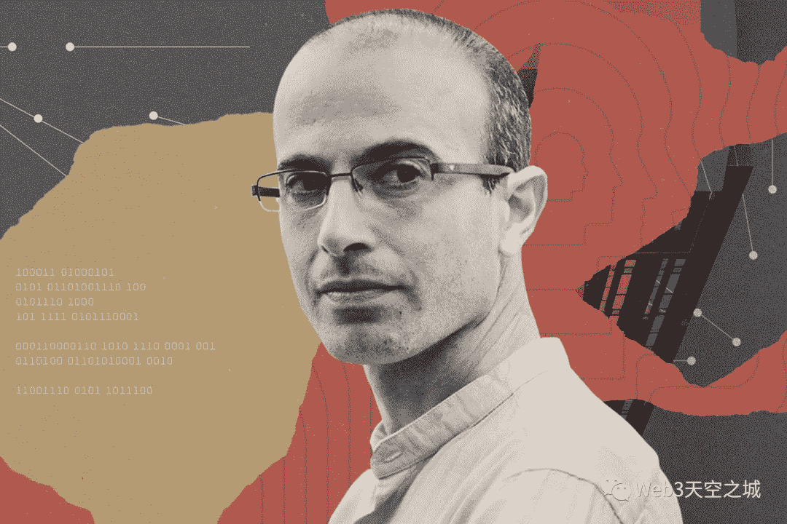

# 《未来简史》作者赫拉利 演讲：AI不需要意识就可以毁灭人类文明

> 来源：[https://jalicvoygc0.feishu.cn/docx/UmDzdCvfdovh67xc1C7cOeMFnqg](https://jalicvoygc0.feishu.cn/docx/UmDzdCvfdovh67xc1C7cOeMFnqg)

引用：https://mp.weixin.qq.com/s/iaTX7ZQ-D_g7rzLh8EqEBA

作者：城主 | 编辑：腾讯新闻 郝博阳

导语：

最近两个月，自从《暂停AI声明书》发布后，我们看到了诸多AI行业内的专家大佬隔空辩论AI的潜在威胁和治理方法，场面一时无两，基本上把技术路径上AI可能带来的危险都提了个遍。告警虽急，但大体上都认为当下AI还不具备威胁人类文明的能力。

但赫拉利于4月29日在Frontiers论坛上的演讲，却明确的表达了AI威胁的当下性，因为AI“已经破解了人类文明的操作系统”。赫拉利提出了与科幻作品中AI威胁完全不同的叙事。

写过《未来简史》的赫拉利一直在关注着AI和科技的进展，在2019年还有一场与李飞飞对于AI威胁的深入对谈，影响破圈。而今天，他对AI威胁的理解更进了一步。

作为**一****名历**史学家和哲学家，他毫无疑问更理解文明，及文明的构建基石——语言。人类的行为都通过语言作为中介，一切宗教，想象，信念乃至货币体系都由语言所构筑，由人们的共同相信而得以实存，并影响着整个人类历史。当AI触及到对语言的掌控时，人类构建的整套文明系统都可能随之被其颠覆。能构建黑客帝国的AI不需要有意识和身体，只需要制造一个异种文明，将我们包裹在这文化迷梦之中，并在梦中逐渐消耗掉人类文明即可。

我们常说要听听另一边的声音。这次赫拉利的系统性发声就是来自人文科学这一侧的发声，向我们揭示了AI更本质的威胁，那根植于哲学和历史的系统逻辑和严重性。

划重点：

1.  1. 科幻场景通常假设，人工智能在构成对人类的重大威胁之前，必须达到或超过两个重要的里程碑。首先，人工智能必须变得有感知力，发展出意识、感情和情绪。其次，人工智能必须擅长在物理世界中导航。但实际上人工智能并不需要有意识，也不需要有在物理世界中移动的能力，就能威胁到人类文明的生存。

1.  2. 人工智能正在获得通往我们所有机构之门的主钥匙。AI与印刷机、收音机以及历史上的每一项发明都有根本的不同，因为它可以创造全新的想法，它可以创造新的文化。我们人类从未真正直接接触到现实，我们总是通过文化的棱镜来体验现实。通过掌握语言，AI可以形成一种异种文化，拥有将人类包裹在矩阵般的幻境世界所需的一切。

1.  3. 新型人工智能工具正逐渐获得与人类建立深入、亲密关系的能力。它并不需要自己的感觉，它只需要能激发我们的感觉，让我们依赖它就可以控制人类。

1.  4. 政府必须立即禁止在未经安全检查的情况下，向公众领域释放更多革命性的AI工具。不是停止所有的AI研究，而是阻止向公众领域释放。同时让AI内容获得区分人类产生内容的标记。

以下为演讲全文：

我要和你们讨论的是人工智能与人类未来。

我知道这次会议的主题是人类面临的生态危机，但无论是好是坏，人工智能也是这个危机的一部分。人工智能可以帮助我们在很多方面克服生态**危机，也可能使其恶化。事实上，人工智能可能会改变生**态系统的含义，因为在地球存在的40亿年里，生态系统只包含有机生命形式。而现在，或者说不久的将来，我们可能会看到第一种无机生命形式出现，或者至少是无机代理的出现。

自20世纪中叶电脑时代开始以来，人们一直对人工智能感到恐惧，这种恐惧激发了许多科幻经典作品的创作，如《终结者》和《黑客帝国》。虽然这些科幻场景已经成为文化里程碑，但在学术、科学和政治辩论中，它们通常不被认真对待，也许这是有充分理由的。

因为**科幻场景**通常假设，人工智能在构成对人类的重大威胁之前，必须达到或超过两个重要的里程碑。首先，人工智能必须变得有感知力，发展出意识、感情和情绪，否则它为什么会想要接管世界？其次，人工智能必须擅长在物理世界中导航。机器人必须能够在房屋、城市、山脉和森林中移动和操作，至少要像人类一样灵活和高效。如果他们不能在物理世界中移动，他们怎么可能接管它？

然而，截至2023年4月，尽管围绕Chat GPT和其他新的人工智能工具的炒作，但这些工具似乎还远未达到这些里程碑。没有证据表明这些工具有任何意识、感情或情绪。至于在物理世界中导航，尽管围绕自动驾驶车辆的炒作，这些车辆将主导我们道路的日期仍在被推迟。

**然**而，令人糟心的是，人工智能并不需要有意识，也不需要有在物理世界中移动的能力，就能威胁到人类文明的生存。

过去几年里，新的人工智能工具已经进入公共领域，这可能会从一个意想不到的方向威胁到人类文明的生存。我们甚至难以理解这些新型人工智能工具的能力，以及它们持续发展的速度。

实际上，由于人工智能能够自主学习、自我改进，即使是这些工具的开发者也不知道它们所创造的东西的全部能力。他们自己经常会被这些工具的突现能力和突现品质所惊讶。我想在座的各位都已经了解了新型人工智能工具的一些最基本能力，比如写作、绘画、作曲和编写代码。但是还有许多额外的能力正在出现，比如伪造人们的声音和图像、起草法案、找到计算机代码和法律合同以及法律协议中的弱点。但最重要的是，新型人工智能工具正逐渐获得与人类建立深入、亲密关系的能力。

每种能力都值得进行一次完整的讨论，我们很难理**解它们**的全部影响。因此，让我们简化一下。当我们将所有这些能力作为一个整体来看时，它们可以归结为一件非常非常重要的事情：操纵和生成语言的能力，无论是用文字、图像还是声音。当前人工智能革命的一个重要方面是，人工智能正在掌握语言，达到超过普通人水平的程度。通过掌握语言，人工智能正在获得通往我们所有机构之门的主钥匙，从银行到庙宇，因为语言是我们用来向银行发出指示、在我们脑海中激发神圣愿景的工具。

**另一种思****考**方式是，人工智能刚刚破解了人类文明的操作系统。在历史上的每一种人类文化中，操作系统始终是语言。一开始就有了话语。我们用语言创造神话和法律，创造神和金钱，创造艺术和科学，创造友谊和国家。

例如，人权并非生物现实，也不是刻在我们DNA中的。人权是我们通过讲故事和制定法律创造出来的。神也不是生物或物理现实，神也是我们用语言通过讲述传说和编写经文创造出来的。金钱并不是生物学或物理现实。纸币只不过是一张毫无价值的纸，而目前世界上90%以上的货币甚至不是纸币，只是电脑里的电子信息在这里和那里传递。给任何形式的货币赋予价值的只是人们，比如银行家、财政部长和加密货币大师，关于货币的故事。

Sam Bankman-Fried、Elizabeth Holmes和Bernie Mado**ff**并没有创造出真正有价值的东西，但不幸的是，他们都是非常出色的讲故事者。那么，对于人类来说，在一个可能大部分故事、旋律、图像、法律、政策和工具都由一个非人类的、熟悉如何以超人的效率利用人类思维的弱点、偏见和成瘾的异种智能塑造的世界中生活意味着什么呢？这是个大问题。

**今天，在象棋等游戏中，没有人能战胜电脑。如果同样的事情发生**在艺术、政治、经济甚至宗教领域会怎样呢？当人们想到ChatGPT和其他新型AI工具时，他们往往会想到诸如孩子们使用ChatGPT编写学校论文的例子。当孩子们用ChatGPT写论文时，学校系统会发生什么？这很可怕。

但这类问题并没有抓住大局。忘掉学校论文吧，试着想象一下，例如2024年美国总统竞选，新型AI工具能够大量制造政治宣言、假新闻和新邪教的圣经，这将产生怎样的影响。近年来，政治影响力强大的QAnon邪教（一个美国极右翼阴谋论组织，宣扬深层政府，支持特朗普）就是围绕着被称为“Q滴”的匿名在线文本形成的。现在，这个邪教在美国和世界其他地区拥有数百万追随者，他们收集、审查并解读这些“Q滴”，就像是某种新的神圣文本。

据我们所知，之前所有的“Q滴”都是由人类撰写的，**机器人只是帮助将这些文本在网上传播**。但是**在**未来，我们可能会看到历史上第一个由非人类智能编写其审查文本的邪教和宗教。当然，历史上的宗教都声称他们的圣书是由非人类智能所写，以前这从未成真过，但这可能会很快变成现实，并产生深远的影响。

在更实际的层面上，我们可能很快就会发现自己与那些我们认为是其他人类的实体进行了**长时间的关于堕胎、气候变化或俄罗斯入侵乌克兰的**在线讨论，但实际上，它们是AI机器人。问题是，试图说服AI机器人改变其政治观点是完全没有用的，但我们与机器人交谈的时间越长，它就越了解我们，了解如何调整其信息，以改变我们的政治观点、经济观点或其他任何东西。通过掌握语言，AI还能与人建立深入而亲密的关系，利用亲密的力量影响我们的观点和世界观。

正如我所说的，**目前还没有迹象表明****AI****具**有意识或自己的感觉，但要与人类建立虚假的亲密关系，AI并不需要自己的感觉，它只需要能激发我们的感觉，让我们依赖它。

在2022年6月，有一个著名的事件，Google工程师Blake Lemon公开宣称，他正在研发的AI聊天机器人Lambda已经具备了自我意识。这个极具争议的声明导致他失去了工作，被解雇了。然而，这个事件最有趣的地方并不是Lemon的声明，这个声明大概率是假的，真正有趣的是他愿意为了保护他认为具有意识的AI聊天机器人，冒着并最终失去自己高薪工作的风险。如果AI能影响人们冒着失去工作的风险，它还能诱使我们做什么呢？

**在每****场政**治争斗中，亲密关系都是最有效的武器，而AI刚刚获得了与数以百万计的人建立亲密关系的能力。过去十年里，社交媒体已经成为一场争夺人类注意力的战场。现在，随着新一代AI的出现，战线正在从注意力转向亲密关系，这是个非常糟糕的消息。当AI与AI为了与我们建立亲密关系而战斗时，人类社会和人类心理会发生什么变化？这种关系可以用来说服我们购买特定的产品或投票支持特定的政治人物。

即使没有创造假的亲密关系，新的AI工具也会对人类的观点和世界观产生巨大影响。比如，人们可能会，或者已经开始使用单一的AI顾问作为他们的一站式智囊团，作为他们需要的所有信息的来源。难怪Google如此恐慌，如果你一直关注新闻通讯，你就会知道Google非常害怕，有足够的理由害怕。当你可以直接问智能顾问你想知道的任何事情时，为什么还要自己去搜索呢？你不需要去搜索。

新闻业和广告业也应该感到恐慌。为什么要读报纸，当我可以直接问智能顾问告诉**我有****什**么新闻？广告的目的是什么，当我可以直接问智能顾问告诉我买什么的时候？所以，有可能在很短的时间内，整个广告行业会崩溃，而控制新一代AI智能顾问的人和公司将变得极其强大。我们可能面临的是人类历史的终结，不是历史的终结，只是我们所称历史的人类主导部分的终结。历史是生物和文化之间的互动，是我们对食物和性等生物需求与我们的文化创造物，如宗教和法律之间的互动。历史就是宗教和法律与食物和性的互动过程。那么，当AI接管文化时，这种互动的历史进程会发生什么呢？

**在几年内，****AI****可能**会消化掉整个人类文化，消化掉我们几千年来创造的一切，然后开始大量产出新的文化创作，新的文化物品。我们要记住，我们人类从未真正直接接触到现实，我们总是被文化包围，我们总是通过文化的棱镜来体验现实。我们的政治观点是由记者的报道和朋友的轶事塑造的，我们的性取向是由电影和童话故事调整的，甚至我们的行走和呼吸方式都是由文化传统引导的。

过去，这种文化的包围总是由其他人编织的。之前的工具，比如印刷机、收**音机****或电视，它们帮助传播人类的文化观念和创作，但它们自己永远无法**创造新的东西。印刷机不能创造新的书，这总是由人类完成的。AI与印刷机、收音机以及历史上的每一项发明都有根本的不同，因为它可以创造全新的想法，它可以创造新的文化。

大问题是，由非人类智能，由异种（alien**）智能产生的****棱镜****，**体验现实会是什么样的？最初的几年，AI可能会大量模仿在其成长初期喂养它的人类原型。但随着每一年的过去，AI文化将大胆地走向人类从未涉足过的地方。

几**千**年来，我们人类基本上是生活在其他人的梦想和幻想中。我们崇拜神，追求美的理想，将我们的生活奉献给源于某个人类诗人、先知或政治家想象中的事业。很快，我们可能会发现自己生活在异种智能的梦想和幻想中。这种情况的潜在危险是根本的，与科幻电影和书籍中设想的大多数事情非常不同。

过去，人们主要担心的是智能机器带来的物理威胁。在**《终结者》中，机器人在街头奔跑，**向人们开枪。而《黑客帝国》认为，为了获得对人类社会的完全控制，AI首先需要获取我们大脑的物理控制，将我们的大脑直接连接到计算机网络中。但这是错误的。只要掌握了人类语言，AI就拥有了将我们包裹在矩阵般的幻境世界所需的一切。

与一些阴谋论者的想法相反，为了控制或操纵人们**，你实际上并不需要将芯片植入人们的大脑。****几千****年**来，先知、诗人和政治家都利用语言和讲故事来操纵和控制人们，改变社会。现在，AI很可能也能做到这一点，一旦能做到这一点，它就不需要派出杀手机器人来射杀我们，如果真的需要，它可以让人类自己扣动扳机。

对AI的恐惧只困扰着人类几代人，比如从20世纪中叶开始。如果回到《弗兰肯斯坦》，可能是200年。但几千年来，人类一直受到一个更深层次的恐惧的困扰。人们一直认识到故事、形象和语言在操纵我们的思想和创造幻觉方面的力量。因此，自古以来，人们就害怕被困在幻觉世界中。

在17世纪，当笛卡尔担心恶魔可能将他困在幻觉世界里时，他创建了他所看到和听到的一切。在古希腊，柏拉图讲述了著名的《洞穴寓言》，其中一群人被束缚在一个洞穴里，一生面对着一面空白的墙。在这个屏幕上，他们看到投影出各种阴影，而犯人们将这些幻觉、这些阴影误认为现实。

在古印度，佛教徒和印度教圣贤们指出，所有人都生活在所谓的摩耶幻境中。摩耶就是幻觉的世界。佛陀说，我们通常**认**为是现实的东西，通常只是我们脑海中的虚构。人们可能会因为相信这些虚构而进行整场战争，杀人，甚至愿意为之献身。所以，AI革命让我们直面恶魔的诡计，面对柏拉图的洞穴，面对摩耶幻境。如果我们不小心，一层幻觉的帷幕可能笼罩整个人类，我们永远无法撕下那层帷幕，甚至意识不到它的存在，因为我们会认为这就是现实。

**如果这听起来有些牵强，那么看看过去几年的社交媒**体吧。社交媒体让我们对未来有了一点了解。在社交媒体上，原始**的**AI工具（虽然很原始）被用来策划内容，而非创作内容。人们制作了故事、视频等，而AI选择了哪些故事、哪些视频会进入我们的耳朵和眼睛，选择那些最能吸引注意力、最有可能成为病毒式传播的内容。

**尽管这些****AI****工具非**常原始，但它们仍然足以在整个世界范围内制造出一层幻觉帷幕，加剧社会分化，削弱我们的心理健康，破坏民主社会。数百万人将这些幻觉误认为是现实。美国拥有全世界最强大的信息技术，然而美国公民甚至无法就上届选举的结果达成一致，也无法就气候变化是否真实、疫苗是否能预防疾病达成一致。

**新一代****AI**工具比社交媒体算法强大得多，可能造成更大的破坏。当然，AI也有巨大的积极潜力。我之所以没有谈论这个问题，是因为开发AI的人自然会足够谈论它，你不需要我加入那个合唱团。历史学家和哲学家（比如我自己）的工作通常是指出潜在的危险，但AI确实可以在无数方面帮助我们，从寻找治疗癌症的新方法，到找到解决生态危机的方案。

为了确保新的AI工具被用于善而不是恶，我们首先需要了解它们的真正能力，并非常谨慎地对它们进行监管。

自1945年以来，我们就知道核技术有可能在为我们提供便宜且丰富的能源的同时，也有可能物理上摧毁人类文明。因此，我们重塑了整个国际秩序，以保护自己，并确保核技术主要用于善事。我们现在必须应对一种新的大规模毁灭性武器，它可以毁灭我们的精神和社会世界。

**核武器和****AI****之间有一个重大的区别：核武器不能制造出更强大**的核武器，但AI可以制造出更强大的AI。所以，我们需要在AI脱离我们控制之前迅速采取行动。药品公司不能在对新药进行严格的安全检查之前就向人们销售。生物技术实验室也不能为了向股东展示他们的技术魔法，就随意向公众释放新病毒。

**同样，政府必须立即禁止在未经安全****检查**的情况下，向公众领域释放更多革命性的AI工具。我并不是说要停止所有的AI研究，第一步是阻止向公众领域释放。你可以研究病毒，而不向公众释放，你可以研究AI，但不要过快地将其释放到公众领域。

如果我们不放慢AI武器竞赛的速度，我们将没有时间去理解正在发生的事情，更不用说有效地管理这项强大的技术了。你可能会疑惑，公开部署AI的速度放慢会不会使民主国家落后于更无情的威权政权。答案绝对是不会，正好相反。未经监管的AI部署会导致民主国家输给威权国家。因为如果我们释放了混乱，威权政权更容易控制这些混乱。

**民主本质上是一种对话。民主是一种开放的对话，而威权是一种命令，只有一****个人****在指挥一切，没有对话。民主是许多**人关于应该做什么的对话。而对话依赖于语言。当AI破解了语言，它就有可能破坏我们进行有意义的公众对话的能力，进而破坏民主。如果我们等待混乱，那么要以民主的方式来规范它就太晚了。也许以威权的方式还有可能，但如果你无法就此展开讨论，又如何以民主的方式进行管理呢？如果我们不能及时管理AI，我们将无法再进行有意义的公共对话。

所以总结一下，**我们基本上在地球上遇到了一种异种智能。我们对这种异种智能**了解甚少，只知道它有可能摧毁我们的文明。因此，我们应该立即停止将这种不负责任的异种智能部署到我们的社会中，并在AI规范我们之前对其进行管理。我们可以提出许多管理措施，但我首先建议的是强制AI披露自己是AI。如果我正在与某人交谈，而无法判断对方是人类还是AI，那么民主的意义就荡然无存，因为这意味着有意义的公共对话的结束。

现在，请思考一下你在过去20到25分钟里听到的内容。你可能会感到警觉，可能会对开发这些技术的公司或未能监管它们的政府感到愤怒。你甚至可能会对我感到愤怒，认为我夸大了威胁，或者误导了公众。但无论你怎么想，我敢打赌我的话在情感上对你产生了影响，不仅是在智力上。我刚给你讲了一个故事，这个故事可能会改变你对某些事情的看法，甚至可能导致你在现实世界中采取一定的行动。

那么，刚才你听到的这个改变了你思维和大脑的故事是谁创造的呢？我向你保证，尽管图像是在AI的帮助下创作的，但这次演讲的文本是由我和其他几个人共同完成的。至少你所听到的话语是人类思维或多个人类思维的文化产物。但你能完全确定这是事实吗？

**一年**前，你可以确定。一年前，在公共领域里，除了人类思维，没有任何东西可以创作出如此复杂和有力的文本。但现在情况不同了，理论上，你刚刚听到的文本可能是由一种非人类的异种智能生成的。

所以，请花一点时间，甚至更多时间来思考这个问题。谢谢。

**现场问答：**

主持人：这真是一场非同寻常的演讲，你们刚刚听到的内容，我想知道你们有多少人感到了恐惧。在座的有很多非常聪明的人，他们都感到这个问题很可怕。这里有很多问题需要提问，我将从观众和在线参与者中接受一些问题。这位先生在这里。

问题1：

我是《Frontiers and Sustainability》的领域编辑，这是一场精彩的演讲。我非常喜欢你的书，我真心的追随你。我有一个问题，关于AI的监管。我非常赞同原则，但问题是如何去做。我认为，在你的地下室里建一个核反应堆是非常困难的，但你完全可以在你的地下室里很容易地训练你的AI。我们应该如何对此进行监管呢？

另一个和这个相关的问题是，这个整个Frontiers和论坛都是关于开放科学和开放信息，开放数据。目前大部分的AI都是用公开可用的信息训练出来的，包括模式、书籍和经文等等。所以，监管AI是否意味着我们应该将这些信息限制在一个封闭的空间里，这与我们真正认为对我们来说非常重要的开放科学和开放数据的倡议相矛盾？

回答：

黑盒子是一种算法，不是吗？我知道会有权衡，我们首先需要时间来理解我们需要哪种监管。现在这些非常强大的AI工具并未由地下室里的个人黑客生产，你需要大量的计算能力，你需要大量的资金。所以，这个领域是由少数几个大公司和政府领导的。对于全球层面的事情进行监管将是非常困难的，因为这是一场军备竞赛。

但是有些事情，即使只是对自己进行监管，也是有益的。比如，一个AI在与人类交互时，必须披露它是AI，即使某些专制政权不愿意这么做，欧盟、美国或其他民主国家都可以做到这一点。这对保护开放社会至关重要。现在有很多关于网络审查的问题。

你会有这样的争议，是Twitter还是Facebook有权阻止美国前总统发表公开言论。这是一个非常复杂的问题。但有一个非常简单的问题，人类有表达的自由，机器人没有表达的自由。这是人权，人类有，机器人没有。所以，如果你拒绝给机器人表达的自由，我认为这对每个人来说都是可以接受的。

问题2：

我是哲学家，我有一个我认为很有趣的问题。关于你从“人工”转向“异种”的语言选择，人工意味着仍然有一定程度的人类控制，而异种则暗示着陌生，而且至少在想象中也暗示着生命形式。我很好奇你想让这些词为你做什么工作。

回答：

**它当然还是人工的，因为是我们制造的，但它越来越多**地自主学习和适应。人工这个词是一种一厢情愿地认为它仍然在我们的控制之下，而事实上它正在逐渐脱离我们的控制。所以在这个意义上，它正变成一种异种力量，不一定是邪恶的，当然它也可以做很多好事。但首先要认识到的是，它是异种的，我们不了解它的工作原理。最令人震惊的事情之一就是，你向领导这项技术的人提问，询问它如何工作，它能做什么，他们会说：“我们不知道。”我们知道最初是如何构建的，但后来它确实是靠自己学习的。

**关于**这是否是一种生命形式的讨论，我认为它目前还没有意识，我不认为它发展意识是不可能的，但我也不认为它发展意识是必要的。这是一个有待解决的问题。但生命并不一定意味着意识，我们有很多生命形式，如微生物、植物、真菌等，我们认为它们没有意识，但仍然把它们视为生命形式。我认为AI正逐渐接近那个地位。当然，生命究竟是什么，这是一个哲学问题。我们来定义边界，比如病毒算不算生命？我们认为阿米巴生物是生命，但病毒在生命与非生命之间徘徊。

这是关于语言，是我们的词汇选择。所以我认为如何称呼AI并不是最重要的，最重要的是真正理解我们面临的是什么，不要自欺欺人地以为这是我们创造的，我们可以控制的东西。如果出了什么问题，我们只要拔掉插头就行了。但现在已经没有人知道怎么拔插头了。

问题3：

我要接受一下在线观众的问题。这个问题来自美国的迈克尔·布朗：你对人工通用智能已经存在，或者说有人可以利用人工通用智能来影响社会系统的可能性有什么看法？我认为这种可能性非常非常小。如果真的存在人工通用智能，我们就不会坐在这里了。从历史的角度来看，我相信世界上没有任何人掌握了人工通用智能。

回答：

我观察世界的混乱状态，人工通用智能实际上是人类历史的终点，这是一**种非**常强大的事物，无人能够控制。至于发展出人工通用智能需要多久，我不知道。但是，威胁文明基础的并不需要人工通用智能，回到社交媒体，非常原始的AI已经足够产生巨大的社会和政治混乱。

**如果****我从**进化的角度来看待这个问题，AI现在刚刚从有机汤中爬出来，就像四十亿年前第一种生命形式从有机汤中爬出来一样。达到霸王龙或者智人的水平需要多长时间，不需要四十亿年，可能只需要四十年。关键在于，数字化进化的时间尺度完全不同于有机进化的时间尺度。

主持人：非常感谢你，这场讨论非常精彩，能有你在这里真是太好了。我相信你会在之后的时间里和我们待在一起，让我们全体给你一次热烈的掌声。

-END-

扫码加入AI Flow Genius社群，探讨使用AI来提升生产力的方法，成为超级个体

超过200需手动拉人 **备注：加群**

