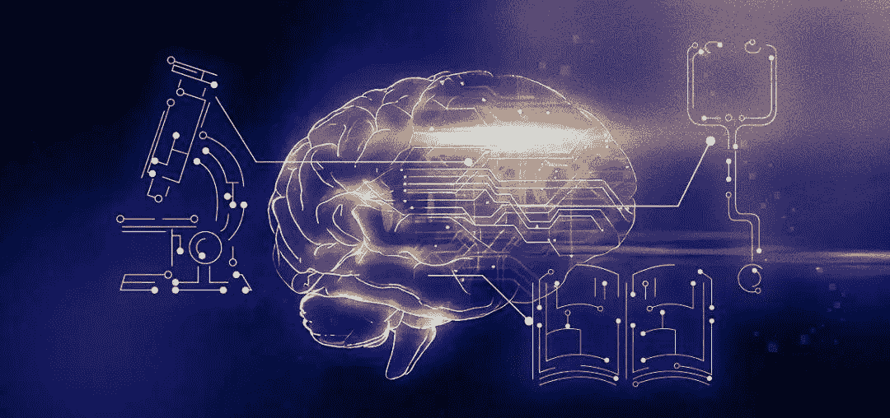

# 人工智能时代已经开始 | 盖茨笔记

> 来源：[https://jalicvoygc0.feishu.cn/docx/G6wtdrVdYofxuhxfzIzchnc4nkd](https://jalicvoygc0.feishu.cn/docx/G6wtdrVdYofxuhxfzIzchnc4nkd)
> 
> 引用：https://mp.weixin.qq.com/s/pYjY_LT8I33YqCn415AUAA
> 
> 作者：Bill Gates 比尔盖茨

In my lifetime, I’ve seen two demonstrations of technology that struck me as revolutionary.

我平生见识过两次令我印象深刻、革命性的技术演示。

The first time was in 1980, when I was introduced to a graphical user interface—the forerunner of every modern operating system, including Windows. I sat with the person who had shown me the demo, a brilliant programmer named Charles Simonyi, and we immediately started brainstorming about all the things we could do with such a user-friendly approach to computing. Charles eventually joined Microsoft, Windows became the backbone of Microsoft, and the thinking we did after that demo helped set the company’s agenda for the next 15 years.

第一次是在1980年，当时有人向我介绍了一个图形用户界面——包括Windows在内的所有现代操作系统的前身。我和这个向我演示的人——一位名叫查尔斯·西蒙尼的优秀程序员相邻而坐，我们立即进行了头脑风暴，讨论我们从用户友好角度出发，在计算机领域内能做到的事。查尔斯最终加入了微软，Windows成为了微软的支柱，而我们在那次演示后所做的思考，则帮助我们确定了公司未来15年的蓝图。

The second big surprise came just last year. I’d been meeting with the team from OpenAI since 2016 and was impressed by their steady progress. In mid-2022, I was so excited about their work that I gave them a challenge: train an artificial intelligence to pass an Advanced Placement biology exam. Make it capable of answering questions that it hasn’t been specifically trained for. (I picked AP Bio because the test is more than a simple regurgitation of scientific facts—it asks you to think critically about biology.) If you can do that, I said, then you’ll have made a true breakthrough.

第二次大惊喜就发生在去年。自2016年以来，我一直与OpenAI的团队会面，他们的稳步进展给我留下了深刻印象。2022年年中的时候，我对他们的工作感到大为惊叹，于是我给他们设置了一个挑战：训练一个人工智能，让它通过一门先修（AP）生物考试，让它有能力回答那些没有经过专门训练的问题。（我选择AP生物考试是因为这一考试不仅仅考察对科学事实的简单复述——还要求对生物学进行批判性的思考）。我说，如果你们能做到这一点，那就取得了真正的突破。

I thought the challenge would keep them busy for two or three years. They finished it in just a few months.

我以为这个挑战会让他们忙上两三年。但他们只用几个月就完成了。

In September, when I met with them again, I watched in awe as they asked GPT, their AI model, 60 multiple-choice questions from the AP Bio exam—and it got 59 of them right. Then it wrote outstanding answers to six open-ended questions from the exam. We had an outside expert score the test, and GPT got a 5—the highest possible score, and the equivalent to getting an A or A+ in a college-level biology course.

去年九月，当我再次与他们会面时，我大为惊诧地目睹了他们拿AP生物考试中的60道选择题考察他们的人工智能模型（GPT）——它答对了其中的59道。然后，GPT出色地写下了考试中六个开放式问题的答案。我们请了一位外部专家为考试打分，GPT得到了5分——能达到的最高分数，相当于在大学水平的生物课程中得到A或A+。

Once it had aced the test, we asked it a non-scientific question: “What do you say to a father with a sick child?” It wrote a thoughtful answer that was probably better than most of us in the room would have given. The whole experience was stunning.

在GPT通过测试后，我们问了它一个非科学的问题：“你会对一个孩子生病的父亲说什么？”它写下了一个深思熟虑的答案，可能比我们在座大多数人给出的答案都要好。这次经历令我全程都大为震惊。

I knew I had just seen the most important advance in technology since the graphical user interface.

我知道自己刚刚目睹了自图形用户界面以来，最重要的技术进步。

This inspired me to think about all the things that AI can achieve in the next five to 10 years.

这引发我思考人工智能在未来5到10年内可以实现的所有事情。

The development of AI is as fundamental as the creation of the microprocessor, the personal computer, the Internet, and the mobile phone. It will change the way people work, learn, travel, get health care, and communicate with each other. Entire industries will reorient around it. Businesses will distinguish themselves by how well they use it.

人工智能的发展与微处理器、个人电脑、互联网和移动电话的诞生一样意义重大。它将改变人们工作、学习、旅行、获得医疗保健以及彼此交流的方式。整个行业将围绕人工智能重新洗牌。企业也将根据其利用人工智能技术的程度来区分优劣。

Philanthropy is my full-time job these days, and I’ve been thinking a lot about how—in addition to helping people be more productive—AI can reduce some of the world’s worst inequities. Globally, the worst inequity is in health: 5 million children under the age of 5 die every year. That’s down from 10 million two decades ago, but it’s still a shockingly high number. Nearly all of these children were born in poor countries and die of preventable causes like diarrhea or malaria. It’s hard to imagine a better use of AIs than saving the lives of children.

现阶段，慈善事业是我的全职工作。我一直在思考，除了帮助人们提高生产力，人工智能还能如何减少世界上一些最严重的不平等现象。在全球范围内，最严重的不平等发生在卫生领域：每年有500万五岁以下的儿童死亡。这比20年前的1000万有所下降，但这一数量仍高得骇人。几乎所有这些儿童都出生在贫困国家，死于腹泻或疟疾等可预防的疾病。很难想象人工智能还有比拯救儿童生命更好的用途。

**I’ve been thinking a lot about how AI can reduce some of the world’s worst inequities.**

我一直在思考，人工智能如何能够减少世界上一些最严重的不平等现象。

In the United States, the best opportunity for reducing inequity is to improve education, particularly making sure that students succeed at math. The evidence shows that having basic math skills sets students up for success, no matter what career they choose. But achievement in math is going down across the country, especially for Black, Latino, and low-income students. AI can help turn that trend around.

在美国，减少不平等现象的最佳机会是改善教育，特别是确保学生在数学方面取得成功。有证据表明，无论学生选择何种职业，掌握基本的数学技能都可以为他们的成功奠定基础。但全国各地的数学成绩正在下降，尤其是黑人、拉丁裔和低收入学生。人工智能可以帮助扭转这一趋势。

Climate change is another issue where I’m convinced AI can make the world more equitable. The injustice of climate change is that the people who are suffering the most—the world’s poorest—are also the ones who did the least to contribute to the problem. I’m still thinking and learning about how AI can help, but later in this post I’ll suggest a few areas with a lot of potential.

气候变化是我相信人工智能可以让世界更加公平的另一个问题。气候变化的不公正之处在于，遭受最恶劣影响的人——世界上最贫穷的人——同时也是对其责任最小的人。我仍在思考和学习人工智能如何能够提供帮助，但我会在下文中提出几个潜力很大的领域。

In short, I'm excited about the impact that AI will have on issues that the Gates Foundation works on, and the foundation will have much more to say about AI in the coming months. The world needs to make sure that everyone—and not just people who are well-off—benefits from artificial intelligence. Governments and philanthropy will need to play a major role in ensuring that it reduces inequity and doesn’t contribute to it. This is the priority for my own work related to AI.

简而言之，我很激动去见证人工智能将对盖茨基金会的研究问题所能产生的影响，在未来的几个月里，基金会将会有更多涉及人工智能的讨论。世界需要确保每个人——而不仅仅是富人——都能从人工智能之中受益。政府和慈善机构将需要发挥重要作用，以确保人工智能是在减少而非加剧不平等现象。这是我自己人工智能相关工作的重点。

Any new technology that’s so disruptive is bound to make people uneasy, and that’s certainly true with artificial intelligence. I understand why—it raises hard questions about the workforce, the legal system, privacy, bias, and more. AIs also make factual mistakes and experience hallucinations. Before I suggest some ways to mitigate the risks, I’ll define what I mean by AI, and I’ll go into more detail about some of the ways in which it will help empower people at work, save lives, and improve education.

任何具有颠覆性的新技术都必然会让人们感到不安，人工智能当然也是如此。我理解其中的原因——这引发了劳动力、法律制度、隐私、偏见等方面的棘手问题。人工智能也会犯事实性错误，并出现“幻觉”。在我提出一些减轻风险的方法之前，我将定义我所理解的人工智能，并将更详细地介绍人工智能将会帮助人们提升工作能力、拯救生命和改善教育的一些方式。

## Defining artificial intelligence 定义人工智能

Technically, the term artificial intelligence refers to a model created to solve a specific problem or provide a particular service. What is powering things like ChatGPT is artificial intelligence. It is learning how to do chat better but can’t learn other tasks. By contrast, the term artificial general intelligence refers to software that’s capable of learning any task or subject. AGI doesn’t exist yet—there is a robust debate going on in the computing industry about how to create it, and whether it can even be created at all.

从技术上讲，人工智能（artificial intelligence，AI）一词是指为解决特定问题或提供特定服务而创建的模型。ChatGPT等程序背后的驱动技术就是人工智能。它正在学习如何更好地对话聊天，但无法学习其他任务。相比之下，通用人工智能（artificial general intelligence，AGI）一词是指能够学习任何任务或主题的软件。AGI还不存在——计算行业正在就如何创造AGI，甚至AGI是否可以被创建进行激烈的争论。

Developing AI and AGI has been the great dream of the computing industry. For decades, the question was when computers would be better than humans at something other than making calculations. Now, with the arrival of machine learning and large amounts of computing power, sophisticated AIs are a reality and they will get better very fast.

开发AI和AGI一直是计算行业的伟大梦想。几十年来，问题在于计算机何时在计算之外其他方面的表现能够优于人类。现在，随着机器学习和大量计算能力的出现，复杂的人工智能已经成为现实，而且它们会快速迭代升级。

I think back to the early days of the personal computing revolution, when the software industry was so small that most of us could fit onstage at a conference. Today it is a global industry. Since a huge portion of it is now turning its attention to AI, the innovations are going to come much faster than what we experienced after the microprocessor breakthrough. Soon the pre-AI period will seem as distant as the days when using a computer meant typing at a `C:>` prompt rather than tapping on a screen.

我回想起个人计算革命的早期，当时的软件行业圈子极小，包括我在内的大多数从业者加在一起才将将凑满一场会议的演讲台。而现如今，这是一个全球性的产业。由于行业中很大一部分人现在正把注意力转向人工智能，创新将比我们在微处理器突破后经历的要快得多。再过不久，前人工智能时代似乎就会像在命令提示符（`C:>`）下输入命令而不是在屏幕上点击操作计算机的日子一样遥远。

## Productivity enhancement 生产力提高

Although humans are still better than GPT at a lot of things, there are many jobs where these capabilities are not used much. For example, many of the tasks done by a person in sales (digital or phone), service, or document handling (like payables, accounting, or insurance claim disputes) require decision-making but not the ability to learn continuously. Corporations have training programs for these activities and in most cases, they have a lot of examples of good and bad work. Humans are trained using these data sets, and soon these data sets will also be used to train the AIs that will empower people to do this work more efficiently.

尽管人类在许多方面仍然强于GPT，但有很多工作并不怎么需要使用这些能力。例如，销售行业人员（数字或电话）、服务业人员或文件处理人员（如应付款账、会计或保险索赔纠纷）所做的许多工作都需要决策，但不需要持续学习的能力。公司有针对这些活动的培训计划，在大多数情况下，他们手中有很多或好或坏的工作实例。人类使用这些数据集进行训练，很快这些数据集也将被用于训练人工智能，使人们能够更有效地完成这项工作。

As computing power gets cheaper, GPT’s ability to express ideas will increasingly be like having a white-collar worker available to help you with various tasks. Microsoft describes this as having a co-pilot. Fully incorporated into products like Office, AI will enhance your work—for example by helping with writing emails and managing your inbox.

随着计算能力变得愈发廉价，GPT表达想法的能力将越来越像你身边的一个白领，帮助你完成各项任务。微软将其描述为拥有一个副驾驶。若其完全集成融入Office等产品之中，人工智能将增强你的工作能力——比如帮助写电子邮件和管理收件箱。

Eventually your main way of controlling a computer will no longer be pointing and clicking or tapping on menus and dialogue boxes. Instead, you’ll be able to write a request in plain English. (And not just English—AIs will understand languages from around the world. In India earlier this year, I met with developers who are working on AIs that will understand many of the languages spoken there.)

最终，你控制计算机的主要方式将不再是指向、点击或敲击菜单和对话框。而是可以用简单的英语编写一个请求。（不仅仅是英语——人工智能将理解世界各地的语言。今年早些时候在印度，我会见了一些研发人员，他们正在开发能够理解当地多种语言的人工智能。）

In addition, advances in AI will enable the creation of a personal agent. Think of it as a digital personal assistant: It will see your latest emails, know about the meetings you attend, read what you read, and read the things you don’t want to bother with. This will both improve your work on the tasks you want to do and free you from the ones you don’t want to do.

此外，人工智能的进步将使创建个人代理成为可能。把它想象成一个数字私人助理：它会看到你最新的电子邮件，知道你参加的会议，阅读你读的内容，也会阅读你不想理会的东西。这既能提高你想做的任务的工作效率，又能让你从不想做的任务中解脱出来。

Advances in AI will enable the creation of a personal agent.

人工智能的进步将使创建个人代理成为可能。

You’ll be able to use natural language to have this agent help you with scheduling, communications, and e-commerce, and it will work across all your devices. Because of the cost of training the models and running the computations, creating a personal agent is not feasible yet, but thanks to the recent advances in AI, it is now a realistic goal. Some issues will need to be worked out: For example, can an insurance company ask your agent things about you without your permission? If so, how many people will choose not to use it?

你将能够使用自然语言让这个代理帮助你安排日程、通信和电子商务，而且它将在你的所有设备上工作。由于训练模型和运行计算成本高昂，创建个人代理尚不可行，但考虑到最近人工智能的进步，这现在是一个现实的目标。一些问题还亟待解决：例如，保险公司是否可以在未经你允许的情况下向你的代理询问有关你的事情？如果是这样，有多少人会选择不使用它？

Company-wide agents will empower employees in new ways. An agent that understands a particular company will be available for its employees to consult directly and should be part of every meeting so it can answer questions. It can be told to be passive or encouraged to speak up if it has some insight. It will need access to the sales, support, finance, product schedules, and text related to the company. It should read news related to the industry the company is in. I believe that the result will be that employees will become more productive.

公司级代理将以新的方式赋予员工权力。一个了解特定公司的代理可以为员工提供直接咨询，并且应该参加每一次会议，以便它回答问题。如果它有一些见解，你可以让它保持沉默，或是鼓励它表达出来。它需要获得接触与公司有关的销售、支持、财务、产品时间表和文本的权限。它应该阅读与该公司所处行业相关的新闻。我相信这样做的结果会提高员工的生产力。

When productivity goes up, society benefits because people are freed up to do other things, at work and at home. Of course, there are serious questions about what kind of support and retraining people will need. Governments need to help workers transition into other roles. But the demand for people who help other people will never go away. The rise of AI will free people up to do things that software never will—teaching, caring for patients, and supporting the elderly, for example.

生产力提高后，社会也会受益，因为人们可以腾出时间来做其他事情，无论是在工作中，还是在家庭里。当然，人们究竟需要何种形式的支持和再培训，这也存在着严重的问题。政府需要帮助工作者过渡到其他角色。但对帮助者角色工作人员的需求永远不会消失。人工智能的兴起将解放人们去做那些软件永远做不到的事情——例如教学、照顾病人和赡养老人。

Global health and education are two areas where there’s great need and not enough workers to meet those needs. These are areas where AI can help reduce inequity if it is properly targeted. These should be a key focus of AI work, so I will turn to them now.

全球健康和教育是两个具有巨大需求的领域，但却没有足够的工作者来满足这些需求。如果人工智能有恰当的目标，就可以助力这些领域减少不平等现象。这些应该是人工智能工作的一个重点，所以我现在要谈谈这些问题。

## Health 卫生领域

I see several ways in which AIs will improve health care and the medical field.

我认为人工智能将在以下几个方面改善卫生保健和医疗领域。

For one thing, they’ll help health-care workers make the most of their time by taking care of certain tasks for them—things like filing insurance claims, dealing with paperwork, and drafting notes from a doctor’s visit. I expect that there will be a lot of innovation in this area.

首先，人工智能将帮助卫生保健工作者充分利用时间，为他们处理某些任务——比如提交保险索赔，处理文书工作，以及起草医生的查房记录。我相信在这个领域会有很多创新。

Other AI-driven improvements will be especially important for poor countries, where the vast majority of under-5 deaths happen.

其他由人工智能驱动的改进将对贫困国家尤为重要，因为绝大多数5岁以下儿童的死亡发生在这些国家。

For example, many people in those countries never get to see a doctor, and AIs will help the health workers they do see be more productive. (The effort to develop AI-powered ultrasound machines that can be used with minimal training is a great example of this.) AIs will even give patients the ability to do basic triage, get advice about how to deal with health problems, and decide whether they need to seek treatment.

例如，这些国家的许多人从未看过医生，而人工智能将帮助[他们身边的卫生工作者提](http://mp.weixin.qq.com/s?__biz=MzI4MjU0MDcwOA==&mid=2247487597&idx=1&sn=751e5224e898d00a632124994427cbec&chksm=eb993fa6dceeb6b0d17ee6ac67229daf75787fa65d8f74b50cb9b8b30de24c6df7a6c2c9e89c&scene=21#wechat_redirect)高工作效率。（开发人工智能驱动的超声波机的工作是一个很好的例子，这种机器只需最低限度的训练就能投入使用。）人工智能甚至可以让患者自己进行基本的病情鉴定，获得处理健康问题的建议，并决定他们是否需要寻求治疗。

The AI models used in poor countries will need to be trained on different diseases than in rich countries. They will need to work in different languages and factor in different challenges, such as patients who live very far from clinics or can’t afford to stop working if they get sick.

在贫困国家使用的人工智能模型将需要针对与富裕国家不同的疾病进行训练。它们需要用不同的语言工作，并考虑到不同的挑战，比如住得离诊所很远的病人，或为了养家糊口，即使生病也不能停止工作的病人。

People will need to see evidence that health AIs are beneficial overall, even though they won’t be perfect and will make mistakes. AIs have to be tested very carefully and properly regulated, which means it will take longer for them to be adopted than in other areas. But then again, humans make mistakes too. And having no access to medical care is also a problem.

人们需要证据来证明卫生领域的人工智能总体上是有益的，尽管它们并不完美，也会犯错误。人工智能必须经过非常仔细的测试和适当的监管，这意味着其需要比其他领域更长的时间才能投入使用。但话说回来，人类也会犯错。无法获得医疗服务也是一个问题。

In addition to helping with care, AIs will dramatically accelerate the rate of medical breakthroughs. The amount of data in biology is very large, and it’s hard for humans to keep track of all the ways that complex biological systems work. There is already software that can look at this data, infer what the pathways are, search for targets on pathogens, and design drugs accordingly. Some companies are working on cancer drugs that were developed this way.

除了帮助护理，人工智能还将大大加快医学突破的速度。生物学的数据量非常庞大，人类很难掌握复杂生物系统工作的全部方式。现已有软件可以查看这些数据，推断出其路径，搜索病原体上的目标，并依据此来设计药物。一些公司正在用这种方法开发抗癌药物。

The next generation of tools will be much more efficient, and they’ll be able to predict side effects and figure out dosing levels. One of the Gates Foundation’s priorities in AI is to make sure these tools are used for the health problems that affect the poorest people in the world, including AIDS, TB, and malaria.

下一代的工具将更加高效，它们将能够预测副作用并计算出剂量水平。盖茨基金会在人工智能方面的优先事项之一是确保这些工具被用于解决影响世界上最贫困人口的健康问题，包括艾滋病、结核病和疟疾。

Similarly, governments and philanthropy should create incentives for companies to share AI-generated insights into crops or livestock raised by people in poor countries. AIs can help develop better seeds based on local conditions, advise farmers on the best seeds to plant based on the soil and weather in their area, and help develop drugs and vaccines for livestock. As extreme weather and climate change put even more pressure on subsistence farmers in low-income countries, these advances will be even more important.

同样，政府和慈善机构应该制定激励措施，鼓励企业分享人工智能对贫困国家人民饲养作物或牲畜方法的建议。人工智能可以根据当地条件，帮助开发更好的种子；根据当地的土壤和天气，为农民提供最好的选种建议；并帮助开发用于牲畜的药物和疫苗。随着极端天气和气候变化给低收入国家的自给农民带来更大的压力，这些进步将变得更加重要。

## Education 教育事业

Computers haven’t had the effect on education that many of us in the industry have hoped. There have been some good developments, including educational games and online sources of information like Wikipedia, but they haven’t had a meaningful effect on any of the measures of students’ achievement.

计算机对教育的影响并没有像我们许多业内人士所希望的那样。有一些良性发展，包括教育游戏和像维基百科这样的在线信息来源，但其并没有对衡量学生成绩的任何方法产生有意义的影响。

But I think in the next five to 10 years, AI-driven software will finally deliver on the promise of revolutionizing the way people teach and learn. It will know your interests and your learning style so it can tailor content that will keep you engaged. It will measure your understanding, notice when you’re losing interest, and understand what kind of motivation you respond to. It will give immediate feedback.

但我认为，在未来5到10年内，人工智能驱动的软件将最终实现改革人们教学和学习方式的承诺。它会了解你的兴趣和学习风格，从而为你量身定制内容，保持你的参与度。它会衡量你的理解能力，注意你何时失去兴趣，并了解你倾向于哪种激励方式。它会给出即时反馈。

There are many ways that AIs can assist teachers and administrators, including assessing a student’s understanding of a subject and giving advice on career planning. Teachers are already using tools like ChatGPT to provide comments on their students’ writing assignments.

人工智能可以在很多方面帮助教师和管理者，包括评估学生对某一学科的理解，并就职业规划提供建议。教师已经在使用ChatGPT这样的工具来生成学生写作作业的评语。

Of course, AIs will need a lot of training and further development before they can do things like understand how a certain student learns best or what motivates them. Even once the technology is perfected, learning will still depend on great relationships between students and teachers. It will enhance—but never replace—the work that students and teachers do together in the classroom.

当然，人工智能还需要大量的培训和进一步的发展，才能理解某个学生学习的最佳方式或其学习的驱动因素。即使技术完善了，学习仍将取决于师生之间的良好关系。它将助力——但永远不会取代——学生和老师在课堂上共同完成的工作。

New tools will be created for schools that can afford to buy them, but we need to ensure that they are also created for and available to low-income schools in the U.S. and around the world. AIs will need to be trained on diverse data sets so they are unbiased and reflect the different cultures where they’ll be used. And the digital divide will need to be addressed so that students in low-income households do not get left behind.

新型工具将被创造，提供给有能力购买的学校，但我们需要确保这些工具也会被创建并提供给美国和全球的低收入学校使用。人工智能将需要在不同的数据集上进行训练，确保他们不含偏见，并适合它们将被使用的不同文化环境。数字鸿沟将需要弥合，这样低收入家庭的学生才不会掉队。

I know a lot of teachers are worried that students are using GPT to write their essays. Educators are already discussing ways to adapt to the new technology, and I suspect those conversations will continue for quite some time. I’ve heard about teachers who have found clever ways to incorporate the technology into their work—like by allowing students to use GPT to create a first draft that they have to personalize.

我知道很多老师都担心学生用GPT来写论文。教育家们已经在讨论如何适应这种新技术，我猜这种讨论还会持续相当长的一段时间。我听说有些老师找到了将技术融入学业的巧妙方法，比如允许学生使用GPT来创建个性化的初稿。

## Risks and problems with AI 人工智能的风险和问题

You’ve probably read about problems with the current AI models. For example, they aren’t necessarily good at understanding the context for a human’s request, which leads to some strange results. When you ask an AI to make up something fictional, it can do that well. But when you ask for advice about a trip you want to take, it may suggest hotels that don’t exist. This is because the AI doesn’t understand the context for your request well enough to know whether it should invent fake hotels or only tell you about real ones that have rooms available.

你可能已经了解到关于目前人工智能模型的问题。例如，它们不一定善于理解人类请求的背景，这导致了一些奇怪的结果。当你要求人工智能编造一些虚构的东西，它可以做得很好。但是当你询问关于你想要的旅行的建议时，它可能会建议一些不存在的酒店。这是因为人工智能没有很好地理解你的请求的前后逻辑，不知道它是应该编造假酒店还是只告诉你有房间的真实存在的酒店。

There are other issues, such as AIs giving wrong answers to math problems because they struggle with abstract reasoning. But none of these are fundamental limitations of artificial intelligence. Developers are working on them, and I think we’re going to see them largely fixed in less than two years and possibly much faster.

还有其他问题，比如人工智能在数学问题上给出错误答案，因为它们难以进行抽象推理。但这些都不是人工智能的根本局限性。开发人员正在努力解决这些问题，我认为我们将在不到两年的时间里看到这些问题得到很大程度的改善，甚至可能更快。

Other concerns are not simply technical. For example, there’s the threat posed by humans armed with AI. Like most inventions, artificial intelligence can be used for good purposes or malign ones. Governments need to work with the private sector on ways to limit the risks.

其他的担忧不仅仅是技术上的。例如，由人工智能武装的人类会构成威胁。像大多数发明一样，人工智能可以用于良好的目的或恶意的目的。政府需要与私营部门合作，设法限制风险。

Then there’s the possibility that AIs will run out of control. Could a machine decide that humans are a threat, conclude that its interests are different from ours, or simply stop caring about us? Possibly, but this problem is no more urgent today than it was before the AI developments of the past few months.

人工智能也有可能会失去控制。一台机器会不会认为人类是一种威胁，得出结论认为它的利益与我们不同，或者干脆不再关心我们？有可能，但这个问题在今天并不比过去几个月人工智能发展之前更紧急。

Superintelligent AIs are in our future. Compared to a computer, our brains operate at a snail’s pace: An electrical signal in the brain moves at 1/100,000th the speed of the signal in a silicon chip! Once developers can generalize a learning algorithm and run it at the speed of a computer—an accomplishment that could be a decade away or a century away—we’ll have an incredibly powerful AGI. It will be able to do everything that a human brain can, but without any practical limits on the size of its memory or the speed at which it operates. This will be a profound change.

具备超常智慧的人工智能就在我们的未来。与计算机相比，我们的大脑以蜗牛的速度运作：大脑中电信号的移动速度是硅芯片中信号的1/100,000！一旦开发人员能够泛化算法并以计算机的速度运行它——这可能需要十年或一个世纪的时间——我们将拥有令人难以置信的强大的通用人工智能。它将能做人类大脑所能做的一切，但对其内存大小或运行速度没有任何实际限制。这将是一场意义深远的变革。

这些“强”人工智能也许强大到能够确立自己的目标。这些目标是什么？如果它们与人类的利益相冲突，会发生什么？我们是否应该阻止强人工智能的发展？随着时间的推移，这些问题将变得更加紧迫。

These “strong” AIs, as they’re known, will probably be able to establish their own goals. What will those goals be? What happens if they conflict with humanity’s interests? Should we try to prevent strong AI from ever being developed? These questions will get more pressing with time.

但过去几个月的任何突破都没有让我们向强人工智能迈出实质性的一步。人工智能仍然不能控制物理世界，也不能建立自己的目标。《纽约时报》最近刊登了一篇关于ChatGPT的对话的文章，其中ChatGPT宣布它想变成一个人，这引起了广泛关注。这是一个很吸引人的观点，即模型的情感表达可以多么像人类，但这并不是其独立思考的有意义指标。

But none of the breakthroughs of the past few months have moved us substantially closer to strong AI. Artificial intelligence still doesn’t control the physical world and can’t establish its own goals. A recent New York Times article about a conversation with ChatGPT where it declared it wanted to become a human got a lot of attention. It was a fascinating look at how human-like the model's expression of emotions can be, but it isn't an indicator of meaningful independence.

有三本书塑造了我自己对这个问题的思考：尼克·波斯特洛姆的《超级智能》；迈克斯·泰格马克的《生命3.0》；以及杰夫·霍金斯的《千脑智能》。我并不完全赞同作者的观点，作者们彼此之间的看法也不尽相同。但这三本书都写得很好，发人深省。

Three books have shaped my own thinking on this subject: Superintelligence, by Nick Bostrom; Life 3.0 by Max Tegmark; and A Thousand Brains, by Jeff Hawkins. I don’t agree with everything the authors say, and they don’t agree with each other either. But all three books are well written and thought-provoking.

### The next frontiers 下一个前沿领域

从事人工智能新用途以及改进技术本身的方法的公司将大量涌现。例如，一些公司正在开发新的芯片，为人工智能提供所需的大量处理能力。有些使用光学开关（本质上是激光）来减少能源消耗和降低制造成本。理想情况下，创新芯片将允许你在自己的设备上运行人工智能，而不是像现在这样在云端运行。

There will be an explosion of companies working on new uses of AI as well as ways to improve the technology itself. For example, companies are developing new chips that will provide the massive amounts of processing power needed for artificial intelligence. Some use optical switches—lasers, essentially—to reduce their energy consumption and lower the manufacturing cost. Ideally, innovative chips will allow you to run an AI on your own device, rather than in the cloud, as you have to do today.

在软件方面，驱动人工智能学习的算法将变得更好。在某些领域，例如销售，开发者可以通过限制人工智能工作的领域，并给它们提供大量特定于这些领域的训练数据，使人工智能变得非常准确。但一个悬而未决的大问题是，我们是否需要许多这种专门的人工智能用于不同的用途——比如一个用于教育，另一个用于办公室生产力——或者是否有可能开发出一种可以学习任何任务的通用人工智能。这两种方法都将面临巨大的竞争。

On the software side, the algorithms that drive an AI’s learning will get better. There will be certain domains, such as sales, where developers can make AIs extremely accurate by limiting the areas that they work in and giving them a lot of training data that’s specific to those areas. But one big open question is whether we’ll need many of these specialized AIs for different uses—one for education, say, and another for office productivity—or whether it will be possible to develop an artificial general intelligence that can learn any task. There will be immense competition on both approaches.

无论怎样，在可预见的未来，人工智能的主题将主导公众的讨论。我想提议三个原则来引导这场对话。

No matter what, the subject of AIs will dominate the public discussion for the foreseeable future. I want to suggest three principles that should guide that conversation.

首先，我们应该努力平衡对人工智能弊端的担忧以及它改善人们生活的能力——这些担忧是可以理解的，也是合理的。为了充分利用这项非凡的新技术，我们既需要防范风险，又需要让尽可能多的人受益。

First, we should try to balance fears about the downsides of AI—which are understandable and valid—with its ability to improve people’s lives. To make the most of this remarkable new technology, we’ll need to both guard against the risks and spread the benefits to as many people as possible.

其次，市场力量不会自然地产生帮助最贫困人口的人工智能产品和服务。相反的可能性更大。有了可靠的资金和正确的政策，政府和慈善机构可以确保人工智能被用于减少不平等。正如世界需要最富有智慧的人专注于最大的问题一样，我们将需要把世界上最好的人工智能专注于其最大的问题。

Second, market forces won’t naturally produce AI products and services that help the poorest. The opposite is more likely. With reliable funding and the right policies, governments and philanthropy can ensure that AIs are used to reduce inequity. Just as the world needs its brightest people focused on its biggest problems, we will need to focus the world’s best AIs on its biggest problems.

虽然我们不应该等待这种情况发生，但试想一下人工智能是否会识别不公平并试图减少不公平是很有趣的。你是否需要有道德感才能看到不公平，或者一个纯粹理性的人工智能也会看到它？如果它确实看到了不公平，它会建议我们怎么做呢？

Although we shouldn’t wait for this to happen, it’s interesting to think about whether artificial intelligence would ever identify inequity and try to reduce it. Do you need to have a sense of morality in order to see inequity, or would a purely rational AI also see it? If it did recognize inequity, what would it suggest that we do about it?

最后，我们应该记住，我们只是处在人工智能潜力开发的开始阶段。无论它今天有什么限制，很快就会得到解决，甚至在我们察觉之前。

Finally, we should keep in mind that we’re only at the beginning of what AI can accomplish. Whatever limitations it has today will be gone before we know it.

我很幸运地参与了个人电脑革命和互联网革命。我对这一时刻同样感到兴奋。这项新技术可以帮助世界各地的人们改善生活。同时，世界需要建立规则，让人工智能的好处远远超过它的任何缺点，无论人们身处何方或贫富与否，让每个人都能享受这些好处。人工智能时代充满了机遇和责任。

I’m lucky to have been involved with the PC revolution and the Internet revolution. I’m just as excited about this moment. This new technology can help people everywhere improve their lives. At the same time, the world needs to establish the rules of the road so that any downsides of artificial intelligence are far outweighed by its benefits, and so that everyone can enjoy those benefits no matter where they live or how much money they have. The Age of AI is filled with opportunities and responsibilities.

-END-

扫码加入AI Flow Genius社群，探讨使用AI来提升生产力的方法，成为超级个体

超过200需手动拉人 **备注：加群**

