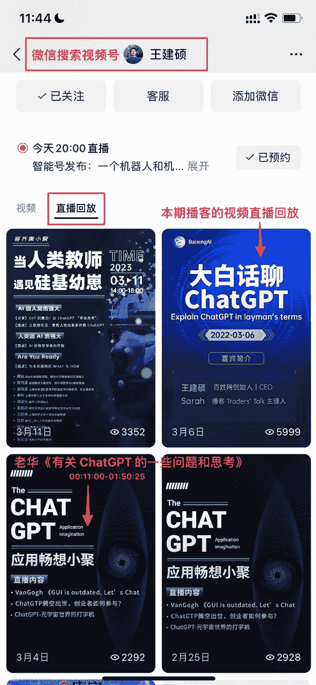

# 大白话聊 ChatGPT（Sarah & 王建硕）

> 来源：[https://jalicvoygc0.feishu.cn/docx/LFGFd5BNKo7ZJLxbLKRcPKKBnHh](https://jalicvoygc0.feishu.cn/docx/LFGFd5BNKo7ZJLxbLKRcPKKBnHh)

引用：https://www.xiaoyuzhoufm.com/episode/641183b5bb1fc0cb68f810c6

作者：Sarah & 王建硕

欢迎各位收听 Traders' Talk 大白话系列第 3 期。

这次建硕和我聊的是一个充满未知和想象力的话题——ChatGPT。就在今天凌晨（2023/3/15），OpenAI 发布了 GPT-4，它比之前的产品更加可靠、更有创意，能处理更细微的指令。

在本期节目中，建硕科普了 ChatGPT 的定义和原理，澄清了关于它的常见误解，并从创业者视角畅谈了 ChatGPT 的应用前景和创业机会。最后，我们还探讨了与 AI 相关的隐忧。

感谢各位的收听，我是 Sarah，让我们开始本期节目吧！

———以上文本由 ChatGPT 生成———

【**相关文稿及视频】**

+   [本期播客逐字稿（未精校）](https://d58hixvcd6.feishu.cn/minutes/obcnyme2oqv67s82sct87997)

+   [完整视频直播逐字稿（精校）](https://d58hixvcd6.feishu.cn/docx/HfMEds7Z1ov37wxqM19czTBinWg)

+   关于如何收看视频直播👇

## **【嘉宾简介】**

王建硕，百姓网创始人、董事长，公众号：王建硕。

## **【Timeline】**

**一、****ChatGPT**** 定义及原理**

00:02:58 ChatGPT 首先是一个产品，其次才是一个大语言模型

00:04:23 自然语言处理 NLP 的两大分支：大语言模型 VS 特定语言模型

00:08:30 GPT-3.5 中的 3.5 编号是怎么来的？

00:10:36 ChatGPT 中 G、P、T 三个字母以及微调的含义

00:18:26 特德·姜的文章比喻：ChatGPT 是人类知识模糊的 JPG

00:21:18 人工智能幻觉 AI Hallucinations 是怎么产生的，需要规避吗？

**二、澄清关于 ****ChatGPT**** / ****LLM**** 的迷思**

00:30:41 为什么 ChatGPT 是数学很差的文科生？它在做的是文字补全 / 文字接龙

00:34:41 近两年大语言模型的突破性进展：涌现、思考链路，但依然算不上通用人工智能

00:40:52 ChatGPT 敲开了 LUI 的大门

00:45:09 建硕经历的四次历史上的惊叹时刻，其中浏览器时刻与 ChatGPT 时刻极为相似

00:49:48 Web3 目前还相当于互联网的 1979 年，虽改变人类世界的能力，但还未到火候，在行业里等待可能是危险的

00:53:51 中国有必要再做一个类似 ChatGPT 的大语言模型吗？

00:59:51 ChatGPT 与搜索引擎的关系

01:01:33 ChatGPT 有没有自我 / 意识 / 人格？

01:13:14 如何看待 Yann LeCun 教授的评价：ChatGPT 所应用的技术并无多大创新，只是在工程设计上非常优秀？

**三、创业视角看 ****ChatGPT**

01:15:36 ChatGPT 可被应用的领域有哪些？

01:19:34 基于同一套 GPT 模型 API 开发的产品该如何进行产品差异化、构建竞争壁垒？

01:22:38 ChatGPT 这一次浪潮究竟是谁的机遇，产业链的价值捕获最终会落在何处？

01:28:43 国内外创业者在这条路上有时间差吗？

01:35:31 ChatGPT 会让人失业吗？

01:39:50 会用 AI 和不会用 AI 的人之间会形成更大的不公平吗？

**四、****AI**** 隐忧**

01:42:13 ChatGPT 生成的内容应该受版权保护吗？

01:44:45 ChatGPT 背后的语料是否可能涉及侵犯隐私或非授权的数据爬取？

01:49:48 未来互联网会不会充斥着 AI 生成了大量同质化或平均水平的语料？

01:59:48 ChatGPT 不仅不会像抖音算法那样割裂世界，反而给人类世界大同的可能性

**五、其他**

02:10:07 AI 教育的重要性，以及建硕在实践的瀛海威互联网分享精神

# 【名词解释】

**1. ****ChatGPT**** 的核心**是大型语言模型（详见第 4 点），及《ChatGPT 中，G、P、T 分别是什么意思？》。

2. 微调（Fine-Tuning）：这部分训练是在预训练之后进行的。该程序接受一项任务，然后针对更具体的数据在更小、更具体的任务上进一步训练它。

**3. ****OpenAI**** 各代产品**

+   2018 年 GPT-1（开源）：首次让人工智能像人类一样「理解文字」、写出文字

+   2019 年 GPT-2（开源，1.5 billion 参数）

+   2020 年 GPT-3（未开源，175 billion 参数，45T 文本）

+   InstructGPT：专注于让其听懂指令

+   ChatGPT（GPT-3.5，500G 文本）：基于对话场景以及安全边界等进行加强，是 GPT-3 模型上进行微调的产物

+   2023/3/2 GPT-3.5 API 开放：人人可用、接入门槛低

+   2023/3/15 GPT-4 上线，最大亮点是多模态能力

**4. ****自然语言处理**（Natural Language Processing，简称 NLP）：是 AI 领域的一个子领域，旨在让计算机能够理解、处理、生成自然语言。

+   **大语言模型**（Large Language Model，简称 LLM）：是自然语言处理领域中的一种技术。LLM 可以基于深度学习算法构建的模型，通过学习大量的文本数据，可以对文本数据进行学习和预测。“大”指的是参数多、语料多。

+   **特定语言模型**（Specific Language Model）：是一种针对特定语种和领域的自然语言处理模型。它在大语言模型的基础上，使用特定领域的文本数据进行训练和优化，以提高模型在该领域中的预测和生成能力。

+   **意图检测**（Intention Detection）：是 NLP 领域的一种技术，旨在识别和理解用户在一段文本中的意图。在应用中，意图识别通常与语音识别和语音合成等技术相结合，以实现智能对话和交互。

+   **实体检测**（Entity Detection）：同样是 NLP 领域的一种技术，旨在从文本中识别出具有特定意义的实体，例如人名、地名、组织机构、日期、数字等。

**5. 提示词（Prompt）**：一种文本片段，包含了对输入数据进行处理的指令或提示，系统可以根据 prompt 生成相应的输出。通常用于生成文本、回答问题等任务中。

**6. 人工智能幻觉（****AI** hallucinations）：人工智能系统在生成输出时，所产生的一些错误或不合理的结果。这些结果通常是由于模型在训练过程中，所接受的数据不足或不平衡所导致的。

7. 涌现（Emergence）：从简单的算法、模型或数据中出现的意想不到的结果或行为。当神经网络的复杂性和训练样本的多样性超过一定规模后，就会有抽象的推理结构在神经网络里自发地涌现出来，这个过程是非线性的，量变导致质变。

**8. ****思**维链路（Chain of Thought，CoT）：用于描述神经网络中的信息流动和计算过程。这一概念试图复现慢思考模式的过程。

**9. 通用人工智能（Artificial Gener**al Intelligence，AGI）：与目前大多数人工智能系统只能解决特定领域的问题不同，AGI 可以具有类似人类的智能，能够在多个领域中学习和应用知识，处理和理解不同类型的信息，并具备自我学习和自我改进的能力。AGI 被认为是人工智能领域中最具挑战性和最具科学意义的目标之一。

**10. ****AIGC****（**Artificial Intelligence Generated Content）：由人工智能自动生成的内容，这些内容可以是文字、图像、音频、视频等。

11. Yann LeCun 杨立昆教授：Meta AI 首席科学家，2018 年图灵奖获得者，CNN 卷积神经网络之父，是世界上最有影响力的人工智能研究人员之一。

**12. **BUI、TUI、CUI、GUI、GIUI、LUI

**13. 乔布斯与 ****GUI**：1979 年，在一次对施乐的帕洛阿托研究中心（Palo AltoResearch Center）的拜访过程中，史蒂夫·乔布斯（Steve Jobs）发现了 GUI 的设计图纸和鼠标。随后便将它运用于 Apple Macintosh 的开发过程中。

14. Netscape Navigator：第一个广泛使用的商业化 Web 浏览器，由美国公司 Netscape Communications Corporation 开发并于 1994 年发布。

**15. ****图灵测试****（****Turing Test****）**：一种测试人工智能是否具有智能的标准之一，由英国计算机科学家图灵在 1950 年提出。

**16. HTTP 协议、****HTML**** 协议、****FTP**** 协议、****Telnet**** 协议、Mailto 协议、****Gopher**** 协议、NNTP 协议**（大家感兴趣的话自行查定义哈……字数太多放不下了）。

**17. ****阿帕奇****（****Apache****）**：一款开源的 Web 服务器软件。它以高性能、稳定性、灵活性和安全性著称，可以满足各种 Web 应用的需求。

**18. 红旗浏览器**：中国自主研发的一款浏览器软件，由中国红旗软件股份有限公司开发，它是国内第一款支持 IPv6 协议的浏览器。

**19. ****AI**** 军备竞赛**[：202](https://zh.wikipedia.org/wiki/Bard_(%E8%81%8A%E5%A4%A9%E6%9C%BA%E5%99%A8%E4%BA%BA))3 年 2 月，Google 推出[ Bar](https://zh.wikipedia.org/w/index.php?title=%E5%85%83%E8%AF%AD%E6%99%BA%E8%83%BD&action=edit&redlink=1)d；微软推出 New Bing。国内百度类 ChatGPT 聊天机器人项目名字确定为「文心一言」；中国初创公司元语智能首发 ChatYuan。

**20. 巴别塔**：《圣经》故事，讲述了人类曾经想要建造一座高耸入云的巨塔，以便让自己的名字传遍全世界，但被上帝惩罚，使得人类的语言不同，无法相互理解，于是他们停止了建造，分散到世界各地。这个故事被认为是对人类的骄傲和自大的警示，同时也是对人类语言多样性的认识和尊重。

-END-

扫码加入AI Flow Genius社群，探讨使用AI来提升生产力的方法，成为超级个体

超过200需手动拉人 **备注：加群**

