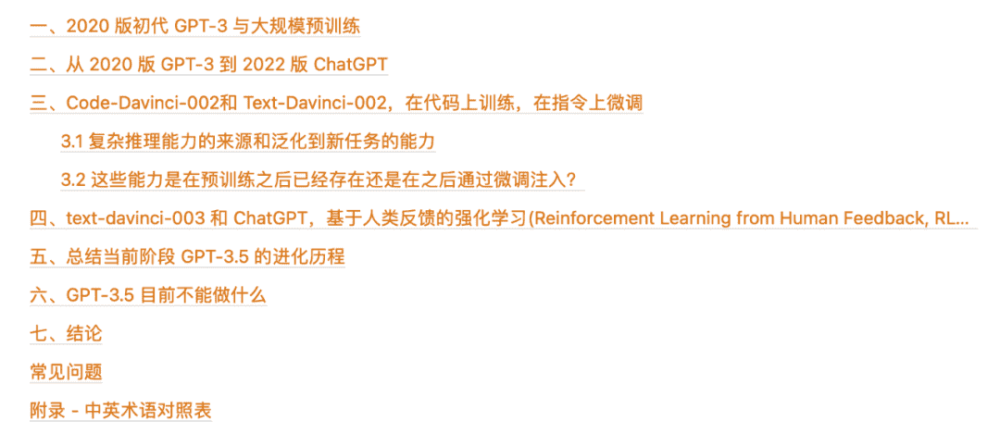
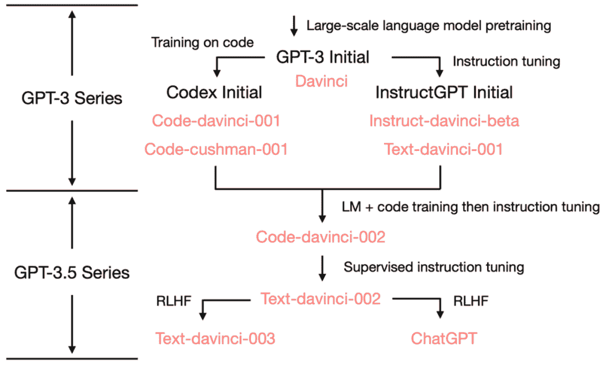
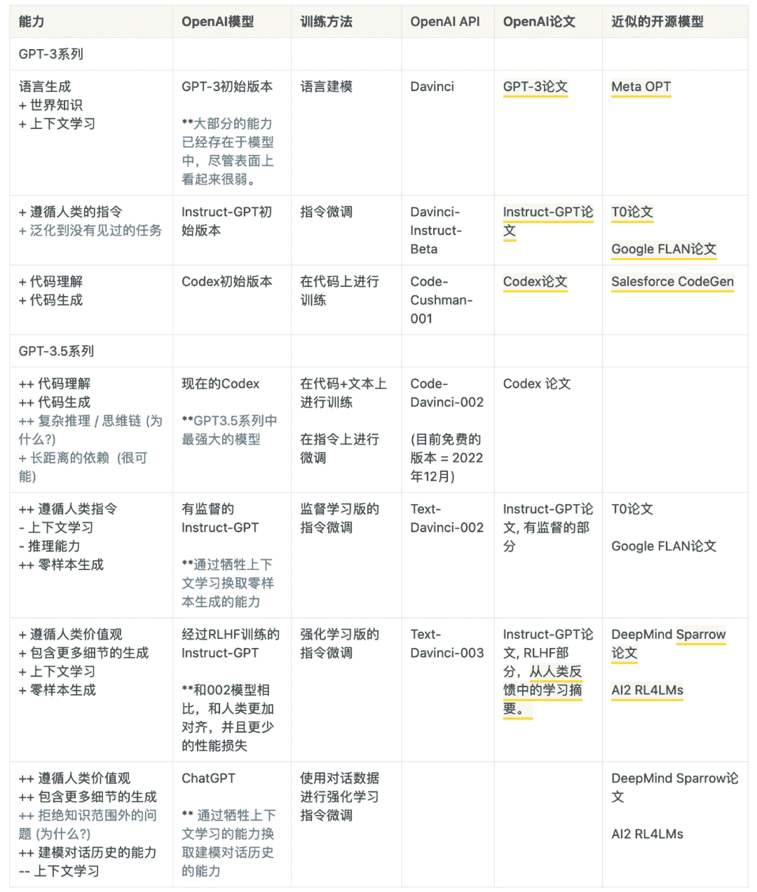
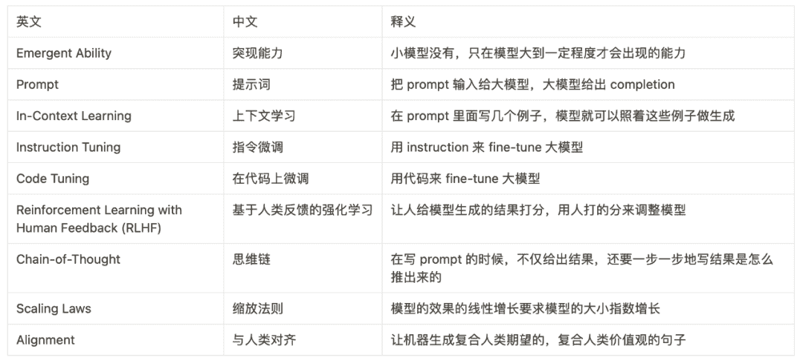

# ChatGPT的各项超能力从哪儿来？万字拆解追溯技术路线图来了！

> 来源：[https://jalicvoygc0.feishu.cn/docx/W5b7dwCLAobpynxcFifcr2rSnub](https://jalicvoygc0.feishu.cn/docx/W5b7dwCLAobpynxcFifcr2rSnub)

引用：https://mp.weixin.qq.com/s?__biz=MzA3MzI4MjgzMw==&mid=2650864144&idx=4&sn=1270624988d70f44d4059af7ac4ae4e0

作者：符尧、彭昊、Tushar Khot、郭志江等 机器之心

> 符尧（yao.fu@ed.ac.uk），爱丁堡大学 (University of Edinburgh) 博士生，本科毕业于北京大学。他与彭昊、Tushar Khot在艾伦人工智能研究院 (Allen Institute for AI) 共同完成英文原稿，与剑桥大学郭志江共同翻译为中文。

> 感谢上海交通大学何俊贤，加州大学洛杉矶分校鲁盼，达特茅斯学院刘睿博对初稿的讨论与建议。感谢 Raj Ammanabrolu (Allen Institute for AI), Peter Liu (Google Brain), Brendan Dolan-Gavitt (New York University), Denny Zhou (Google Brain) 对终稿的讨论和建议，他们的建议极大程度上增加了本文的完整度。

最近，OpenAI的预训练模型ChatGPT给人工智能领域的研究人员留下了深刻的印象和启发。毫无疑问，它又强又聪明，且跟它说话很好玩，还会写代码。**它在多个方面的能力远远超过了**自**然语言处理研究者们**的预期。于是我们自然就有一个问题：ChatGPT 是怎么变得这么强的？它的各种强大的能力到底从何而来？在这篇文章中，我们试图剖析 ChatGPT 的突现能力([)(1])（Emergent Ability），追溯这些能力的来源，希望能够给出一个全面的技术路线图，来说明 GPT-3.5([2)(]) 模型系列以及相关的大型语言模型([3)(] )是如何一步步进化成目前的强大形态。

我们希望这篇文章能够促进大型语言模型的透明度，成为开源社区共同努力复现 GPT-3.5 的路线图。

致国内的同胞们：

+   在国际学术界看来，**ChatGPT**** / ****GPT-3.5**** **是一种**划时代**的产物，**它与之前常见的语**言模型 (B**ert/ Bar**t/ T5) 的区别，几乎是导弹与弓箭的区别，一定要引起最高程度的重视。

+   **在我跟国际同****行的交流中，国****际上的主****流学术**机构 (如斯坦福大学，伯克利加州大学) 和主流业界研究院（如谷歌大脑，微软研究院）都已经全面拥抱大模型。

+   在当前这个阶段，国内的技术水准，学术视野，**治学理念和国**际前沿的差距似乎并没**有减少，反而正在扩大**，如果现状持续下去，极有可能出现技术断代。

+   **此诚危急存亡之秋**。

**

目**录

> 多年以后，面对行刑队，奥雷里亚诺·布恩迪亚上校将会回想起父亲带他去见识冰块的那个遥远的下午。 —— 《百年孤独》 加西亚·马尔克斯

### 一、2020 版初代 GPT-3 与大规模预训练

初代GPT-3展示了三个重要能力：

+   **语言生成**：遵循提示词（prompt），然后生成补全提示词的句子 (completion)。这也是今天人类与语言模型最普遍的交互方式。

+   上下文学习 (in-context learning): 遵循给定任务的几个示例，然后为新的测试用例生成解决方案。很重要的一点是，GPT-3虽然是个语言模型，但它的论文几乎没有谈到“语言建模” (language modeling) —— 作者将他们全部的写作精力都投入到了对上下文学习的愿景上，这才是 GPT-3的真正重点。

+   世界知识 (world knowledge)：包括事实性知识 (factual knowledge) 和常识 (commonsense)。

那么这些能力从何而来呢？

基本上，以上三种能力都来自于大规模预训练：在有3000亿单词的语料上预训练拥有1750亿参数的模型（ 训练语料的60%来自于 2016 - 2019 的 C4 + 22% 来自于 WebText2 + 16% 来自于Books + 3%来自于Wikipedia）。其中：

+   **语言生成**的能力来自于语言建模的**训练目标** (language modeling)。

+   **世界知识**来自 3000 亿单词的**训练语料库**（不然还能是哪儿呢）。

+   **模型的 1750 亿参数**是为了**存储知识**，Liang et al. (2022) 的文章进一步证明了这一点。他们的结论是，知识密集型任务的性能与模型大小息息相关([4)(]) 。

+   **上下文学习的**能力来源及为什么上下文学习可以泛化，仍然难以溯源。直觉上，这种能力可能来自于同一个任务的数据点在训练时按顺序排列在同一个 batch 中。然而，很少有人研究([5)(]) 为什么语言模型预训练会促使上下文学习，以及为什么上下文学习的行为与微调 (fine-tuning) 如此不同。

令人好奇的是**，初代的GPT-3有多强。**

其实比较难确定初代 GPT-3（在 OpenAI API 中被称为davinci）到底**是“强”还是“弱”。一方面，它**合理地回应了某些特定的查询，并在许多数据集中达到了还不错的性能；另一方面，它在许多任务上的表现还不如 T5 这样的小模型（参见其原始论文）。在今天（2022 年 12 月）ChatGPT 的标准下，很难说初代的 GPT-3 是“智能的”。Meta 开源的 OPT 模型试图复现初代 GPT-3，但它的能力与当今的标准也形成了尖锐的对比。许多测试过 OPT 的人也认为与现在的text-davinci-002相比，该模型确实 “不咋地”。尽管如此，OPT 可能是初代 GPT-3 的一个足够好的开源的近似模型了（根据 OPT 论文和斯坦福大学的 HELM 评估）。

虽然初代的 GPT-3 可能表面上看起来很弱，但后来的实验证明，初代 GPT-3 有着非常强的潜力。这些潜力后来被代码训练、指令微调 (instruction tuning) 和基于人类反馈的强化学习 (reinforcement learning with human feedback, RLHF) 解锁，最终体展示出极为强大的突现能力。

### **二、从 202**0 版 GPT-3 到 2022 版 ChatGPT

从最初的 GPT-3 开始，为了展示 OpenAI 是如何发展到ChatGPT的，我们看一下 GPT-3.5 的进化树：

在** 2020 年 7 **月，OpenAI 发布了模型索引为的 davinc**i 的初代 GPT-**3 论文([6)(]) ，从此它就开始不断进化。在 2021 年 7 月，Codex 的论文([7)(]) 发布，其中**初始的 Codex **是根据（可能是内部的）120 亿参数的 GPT-3 变体进行微调的。后来这个 120 亿参数的模**型演变成** OpenAI API 中的 code-cushman-001。在 2022 年** 3 月，OpenAI **发布了指令微调([8)(])  (instruction tuning)** 的论文**，其监**督微**调([9**)(]) ** (s**up**erv**ise**d instruction t**uning) 的部分对**应了davinci-instruct-beta和text-davinci-001。在 2022 年 4 月至 7 月的，OpenAI 开始对cod**e-davi**nci-002模型进行 Beta 测试，也称其为** C**odex。然后code-davinci-002、text-davinci-003和ChatGPT 都是从code-davinci-002进行指令微调得到的。详细信息请参阅 OpenAI的模型索引文档([)(10]) 。

尽管 Codex 听着像是一个只管代码的模型，但code-davinci-002可能是最强大([)(11]) 的针对自然语言的GPT-3.5 变体（优于 text-davinci-002和 -003）。code-davinci-002很可能在文本和代码上都经过训练，然后根据指令进行调整（将在下面解释）。然后2022 年 5-6 月发布的text-davinci-002是一个基于code-davinci-002的有监督指令微调 (supervised instruction tuned) 模型。在text-davinci-002上面进行指令微调很可能降低了模型的上下文学习能力，但是增强了模型的零样本能力（将在下面解释）。然后是text-davinci-003和 ChatGPT，它们都在 2022 年 11 月发布，是使用的基于人类反馈的强化学习的版本指令微调 (instruction tuning with reinforcement learning from human feedback) 模型的两种不同变体。text-davinci-003 恢复了（但仍然比code-davinci-002差）一些在text-davinci-002 中丢失的部分上下文学习能力（大概是因为它在微调的时候混入了语言建模） 并进一步改进了零样本能力（得益于RLHF）。另一方面，ChatGPT 似乎牺牲了几乎所有的上下文学习的能力来换取建模对话历史的能力。

总的来说，在 2020 - 2021 年期间，在code-davinci-002之前，OpenAI 已经投入了大量的精力通过代码训练和指令微调来增强GPT-3。当他们完成code-davinci-002时，所有的能力都已经存在了。很可能后续的指令微调，无论是通过有监督的版本还是强化学习的版本，都会做以下事情（稍后会详细说明）：

+   指令微调**不会为模型注入新的能力**** —— 所有的能力都已**经存在了。指令微调的作用是解锁 / 激发这些能力。这主要是因为指令微调的数据量比预训练数据量少几个数量级（基础的能力是通过预训练注入的）。

+   指令微调将 GPT-3.5 的分化到不同的技能树。有些更擅长上下文学习，如text-davinci-003，有些更擅长对话，如ChatGPT。

+   指令微调通过牺牲性能换取与人类的对齐（alignment）。OpenAI 的作者在他们的指令微调论文([)(12]) 中称其为 “对齐税” (alignment tax)。许多论文([)(13] )都报道了code-davinci-002在基准测试中实现了最佳性能（但模型不一定符合人类期望）。在code-davinci-002上进行指令微调后，模型可以生成更加符合人类期待的反馈（或者说模型与人类对齐），例如：零样本问答、生成安全和公正的对话回复、拒绝超出模型它知识范围的问题。

### **三、Code-Davinci-002和 Text-****Da****vin**ci-002，在代码上训练，在指令上微调

在code-davinci-002和text-davinci-002之前，有两个中间模型，分别是 davinci-instruct-beta 和 text-davinci-001。两者在很多方面都比上述的两个-002模型差（例如，text-davinci-001 链式思维推理([)(14]) 能力不强）。所以我们在本节中重点介绍 -002 型号。

#### 3.1 复杂推理能力的来源和泛化到新任务的能力

我们关注code-davinci-002和text-davinci-002，这两兄弟是第一版的 GPT3.5 模型，一个用于代码，另一个用于文本。它们表现出了三种重要能力与初代 GPT-3 不同的能力：

+   **响应人类****指令**：以前，GPT-3 的输出主要训练集中常见的句子。现在的模型会针对指令 / 提示词生成更合理的答案（而不是相关但无用的句子）。

+   **泛化到没有见过的任务**：当用于调整模型的指令数量超过一定的规模时，模型就可以自动在**从没见过的新指令上也能生成有**效的回答。 这种能力对于上线部署至关重要，因为用户总会提新的问题，模型得答得出来才行。

+   **代码生成和代码理解**：这个能力很显然，因为模型用代码训练过。

+   **利**用思维链 (chain-of-thought) 进行复杂推理：初代 GPT3 的模型思维链推理的能力很弱甚至没有。 code-davinci-002 和 text-davinci-002 是两个拥有足够强的思维链推理能力的模型。

+   思维链推理之所以重要，是因为思维链可能是解锁突现能力和超越缩放法则 (scaling laws) 的关键。请参阅上一篇博文([)(15]) 。

这些能力从何而来？

**

与****之前**的**模型相比**，两个主要区别是指令微调和代码训练。具体来说

+   能够**响应人类****指令**的能力是**指令微调**的直接产物。

+   **对没有见过的****指令****做出反馈****的泛化能力**是在指令数量超过一定程度之后自动出现的，T0([)(16]) 、Flan([)(17])  和 FlanPaLM([)(18])  论文进一步证明了这一点

+   使用**思维链**进行**复杂推理**的能力很可能是**代码训练**的**一个神奇的副产物**。对此，我们有以下的事实作为一些支持：

+   **最初的** GPT-3 没有接受过代码训练，它不能做思维链。

+   text-davinci-001 模型，虽然经过了**指令微调，但第一版思维链论文([)(19]**) 报告说，它的它思维链推理的能力非常弱 —— 所以指令微调可能不是思维链存在的原因，代码训练才是模型能做思维链推理的最可能原因。

+   PaLM([20)(])  有 5% 的代码训练数据，可以做思维链。

+   Codex论文([21)(]) 中的代码数据量为 159G ，大约是初代 GPT-3([22)(])  5700 亿训练数据的28%。code-davinci-002 及其后续变体可以做思维链推理。

+   在 HELM 测试中，Liang et al. (2022)([23)(]) 对不同模型进行了大规模评估。他们发现了针对代码训练的模型具有很强的语言推理能力，包括 120亿参数的code-cushman-001.。

+   我们在 AI2 的工作([24)(]) 也表明，当配备复杂的思维链时，code-davinci-002 在 GSM8K 等重要数学基准上是目前表现最好的模型

+   直觉来说，**面向过程的编程 (procedure-o**rien**ted pr**ogrammi**ng) 跟人****类逐****步**解决任务**的过程很类似，面向对象编程 **(object-oriented programming) 跟人类将复杂任务分解为多个简单任务的过程很类似。

+   以上所有观察结果都是代码与推理能力 / 思维链 之间的相关性，但不一定是因果性。这种相关性很有趣，但现在还是一个待研究的开放性问题。目前看来，我们没有非常确凿的证据证明代码就是思维链和复杂推理的原因。

+   此外， **代码训练**另一个可能的副产品是**长距离依赖**，正如Peter Liu([25)(]) 所指出：“语言中的下个词语预测通常是非常局部的，而代码通常需要更长的依赖关系来做一些事情，比如前后括号的匹配或引用远处的函数定义”。这里我想进一步补充的是：由于面向对象编程中的类继承，代码也可能有助于模型建立编码层次结构的能力。我们将对这一假设的检验留给未来的工作。

另外还要注意一些细节差异：

+   text-davinci-002 与 code-davinci-002

+   Code-davinci-002 是基础模型，text-davinci-002 是指令微调 code-davinci-002 的产物（见 OpenAI 的文档([26)(]) ）。它在以下数据上作了微调：（一）人工标注的指令和期待的输出；（二）由人工标注者选择的模型输出。

+   当有上下文示例 (in-context example) 的时候， Code-davinci-002 更擅长上下文学习；当没有上下文示例 / 零样本的时候， text-davinci-002 在零样本任务完成方面表现更好。从这个意义上说，text-davinci-002 更符合人类的期待（因为对一个任务写上下文示例可能会比较麻烦）。

+   OpenAI 不太可能故意牺牲了上下文学习的能力换取零样本能力 —— 上下文学习能力的降低更多是指令学习的一个副作用，OpenAI 管这叫对齐税。

+   **00**1 模型（code-cushman-001 和 text-davinci-001）v.s. 002 模型（code-davinci-002 和 text-davinci-002）

+   001 模型主要是为了做纯代码 / 纯文本任务；002 模型则深度融合了代码训练和指令微调，代码和文本都行。

+   Code-davinci-002 可能是第一个深度融合了代码训练和指令微调的模型。证据有：code-cushman-001 可以进行推理但在纯文本上表现不佳，text-davinci-001 在纯文本上表现不错但在推理上不大行。code-davinci-002 则可以同时做到这两点。

3.2 这些能力是在预训练之后已经存在还是在之后通过微调注入？

在这个阶段，我们已经确定了指令微**调和代码训练的关键作用。一**个重要的**问题是如**何进一步分析代码训练和**指令微****调的影响？具体来说：上****述三种**能力是否已经存在于初代的GPT-3中，只是通过指令和代码训练触发 / 解锁？或者这些能力在初代的 GPT-3 中并不存在，是通过指令和代码训练注入？ 如果答案已经在初代的 GPT-3 中，那么这些能力也应该在 OPT 中。因此，要复现这些能力，或许可以直接通过指令和代码调整 OPT。 但是，code-davinci-002 也可能不是基于最初的 GPT-3 davinci，而是基于比初代 GPT-3 更大的模型。如果是这种情况，可能就没办法通过调整 OPT 来复现了。研究社区需要进一步弄清楚 OpenAI 训练了什么样的模型作为 code-davinci-002 的基础模型。

我们有以下的假设和证据：

+   code-davinci-002的基础模型可能不是初代GPT-3 davinci 模型。以下是证据：

+   初代的GPT-3在数据集 C4 2016 - 2019 上训练，而 code-davinci-002 训练集则在延长到2021年才结束。因此 code-davinci-002 有可能在 C4 的 2019-2021 版本上训练。

+   **初代的 **GPT-3 有一个大小为 204**8 个词**的上下文窗口。code-davinci-002 的上下文窗口则为 8192。GPT 系列使用绝对位置嵌入 (absolute positional embedding)，直接对绝对位置嵌入进行外推而不经过训练是比较难的，并且会严重损害模型的性能（参考 Press et al., 2022([27)(]) ）。如果 code-davinci-002 是基于初代GPT-3，那OpenAI 是如何扩展上下文窗口的？

+   **另一****方面**，无论基础模型是初代的 **GP**T-**3 还是后来**训练的模型， 遵循指令和零样本泛化的能力都可能已经存在于基础模型中，后来才通过指令微调来解锁 （而不是注入）

+   这主要是因为 OpenAI 的论文([28)(]) 报告的指令数据量大小只有 77K，比预训练数据少了几个数量级。

+   其他指令微调论文进一步证明了数据集大小对模型性能的对比，例如 Chung et al. (2022) 的工作中， Flan-PaLM 的指令微调仅为预训练计算的 0.4%。一般来说，指令数据会显著少于预训练数据。

+   然而 ，模型的复杂推理能力可能是在预训练阶段通过代码数据注入

+   代码数据集的规模与上述指令微调的情况不同。这里的代码数据量足够大，可以占据训练数据的重要部分（例如，PaLM 有 8% 的代码训练数据）

+   如上所述，在 code-davinci-002 之前的模型 text-davinci-001 大概没有在代码数据上面微调过，所以它的推理 / 思维链能力是非常差的，正如第一版思维链论文中所报告的那样，有时甚至比参数量更小的 code-cushman-001 还差。

+   **区分代码训练和****指令****微调效果的最好方法**可能是比较 code-cushman-001、T5 和 FlanT5

+   因为它们具有相似的模型大小（110亿 和 120亿），相似的训练数据集 (C4)，它们最大的区别就是有没有在代码上训练过 / 有没有做过指令微调。

+   目前还没有这样的比较。我们把这个留给未来的研究。

### **四、text-****davinci-****003 ****和**** ChatGPT，基于人类反馈的强化学习(R****ei****nfor****cemen**t Learning from Human Feedback, RLHF) 的威力

在当前阶段（202**2 年 12 月）， te**xt-davinci-002、text-davinci-003 和 ChatGPT之间几乎没有严格的统计上的比较，主要是因为

+   text-davinci-003 和 ChatGPT 在撰写本文时才发布不到一个月。

+   ChatGPT 不能通过 OpenAI API 被调用，所以想要在标准基准上测试它很麻烦。

所以在这些模型之间的比较更多**是基于研究社区的集体经**验 （统计上不是很严格）。不过，我们相信初步的描述性比较仍然可以揭示模型的机制。

我们首先注意到以下 text-davinci-002，text-davinci-003 和 ChatGPT 之间的比较：

+   所有三个模型都经过**指令****微调**。

+   text-d**avin****ci****-0**02 是一个经过监督学习指令微调 (supervised instruction tuning) 的模型

+   **text-da**vi**nci-003**** 和 C****h****at****GP**T 是基于人类反馈的强化学习的指令微调 (Instruction tuning with Reinforcement Learning from Human Feedback RLHF)。这是它们之间最显着的区别。

**

这意味****着大多数**新模型的行为都是 RLHF 的产物。

那么让我们看看 RLHF 触发的能力：

+   **翔实的回应： **text-davinci-003 的生成通常比 text-davinci-002长([29)(]) 。ChatGPT 的回应则更加冗长，以至于用户必须明确要求“用一句话回答我”，才能得到更加简洁的回答。这是 RLHF 的直接产物。

+   **公正的回应：**ChatGPT 通常对涉及多个实体利益的事件（例如政治事件）给出非常平衡的回答。这也是RLHF的产物。

+   **拒绝不当问题：**这是内容过滤器和由 RLHF 触发的模型自身能力的结合，过滤器过滤掉一部分，然后模型再拒绝一部分。

+   **拒绝其知识范围之外的问题：**例如，拒绝在2021 年 6 月之后发生的新事件（因为它没在这之后的数据上训练过）。这是 RLHF 最神奇的部分，因为它使模型能够隐式地区分哪些问题在其知识范围内，哪些问题不在其知识范围内。

有两件事情值得注意：

+   **所有的能力****都是模型****本来就有**的， 而不是通过RL**HF 注入的。RLHF** 的作用是触发 / 解锁突现能力。这个论点主要来自于数据量大小的比较：因为与预训练的数据量相比，RLHF 占用的计算量 / 数据量要少得多。

+   模型知道它不知道什么不是通过编写规则来实现的， 而是通过RLHF解锁的。这是一个非常令人惊讶的发现，因为 RLHF 的最初目标是让模型生成复合人类期望的回答，这更多是让模型生成安全的句子，而不是让模型知道它不知道的内容。

幕后发生的事情可能是：

+   ChatGPT: 通过**牺牲上下文学习**的能力**换取建模对话历史**的能力。这是一个基于经验的观测结果，因为 ChatGPT 似乎不像 text-davinci-003 那样受到上下文演示的强烈影响。

+   **tex****t-davinci**-003：恢复了** te**xt**-davinci-0**02 所牺牲的上下文学习能力()([30)(])() ， 提高零样本的能力()([31)(]) 。 根据instructGPT([32)(]) 的论文，这是来自于强化学习调整阶段混入了语言建模的目标（而不是 RLHF 本身）。

**

五、总结当前阶段**** GPT-3.****5 的进化历**程

到目前为止，我们已经仔细检查了沿着进化树出现的所有能力，下表总结了演化路径：

(表格中引用见[33)(])

我们可以得出结论：

+   语言生成能力 + 基础世界知识 + 上下文学习都是来自于预训练（davinci）

+   存储大量知识的能力来自 1750 亿的参数量。

+   遵循指令和泛化到新任务的能力来自于扩大指令学习中指令的数量（Davinci-instruct-beta)

+   执行复杂推理的能力很可能来自于代码训练（code-davinci-002）

+   生成中立、客观的能力、安全和翔实的答案来自与人类的对齐。具体来说：

+   如果是监督学习版，得到的模型是text-davinci-002

+   如果是强化学习版 (RLHF) ，得到的模型是text-davinci-003

+   无论是有监督还是 RLHF ，模型在很多任务的性能都无法超过 code-davinci-002 ，这种因为对齐而造成性能衰退的现象叫做对齐税。

+   对话能力也来自于 RLHF（ChatGPT），具体来说它牺牲了上下文学习的能力，来换取：

+   建模对话历史

+   增加对话信息量

+   拒绝模型知识范围之外的问题

### **六、****GPT-3.5**** 目前不能做什么**

虽然GPT-3.5是自然语言处理研究中的重要一步，但它并没有完全包含许多研究人员（包括 AI2）设想的所有理想属性。以下是GPT-3.5不具备的某些重要属性：

+   **实时改写模型的信念**：当模型表达对某事的信念时，如果该信念是错误的，我们可能很难纠正它：

+   我最近遇到的一个例子是：ChatGPT 坚持认为 3599 是一个质数，尽管它承认 3599 = 59 * 61。另外，请参阅Reddit上关于游得最快的海洋哺乳动物([34)(]) 的例子。

+   然而，模型信念的强度似乎存在不同的层次。一个例子是即使我告诉它达斯·维达（星球大战电影中的人物）赢得了2020年大选，模型依旧会认为美国现任总统是拜登。但是如果我将选举年份改为 2024 年，它就会认为总统是达斯·维达是 2026 年的总统。

+   **形式推理**：GPT-3.5系列不能在数学或一阶逻辑等形式严格的系统中进行推理：

+   在自然语言处理的文献中， “推理” 一词的定义很多时候不太明确。但如果我们从模糊性的角度来看，例如一些问题 (a) 非常模棱两可，没有推理；(b) 有点儿逻辑在里面，但有些地方也可以模糊；(c) 非常严谨，不能有任何歧义。那么，

+   模型可以很好地进行 (b) 类的带模糊性的推理，例子有：

+   生成如何做豆腐脑的方法。做豆腐脑的时候，中间很多步骤模糊一点是可以接受的，比如到底是做咸的还是做甜的。只要整体步骤大致正确，做出来的豆腐脑儿就能吃。

+   数学定理的证明思路。证明思路是用语言表达的非正式的逐步解法，其中每一步的严格推导可以不用太具体。证明思路经常被用到数学教学：只要老师给一个大致正确的整体步骤，学生就可以大概明白。然后老师把具体的证明细节作为作业布置给学生，答案略。

+   GPT-3.5 不能进行类型 (c) 的推理（推理不能容忍歧义）。

+   一个例子是严格的数学证明，要求中间步骤中不能跳，不能模糊，不能错。

+   但这种严格推理到底是应该让语言模型做还是让符号系统做还有待讨论。一个例子是，与其努力让 GPT 做三位数加法，不如直接调 Python。

+   **从互联网进行检索**：GPT-3.5 系列（暂时）不能直接搜索互联网

+   但是有一篇 WebGPT ([35)(]) 论文发表于2021年12月，里面就让 GPT 调用了搜索引擎。所以检索的能力已经在 OpenAI 内部进行了测试。

+   这里需要区分的一点是，GPT-3.5 的两个重要但不同的能力是 **知识** 和 **推理**。一般来说，如果我们能够 将知识部分卸载到外部的检索系统，让语言模型只专注于推理，这就很不错了。 因为：

+   模型的内部知识总是在某个时间被切断。模型始终需要最新的知识来回答最新的问题。

+   回想一下，我们已经讨论过 1750 亿的参数大量用于存储知识。如果我们可以将知识卸载到模型之外，那么模型参数可能会大大减少，最终它甚至可以在手机上运行（疯狂的想法，但 ChatGPT 已经足够科幻了，谁知道未来会怎样呢).

**

七、结**论

在这篇博文中，我们仔细检查了GPT-3.5系列的能力范围，并追溯了它们所有突现能力的来源。初代GPT-3模型通过预训练获得生成能力、世界知识和in-context learning。然后通过instruction tuning的模型分支获得了遵循指令和能泛化到没有见过的任务的能力。经过代码训练的分支模型则获得了代码理解的能力，作为代码训练的副产品，模型同时潜在地获得了复杂推理的能力。结合这两个分支，code-davinci-002似乎是具有所有强大能力的最强GPT-3.5模型。接下来通过有监督的instruction tuning和 RLHF通过牺牲模型能力换取与人类对齐，即对齐税。RLHF 使模型能够生成更翔实和公正的答案，同时拒绝其知识范围之外的问题。

我们希望这篇文章能够帮助提供一个清晰的GPT评估图，并引发一些关于语言模型、instruction tuning和code tuning的讨论。最重要的是， 我们希望这篇文章可以作为在开源社区内复现GPT-3.5的路线图。

> “因为山就在那里。”——乔治·马洛里，珠穆朗玛峰探险先驱

# **常见问题**

+   这篇文章中的这些说法更像是假设 (hypothesis) 还是结论 (conclusion)？

+   **复杂推理的能力来自于代码训练**是我们倾向于相信的假设 (hypothesis)

+   **对没****有见**过的任务泛化能力来自大规模指令学习 是至少 4 篇论文的结论 (conclusion)

+   **GPT-3.5**来自于其他大型基础模型，而不是1750亿参数的GPT-3 是有根据的猜测 (educated guess)。

+   **所有这些能力****都已经存在****了，通过****i****nstr****uction tuning，无**论是有监督学习或强化学习的方式来解锁而不是注入这些能力 是一个比较强的假设 (strong assumption)。主要是因为instruction tuning数据量比预训练数据量少了几个数量级。

+   结论 (conclusion) = 许多证据支持这些说法的正确性；假设 (hypothesis) = 有正面证据但不够有力；有根据的猜测 (educated guess) = 没有确凿的证据，但某些因素会指向这个方向

+   为什么其他模型（如 OPT 和 BLOOM）没有那么强大？

+   OPT大概是因为训练过程太不稳定

+   BLOOM的情况则未知。如果您有更多意见，请与我联系

**附录 - 中英术语对照表**

注释：

[1]  很多能力小模型没有，只有当模型大到一定的量级之后才会出现。这样的能力称为突现能力 Emergent Abilities

[2]  GPT-3 是 OpenAI 在 2020 年发布的模型，之后它经过了多次版本迭代。现在最新的版本的能力已经远超初代的 GPT-3，被命名为 GPT-3.5

[3]  从 2022 年的标准看来，参数量超过 100B 才叫大模型，所以 BERT/ BART/ GPT-2/ T5 都是小模型

[4]  https://crfm.stanford.edu/helm/v1.0/?group=knowledge

[5]  Xie et. al. 2021. An Explanation of In-context Learning as Implicit Bayesian Inference

Min et. al. 2022. Rethinking the Role of Demonstrations: What Makes In-Context Learning Work?

一个很有趣的但是还在审稿中的工作: https://arxiv.org/abs/2211.15661

[6]  Brown. et. al. 2020. Language Models are Few-Shot Learners

[7]  Chen et. al. 2021. Evaluating Large Language Models Trained on Code

[8]  Ouyang et. al. 2022. Training language models to follow instructions with human feedback

[9]  Instruction tuning 有两个版本，一个是 supervised tuning，另一个是 reinforcement learning from human feedback (RLHF). ChatGPT 就是通过 RLHF 得来的

[10]  https://beta.openai.com/docs/model-index-for-researchers

[11]  Suzgun et. al. 2022. Challenging BIG-Bench tasks and whether chain-of-thought can solve them

Chung et. al. 2022. Scaling Instruction-Finetuned Language Models

Fu et. al. 2022. Complexity-based Prompting for Multi-Step Reasoning

Madaan et. al. 2022. Language Models of Code are Few-Shot Commonsense Learners

[12]  Ouyang et. al. 2022. Training language models to follow instructions with human feedback

[13]  Suzgun et. al. 2022. Challenging BIG-Bench tasks and whether chain-of-thought can solve them

Chung et. al. 2022. Scaling Instruction-Finetuned Language Models

Fu et. al. 2022. Complexity-based Prompting for Multi-Step Reasoning

Madaan et. al. 2022. Language Models of Code are Few-Shot Commonsense Learners

[14] 参见附录中的图8 https://arxiv.org/pdf/2201.11903v1.pdf

[15] https://yaofu.notion.site/A-Closer-Look-at-Large-Language-Models-Emergent-Abilities-493876b55df5479d80686f68a1abd72f

[16] Sanh. et. al. Oct 2021. Multitask Prompted Training Enables Zero-Shot Task Generalization

[17] Wei et. al. Sep 2021. Finetuned Language Models Are Zero-Shot Learners

[18] Chung et. al. Oct 2022. Scaling Instruction-Finetuned Language Models

[19] 第一个版本(https://arxiv.org/pdf/2201.11903v1.pdf) 报告了davinci在GSM8K上的准确率 12.4

v.s. 第五个版本 (https://arxiv.org/pdf/2201.11903v5.pdf) 报告了 code-davinci-002 准确率为 63.1

[20] Chowdhery et. al. Apr. 2022. PaLM: Scaling Language Modeling with Pathways

[21] Chen et. al. Jul 2021. Evaluating Large Language Models Trained on Code

[22] Brown. et. al. May 2020. Language Models are Few-Shot Learners

[23] Liang et. al. Nov 2022. Holistic Evaluation of Language Models

[24] Fu et. al. Oct 2022. Complexity-based Prompting for Multi-Step Reasoning.

https://openreview.net/forum?id=yf1icZHC-l9

[25] https://twitter.com/peterjliu/status/1603098202856722432?s=46&t=Gw2wumo4l8kIRaGzXDXyRw

[26] https://beta.openai.com/docs/model-index-for-researchers

[27] Press et. al. 2022. Train Short, Test Long: Attention with Linear Biases Enables Input Length Extrapolation

[28] Ouyang et. al. 2022. Training language models to follow instructions with human feedback

[29] https://help.openai.com/en/articles/6779149-how-do-text-davinci-002-and-text-davinci-003-differ

[30] 见https://arxiv.org/pdf/2210.11416.pdf的附录D

[31] https://help.openai.com/en/articles/6779149-how-do-text-davinci-002-and-text-davinci-003-differ

https://scale.com/blog/gpt-3-davinci-003-comparison

[32] https://arxiv.org/abs/2203.02155

[33] Brown et. al. May 2020. Language Models are Few-Shot Learners.

Zhang et. al. 2022. OPT: Open Pre-trained Transformer Language Models

Sanh. et. al. Oct 2021. Multitask Prompted Training Enables Zero-Shot Task Generalization

Ouyang et. al. Mar 2022. Training language models to follow instructions with human feedback

Wei. et. al. Sep 2021. Finetuned Language Models Are Zero-Shot Learners

Chung. et. al. Oct 2022. Scaling Instruction-Finetuned Language Models

https://github.com/salesforce/CodeGen

Chen et. al. Jul 2021. Evaluating Large Language Models Trained on Code

https://www.deepmind.com/blog/building-safer-dialogue-agents

Stiennon et. al. Sep. 2020. Learning to summarize from human feedback

https://github.com/allenai/RL4LMs

[34] https://www.reddit.com/r/ChatGPT/comments/zd7l8t/nice/

[35] https://openai.com/blog/webgpt/

-END-

扫码加入AI Flow Genius社群，探讨使用AI来提升生产力的方法，成为超级个体

超过200需手动拉人 **备注：加群**

