# 【NLP】Prompt Learning 超强入门教程

> 来源：[https://jalicvoygc0.feishu.cn/docx/SBTddeCDvovGEFxbMQscgxG1nog](https://jalicvoygc0.feishu.cn/docx/SBTddeCDvovGEFxbMQscgxG1nog)

引用：https://zhuanlan.zhihu.com/p/442486331

作者：sergio

本文主要根据刘鹏飞在北京智源大会上关于 Prompt 的[分享以及个人整理而得。关于分享可以查看：【线上直播](https://link.zhihu.com/?target=https%3A//event.baai.ac.cn/activities/172)】Big Model Meetup 第1期：大模型Prompt Tuning技术 。

首先我们需要了解什么是预训练语言模型，以及其带来的Pretrain + Fine-tunin[g 的范式。如果不](https://zhuanlan.zhihu.com/p/103226488)了解的同学，可以参考我关于BERT的文章。

在很长的一段时间内，NLP的任务采用的都是 Pretrain + Fine-tuning（Model Tuning）的解决方案，但是这种方案，需要对于每个任务都重新 fine-tune 一个新的模型，且不能共用。但是对于一个预训练的大语言模型来说，这就仿佛好像是对于每个任务都进行了定制化，十分不高效。是否存在一种方式，可以将预训练语言模型作为电源，不同的任务当作电器，仅需要根据不同的电器（任务），选择不同的插座，对于模型来说，即插入不同的任务特定的参数，就可以使得模型适配该下游任务。Prompt Learning 就是这个适配器，它能高效得进行预训练语言模型的使用。

这种方式大大地提升了预训练模型的使用效率，如下图：

+   左边是传统的 Model Tuning 的范式：对于不同的任务，都需要将整个预训练语言模型进行精调，每个任务都有自己的一整套参数。

+   右边是Prompt Tuning，对于不同的任务，仅需要插入不同的prompt 参数，每个任务都单独训练Prompt 参数，不训练预训练语言模型，这样子可以大大缩短训练时间，也极大的提升了模型的使用率。

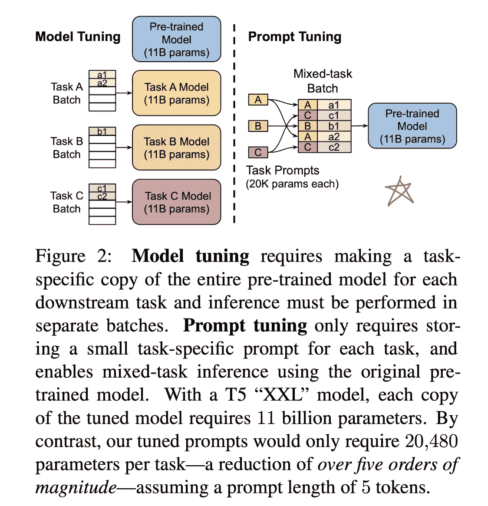

所以什么是 Prompt, 字面上来讲，Prompt 就是提示：

例如我们有人忘记了某个事情，我们给予特定的提示，他就可以想起来，例如我们说：

> 白日依山尽,

大家自然而然地会想起来下一句诗：黄河入海流。

亦或者，搜索引擎，可以根据我们的输入，进行输出的提示：

那么在NLP中 Prompt 代表的是什么呢？

+   prompt 就是给 预训练语言模型 的一个线索/提示，帮助它可以更好的理解 人类的问题。

例如，下图的BERT/BART/ERNIE 均为预训练语言模型，对于人类提出的问题，以及线索，预训练语言模型可以给出正确的答案。

+   根据提示，BERT能回答，JDK 是 Oracle 研发的

+   根据 TL;DR: 的提示，BART知道人类想要问的是文章的摘要

+   根据提示，ERNIE 知道人类想要问鸟类的能力--飞行

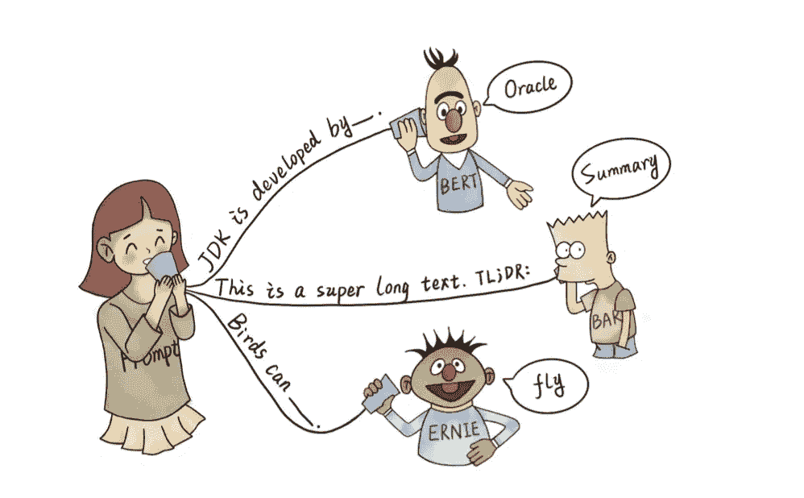

Prompt 更严谨的定义如下：

> Prompt is the technique of making better use of the knowledge from the pre-trained model by adding additional texts to the input.
>
> Prompt 是一种为了更好的使用预训练语言模型的知识，采用在输入段添加额外的文本的技术。

+   目的：更好挖掘预训练语言模型的能力

+   手段：在输入端添加文本，即重新定义任务（task reformulation）

## Prompt 的工作流

Prompt 的工作流包含以下4部分：

1.  Prompt 模版（Template）的构造
2.  Prompt 答案空间映射（Verbalizer）的构造
3.  文本代入template，并且使用预训练语言模型进行预测
4.  将预测的结果映射回label。

具体的步骤如下图，我们将一步步进行拆解分析。

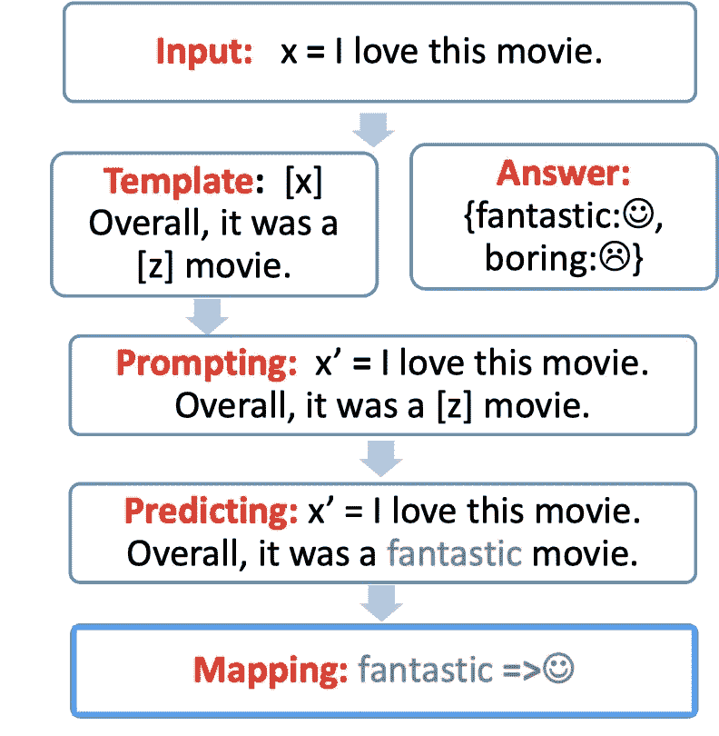

### Step 1: prompt construction【Template】

首先我们需要构建一个模版Template，模版的作用是将输入和输出进行重新构造，变成一个新的带有mask slots的文本，具体如下：

+   定义一个模版，包含了2处代填入的slots：`[x]` 和 `[z]`

+   将`[x]`用输入文本代入

例如：

+   输入：`x = 我喜欢这个电影`。

+   模版：`[x]总而言之，它是一个[z]电影`。

+   代入（prompting）：我喜欢这个电影。总而言之，它是一个`[z]`电影。

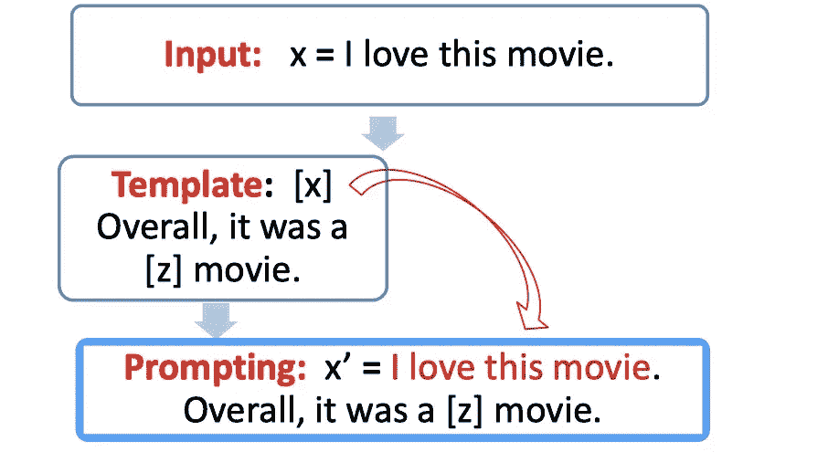

### Step 2: answer construction【Verbalizer】

对于我们构造的prompt，我们需要知道我们的预测词和我们的label 之间的关系，并且我们也不可能运行`z`是任意词，这边我们就需要一个映射函数（mapping function）将输出的词与label进行映射。例如我们的这个例子，输出的label 有两个，一个是 ，一个是 ，我们可以限定，如果预测词是fantastic 则对应 ，如果是 boring 则对应 .

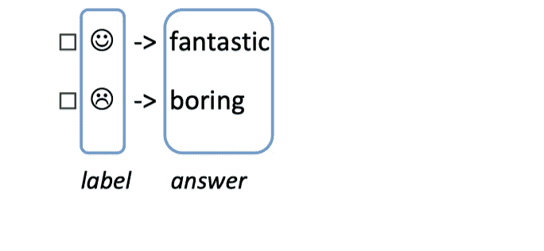

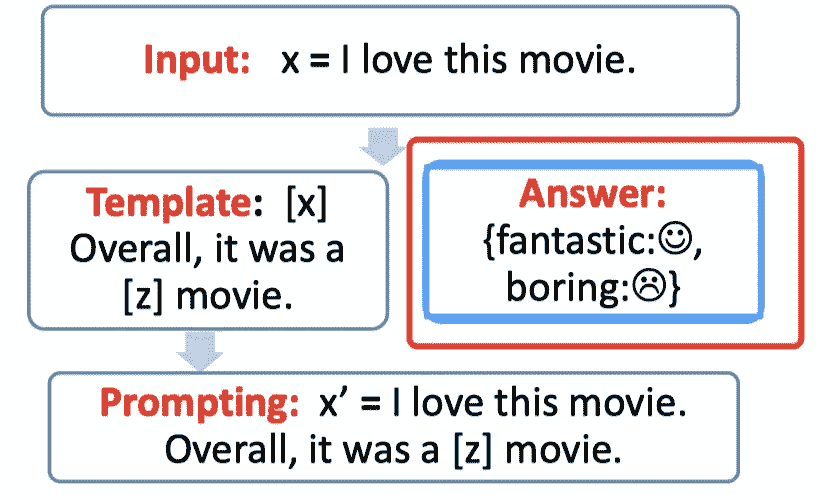

### Step 3: answer prediction【Prediction】

到了这边我们就只需要选择[合适的预训练语言模型](https://link.zhihu.com/?target=https%3A//huggingface.co/docs/transformers/model_summary)，然后进行mask slots `[z]`的预测。例如下图，得到了结果 fantastic, 我们需要将其代入`[z]`中。

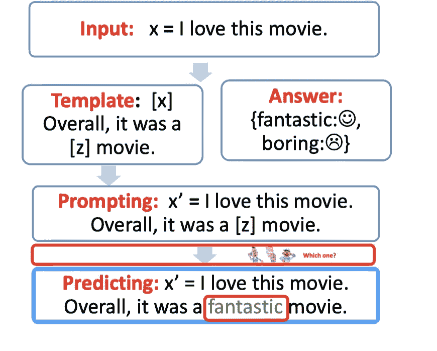

### Step 4: answer-label mapping【Mapping】

第四步骤，对于得到的 answer，我们需要使用 Verbalizer 将其映射回原本的label。

例如：fantastic 映射回 label：

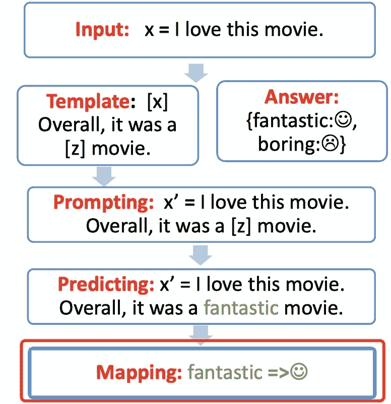

### 总结

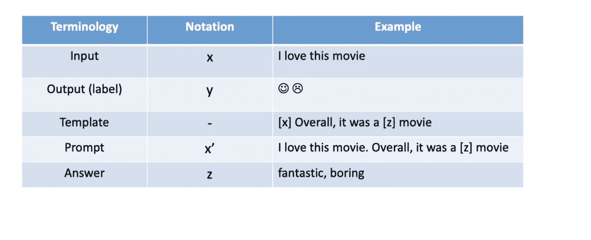

## Prompt-based 方法的工程选择问题

在知乎中有个提问：

> 现代的deep learning 就是为了规避 feature engineering，可是prompt 这边选择了template和answer不还是 feature engineering吗？

从这个问题中我们可以发现，确实如果使用BERT的 fine-tuning 范式（下图左），我们是不需要使用任何的人工特征构造，而使用prompt-based的方法的话，需要人工参与的部分包含了以下部分：

+   template 构造

+   answer 构造

+   预训练模型选择

+   prompt 的组合问题选择

+   以及训练策略的选择等

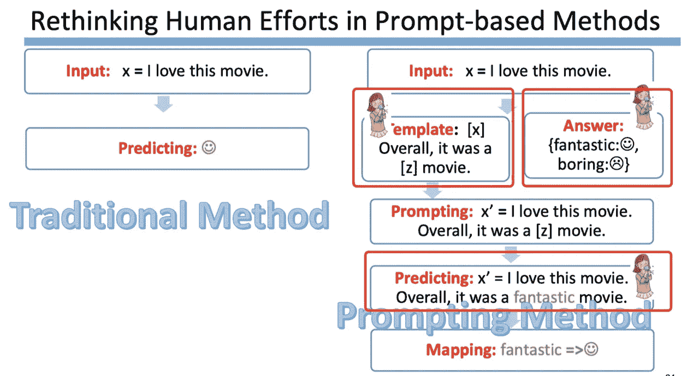

下面我们会先进行每个需要人工engineering 的部分进行详细讲解，然后再分析为什么我们还需要prompt 这种范式。

### Prompt Template Engineering（Prompt模版工程）

如何构造合适的Prompt 模版？对于同一个任务，不同的人可能构造不同的Template。

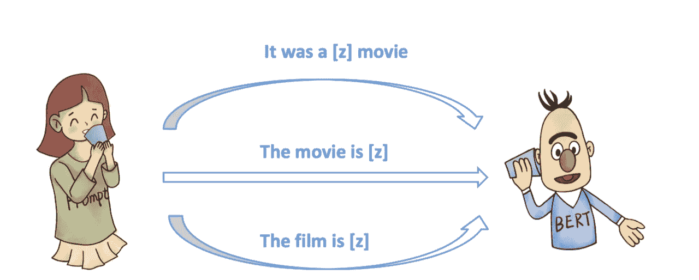

且每个模版都具有合理性。Tempalte的选择，对于Prompt任务起到了很重大的作用，就算一个word的区别，也坑导致10几个点的效果差别，论文GPT Understands, Too 给出了如下的结果：

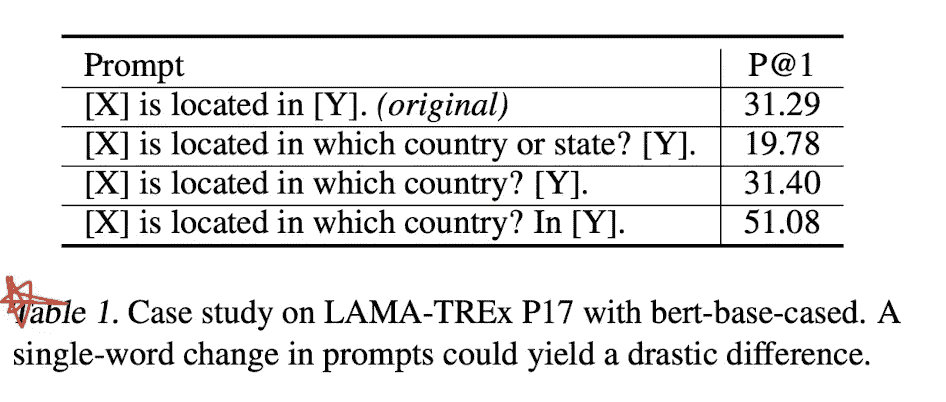

对于不同的template，可以从以下两种角度进行区分：

1.  根据slot 的形状/位置区分

+   1.1 完形填空（Cloze）的模式，即未知的slot在template的中间等不定的位置

+   1.2 前缀模式（Prefix），未知的slot在template的开头

2.  根据是否是由人指定的来区分

+   2.1 人工指定 template

+   2.2 自动搜索 template

+   2.3 Discrete 离散Template，即搜索的空间是离散的，为预训练语言模型的字典里的字符。

+   2.4 Continuous 连续Template，即搜索的空间是连续的，因为所有新增的这些prompt的参数主要是为了让机器更好地服务于任务，所以其参数的取值空间不需要限定在特定的取值范围内，可以是连续的空间。

具体的思维导图如下：

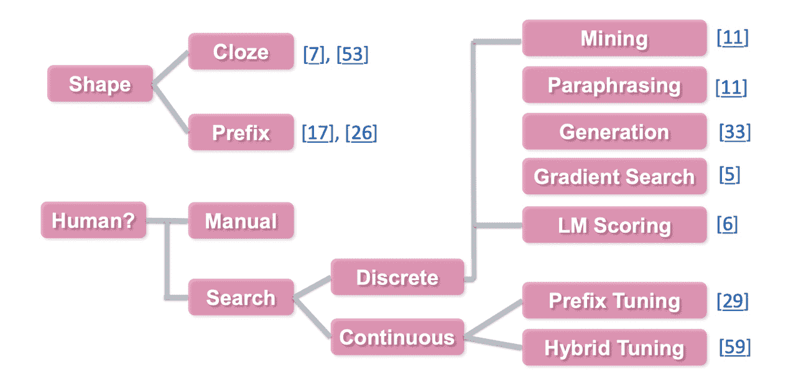

### Answer Engineering（答案工程）

在给定一个任务或者Prompt，如何对 label 空间 和 answer 空间进行映射？

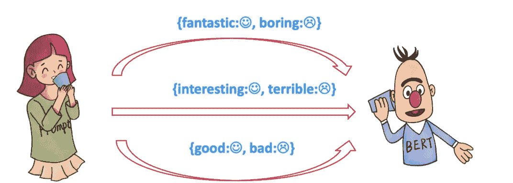

在上图，我们的label 空间  是: Positive, Negative, 答案空间  可以是表示positive或者negative 的词，例如 Interesting/Fantastic/Happy/Boring/1-Star/Bad，具体的答案空间 的选择范围可以由我们指定。我们可以指定一个  对应1-N个字符/词。

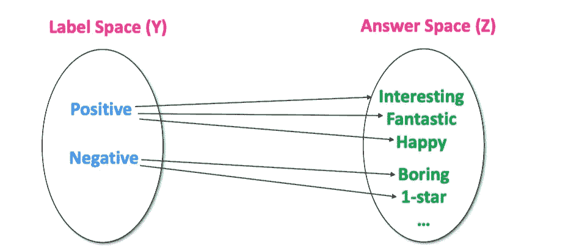

具体的答案空间的选择可以有以下三个分类标注：

1.  根据形状

+   1.1 Token 类型

+   1.2 Span 类型

+   1.3 Sentence 类型

2.  是否有界

+   2.1 有界

+   2.2 无界

3.  是否人工选择

+   3.1 人工选择

+   3.2 自动搜素

+   3.2.1 离散空间

+   3.2.2 连续空间

具体的思维导图如下：

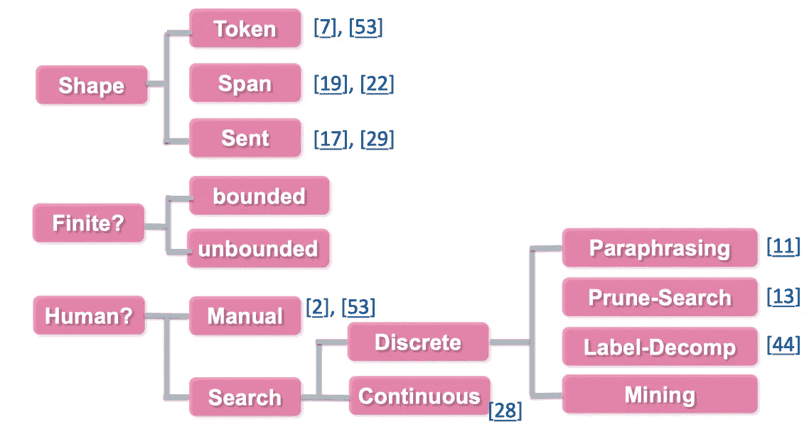

### Pre-trained Model Choice（预训练模型选择）

在定义完模版以及答案空间后，我们需要选择合适的预训练语言模型对 prompt 进行预测，如何选择一个合适的预训练语言模型也是需要人工经验判别的。

具体的预训练语言模型分类可以分为如下5类，具体参考：Huggingface Summary of the models

+   autoregressive-models: 自回归模型，主要代表有 GPT，主要用于生成任务

+   autoencoding-models: 自编码模型，主要代表有 BERT，主要用于NLU任务

+   seq-to-seq-models：序列到序列任务，包含了an encoder 和 a decoder，主要代表有 BART，主要用于基于条件的生成任务，例如翻译，summary等

+   multimodal-models：多模态模型

+   retrieval-based-models：基于召回的模型，主要用于开放域问答

基于此，例如下图想要做summary 任务，我们可以选择更合适的 BART 模型。

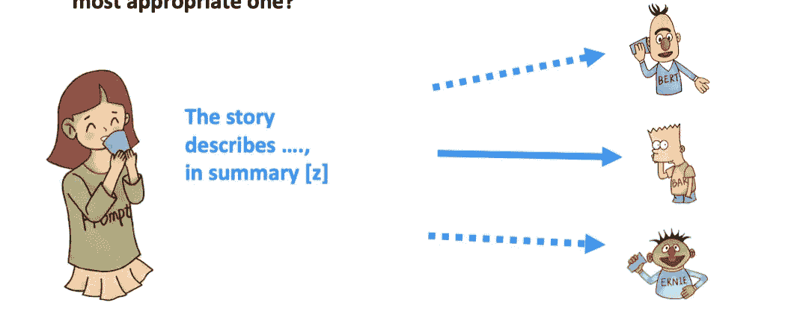

其他分类标准也可参考：

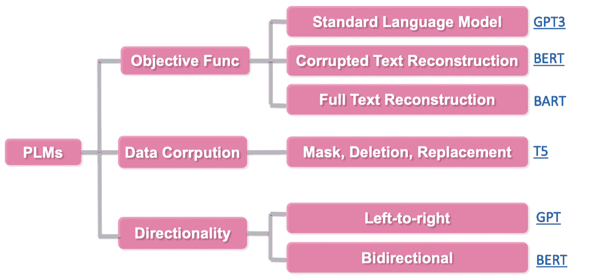

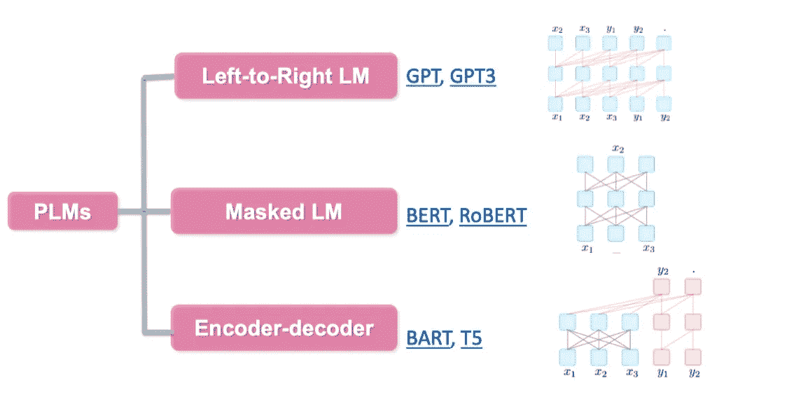

### Expanding the Paradigm（范式拓展）

如何对已有的 Prompt 进行任务增强以及拓展，具体可以从以下几个方面进行探讨：

+   Prompt Ensemble：Prompt 集成，采用多种方式询问同一个问题

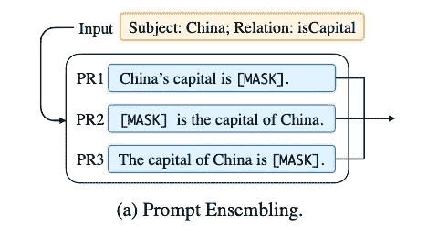

+   Prompt Augmentation：Prompt 增强，采用类似的 prompt 提示进行增强

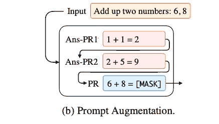

+   Prompt Composition：Prompt 组合，例如将一个任务，拆成多个任务的组合，比如判别两个实体之间是否是父子关系，首先对于每个实体，先用Prompt 判别是人物，再进行实体关系的预测。

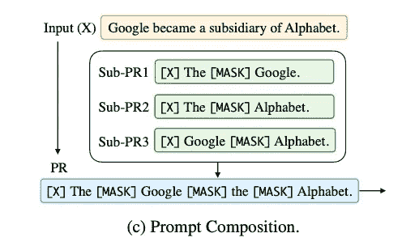

+   Prompt Decomposition：将一个prompt 拆分成多个prompt

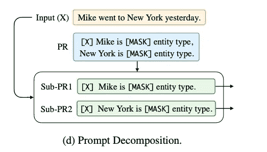

具体的思维导图如下：

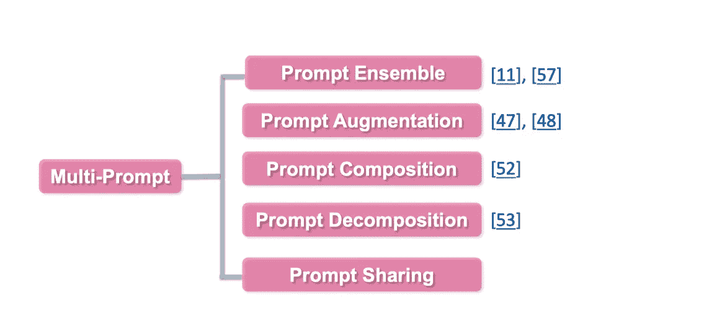

## Prompt-based Training Strategies（训练策略选择）

Prompt-based 模型在训练中，有多种训练策略，可以选择哪些模型部分训练，哪些不训练。

可以根据训练数据的多少分为：

+   Zero-shot: 对于下游任务，没有任何训练数据

+   Few-shot: 对于下游任务只有很少的训练数据，例如100条

+   Full-data: 有很多的训练数据，例如1万多条数据

也可以根据不同的参数更新的部分，对于prompt-based 的模型，主要分为两大块

一个是预训练模型，一个是 Prompts 参数。

这两个部分，都可以独立选择参数训练选择。

对于

+   预训练语言模型，可以选择精调，或者不训练

+   对于prompts：

+   可以是没有prompts

+   固定的离散字符 prompts。（无参数）

+   使用训练好的 prompts参数，不再训练。

+   继续训练 prompts参数

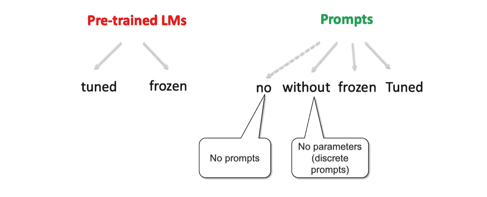

这些训练策略均可以两两组合，下面举例说明：

### 策略分类

+   Promptless Fine-tuning

如果只有预训练语言模型，没有prompts，然后fine-tuning，即是bert 的常规使用。

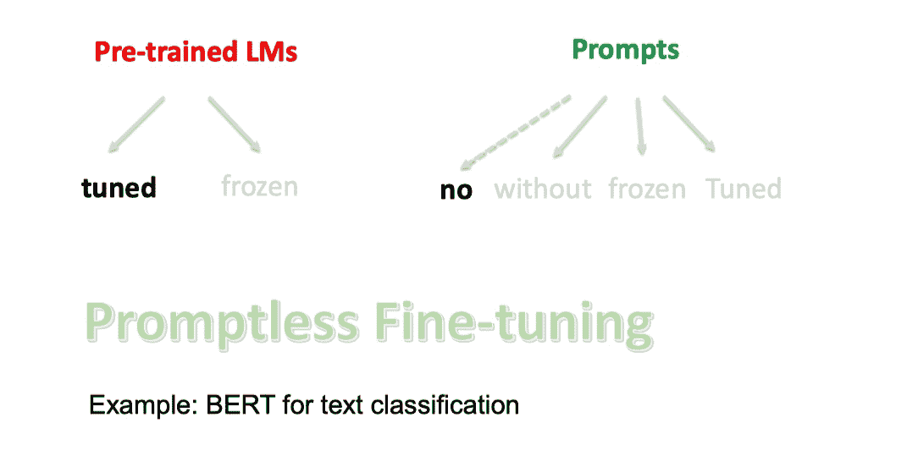

+   Fixed-Prompt Tuning

如果使用精调预训练语言模型+离散的固定prompts，就是 BERT + Discrete Prompt for text classification

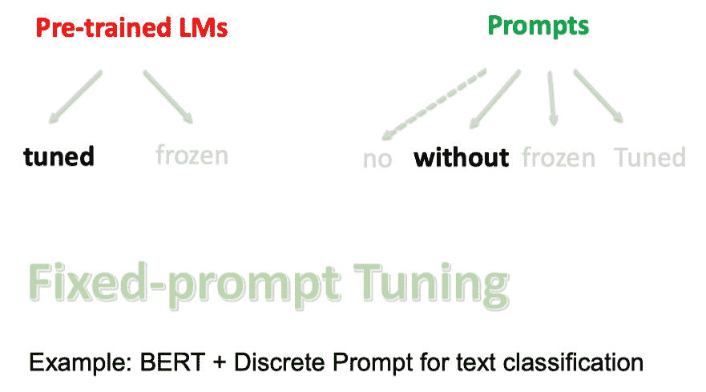

如果使用精调预训练语言模型+连续训练好的固定prompts，就是 BERT + Transferred Continuous Prompt for text classification

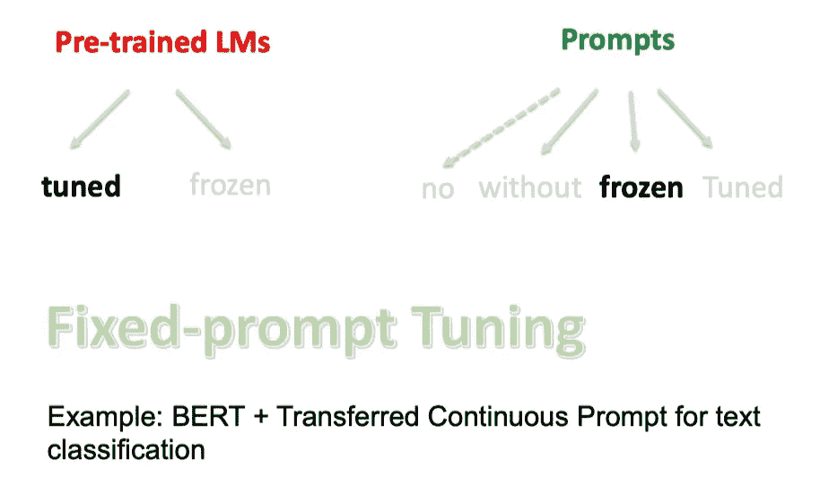

+   Prompt+LM Fine-tuning

如果使用精调预训练语言模型+可训练的prompts，就是 BERT + Continuous Prompt for text classification

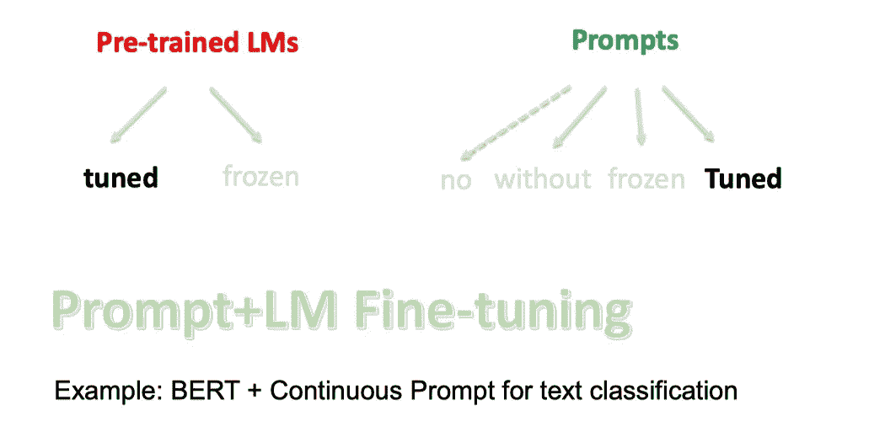

+   Adapter Tuning

如果使用固定预训练语言模型无prompt，只是插入task-specific模块到预训练语言模型中，就是BERT + Adapter for text classification

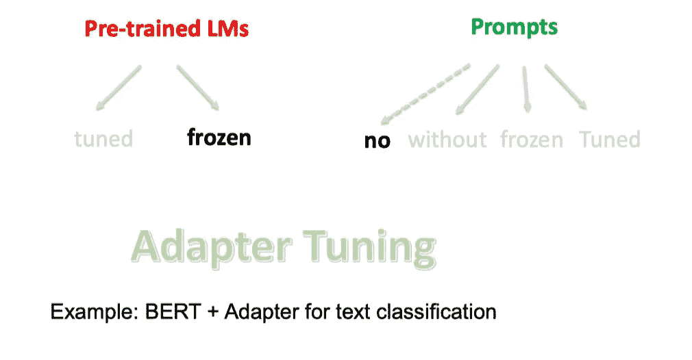

+   Tuning-free Prompting

如果使用固定预训练语言模型和离散固定的prompt，就是GPT3 + Discrete Prompts for Machine Translation

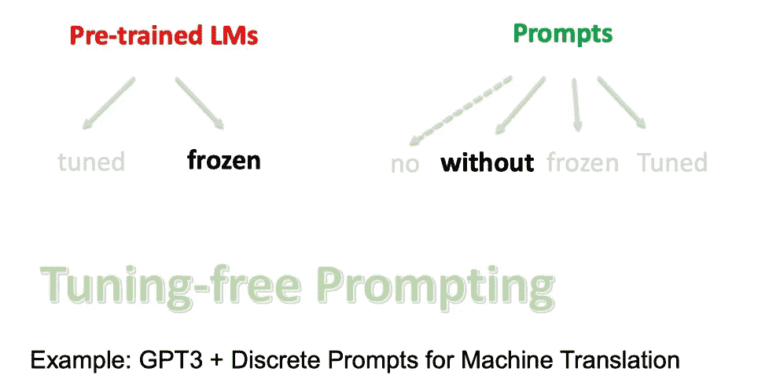

如果使用固定预训练语言模型和连续固定的prompt，就是 GPT3 + Continuous Prompts for Machine Translation

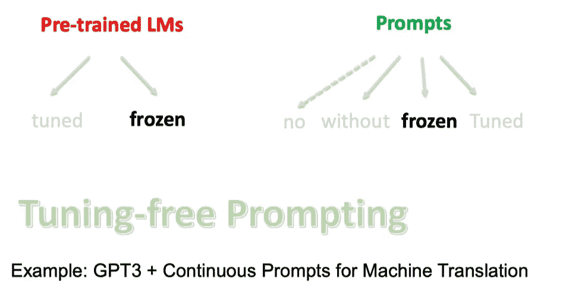

+   Fixed-LM Prompt Tuning

如果使用固定预训练语言模型和可训练的prompt，就是 BART + Continuous Prompts for Machine Translation

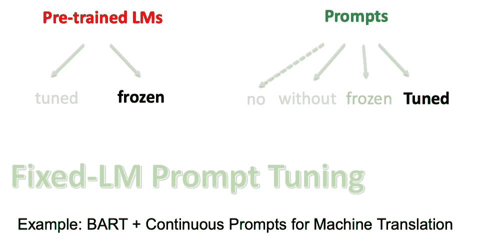

### 策略选择

对于不同的策略，需要进行不同的选择，我们往往需要考虑以下两点：

+   我们的数据量级是多少

+   我们的是否有个超大的 Left-to-right 的语言模型

通常如果我们只有很少的数据的时候，我们往往希望我们不要去`fine-tune`预训练语言模型，而是使用`LM`的超强能力，只是去调`prompt`参数。而让我们数据量足够多的时候，我们可以精调语言模型。

而只有像`GPT-3`这种超大的语言模型的时候，我们才能直接使用，不需要任何的`fine-tuning`。

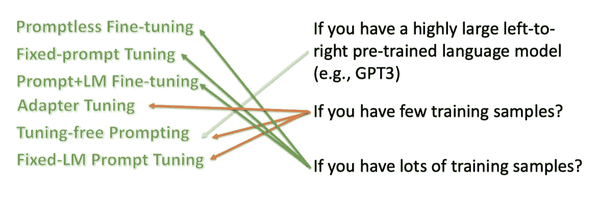

## Prompt 的优势是什么

`Prompt Learning`的优势有哪些呢？我们可以从四个角度进行分析。

+   Level 1. `Prompt Learning`角度
+   Level 2. `Prompt Learning`和`Fine-tuning`的区别
+   Level 3. 现代 NLP 历史
+   Level 4. 超越NLP

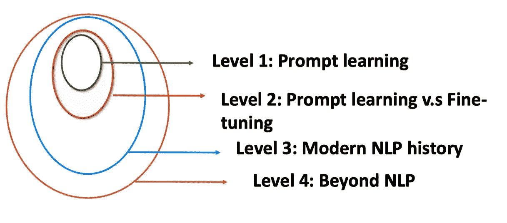

### Level 1. `Prompt Learning`使得所有的NLP任务成为一个语言模型的问题

+   `Prompt Learning`可以将所有的任务归一化预训练语言模型的任务
+   避免了预训练和`fine-tuning`之间的`gap`，几乎所有 NLP 任务都可以直接使用，不需要训练数据。
+   在少样本的数据集上，能取得超过`fine-tuning`的效果。
+   使得所有的任务在方法上变得一致

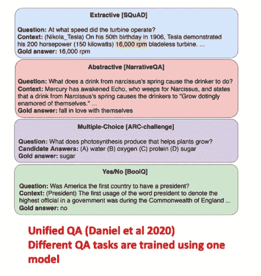

### Level 2. `Prompt Learning`和`Fine-tuning`的范式区别

+   `Fine-tuning`是使得预训练语言模型适配下游任务
+   `Prompting`是将下游任务进行任务重定义，使得其利用预训练语言模型的能力，即适配语言模型

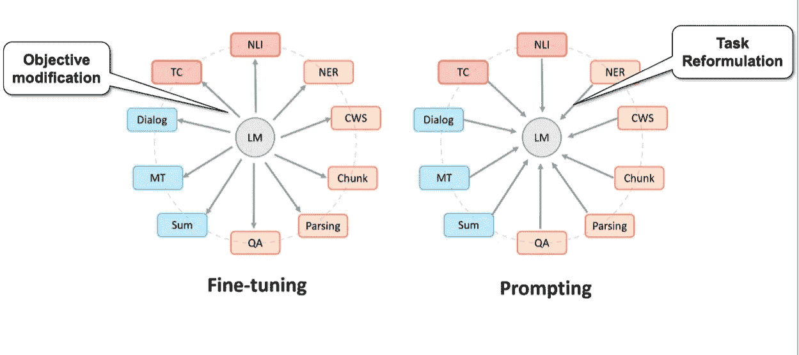

### Level 3. 现代 NLP 第四范式

`Prompting`方法是现在NLP的第四范式。其中现在NLP的发展史包含

1.  `Feature Engineering`：即使用文本特征，例如词性，长度等，在使用机器学习的方法进行模型训练。（无预训练语言模型）
1.  `Architecture Engineering`：在`W2V`基础上，利用深度模型，加上固定的`embedding`。（有固定预训练`embedding`，但与下游任务无直接关系）
1.  `Objective Engineering`：在`bert`的基础上，使用动态的`embedding`，再加上`fine-tuning`。（有预训练语言模型，但与下游任务有`gap`）
1.  `Prompt Engineering`：直接利用预训练语言模型辅以特定的`prompt`。（有预训练语言模型，但与下游任务无`gap`）

我们可以发现，在四个范式中，预训练语言模型和下游任务之间的距离变得越来越近，直到最后`Prompt Learning`是直接完全利用`LM`的能力。

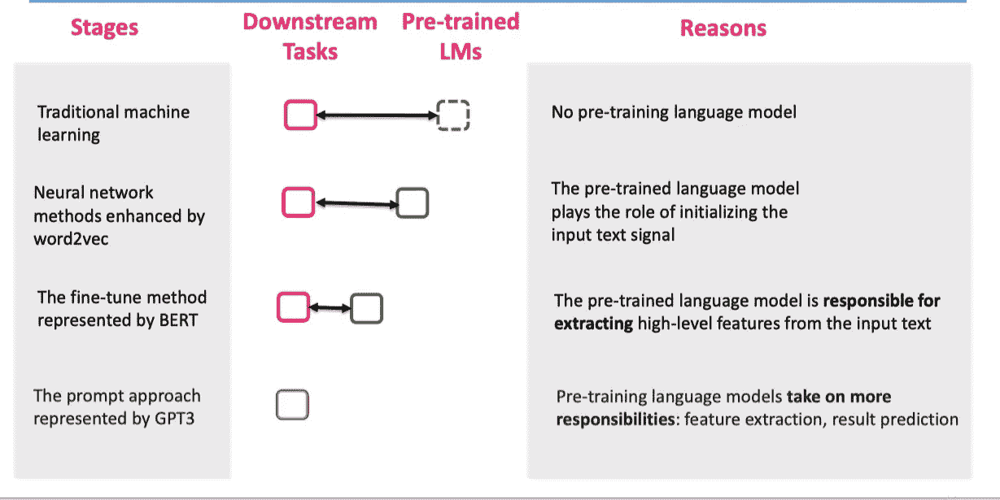

### Level 4. 超越NLP的角度

`Prompt`可以作为连接多模态的一个契机，例如`CLIP`模型，连接了文本和图片。相信在未来，可以连接声音和视频，这是一个广大的待探索的领域。

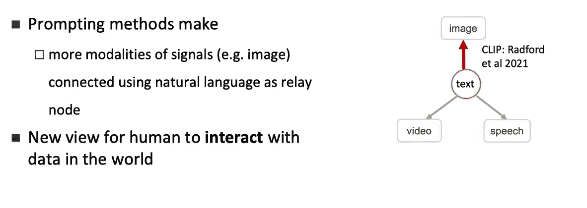

ref:

+   大模型`prompt tuning`技术上的应用【智源分享】
+   [Pre-train, Prompt, and Predict: A Systematic Survey of Prompting Methods in Natural Language Processing](https://link.zhihu.com/?target=https%3A//arxiv.org/pdf/2107.13586.pdf)

-END-

扫码加入AI Flow Genius社群，探讨使用AI来提升生产力的方法，成为超级个体

超过200需手动拉人 **备注：加群**

