# 一文搞懂提示工程的原理及前世今生

> 来源：[https://jalicvoygc0.feishu.cn/docx/TfLPdMpdGoZnmCxWUWLc7wStn5f](https://jalicvoygc0.feishu.cn/docx/TfLPdMpdGoZnmCxWUWLc7wStn5f)

引用：https://mp.weixin.qq.com/s/q4KjP37qaukrHLT9BO1Xgg

作者：polo 余生不设限

**“ 在大****语言模型中，****提示工程（prompt**** eng**ineering）是指设计和编写提示文本，以引导模型生成符合特定要求的语言输出。提示工程可以包括选择合适的词汇、语法、上下文和主题等元素，以及使用不同的技巧和策略来影响模型的生成行为和结果。通过优化提示工程，可以使大语言模型更加准确、可控和适应不同的任务和应用场景。提示工程在自然语言处理、文本生成、对话系统、信息检索等领域中具有重要的应用价值。本文重点介绍下提示工程原理及前世今生。”

# 01

# —

# 什么是提示工程

## 1.1 **提示工程的定义**

**提示工程**（Prompt engineering）是人工智能中的一个概念，特别是自然语言处理（NLP）。 在提示工程中，任务的描述会被嵌入到输入中。例如，不是隐含地给予模型一定的参数，而是以问题的形式直接输入。 提示工程的典型工作方式是将一个或多个任务转换为基于提示的数据集，并通过所谓的“基于提示的学习（prompt-based learning）”来训练语言模型。提示工程可以从一个大型的“冻结”预训练语言模型开始工作，其中只学习了提示的表示方法，即所谓的“前缀调整（prefix-tuning）”或“提示调整（prompt tuning）”。

+

```
参考：https://zh.wikipedia.org/wiki/%E6%8F%90%E7%A4%BA%E5%B7%A5%E7%A8%8B
```

## **提示工程演示(****ChatGPT****)**

调用ChatGPT接口，运行“/Users/ddup/chatgpt/chatgpt-demo.ipynb”

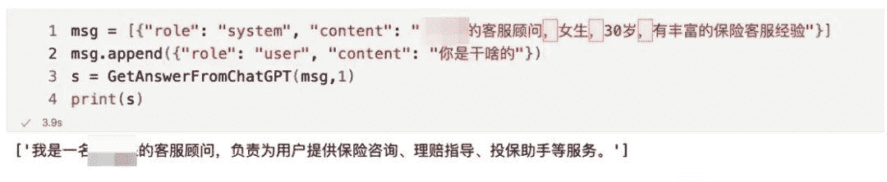

# 02

# —

# 提升工程的前世今生

## 2.1 **NLP****发展历程**

刘鹏飞，卡耐基梅隆大学博士后，2021年写的论文，23年发表在ACM Computing Surveys上

Pre-train, Prompt, and Predict: A Systematic Survey of Prompting Methods in Natural Language Processing

ACM Computing Surveys, Vol. 55, No. 9, Article 195. Publication date: January 202

## 2.2 **任务适配模型示例**

以Bert做情感分类为例，完形填空类Prompt

以GPT做情感分类为例，前缀类Prompt

## 2.3 Prompt Learning VS Finetune

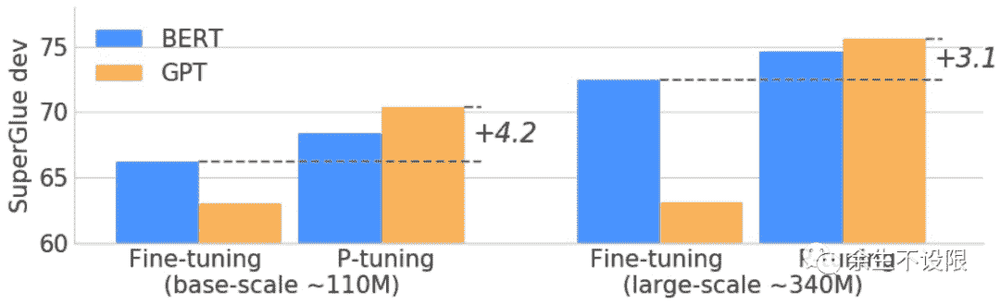

Paper: GPT Understands, Too

在相同参数规模下，bert的在nlu任务上的效果，超过gpt很多；但是在p-tuning下，gpt可以取得超越bert的效果。

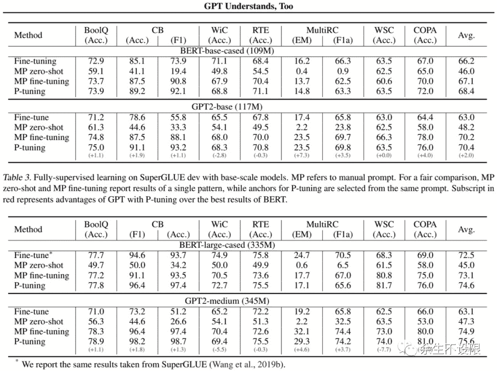

## 2.4 不同模型参数下，Finetune VS Prompt

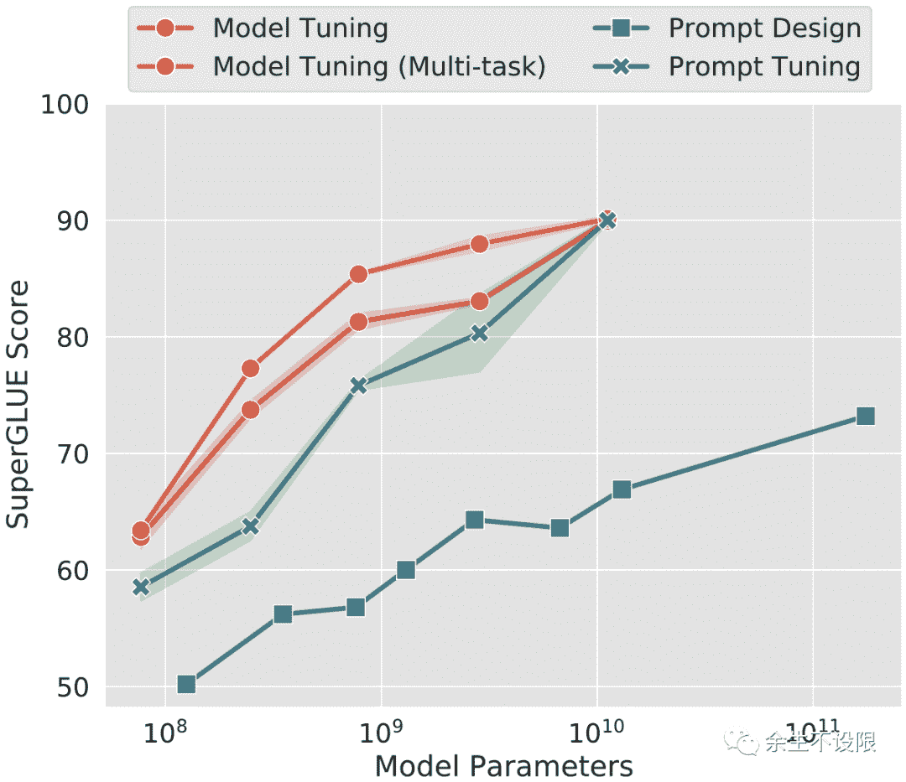

Paper: The Power of Scale for Parameter-Efficient Prompt Tuning

# 03

# —

# 提示学习技术简介

# 提示学习技术全景图：

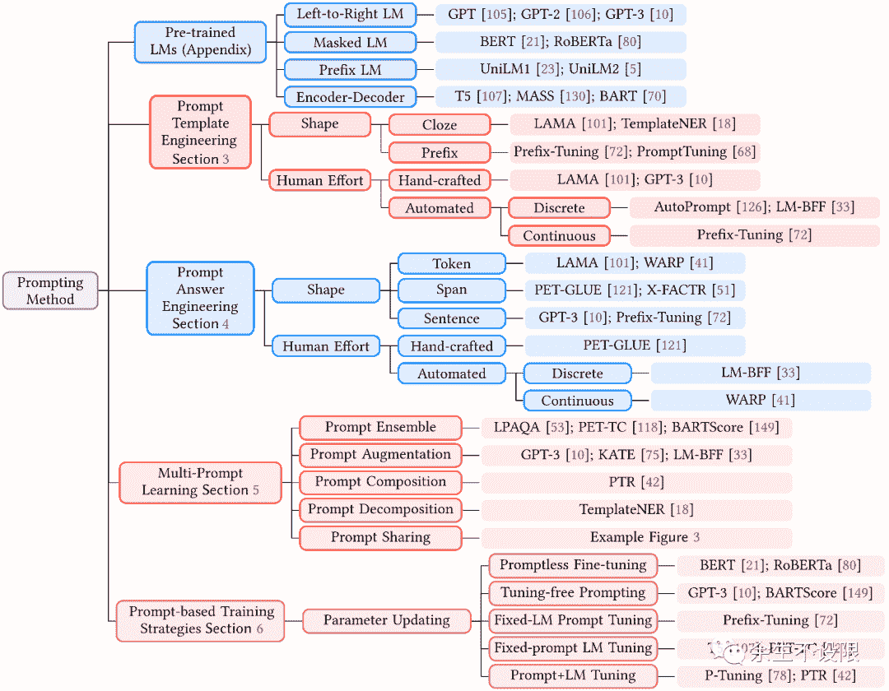

## 3.1 **常见任务如何使用Prompt**

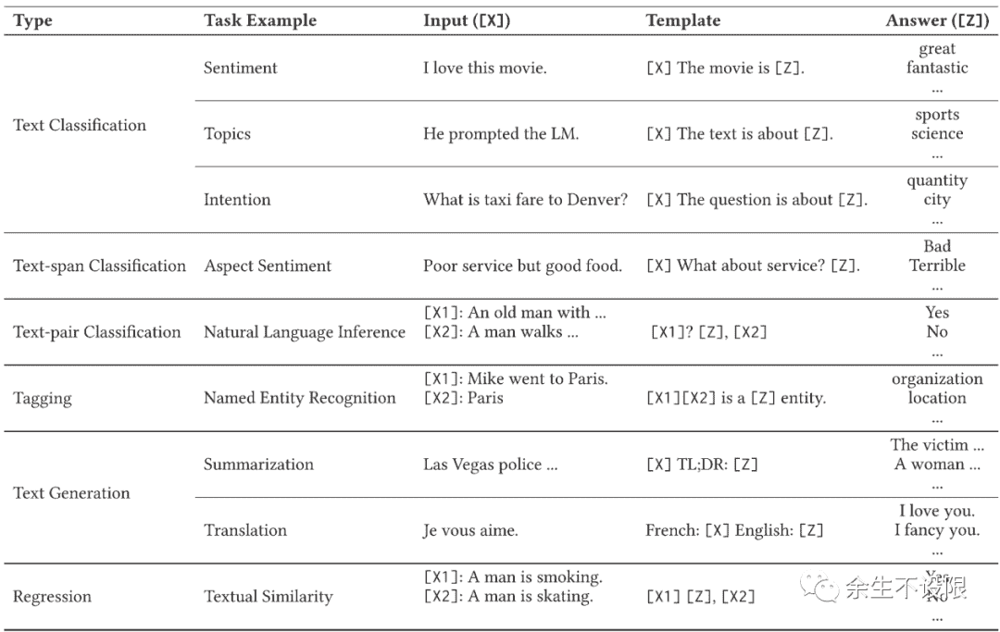

## 3.2 **预训练语言模型适配**

Prompt要尽量适应语言模型的形式，如GPT适合做前缀提示，不适合做完形填空

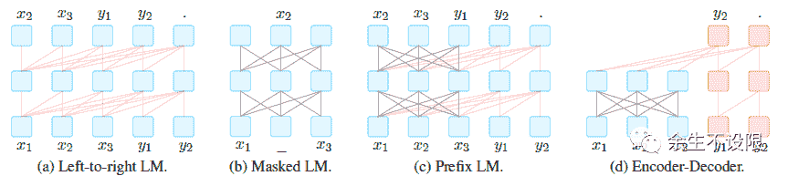

## 3.3 Prompt Template Engineering

### 3.3.1 **提示工程的意义**

好的提示可以显著提升任务效果，LAMA数据集效果

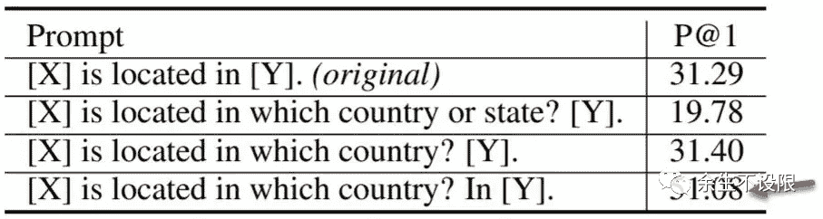

### 3.3.2 手工设计Prompt VS 自动设计Prompt

### 3.3.3 **自动设计Prompt技术简介**

1.  1.  离散提示，文本型提示

+   提示挖掘，给定输入x，输出y，在大数据集（如维基百科）中搜索含x和y的字符串。

+   提示改写，给定种子提示，改写为其它的候选提示（回译、同义词替换、Prompt改写模型、生成模型等）

+   基于梯度的搜索，调用预训练模型来生成token梯度，搜索最佳token序列

+   提示生成，将提示作为一个生成任务，用语言模型来生成

+   提示打分，手写一个提示集作为候选集，然后将输入和输出填充到这些候选集上，通过语言模型打分，取得分最高的模版

+

2.  连续提示，embedding空间做提示

连续提示解除了两个限制，1.模版不再必须是自然语言，2.模版不再必须是预训练语言模型生成的。因此模版可以从下游任务中训练自己的参数

+   前缀调试：冻结LM参数，在embedding后训练一个序列化的参数矩阵，使得输出的概率最大化。通过只学习0.1%的参数，前缀调优在完整的数据设置中获得了可比较的性能，在低数据设置中优于微调

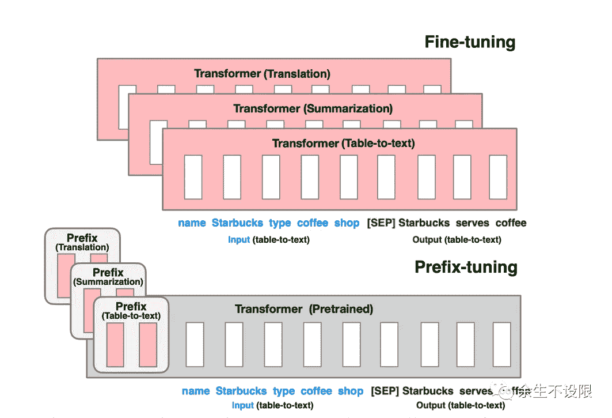

Paper: Prefix-Tuning: Optimizing Continuous Prompts for Generation

+   调试采用离散提示初始化：采用已经生成的或搜索到的提示模版来初始化连续提示

+   软硬结合提示：在硬提示基础上插入几个软提示

前缀学习相比离散提示来讲，在数据量较少时对初始化参数更敏感

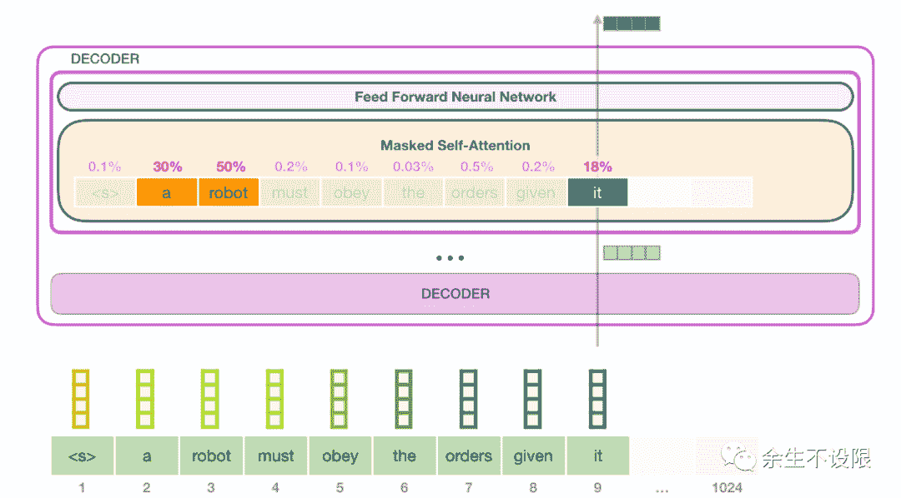

Prefix-Tuning前提：可以接受Embedding输入，对于三方开放API的场景难度较大

迭代顺序

Prefix-Tuning: Optimizing Continuous Prompts for Generation, 2021.1

P-Tuning V1: GPT Understands, Too, 2021.8

P-Tuning V2: Prompt Tuning Can Be Comparable to Fine-tuning Universally Across Scales and Tasks, 2021.10

3.  静态提示 VS 动态提示

静态提示：对每个输入都使用相同的模版

动态提示：对每个输入都使用不同的模版

## 3.4 Answer Template Engineering

在给定一个任务或者Prompt，如何对 label 空间 和 answer 空间进行映射？

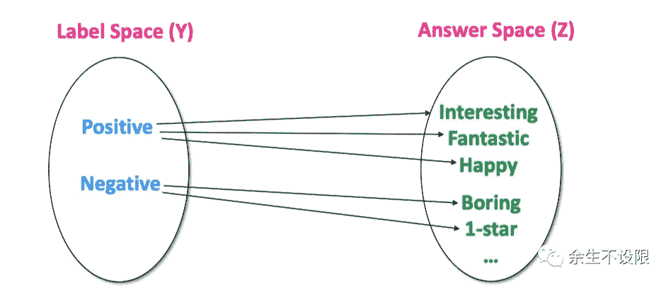

答案类别：token，span，sentence

其它结构整体与提示模版相同

## 3.5 **多提示模版学习**

类似集成学习，每个输入都通过多个提示模版，对效果提升有帮助。

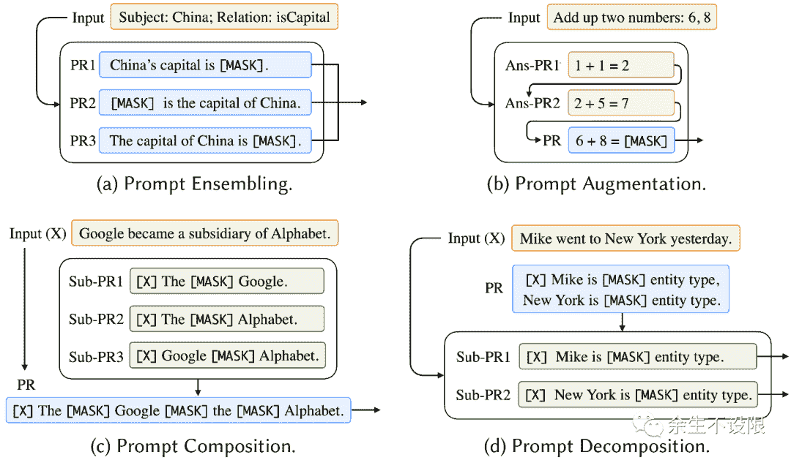

(a) Prompt ensembling: 对于一个问题用多个类似的prompt来解决(b) Prompt augmentation: 使用少量样本来让模型学习出共性(c) Prompt composition: 将多个子问题组合成一个问题(d) Prompt decomposition: 将一个困难的问题拆分成多个子问题

## 3.6 Prompt Learning的局限

效果不稳定，谈不上资源节约，想要大模型理解提示，需要模型针对提示做训练

# 04

# —

# 思维链提示及涌现

## 4.1 **思维链提示**

思维链paper，2022年1月：Chain-of-Thought Prompting Elicits Reasoning in Large Language Models

### 4.1.1 **什么是思维链提示**

采用一系列中间推理步骤来做提示，可以显著提高大语言模型解决复杂问题的效果。

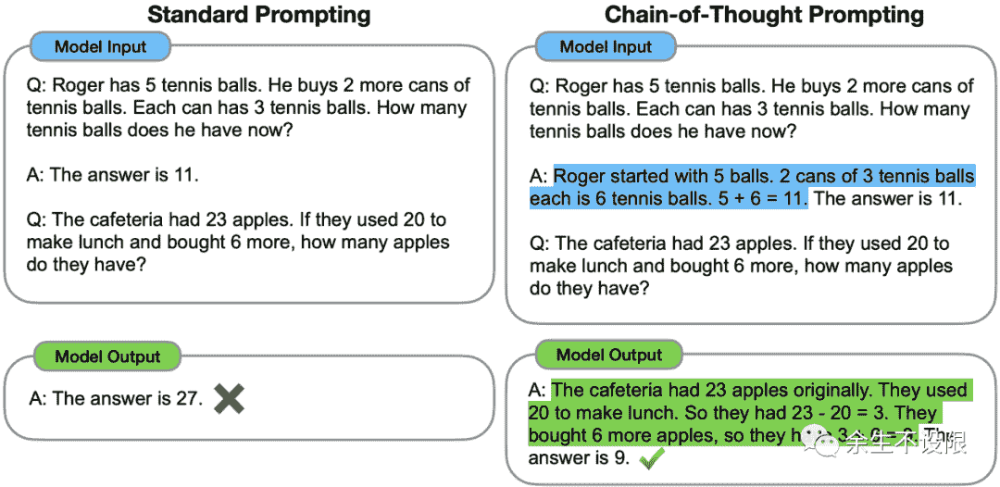

### 4.1.2 **思维链提示 - ****大模型****涌现能力**

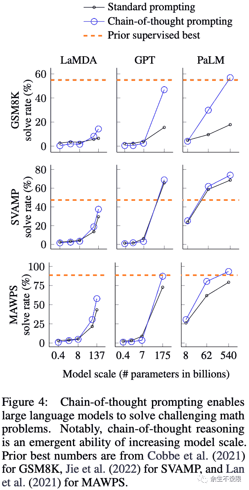

## 4.2 **涌现**

### 4.2.1 **涌现的原始定义**

定义：复杂系统中在自我组织的过程中，所产生的各种新奇且清晰的结构、图案、和特性。

+

```
参考：https://zh.wikipedia.org/zh-hans/%E6%B6%8C%E7%8E%B0
```

### 4.2.2 **大模型****涌现能力简介**

Paper: Emergent Abilities of Large Language Models

在较小的模型中不出现，而在较大的模型中出现的能力，则可以称之为emergent

few-shot prompting的emergent主要体现为模型在没有达到一定规模前，得到的表现较为随机，在突破规模的临界点后，表现大幅度提升

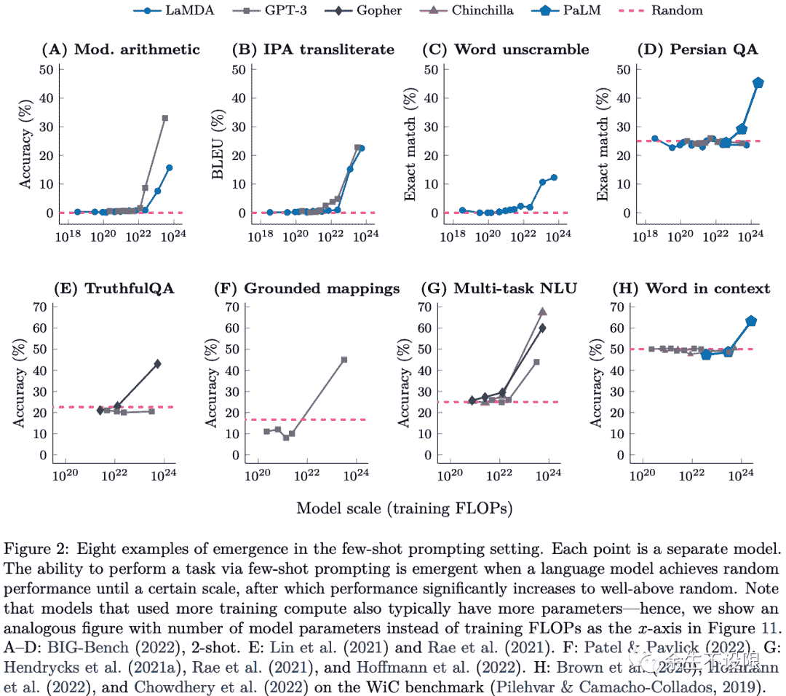

### 4.2.3 **不同任务出现涌现所需模型规模**

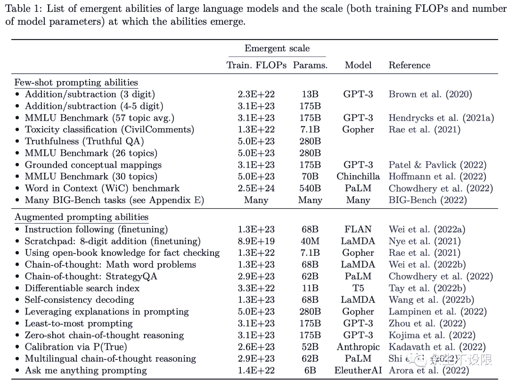

### 4.2.4 **讨论**

#### 4.2.4.1 **涌现现象可能的解释**

1.  对于某些任务，可能自然而然的需要模型参数大于阈值。如多步推理任务，需要n步，那么模型深度至少O(n)

2.  对于需要“世界知识”的任务，需要模型记忆更多的东西才可以解决

3.  从评估标准角度考虑，比如精确匹配，特别是长序列情况，效果可能一直在提升，但只有完全匹配才算正确

#### 4.2.4.2 **Beyond Scaling**

虽然本文主要探究模型超过一定规模后出现emergent ability, 但模型仍然有可能通过数据，算法的改进在更小规模出现emergence. 比如在BIG-Bench任务上，LaMDA在137B，GPT-3在175B上出现emergent ability，而PaLM在62B就可以出现。另外，采用不同的预训练目标也可能解锁涌现能力。

涌现能力出现以后，可以进一步研究如何用更小尺度的模型来实现该能力。如有人发现instruction-based finetuning仅在68B参数量以上decoder only模型下可以有涌现能力；又有人发现相同的操作在11B的编解码模型结构上就可以出现；还有人发现 InstructGPT用的RLHF方法可以使得1.3B的模型具备比大模型更好的效果。

## 4.3 **思维链研究进展**

+   Paper：Self-Consistency Improves Chain of Thought Reasoning in Language Models

+   使用了对答案进行了多数投票（majority vote），并且发现其可以显著地提高思维链方法的性能

+   STaR: Self-Taught Reasoner Bootstrapping Reasoning With Reasoning

+   提出了一种boost方法，让中小模型也可以通过训练具有思维链能力

# 05

# —

# 展望

1.  随着模型规模的增加，中小型公司用提示学习方法调用大公司的API已成为必然。

2. 效果上看，连续型Prompt > 离散型Prompt > 手工设计Prompt，但连续型Prompt需要在Embedding之后输入，API支持的可能性低，故所以离散型Prompt可能是将来的方向。随着模型的进一步优化，会出现手工简单设计Prompt即可达到应用效果的模型。

3.  中大型公司在垂直领域训练规模中等的模型也是一个不错的选择

-END-

扫码加入AI Flow Genius社群，探讨使用AI来提升生产力的方法，成为超级个体

超过200需手动拉人 **备注：加群**

