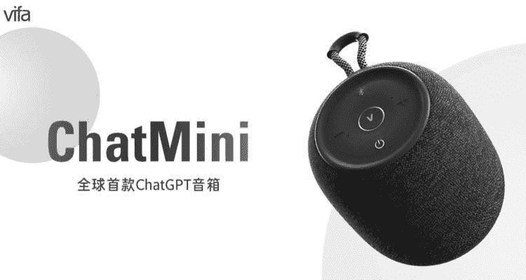

# 全球首个内置 ChatGPT 智能音箱 ChatMini 计划下周发布

> 来源：[https://jalicvoygc0.feishu.cn/docx/NQB7dVJgtohLwjxQuyacN6upnHh](https://jalicvoygc0.feishu.cn/docx/NQB7dVJgtohLwjxQuyacN6upnHh)

品玩8月11日讯，智度科技今天宣布，全球首款内置 ChatGPT 的智能音箱 Vifa ChatMini 将于 8 月 17 日全球首发。

据报道，ChatMini 号称内置 ChatGPT 和百度文心一言双 AI，能够与用户进行更丰富的对话，包括根据用户兴趣爱好创作诗歌、歌词、文章；根据用户情绪状态提供安慰、鼓励或建议；或者与用户进行游戏 / 测试 / 问答等等。

该智能音箱将于 8 月 17 日在美国正式发布，官方售价为 259 美元。

##### 继续浏览全站内容：

[🎪首页](https://jalicvoygc0.feishu.cn/wiki/DdEvwxYsSidd36kAIIVcnROwnmb)

[🤔学习AI工作流](https://jalicvoygc0.feishu.cn/wiki/W15IwochvimsqvkkuCPcZuBxnqg)

[🤖查找AI工具](https://jalicvoygc0.feishu.cn/wiki/Bu8GwqYu8i5LBRkyVKocUvX5n97)

[📊阅读AI文章](https://jalicvoygc0.feishu.cn/wiki/SIywwqrVji2lZkkqFFpcEHZ8nNc)

扫码加入AI Flow Genius社群，探讨使用AI来提升生产力的方法，成为超级个体

超过200需手动拉人 **备注：加群**

