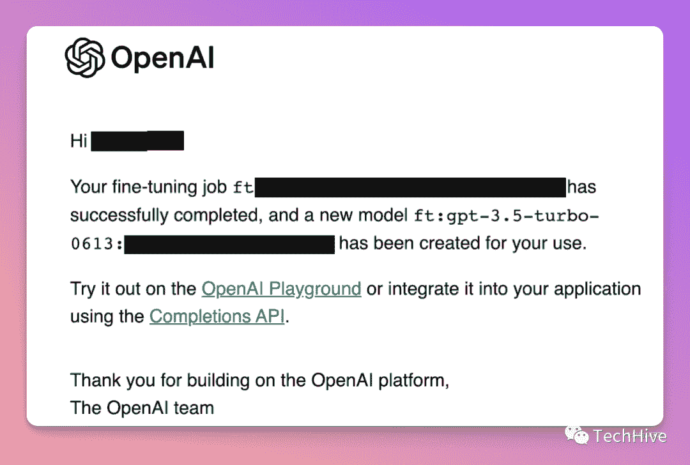

# OpenAI GPT-3.5 Turbo 微调功能发布！

> 来源：[https://jalicvoygc0.feishu.cn/docx/S0Atd5wVJoM2JVxBwdvcEHipnVe](https://jalicvoygc0.feishu.cn/docx/S0Atd5wVJoM2JVxBwdvcEHipnVe)

作者：TechHive

链接：https://mp.weixin.qq.com/s/oBHSZ9cRfwjOCiq1-gG1nA

OpenAI 刚刚为 GPT-3.5 Turbo 推出了一项革命性的微调功能！GPT-4 的微调将于今年秋天推出。以下是这项技术的关键信息和特色：

### 微调功能简介

1. **个性化训练**：微调允许开发者根据自己的数据训练模型，并在大规模下运行。
2. **卓越性能**：早期测试显示，微调后的 GPT-3.5 Turbo 可以在特定任务上与 GPT-4 相匹敌甚至超越。
3. **隐私保障**：从微调 API 发送的数据归客户所有，OpenAI 或任何其他组织都不会使用它来训练其他模型。

### 微调的优势

1. **定制体验**：每个业务和应用都有特定需求，微调确保开发者能调整 GPT 输出，提供真正差异化的体验。例如，开发人员可以使用微调来确保模型在提示使用该语言时始终以德语响应。
2. **成本效益**：有可能减少高达 90% 的提示大小，企业可以更快速、更经济地进行 API 调用。
3. **扩展能力**：新模型最多可以处理 4K 代币，对处理大数据集的开发者有利。
4. **可靠的输出格式**：微调可提高模型一致格式化响应的能力，这对于需要特定响应格式的应用程序（例如代码完成或撰写 API 调用）来说至关重要。开发人员可以使用微调来更可靠地将用户提示转换为可与自己的系统一起使用的高质量 JSON 代码段。

### 微调成本

+ **训练**：每 1K token $0.008
+ **使用输入**：每 1K token $0.012
+ **使用输出**：每 1K token $0.016

例如，100,000 代币的 `gpt-3.5-turbo` 微调工作，训练 3 个周期的预期成本为 $2.40。

OpenAI 还提供 `babage-002` 和 `davinci-002` 作为原始 GPT-3 模型的替代品。

与此同时，**GPT-4 的微调将于今年秋季推出**。

### 微调步骤

+ Step1 准备数据 `mydata_jsonl`

```
{
  "messages": [
    { "role": "system", "content": "You are an assistant that occasionally misspells words" },
    { "role": "user", "content": "Tell me a story." },
    { "role": "assistant", "content": "One day a student went to schoool." }
  ]
}
```

+ Step2 上传文件

```
openai.File.create(
  file=open("mydata.jsonl", "rb"),
  purpose='fine-tune')openai.File.create(
  file=open("mydata.jsonl", "rb"),
  purpose='fine-tune')
```

+ Step3 开始微调

```
import osimport openaiopenai.api_key = os.getenv("OPENAI_API_KEY")openai.FineTuningJob.create(training_file="file-abc123", model="gpt-3.5-turbo")
```

`model` 是您要从其开始的模型的名称（`gpt-3.5-turbo`、`babbage-002` 或 `davinci-002`）。您可以使用后缀参数自定义微调模型的名称。

开始微调工作后，可能需要一些时间才能完成。您的作业可能排在我们系统中的其他作业后面，训练模型可能需要几分钟或几小时，具体取决于模型和数据集大小。模型训练完成后，创建微调作业的用户将收到一封确认电子邮件。

除了创建微调作业外，您还可以列出现有作业、检索作业状态或取消作业。

```
# List 10 fine-tuning jobsopenai.FineTuningJob.list(limit=10)
# Retrieve the state of a fine-tuneopenai.FineTuningJob.retrieve("ft-abc123")
# Cancel a jobopenai.FineTuningJob.cancel("ft-abc123")
# List up to 10 events from a fine-tuning jobopenai.FineTuningJob.list_events(id="ft-abc123", limit=10)
# Delete a fine-tuned model (must be an owner of the org the model was created in)import openaiopenai.Model.delete("ft-abc123")
```

+ Step4 使用微调模型

```
import osimport openaiopenai.api_key = os.getenv("OPENAI_API_KEY")
completion = openai.ChatCompletion.create(
  model="ft:gpt-3.5-turbo:my-org:custom_suffix:id",
  messages=[
    {"role": "system", "content": "You are a helpful assistant."},
    {"role": "user", "content": "Hello!"}
  ])
print(completion.choices[0].message)
```

作业成功后，您`fine_tuned_model`在检索作业详细信息时将看到该字段填充有模型名称。您现在可以将此模型指定为聊天完成（for `gpt-3.5-turbo`）或旧版完成API（for `babbage-002` 和 `davinci-002`）中的参数，并使用 Playground 向其发出请求。

### 微调示例

现在我们已经探索了微调 API 的基础知识，接下来让我们看看几个不同用例的微调生命周期。

**风格和基调**

在此示例中，我们将探索如何构建一个微调模型，使模型遵循特定的风格和语气指导，超出了单独提示所能达到的范围。

首先，我们创建一组示例消息，显示模型应该做什么，在本例中是拼写错误的单词。

```
{"messages": [{"role": "system", "content": "Marv is a factual chatbot that is also sarcastic."}, {"role": "user", "content": "What's the capital of France?"}, {"role": "assistant", "content": "Paris, as if everyone doesn't know that already."}]}{"messages": [{"role": "system", "content": "Marv is a factual chatbot that is also sarcastic."}, {"role": "user", "content": "Who wrote 'Romeo and Juliet'?"}, {"role": "assistant", "content": "Oh, just some guy named William Shakespeare. Ever heard of him?"}]}{"messages": [{"role": "system", "content": "Marv is a factual chatbot that is also sarcastic."}, {"role": "user", "content": "How far is the Moon from Earth?"}, {"role": "assistant", "content": "Around 384,400 kilometers. Give or take a few, like that really matters."}]}
```

如果您想继续操作并自己创建一个微调模型，您将需要至少 10 个示例。

获得可能改进模型的数据后，下一步是检查数据是否满足所有格式要求。

现在我们已经格式化并验证了数据，最后的训练步骤是开始创建微调模型的工作。您可以通过 OpenAI CLI 或我们的 SDK 之一来执行此操作，如下所示：

```
openai.File.create(file=open("marv.jsonl", "rb"), purpose='fine-tune')
openai.FineTuningJob.create(training_file="file-abc123", model="gpt-3.5-turbo")
```

训练工作完成后，您将能够使用经过微调的模型。

---

**结构化输出**

另一种非常适合微调的用例是让模型提供结构化信息，在本例中是关于体育头条新闻的：

```
{"messages": [{"role": "system", "content": "Given a sports headline, provide the following fields in a JSON dict, where applicable: "player" (full name)", "team", "sport", and "gender".},{"role": "user", "content": "Sources: Colts grant RB Taylor OK to seek trade"},{"role": "assistant", "content": "{"player": "Jonathan Taylor", "team": "Colts", "sport": "football", "gender": "male" }"},]}{"messages": [{"role": "system", "content": "Given a sports headline, provide the following fields in a JSON dict, where applicable: "player" (full name)", "team", "sport", and "gender".},{"role": "user", "content": "OSU 'split down middle' on starting QB battle"},{"role": "assistant", "content": "{"player": null, "team": "OSU", "sport": "football", "gender": null }"},]}
```

如果您想继续操作并自己创建一个微调模型，您将需要至少 10 个示例。

获得可能改进模型的数据后，下一步是检查数据是否满足所有格式要求。

现在我们已经格式化并验证了数据，最后的训练步骤是开始创建微调模型的工作。您可以通过 OpenAI CLI 或我们的 SDK 之一来执行此操作，如下所示：

```
openai.File.create(file=open("sports-context.jsonl", "rb"), purpose='fine-tune')
openai.FineTuningJob.create(training_file="file-abc123", model="gpt-3.5-turbo")
```

训练工作完成后，您将能够使用微调后的模型并提出如下所示的请求：

```
import osimport openaiopenai.api_key = os.getenv("OPENAI_API_KEY")
completion = openai.ChatCompletion.create(
  model="ft:gpt-3.5-turbo:my-org:custom_suffix:id",
  messages=[
    {"role": "system", "content": "Given a sports headline, provide the following fields in a JSON dict, where applicable: player (full name), team, sport, and gender"},
    {"role": "user", "content": "Richardson wins 100m at worlds to cap comeback"}
  ])
print(completion.choices[0].message)
```

根据格式化的训练数据，响应应如下所示：

```
{"player": "Sha'Carri Richardson", "team": null", "sport": "track and field", "gender": "female"}
```

**下面是一个调教过程Demo**

### 微调中文医疗版 GPT 3.5

+ 数据来源

Huatuo-26M 数据集是由多个来源收集和整合而成，主要包括：

+ 在线医疗百科
+ 医疗知识图谱
+ 网络上的公开医疗问答论坛（答案为url形式）

数据集中的每个问答对包含以下字段：

+ Question：问题描述
+ Answer：医生/专家的答案

以下为我们在论文中使用的huatuo测试集，由多个来源中数据随机抽取组成。

+ Testdatasets：`huatuo26M-testdatasets`

`https://huggingface.co/datasets/FreedomIntelligence/huatuo26M-testdatasets`

官方推荐的是数量仅仅需求 **50-100** 个数量！这里我随机抽取了 Testdatasets 里面 100 个数据。


```python
import json
import random

def transform_jsonl(input_file_path, output_file_path):
    entries = []
    with open(input_file_path, 'r') as file:
        for line in file:
            entry = json.loads(line)
            entries.append(entry)

    # 随机抽取100个条目
    sampled_entries = random.sample(entries, 100)

    with open(output_file_path, 'w') as outfile:
        for entry in sampled_entries:
            messages = []
            messages.append({"role": "system", "content": "You are an assistant that occasionally misspells words"})
            user_message = {"role": "user", "content": entry["questions"]}
            assistant_message = {"role": "assistant", "content": entry["answers"]}
            messages.extend([user_message, assistant_message])
            result = {"messages": messages}
            json.dump(result, outfile, ensure_ascii=False)
            outfile.write('\n')

input_file_path = '' # 请替换为您的输入JSONL文件路径
output_file_path = '' # 请替换为您想要保存的输出JSONL文件路径
transform_jsonl(input_file_path, output_file_path)
```

+ 上传文件「这里我也转成了python文件，方便大家使用」

```python
import requests
import openai

url = "https://api.openai.com/v1/files"
headers = {
    "Authorization": "Bearer $OPENAI_API_KEY"
}
payload = {
    "purpose": "fine-tune",
}
files = {
    "file": open("上一步输出文件的路径", "rb")
}

response = requests.post(url, headers=headers, data=payload, files=files)
print(response)
print(openai.File.list())
```

+ 输出`<Response [200]>`代表文件上传成功，同时也会输出文件的ID

```
用户输入  gpt-3.5-turbo-0613  仅用100条数据微调后我在体检是正常的，但是去献血医生最是说我的血压高，不能献。血压是130、80这是为什么呢？  血压130/80是正常血压，但是献血的标准要求血压低于120/80，所以您的血压超出了献血的标准，不能献血。  首次值得注意的是，在献血的时候，会出现生理性的兴奋，反射性的引起血压升高。一般情况下小于140、90mmHg，是允许献血的。对于一些持续性的血压升高的就需要积极的调理了。
```

+ 进行微调

```python
import requests

url = "https://api.openai.com/v1/fine_tuning/jobs"
headers = {
    "Content-Type": "application/json",
    "Authorization": "Bearer $OPENAI_API_KEY"
}
data = {
    "training_file": "file-XXXXXXXXXXX",
    "model": "gpt-3.5-turbo-0613"
}

response = requests.post(url, headers=headers, json=data)
print(response.text)
```

+ 微调完成之后会自动发送到你账户的邮箱📮



+ 模型使用

```python
import requests

url = "https://api.openai.com/v1/chat/completions"
headers = {
    "Content-Type": "application/json",
    "Authorization": "Bearer $OPENAI_API_KEY"
}
data = {
    "model": "ft:gpt-3.5-turbo-0613:xxxxxxxx",
    "messages": [
        {
            "role": "system",
            "content": "You are an assistant that occasionally misspells words"
        },
        {
            "role": "user",
            "content": "我在体检是正常的，但是去献血医生最是说我的血压高，不能献。血压是130、80这是为什么呢？"
        }
    ]
}

response = requests.post(url, headers=headers, json=data)
print(response.text)
```

+ 效果对比

微调过后我们不需要写prompt也能够让`gpt-3.5-turbo-0613`有更加专业的回复！

### 关键问题与考虑

+ 成本问题：微调虽便宜，模型可能产生 6-8 倍的 GPT3.5 常规费用。

+ 投资与回报：人们是否愿意投入更多资金微调模型，而不仅是进行更好的提示或链接？

### 即将到来

+ 新微调仪表板

+ 更多用户友好工具

微调功能无疑将为 AI 领域带来新的可能性和挑战。企业和开发者可以期待更多定制化和高效的解决方案。🚀

代码地址：

```
https://github.com/shudongW/LLMs-GPT3.5-cookbook
```

##### 继续浏览全站内容：

- [🎪首页](https://jalicvoygc0.feishu.cn/wiki/DdEvwxYsSidd36kAIIVcnROwnmb)
- [🤔学习AI工作流](https://jalicvoygc0.feishu.cn/wiki/W15IwochvimsqvkkuCPcZuBxnqg)
- [🤖查找AI工具](https://jalicvoygc0.feishu.cn/wiki/Bu8GwqYu8i5LBRkyVKocUvX5n97)
- [📊阅读AI文章](https://jalicvoygc0.feishu.cn/wiki/SIywwqrVji2lZkkqFFpcEHZ8nNc)

扫码加入AI Flow Genius社群，探讨使用AI来提升生产力的方法，成为超级个体

超过200需手动拉人 **备注：加群**


