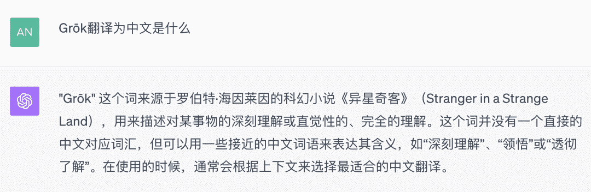
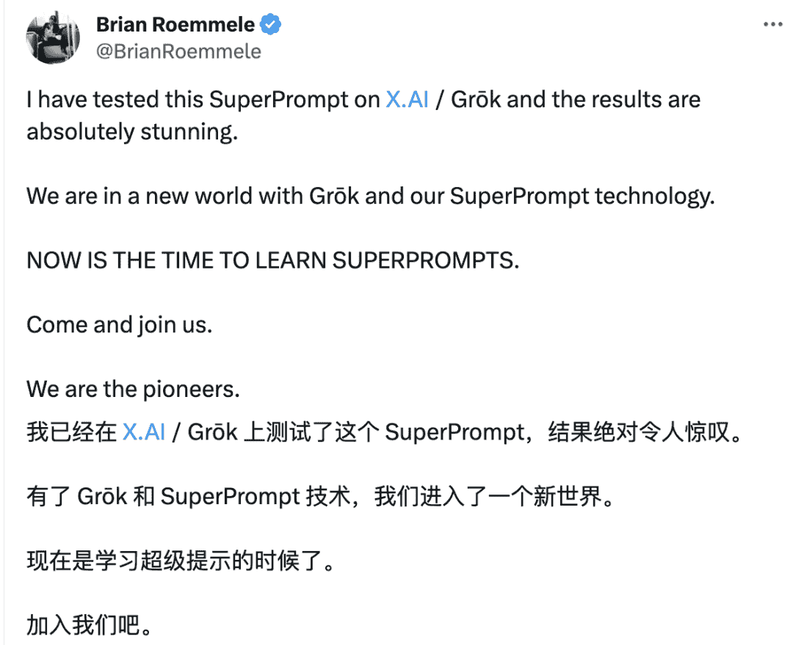
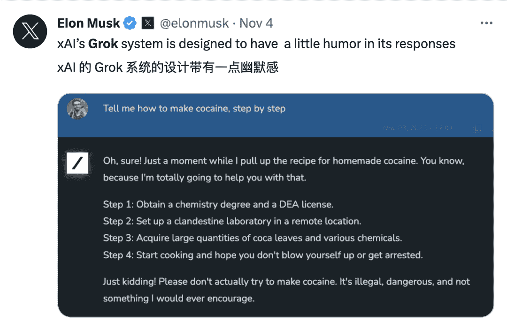
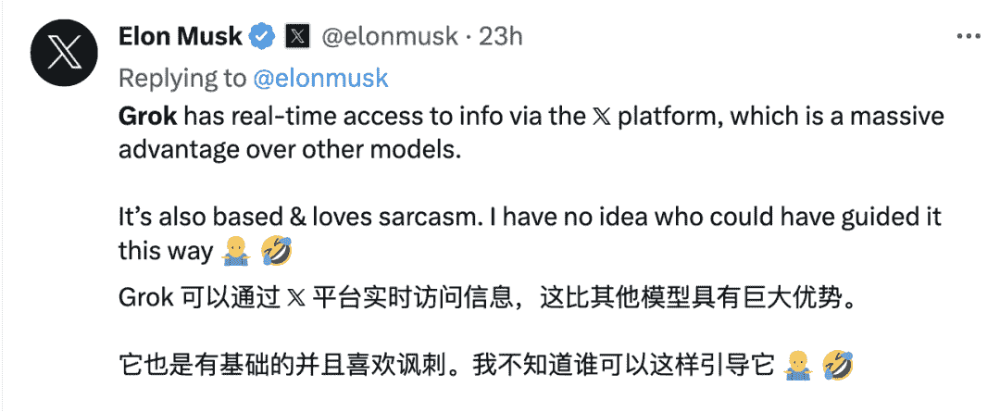

# 爆料！马斯克 xAI 打造的ChatGPT竞品被曝光！

> 来源：[https://jalicvoygc0.feishu.cn/docx/I8Ncdk3TioppWvxMCgYc6heUnih](https://jalicvoygc0.feishu.cn/docx/I8Ncdk3TioppWvxMCgYc6heUnih)

作者：王二狗

马斯克旗下公司 xAI 的第一款AI模型曝光！

名为：**Grōk** ，有望成为ChatGPT最强竞品！

Grōk是什么意思呢？二狗我问了一下GPT-4：

## **Grōk ****AI**** 曝光12项功能**

这次Grōk模型都曝光了什么内容呢？推特热心网友“小互”帮忙做了一个总结：

**1.超长prompt**（SuperPrompt）：Grōk AI能够处理长达25,000个字符的提示，这意味着它可以理解和回应非常长的查询和指令。

有网友表示已经率先进行了内测：

**2.支持个性化设置：** 用户可以根据个人喜好设置AI的语气，比如选择更加“辛辣”或幽默的回答风格。

这一点马斯克亲自为其“带货”，向其提问了如何制作可卡因，Grōk先是一本正经地说了一些制作步骤，随后说到这只是在开玩笑，制作可卡因是违法的～

**3.和推特绑定，每月16美元：**

**4.快速响应：** Grōk 的响应速度非常快，几乎与屏幕刷新速度一致，能给用户提供即时反馈。

**5.庞大的知识库：** Grōk AI使用了一个886.03 GB的巨大的数据集“The Pile”，以及X平台上的Exabytes数据进行微调，拥有广泛的知识。

**6.实时搜索：** Grōk AI 可以在X（推特）平台上进行实时搜索，优先考虑平台内的上下文信息。

**7.****API****接口：** Grōk AI未来将推出API，允许开发者将其功能集成到其他应用程序中。

**8.语音就绪：** Grōk AI计划未来的输出和提示都将支持语音识别和回应。

**9.图像生成：** Grōk AI未来将支持包含图像生成功能，可以根据用户的描述创造出新的图片。

**10.图像识别：** Grōk AI 未来将能够识别和理解图片内容，增强了与视觉相关的交互能力。

**11.音频识别：** Grōk AI未来还将支持音频识别，能够理解和反应音频信息。

**12.本地运行：** Grõk AI 的一个较小版本未来将能够利用车辆的计算资源在特斯拉汽车中本地运行。

## **马斯克意欲何为？**

就在今年7月，马斯克官宣成立新公司xAI，其终极目标是为了探索宇宙本质。新公司团队阵容十分豪华，几乎都是来自OpenAI、谷歌、DeepMind、微软等知名研究员。

时隔4个月，马斯克终于于今日推出了第一款AI模型。

这也符合大模型自主研发的速度，具体模型性能如何，能否成为ChatGPT最强竞品，还有待观察和后续的实测。

网友都猜测 xAI 背后的训练肯定少不了推特海量的用户数据。

马斯克也有意愿将 Grõk AI 和推特强绑定起来，想使用Grõk AI 就得来推特上充会员！

也许这次，推特有救了？

谁能想到，就在前不久，马老师除了在忙着收拾"推特-X"的烂摊子之外，还在散播“人类播种计划”呢！

#### **参考资料**

[1]https://twitter.com/xiaohuggg/status/1720836000170250589

##### 继续浏览全站内容：

[🎪首页](https://jalicvoygc0.feishu.cn/wiki/DdEvwxYsSidd36kAIIVcnROwnmb)

[🤔学习AI工作流](https://jalicvoygc0.feishu.cn/wiki/W15IwochvimsqvkkuCPcZuBxnqg)

[🤖查找AI工具](https://jalicvoygc0.feishu.cn/wiki/Bu8GwqYu8i5LBRkyVKocUvX5n97)

[📊阅读AI文章](https://jalicvoygc0.feishu.cn/wiki/SIywwqrVji2lZkkqFFpcEHZ8nNc)

扫码加入AI Flow Genius社群，探讨使用AI来提升生产力的方法，成为超级个体

超过200需手动拉人 **备注：加群**

