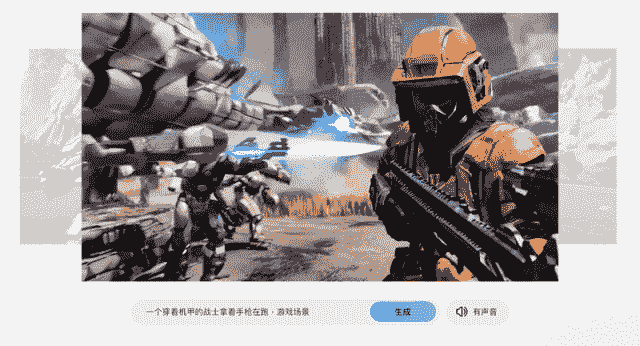
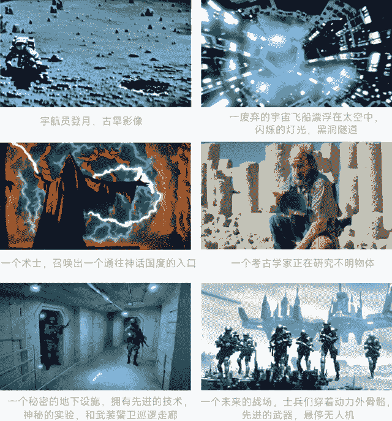
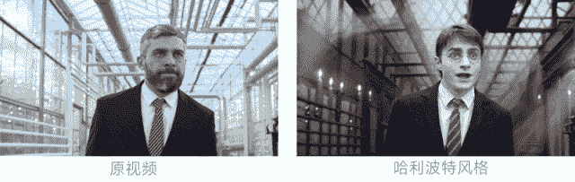
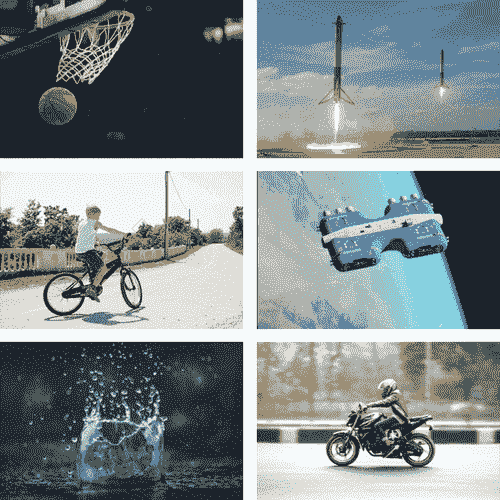
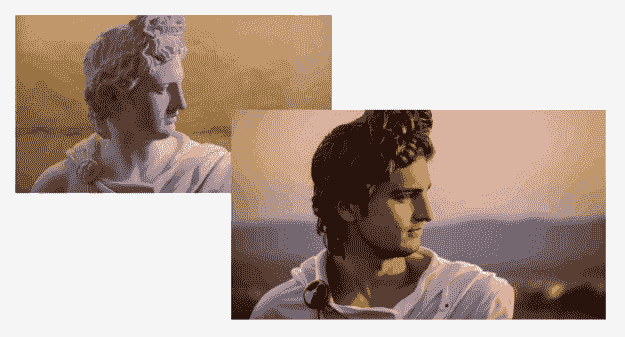
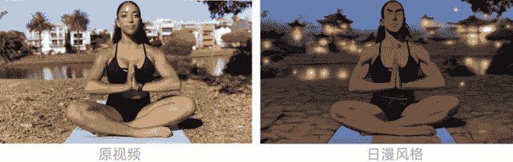
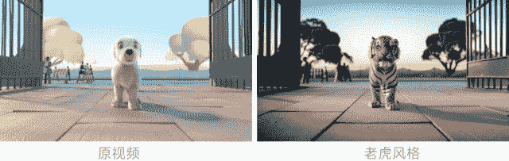
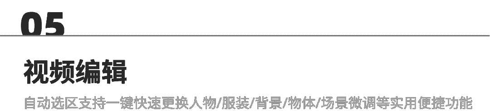
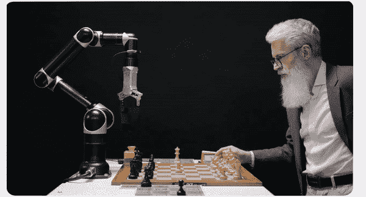
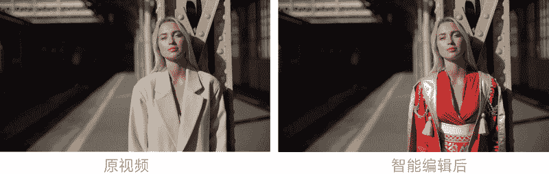

# Video Studio | 视频创作，让创意动起来

> 来源：[https://jalicvoygc0.feishu.cn/docx/RCOcdGYdooUbBrx48P3cajT4nNb](https://jalicvoygc0.feishu.cn/docx/RCOcdGYdooUbBrx48P3cajT4nNb)

引用：https://mp.weixin.qq.com/s/rkN-4JYf7r1NUg58Im2niA

作者：RightBrain AI

Video Studio视频功能开启内测！旨在让创意动起来，打破想象力壁垒，为视觉创作领域赋能灵感，打造多类型视频速度快、效率高、细[节精的生成。真正做到AIGC的](http://rightbrainai.cn/)跨步发展，解放生产力落地实行。视频功能现已开启内测申请，RightBrain AI 官网：rightbrainai.cn

一个举着武器的战士在冲锋，游戏场景

# 关于右脑

北京右脑科技有限公司（RightBrain AI）成立于2022年9月，是一家专注研发AI图像和视频生成的初创公司， 致力于将AIGC技术应用于图像及视频领域，赋能创作，让想象成为具象。

# ABOUT US

右脑创始团队成员均毕业于北京大学，是NUWA女娲、智源悟道等多模态预训练大模型的核心成员， 具备微软亚洲研究院、商汤研究院、智源研究院等国内顶尖AI研究背景， 拥有业内最前沿的图像视频生成的研究和落地经验，数篇成果发表于NeurIPS、ECCV、ACM MM等顶会。 目前已经完成了陆奇博士创立的奇绩创坛的种子轮，以及光速中国等一线VC数千万天使轮融资， 作为国内最早一批从事AI视觉生成的研究者，大模型研究经验丰富， 右脑科技致力于重塑AIGC（Artificial Intelligence Generated Content）创作生态，不断释放创作想象力。