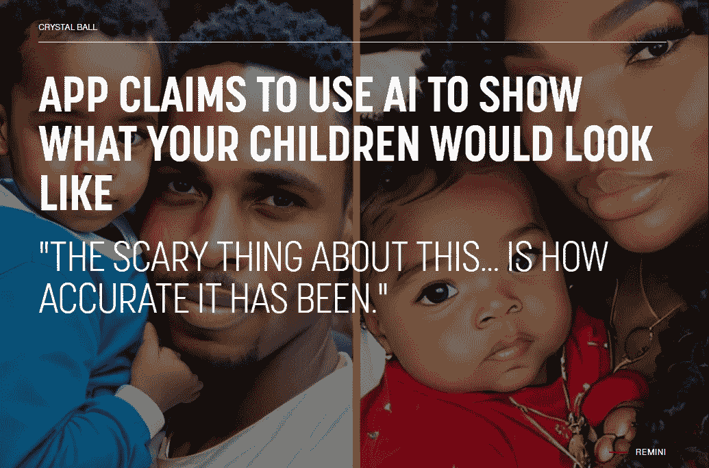
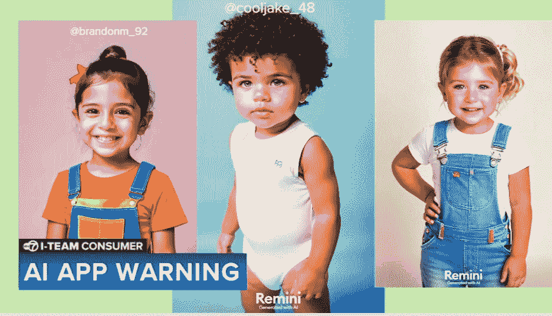

# 利用AI展示出你孩子未来的样子

> 来源：[https://jalicvoygc0.feishu.cn/docx/W3yOd4xQ0orLxyxSSeqc5Bxnnhb](https://jalicvoygc0.feishu.cn/docx/W3yOd4xQ0orLxyxSSeqc5Bxnnhb)

作者：MAGGIE HARRISON

# AI生成的后代

芝加哥的广播公司ABC7报道称，一款名为Remini的生成AI应用在TikTok上走红，声称可以通过AI技术展示用户未来孩子的模样。

虽然这款应用的输出对用户来说无疑是非常吸引人的，但正如任何面部扫描应用一样，它无疑引发了一个问题：为了一睹未来的孩子可能会长什么样，你是否愿意交出自己的数据？

这个过程似乎很简单。用户上传一张自己和伴侣的照片，程序会迅速生成一些生成AI生成的孩子的照片。

根据使用过这款应用的人们的说法，结果相当令人印象深刻。

一位名为Melissa McDuffie的TikTok影响者告诉ABC7说：“我已经到了结婚并准备要孩子的年龄了。我觉得看看他们可能长什么样会很有趣。”

她补充道：“AI可以接受你的照片并生成这个图像，而且非常逼真。”

# 末日螺旋

然而，安全专家对此持有保留意见。毕竟，任何需要生物识别数据的程序都值得审查，而在这种情况下，至少在理论上，你提供的数据可能特别宝贵。

网络安全公司High Wire Networks的首席技术官David Barton告诉ABC7说：“这个可怕之处在于它的准确性。我看过一些视频剪辑，人们把父亲和母亲的照片放进这个应用，它生成了一个看起来像他们孩子的照片。这有点吓人。”

这位专家思考道：“我们是否无意中为那些可能将其用于恶意目的的人提供了我们孩子的未来照片？我不知道。我的直觉告诉我，我不会这么做。”

# **表现正常**

虽然这听起来相当反乌托邦，但我们对于未来如何使用AI生成的数据知之甚少；至少在目前，对于向AI工具提供个人数据要保持谨慎可能是明智之举。

Barton告诉ABC7说：“如果你要使用它，要明白其中存在风险。归根结底，我们通过每天处理的风险来管理我们的生活。”

对于Remini来说，该公司在一份声明中告诉ABC7他们非常重视数据保护和隐私，并且“已经制定了严格的协议，以确保保护用户权益”。

该公司补充说：“由于其本质，该应用程序在不断发展，我们将继续采取行动来应用保护措施并确保用户隐私。”

引用：https://futurism.com/the-byte/app-ai-children

##### 继续浏览全站内容：

[🎪首页](https://jalicvoygc0.feishu.cn/wiki/DdEvwxYsSidd36kAIIVcnROwnmb)

[🤔学习AI工作流](https://jalicvoygc0.feishu.cn/wiki/W15IwochvimsqvkkuCPcZuBxnqg)

[🤖查找AI工具](https://jalicvoygc0.feishu.cn/wiki/Bu8GwqYu8i5LBRkyVKocUvX5n97)

[📊阅读AI文章](https://jalicvoygc0.feishu.cn/wiki/SIywwqrVji2lZkkqFFpcEHZ8nNc)

扫码加入AI Flow Genius社群，探讨使用AI来提升生产力的方法，成为超级个体

超过200需手动拉人 **备注：加群**

