# Midjourney一周年！从V1到V5，画出的美女有何不同？

> 来源：[https://jalicvoygc0.feishu.cn/docx/JY5Jdd2wco47sfxhgIBchQZJnxd](https://jalicvoygc0.feishu.cn/docx/JY5Jdd2wco47sfxhgIBchQZJnxd)

引用自新智元

7月14日，Midjourney距离初次发布已经一周年了！就在一年前的这一天，Midjourney开始公测。而我们，也眼看着它从v1进化到了v5.2。在今天，网友们纷纷刷起了「Midjourney生日快乐」，并且纷纷刷起了同样的prompt从V1到V5.2的变化。

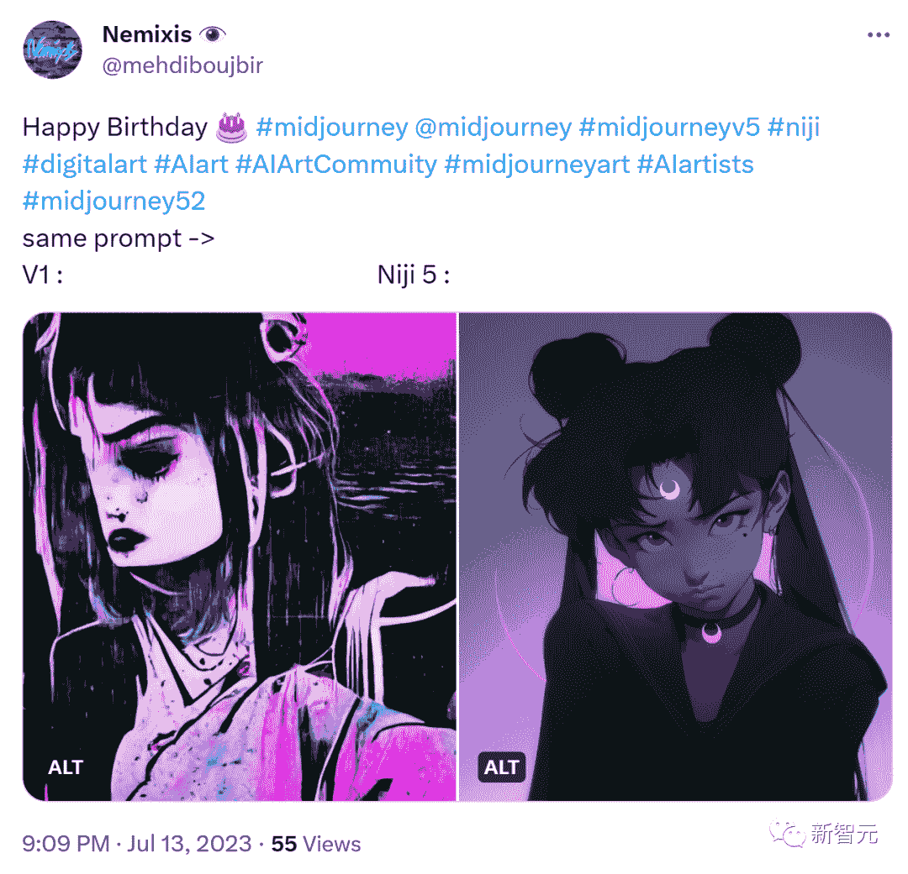

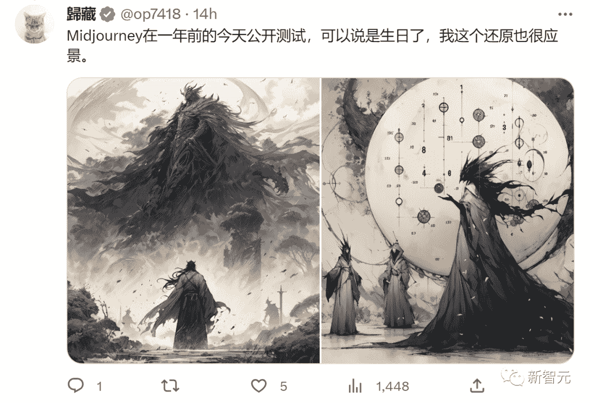

同样的prompt，V1到V5.2有何不同

Youtube大V紐村遁一子输入了同样的prompt「一个女孩」，记录了从v1到v5.2的作图进化史。

**v1**

**v2**

**v3**

**v4**

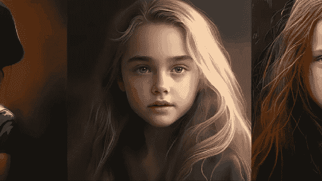

**v5**

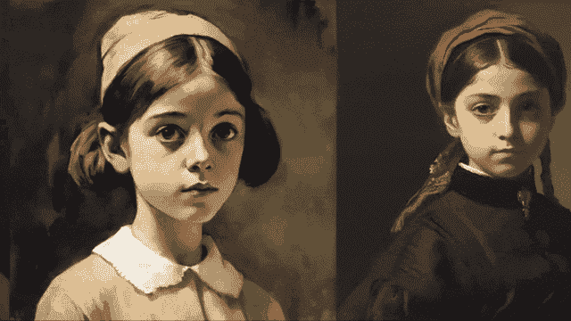

**v5.1**

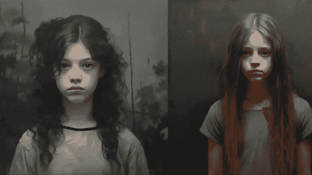

**v5.2**

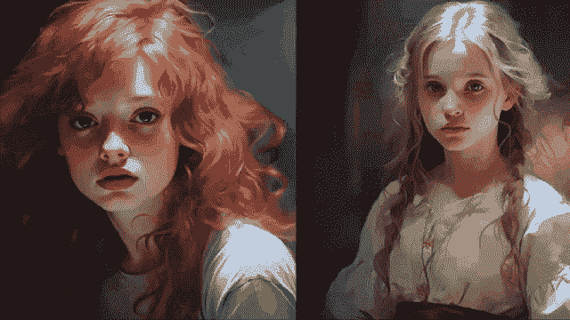

**v1更有艺术性，v5更写实？**

此前，网上就有了网友对同样的prompt进行了对比。

这位网友的对比测试也是绝了。v1版本的马简直是一个异形，v5的马就已经如同真马了。

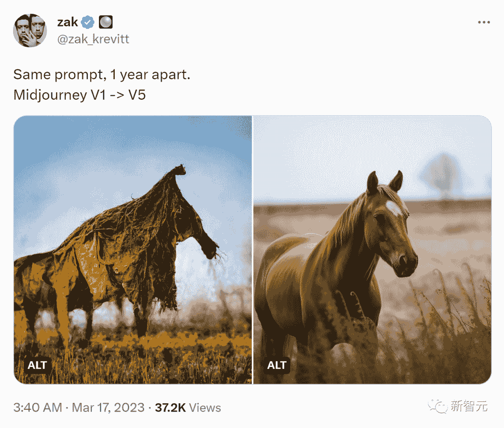

但有趣的是，在留言区中，网友们纷纷表示更欣赏v1的作品，认为它充满了一种「深奥的有趣」。

输入简单的「猫」，v1输出的还是略显诡异的图画，v5就已经是自然光下的真猫了，毛发和胡须纤毫毕现。

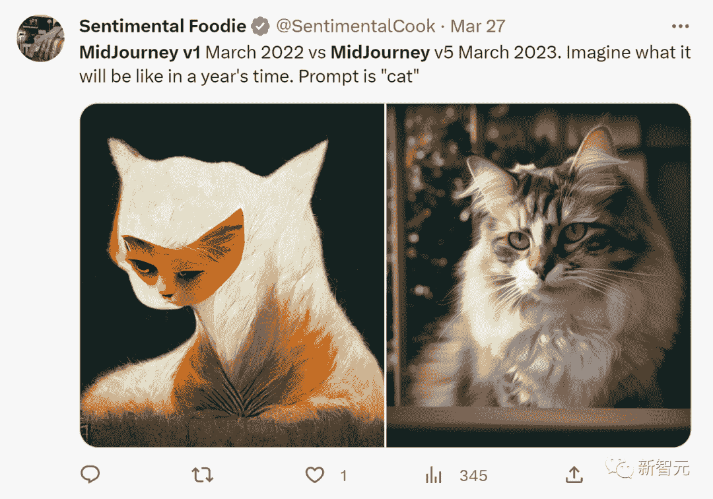

输入prompt「驾驶红男爵的飞行员猫」，v1到v4的输出依次如下。

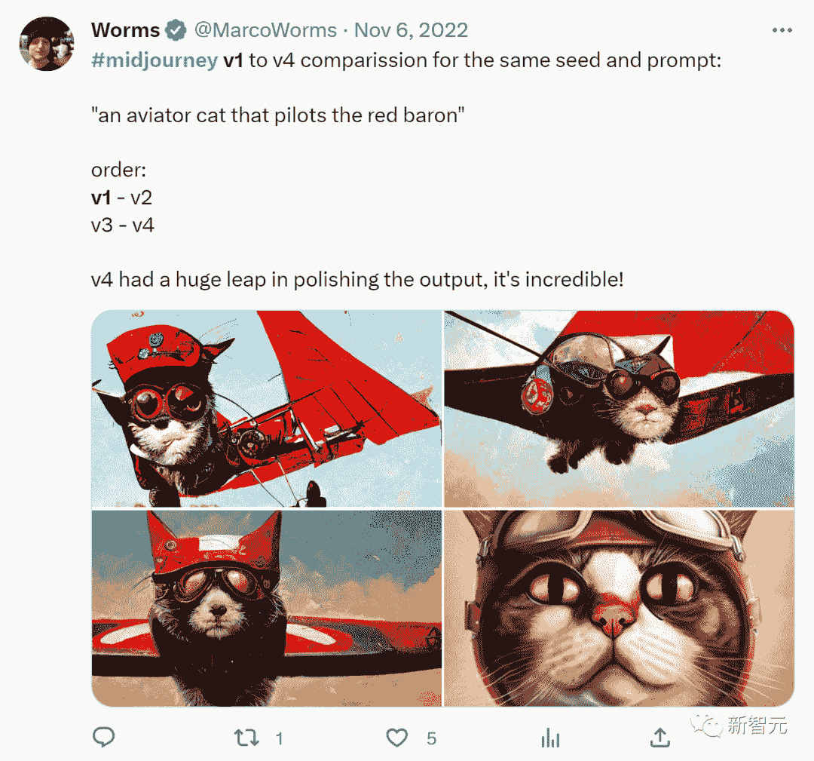

v1时的输出，画面比例还极度不和谐，无论是猫还是飞机都画得很诡异。

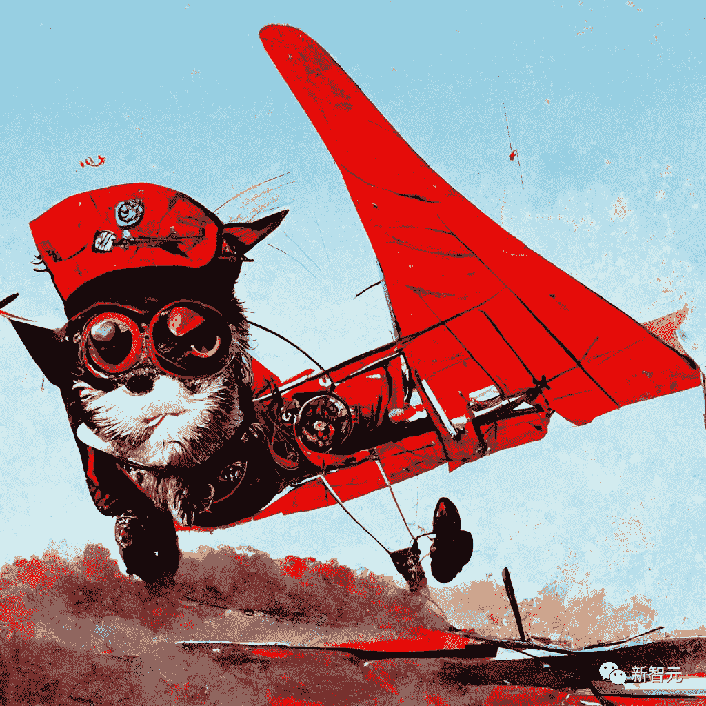

而到了v4版，飞行员猫已经变得威风凛凛，质地极为写实，但可惜的是红男爵飞机并没有被画出。

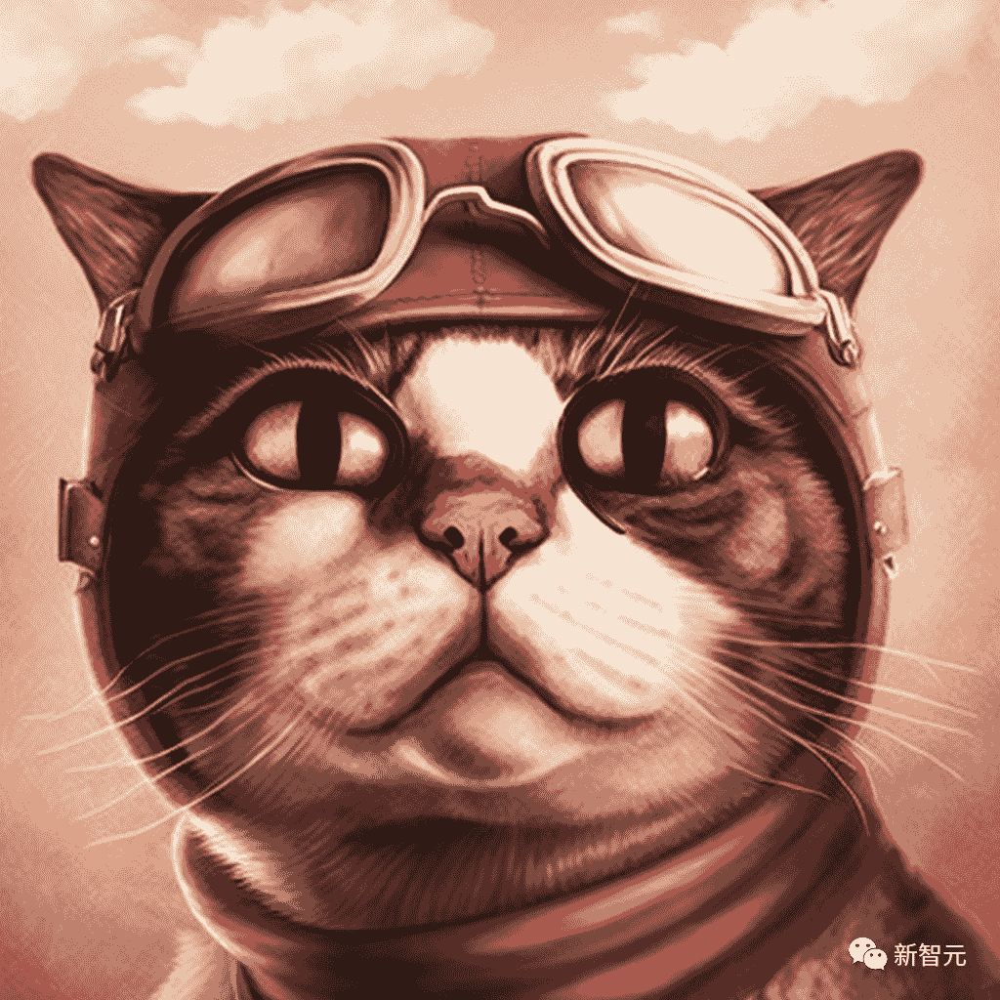

输出prompt「图书馆中一只狗的画像，Sigma 85mm f/1.4」。

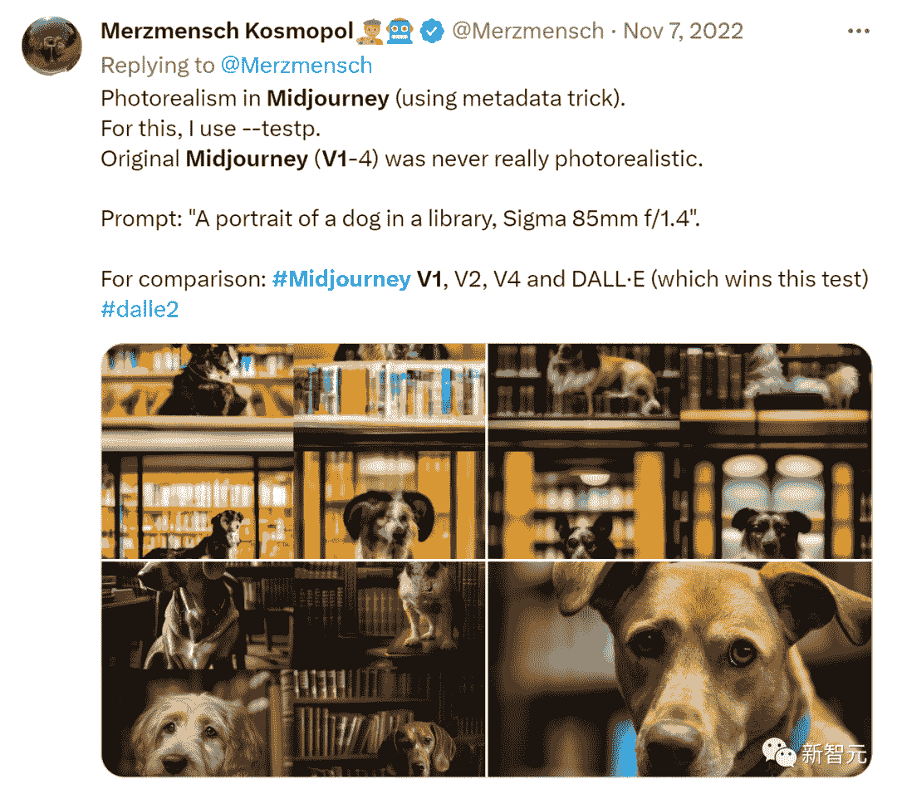

v1输出的图片错误百出，简直不忍直视。

v2的输出比起v1，只能说稍稍有所进步。

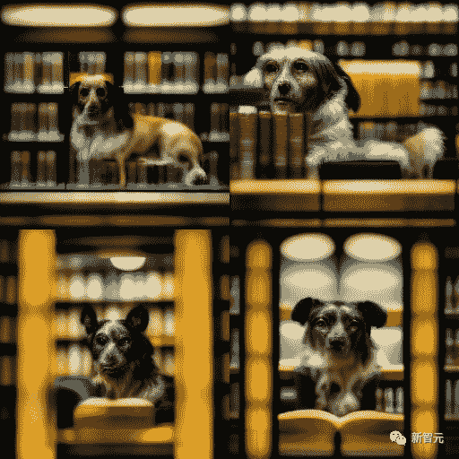

但到了v4，输出瞬间就高级了不止100倍。无论是图书馆中书架的背景，还是狗狗的外形和神态，光影效果一绝，堪称电影画质。

似乎有相当多人认为，v1的图片虽然更加原始，但也更有趣、更幽默。如果能获得一张图片，同时就有v1的艺术性，和v5的质量，那就完美了。问题是怎样才能做到呢，通过混合还是描述？当然，也有网友指出，别忘了，V1可是免费的，V5要60刀一个月。

参考资料：https://twitter.com/jesselaunz/status/1679287036455559170

##### 继续浏览全站内容：

[🎪首页](https://jalicvoygc0.feishu.cn/wiki/DdEvwxYsSidd36kAIIVcnROwnmb)

[🤔学习AI工作流](https://jalicvoygc0.feishu.cn/wiki/W15IwochvimsqvkkuCPcZuBxnqg)

[🤖查找AI工具](https://jalicvoygc0.feishu.cn/wiki/Bu8GwqYu8i5LBRkyVKocUvX5n97)

[📊阅读AI文章](https://jalicvoygc0.feishu.cn/wiki/SIywwqrVji2lZkkqFFpcEHZ8nNc)

扫码加入AI Flow Genius社群，探讨使用AI来提升生产力的方法，成为超级个体

超过200需手动拉人 **备注：加群**

