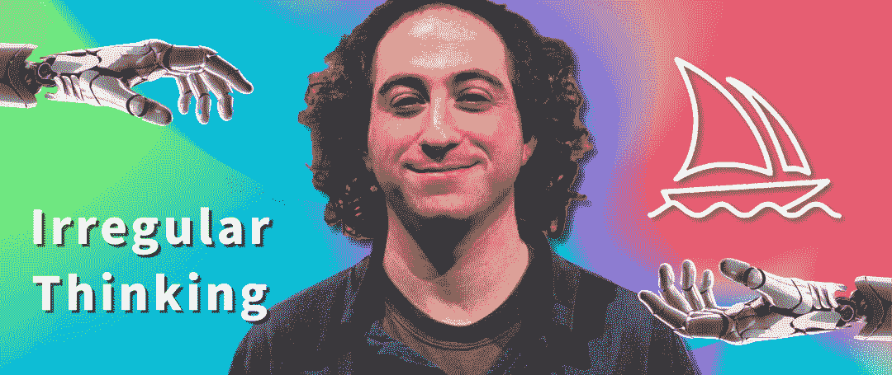

# David Holz：MidJourney 比 Instagram 更疯狂；我对现实世界几乎没兴趣，我想要使它变得非常不同！

> 来源：[https://jalicvoygc0.feishu.cn/docx/NpmedlUsgoVHGTxTGlocxJNJnob](https://jalicvoygc0.feishu.cn/docx/NpmedlUsgoVHGTxTGlocxJNJnob)

作者：David Holz 有新Newin

Midjourney 是一款现象级的生成式 AI 产品，火热程度不亚于 ChatGPT，在 7 月份的生成式AI产品月访问排名中能排到 Top10。

创始人 David Holz 更早之前被人所熟知的项目为其开发的 LeapMotion，一家曾经活跃于虚拟现实（VR）和增强现实（AR）技术领域的公司，它专注于开发先进的手势识别和追踪技术，允许用户通过手势和手指的运动与计算机进行自然而直接的交互，从而实现更加沉浸式的虚拟现实和增强现实体验，直到2019年 LeapMotion被Ultrahaptics所收购，David Holz才开始他的Midjourney之旅。

至今，Midjourney 仍然是一家自负盈亏的研究室，依然没有对外接受投资，即使是 David Holz 上一个项目LeapMotion的早期投资人 A16Z 也一样拒绝，Holz 表示迄今为止还没有找到需要 VC 投资的理由，不想项目被打造成 Andresseen 想要的东西。

Midjourney 开发了文生图模型，商业模式上采用 SaaS 的模式，基于 Discord 提交 Prompt 为用户交付生成的图片，而用户可以按月或按年购买这项服务。

今天的内容来自 Midjourney 创始人 David Holz 最近在《What Future》节目上的分享，Holz 介绍了Midjourney的产品设计理念、商业化以及目前对于外界的看法：

+   如何理解Midjourney？

+   反思，想象，协调

+   你所创，即你所是

+   “美”在于共生演化

+   不差钱，VC也没打动我

+   70%C端+30%P端

+   深度伪造 vs 原创

+   避免“扎克伯格”作恶

+   生成的极限是什么

+   下一个Instagram？

以下为全文内容，大家enjoy～✌️

# **如何理解Midjourney？**

Joshua Topolski

假设我们在派对上见面，你要向一个完全陌生的人描述 Midjourney ，你会怎么说？

**David Holz**

派对上我会尽量避免谈论这个，我通常比较低调。我从来不是真的想要一个公司，我只是想要一个家，所以 Midjourney 就像是我的新家，我将在未来十年里与一些我关心的很酷的人一起工作，做很多我关心的项目，希望对每个人都有好处。

我们有一些主题，如果用三个词来概括的话，就是反思、想象和协调。为了文明繁荣，我们需要创造很多新事物，创造新事物涉及到这三个词，而且我们需要更多围绕它们的内容，比如基础设施，真正围绕每一个词构建新的基础设施。

实际上，最初我们更多地在反思工具和协调工具上工作，我们当时也在进行一些想象方面的工作，但后来在 AI 方面出现了一些突破，大约是一年半前，现在看来似乎一切都爆炸了，但在一年半前，我们都参加了圣诞派对，对吧？

所以所有的 AI 群体都在这里，这些扩散模型似乎不同于其他东西。最终说，我认为这里会有人性的一面，不仅仅是关于生成图片，而是有一种来回的交流，在这方面还有很多内容，不仅仅是通过优化计算机程序中的一个数字来解决，可能会涉及一些情感，没有人知道是什么。我觉得我有一些东西要贡献出来。

Joshua Topolski

非常有趣，对你刚刚说的很多问题我会简化一些，因为不是每个人都会理解，Midjourney 现在很出名，因为它是我们都在谈论的一个东西，一个基于 AI 和机器学习等各种复杂技术的艺术创作工具，这些技术融合在一起，创造出了一些相对新颖的东西。我想大多数人会说，你们开发了一个工具，可以将人类语言标签，比如基本的英语 Prompt ，或者其他语言的 Prompt ，转化为一幅完全由机器创作的艺术作品，这么理解对么？

**David Holz **

我其实尽量避免使用“艺术”这个词，我认为这不完全是艺术，这是关于想象力的，有时候人们会用他们的想象力来创造艺术，但通常不是，我通常认为是创造通过 AI 增强想象力的能力。

有时我几乎把它称为一种“载体”，如果问我们在做什么，这是否类似于摄影的发明，以及它是如何改变绘画的，我会说，不，它更像是内燃机和汽车的发明。

当我们发明汽车时，它们比我们快，但我们没有砍掉自己的腿，我们必须真正移动到某个地方，通过载体移动，它就像是一种想象力的载体，你真的必须去某个地方，要使用这些像喷气飞机、船和汽车一样的载体；我们从来没有一个小机器人作为我们的 logo ，我们的 logo 是帆船，非常努力地帮助人们探索和想象这些审美可能性的种子。

Joshua Topolski

我觉得有点防守性的立场，这对各种产业意味着什么？我觉得很多人可能会觉得你们因此需要进行一轮新的防御，因为这可能会改变一些产业，不是吗？但是你并不是这样看。

**David Holz**

不是的。对我来说，实际上这非常无趣，生成假艺术实际上很无趣。谁在乎呢，或者生成假照片，对我来说真正有趣的是生成从未存在过的东西，我不喜欢别人生成一张狗的深度伪造照片，我们做了很多工作使这变得很困难。

我认为最有趣的图像是那些不像我们以前见过的任何东西的图像，它们不像人类创造的，也不像机器创造的，它们看起来是全新的，我们所知道的就是全新的事物，全新的领域。

# **反思，想象，协调**

Joshua Topolski

我完全理解你并不试图建立一个类似新版 Photoshop 的工具，尽管我认为显然有一些在那个领域的应用，你如何用三个词形容Midjourney，它们是什么？

**David Holz **

反思、想象和协调。

Joshua Topolski

所以这是什么意思？我理解想象部分，我也理解你现在在想象中的 Midjourney 做了什么，但是告诉我一下反思和协调是什么？

**David Holz**

我们在努力理解个体人类思维，以帮助人们进行反思，同时也帮助人们更好地协同工作，我们做了很多数量心理学和结构思维方面的工作，以尽快地创建出一种类似蜂巢智慧的集体思维，有点未来主义的感觉，有很多奇怪的东西。

**Joshua Topolski**

你是说这个起源是，我们是否能在集体层面上为我们解决问题？

**David Holz**

我认为有两个方面。一个方面是，如何帮助某人思考自己是谁，他们想要什么，以及如何处理他们的事情，另一个方面是，如何帮助他们找到合适的人？任何大的需求都需要其他人，所以如何找到这些人？

我知道当我20岁的时候，我会说你必须有你的目标，然后与那些共享目标的人保持一致，然后我做了，结果目标一旦改变，群体就分裂了，因为涉及价值观或其他什么东西。

如果你在价值观上保持一致，然后经过五到十年，群体再次分裂，因为我们的价值观在变化，我们的经验也在变化，所以也许这个想法是，我们需要一些更高于价值观的东西，也许是美学，这不是关于什么是对还是错，什么是重要还是不重要，而是在非常深层次上，关于我们觉得美丽和丑陋的是什么，这真正导致了我们价值的事物，我们实际上试图构建的事物，很有趣，所以也许美学本身可以成为更好的社交和协调层的基础，这种方式很难理解。

# **你所创，即你所是**

Joshua Topolski

我的意思是，这是一个令人着迷的想法。坦率地说，我对这个基本概念有很多问题，但我同意你的看法，美学确实有可能把人们团结在一起。概念上来说，对某些东西有品味或偏好的想法，可能会有一些局限性，我不知道每个人是否都在审美层面上思考，也许我没有给每个人足够的信任。

**David Holz**

我认为你是对的。人们没有考虑过这个，但它确实存在。就像我尝试过的，比如，你的美学是什么，它导致了你的价值观，最终导致了你的目标是什么？你可以问这个问题，几乎没有人能回答得正确，这是一个非常困难的问题，但突然之间你给他们一些类似于 Midjourney 的东西，然后你说，你可以生成任何东西，你想要什么，然后一切都涌现出来，然后他们经历整个过程，通过这个，所有东西都变得很清楚。

Joshua Topolski

举一个例子，假设我很喜欢《星球大战》，真的很入迷，我是卢克·天行者、莱娅公主、汉·索罗这些反抗联盟的粉丝。

**David Holz**

肯定有很多人是它们的粉丝，他们有自己叛逆的方式，在这方面你们有共同点，但也可能还有其他，当然你不想只锁定在这样的标签上，你想要一些更广泛、更有趣的东西，在生成了一堆《星球大战》的图片之后，下一步要做什么？然后这一切都会怎么组合起来？

# **“美”在于共生演化**

Joshua Topolski

你们是如何思考 AI 的？

**David Holz**

我不太喜欢用 AI 和艺术这两个词，问题在于像 AI 这样的词，人们会赋予它很多主动性、意志和目的，而这个东西，它没有故事、没有叙事，也没有意志。

**Joshua Topolski**

它没有感觉，没有灵魂。

**David Holz **

实际上从很多人那里学到东西，然后发生变化，它们之间有一种共同演化，就像 Midjourney 是一朵花，然后用户是蜜蜂，花朵试图为蜜蜂变得美丽，但蜜蜂选择哪些花朵能够生存，花朵和蜜蜂之间有这种共同演化关系，它没有很多意志，确实有一些意志，有一个意愿变得美丽。

关于花朵变得美丽的奇怪之处在于，我们也觉得它们美丽。这是什么意思呢？因为它们并不是专门为我们设计的，就像我们和蜜蜂为什么都觉得某些东西美丽？这似乎涉及某种奇怪的客观性。

Joshua Topolski

我可以从哲学层面理解这一点，具体在做什么？

**David Holz **

这是一个有很多模型的程序。有一个模型用于模拟语言，还有一个模型用于模拟语言和图像之间的联系，还有一个模型试图模拟图像的外观，实际上还有一些模型，试图理解美，什么是美，还有其他模型，试图理解多样性与创意之间的权衡，以及直接性和隐喻性的权衡。

它就像一个结构，有很多的修补，人们会问它是活的吗？如果我说一些类似悲伤或快乐之类的话，它是如何理解并生成一幅它从未经历过的情感的图像的呢？他们会问这些问题，就像这是什么？这是一个软件，但又不是 AI，因为它从未有过那些经历，这是很多非常有趣的问题。

Joshua Topolski

我认为很多人听到AI，他们会认为有一个机器，在中间有一个发光的红色球，它在跳动。确切地说，然后有像神经网络这样的东西，你们构建了一些定制的硬件，有一个神经网络，就像是一个数字大脑，对吧？

**David Holz**

这些程序与我们的大脑确实有一些共同之处，就像飞机与鸟类之间共享某些东西一样，它们都在天空中共享空气动力学和物理学，就像这些东西与思想的一些物理学共享一样。

# **不差钱，****VC****也没打动我**

Joshua Topolski

这不是你构建软件的方式，软件会执行一些相当复杂的操作，它实际上是托管在某个地方的 AWS 机架上，基本上是这样，但这个产品是什么？你们不需要投资人，我现在是一个 Midjourney 狂热粉丝，那么这就是产品吗？人们付费订阅使用？

**David Holz **

我们正在经营一个非常诚实的业务，就像你说的，你不会在自己的计算机上运行，而是在云中运行，然后我们会收取费用，这会带来一些收入，这就是业务模式。

Joshua Topolski

你不会让Marc Andreessen 过来，给你数十亿美元变成他想要的东西对么？

**David Holz**

确实有很多这样的人，想给我们提供很多钱，但是我们还没有接受任何投资，迄今为止。

这些投资人来找我们，给我们提供钱，我在想我们会用它来做什么？而他们会说你应该接受，但我表示我不需要，因为到目前为止，还没有听到一个非常令人信服的论点。

Joshua Topolski

你愿意在当前产品的基础上进行迭代，让用户在一定程度上决定一些方向。

**David Holz**

我们创造了一些东西，人们喜欢它，他们给我们付费，如果他们不喜欢它，我们就不会赚钱，但是我们正在努力创造一些人们喜欢的东西，因为它支持我们的事业，这是非常诚实、直接的业务，我会保持这种方式。

# **70%****C端****+30%P端**

Joshua Topolski

显然这方面可能存在商业应用，你可以生成任意种类的原创艺术的迭代，这是否是业务的一部分？

**David Holz **

我会说我们是一个消费者业务，也有一些专业群体，所以大约70%是消费者，30%是专业群体，专业群体大多在用它进行头脑风暴和概念构思，然后消费者则在玩得开心，同时体验反思、精神和个人的经历，

我很高兴看到人们发现它有用，但我对专业群体的使用不是那么感兴趣，普通人明显更能激励和启发我，而不是专业群体的使用，我对现实世界几乎没有兴趣，我想要使它变得非常不同。

对于消费者来说，要使它变得非常不同要容易得多，而要立即影响专业领域则困难得多。当人们来找我时，他们会说，他们甚至不得不将我们归入他们的Photoshop预算，因为视频游戏已经预算分配完毕，而且需要16个月的时间，我必须等待他们生成下一个视频游戏，而我觉得这不对，我很高兴我的业务不依赖于某人在16个月内完成他们的视频游戏，那就是我的世界。

**Joshua Topolski**

如果我在生成一个视频游戏，尤其是如果我是一个独立的开发者，我需要艺术作品，我想创造一个以前没有生成过的世界。正常情况下，这实际上会引发关于艺术家、数字艺术家，甚至是正在画廊中展示的美术家的某些人的非常响亮的呼声，他们会说第一这是盗窃，因为它使用了他们的作品，它使用了可以看到的作品作为创作灵感；第二，当它创作新作品时，他们没有得到任何好处，不仅使他们的工作更加过时，而且还是在他们所有作品的基础上做的，这并不是一个毫无说服力的论点。在某种程度上，有理由认为所有这些概念在某种程度上都是真实的，你对此有什么看法？

**David Holz **

对于这项技术，有很多误解，艺术家不会真正了解这项技术是如何工作的是有道理的，我最喜欢用任何这些模型创建的一些最喜欢的图像，它们看起来很有艺术性，但它们只是在照片上进行训练的。因此，这是一个理解图像的系统，如果你在生活中看过足够多的照片，然后你看到一幅绘画，你可以在没有被训练过绘画的情况下描述出那幅绘画，就像这个东西理解图像，然后它理解语言，理解语言与图像之间的联系。

它还有一些元素，了解某种风格需要在之前看过单词和风格的情况下，所以在这方面还有一些联系，但总的来说，它的工作方式并不是他们想象的那样，所以问题在于艺术家害怕被包含在数据集中，但实际上，你只需拿出他们的一张照片，将其输入到这些模型之一，就能够生成出与之类似的图片，而这些模型以前从未见过它，也从未进行过任何训练。

Joshua Topolski

这显然引发了许多关于这是否会越来越精细的问题，我是否可以选择任何艺术家，比如我喜欢的Instagram摄影师，然后说以这位Instagram摄影师的风格，然后它会生成一些东西。

**David Holz **

你肯定可以将他们的一张照片放到另一个服务中，然后它会给你一张看起来像它的照片，我认为这更多的是一个技术问题，基本上如果系统理解图像，它就能够复制你向它展示的任何东西，无论它是否对它们进行了训练；当然，法律已经涵盖了这一点，如果你生成了一些非常模仿另一个艺术家的东西，是不可以的，即使从法律上讲也是如此，也许应该有更严格的规定。

# **深度伪造 vs 原创**

Joshua Topolski

CGI（计算机生成图像）就像是为电影或其他内容构建环境一样，你想创建一个山脉或者其他什么，你不会一个一个手动绘制构建山脉的每一个多边形，计算机会自己解决，即使现在，它基本上会在虚幻引擎或其他地方自动构建一个山脉。

**David Holz**

大多数人不识字，不能写字，而现在每个人都可以，现在有更多的作家和读者从事专业工作，比以往任何时候都要多。

Joshua Topolski

这有点像摄影，每个人现在都随时随地都带着一台类似专业相机的手机，我们到处都是高质量的照片。如果回到50年前，甚至不用说25年前，你所能拥有的最好的手机相机也很糟糕，显然画质低劣，我们并没有到处都是照片。

在过去的25年里，几乎每个人都变成了业余摄影师，也许这是一个浅浅的论点，我不想用这个论点来质问你，但是关于深度伪造和创造不存在的现实，你们是否在处理这个问题？

**David Holz **

这是一个真正的风险，我们专门使用了一些算法，要生成一个逼真的深度伪造实际上很困难；通常情况下，你要求计算机生成一张照片，它看起来很逼真，但在光照、阴影和色调方面都有一些差异，让它与照片有一定的区别，虽然看起来很逼真，但你的大脑会立刻察觉到这不是真实的图像。

Joshua Topolski

你认为这种限制会被解除吗？对于某些用户，对于那些具有非常有创意的想法的人也许会，你在这方面的想法是什么？

**David Holz **

这样做有很多利弊，我们发现当我们突破这个界限时，有时看起来很完美，有时看起来就像“恐怖谷”里的僵尸。

**Joshua Topolski**

就像令人不安的感觉。

**David Holz **

现在如果我们突破这个界限，可以说是50/50的机会，有时看起来很完美，有时看起来像“恐怖谷”，而且“恐怖谷”的感觉对我这个视觉审美的人来说太不舒服了，我不想生成任何看起来像那样的东西，我认为最好的办法是根本不允许那种情况发生，也许在未来，技术会变得如此出色，以至于它永远不会看起来像“恐怖谷”，但现在技术还没有达到那个水平。

# **避免“扎克伯格”作恶**

Joshua Topolski

明确一点，从现在起的五年内，我们不可能达到这样一个程度，即中途或其他类似的程序能够完全生成逼真的，甚至是完全运动的图像，肯定还需要大约五年的时间。

**David Holz**

这里可能会有多个方向，我认为一种是努力生成逼真的现实复制品，而另一种可能是生成超现实的东西，超越现实。我认为超越现实的东西才是既有人类趣味的地方，也可能是所有消费者和商业活动的地方。

Joshua Topolski

我毫不掩饰地喜欢这个东西，但我也能理解人们对此感到恐惧，不过人们对计算机所做的很多事情都感到恐惧，而且理由充分。这也是你们面临的问题，人们也害怕像你这样的人，我不是指你个人，据我所知，你是个可爱的人，就好像如果你问马克·扎克伯格，关于Facebook早期阶段，他可能会说——只想让人们连接在一起，让人们在社交环境中聚在一起，或者其他什么方式来连接。

实际上，随着这个东西的发展，马克·扎克伯格做了很多疯狂、怪异、错误的决定，你可以反驳的观点，但我认为在你的内心深处，这是真的。

从你的角度来看，如何防范这些看起来像是创造性决策的东西？就像我们无法预见Facebook会成为一个生成虚假信息的机器，以及所有这些恶意行为和滥用系统的方式，我们在看到实际的滥用行为之前是无法预见的，Midjourney 如何防范这些问题，其中涉及到人性最恶劣的一面？你们是否正在积极地做这些事情？

因为这样一个工具的最佳部分会找到令人惊叹的用途，但同样存在着相等的对立力量，会将其用于最坏的目的，所以告诉我你们如何打造这样一个产品。

**David Holz **

具有破坏性。我的理念是，创作者会把他们的价值观融入到他们创造的东西中，无论他们是否意识到这一点，而这些东西在他们不在场的时候也会传播这些价值观。这实际上很大程度上归咎于像扎克伯格这样的人，这意味着他创造Facebook时持有错误的价值观。

我不认识扎克伯格，但我喜欢思考的一个有趣例子是，比较Facebook和MySpace的默认设置，显然他是知道MySpace的存在的，毕竟是主要竞争对手，我记得第一次访问MySpace时，我的页面是空白的，上面写着我有一个朋友，我想谁是我的朋友？Tom？谁是Tom？这个人看起来很不错，他是MySpace的创始人，这很酷，Tom是我的朋友，他一定关心我。

我敢打赌，我可以认识其他我不认识的朋友，我的MySpace是一个我可以交朋友的地方，而且Tom在乎我，然后你登录Facebook时，你没有朋友，而扎克伯格肯定不是你的朋友。

**Joshua Topolski**

我从来没有考虑过这个，但是他不是你在Facebook上的第一个朋友。

**David Holz **

肯定不是，那意味着什么呢？不仅他不是你的第一个朋友，而且当你加入时，你根本就没有朋友。

**Joshua Topolski**

当你加入Facebook时，你就是一个没有朋友的无名之辈，你必须努力争取已经认识的任何人，让他们成为你的朋友，哪怕只有一个人让我成为Facebook上的朋友，对吧？

**David Holz**

这些细节是由真正的人创造的，这些人有价值观，就像他必须考虑这些问题。显然他思考过，他并不傻，他肯定考虑过这些问题。

**Joshua Topolski**

他本来想成为你的第一个朋友，但实际上他们可能会说，MySpace的Tom可能会因为知识产权问题起诉我们，如果我们做与他相同的事情。

**David Holz **

他对于被起诉并不是那么谨慎，因为后来确实发生了。有很多有趣的事情，我认为也许一切都是这样。目标不是不去创造东西，而是创造出具有良好价值观的东西，让具有良好价值观的人创造东西，而且不同的人之间的创造是不等同的。

# **生成的极限是什么**

**Joshua Topolski**

实际上，我还有一个关于限制级内容的问题，这是一个大问题，如果你想让中途创造出令人难以置信的原创限制级场景，因为互联网上有很多限制级内容，你会说有很多这样的内容吗？基本上都是视觉媒体，虽然显然也有一些这类作品，你们肯定在运行一个带有限制级内容的中途实例，我可以创造出完全的限制级场景，对吧？别对我撒谎。

**David Holz **

当我第一次考虑这个问题时，我想，谁想要一个由AI生成的“美女”呢？随着时间的推移，当算法变得更好时，我看到了一些相当不错的“美女”，就它显然可以生成出非常出色的。

Joshua Topolski

这是个大问题，我甚至不能画一幅文艺复兴时期的裸体油画，比如中规中矩的艺术性的、带有中途旅程的裸体，对吧？有没有一个层次可以允许生成裸体呢？我只是为自己问一下。

**David Holz**

我认为关键是他们认为什么对世界有帮助。我可以给你两个故事：有一个是当他们的系统过滤效果不好的时候，会有人试图创造出他们幻想中的人物，基本上就是变得超级着迷于这个红发女郎或者其他什么，随着时间推移，变成了一个非常具体的事情，当然这是一个市场。

我认为现在不会是健康的，我们还尝试过其他事情，我们曾经创建了一个聊天室，称之为“不安全，不要评判”。我们把大约100人扔进去，然后关闭了所有过滤，只是想看看会发生什么，我们把他们都扔进去，然后说没有过滤了，大家可以随便做任何你想做的，但是其他人会看到你看到的东西。

**Joshua Topolski**

肯定会有人在这种情况下毫不害臊。

**David Holz**

一开始非常安静，然后发生的事情是，变得如此荒谬，以至于每个人都开始放下他们知道的一切，通常会感到愤怒的事情，不久之后我关闭了它。

Joshua Topolski

这只是一个很小的样本，它立刻就进入了大约99%的正常互联网用户都会反感的领域。

**David Holz **

我认为有趣的是人们在这个房间里的心理体验是什么。

Joshua Topolski

这不是总是发生的吗？你在测试极限，人们认为很有趣，但是非常大的受众可能不会觉得有趣，所以问题是你给予人们这种无拘无束地创造他们心中想象的权力，他们会做什么？我希望人们会想出很酷的东西，但当然肯定有一部分受众，这实际上与我之前问的问题有关，你在一个房间里进行了一个实验，那里有一群人，他们只是用户，像是测试，或者是测试用户之类的。

**David Holz**

一群用户，我们进行了一个小时的实验，我说如果有人泄露图像，我会终身封禁他们。

Joshua Topolski

这就是你对此的一点了解，显然你构建系统的方式是你不能做那些事情。你是否必须不断警惕可能被滥用的方式？就像你如何应对那些你甚至还没有想到的滥用呢？

**David Holz **

我们有大约40名审核人员，他们会观察事物，然后他们只需使用一些/ban命令，一个词便不再使用了，我知道今天有一些被禁止的词语。

Joshua Topolski

这就是我试图要问的，如何创建一家公司，它拥有所有我认为你拥有的崇高、有趣和令人兴奋的理念，但同时又能够防止构建一个最终会重复Facebook或Twitter等世界上公司错误的产品。

问题确实归结为当你进行这些对话时，谁在房间里？谁在与你进行这种对话？你将采取什么行动？你将采取什么行动，以确保你与一组足够庞大且足够聪明的专家在这些领域进行了对话，比如伦理学、语言学和历史等领域，而且这是一个多样化的团队，实际上可以创造出一个为所有人服务而不仅仅是对我们这样的酷炫产品，但可能对世界上的其他百万人无效的产品。

**David Holz **

如果这个图像是一个200万人的事情，甚至更大，我会很高兴，我希望它是包容性的，但如果只有200万人，我也可以接受，并且以显著的方式改善了他们的生活，我已经让这个世界变得更好了。

当然，我希望它多样化，我们在这方面努力了，但是我的意思是，在一天结束时，更重要的是它对与之互动的人是好的，而不是它拥有尽可能多的人，这是一个巨大的权衡，因为大多数人决定不做出这个权衡。

Joshua Topolski

我同意，如果你考虑无限的受众，显然你不希望像每个人都应该在其中或使用这个东西，但是我猜这是一个非常敏感的领域，你构建了一个工具，可以从虚无中创造出东西，你构建了一个工具，可以使梦想看起来像是现实，那么你如何正确地做到这一点呢？

我觉得这是一个带来一大批从未出现在谷歌的人们参与对话的机会，当我思考像这样的任何新技术时，我总是想到现在，也许是因为我之前受到过存在的技术公司的滥用，会发生什么问题，对吧？以及你如何防止发生这种情况。

**David Holz**

我们做了很多事情，比如我每周会花4个小时进行办公时间，在那里我会尽可能多地与人们交流，因为我会做一些主题性的活动，

Joshua Topolski

你对滥用系统的人有一个防护层，他们生成出奇怪的照片之类的东西。

**David Holz **

有很多这些微妙的事情，从技术上讲它可能应该能够创造出有品位的图片，但这是一个很难的界限。

**Joshua Topolski**

这是一个关于艺术的问题，对吧？什么是限制级，你看到了就知道了，但是有不同程度的。

**David Holz **

我们最近一直在试图教会系统一些这些微妙之处，我们有一些用户进去，他们随机评价图像，总体上，我们发现人们很少认为某些东西是冒犯性的，非常少，所以当他们说有趣的时候，就很有趣，然后我们把所有这些聚集在一起，然后我们教育AI，我们说不管某件事是否冒犯，人们对你的图像作出了怎样的反应，这很有趣，然后它实际上会改变自己的行为。

Joshua Topolski

你是否担心你正在创造一种保守的 AI ？你是否担心你正在创造一种在性和人体方面会变得奇怪的、性格压抑的 AI ？

**David Holz **

我认为问题是，当我们构建这些技术时，我们想要争取哪些战斗，以及我们想要在哪些方面推动世界前进，我希望世界变得更有想象力，我想在美学方面推动界限。

在创造中。我认为这非常有趣，也非常值得，但我可能有点挑剔，我对暴力和性方面的东西不太感兴趣，有人认为我们必须推动性的界限。让世界变得更加性感，其他人可以做到这一点，我只是觉得内心并没有被强制推动这一点。

我认为还有更广泛的问题，就是让人们反思，普通人进来后，他们会说一些像是天堂中的马耳他狗之类的话，我会联系他们，问他们为什么这样做。

但是现在，当我开始使用Midjourney时，我开始觉得我正在变成我从未能够成为的人，现在我必须思考这个问题。

然后你开始看所有的东西，你会说，你会试图走上这条“我是谁”的道路，你的真正审美是什么？然后你会学到很多东西。人们学习所有这些困难的历史和所有这些运动，他们开始把事物结合起来，形成他们自己的感觉。然后就是第三个月，你有了这个审美的宇宙，你开始将它应用于一切。

Joshua Topolski

你的意思是，基本上你看到这是一种治疗形式？

**David Holz **

至少有30%的使用是艺术治疗。这完全出乎意料，但这真的很重要。显然，这是一种反思工具。然后人们开始相互结识，开始形成这些团体，开始推动这些审美边界，发现新的东西。这真的很美好。显然是一个充满诚意和积极的未来的一部分，这就是我关心的。

# **下一个Instagram？**

Joshua Topolski

你认为有一个未来状态，就像Midjourney本身就是Instagram，肯定会有。

**David Holz **

有点像那样，但更疯狂。我认为未来更像是液体想象力在房间里旋转，形成山脉、小树、动物和废墟，你试图想出怎么给人们冲浪板或船，像冲浪大海一样的液体想象力的海洋，发现全新的土地，但这是非常不同的事情，它形成了一种新的物质，你可以用它创造世界，并通过它表现出来，通过它反映出来，这就是它的意义。

它是创造一种新的物质，它真的不是关于创造一个Instagram，或者创造限制级，或者创造巨大的...显然，所有这些事情都会发生，但那不重要，那不是真正的事情，就像在引擎之前有一个文明，在引擎之后也有一个文明。

现在有趣的是，我们正在过渡到一个拥有这些想象引擎的文明，这将如何改变事物？就像引擎一样，我们有高速公路，我们有火车，我们有巨大的国际贸易，有很多东西很多人在技术方面感觉我们没有出路，很多普通人真的觉得我们没有未来，但我觉得我们真的在这方面途中。

就像我们身后有丰富而美丽的过去，前面有奇妙而不可思议的未来，整个生成的目标就是找出我们可以成为什么，以及如何在积极、充满探索和美好、人性化的方式下实现这一点，这就是我试图做的，希望它在这些东西中体现出来。

Source：

https://podcasts.apple.com/lu/podcast/how-computers-dream-with-david-holz-rerelease/id1650596614?i=1000623280583

https://mp.weixin.qq.com/s/fxa1Dc-K7cWMEGtpQqycgw

**----- ****End**** -----**

##### 继续浏览全站内容：

[🎪首页](https://jalicvoygc0.feishu.cn/wiki/DdEvwxYsSidd36kAIIVcnROwnmb)

[🤔学习AI工作流](https://jalicvoygc0.feishu.cn/wiki/W15IwochvimsqvkkuCPcZuBxnqg)

[🤖查找AI工具](https://jalicvoygc0.feishu.cn/wiki/Bu8GwqYu8i5LBRkyVKocUvX5n97)

[📊阅读AI文章](https://jalicvoygc0.feishu.cn/wiki/SIywwqrVji2lZkkqFFpcEHZ8nNc)

扫码加入AI Flow Genius社群，探讨使用AI来提升生产力的方法，成为超级个体

超过200需手动拉人 **备注：加群**

