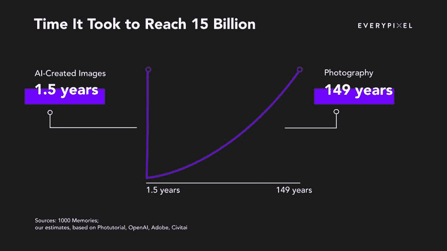

# 一年多时间AI生产的图片数量已经超过了150年间人类拍摄的所有照片数量

> 来源：[https://jalicvoygc0.feishu.cn/docx/EFX6dAx77o1zflxjxxVcOeejnMd](https://jalicvoygc0.feishu.cn/docx/EFX6dAx77o1zflxjxxVcOeejnMd)

作者：**歸藏**

AI领域里面大家可能更多关注的是LLM相关的内容，但是AI画图的一些数据往往难以找到。

今天一个团队发布了一份关于AI画图领域的数据分析，里面的数据显示过去一年多时间AI生产的图片数量已经超过了150年间人类拍摄的所有照片数量，太离谱了。

下面是这个数据分析的主要内容：

**→自去年以来，使**用文本转图像算法创建了超过 150 亿张图像。客观地说，**从 1826 年拍摄**第一张照片到 1975 年，摄影师花了 150 年的时间才达到 150 亿张大关。

→DALLE-2 推出以来，人们平均每天创建 3400 万张图像。

→增长最快的产品是 Adobe Firefly，自推出以来仅三个月内就创建了 10 亿张图像。

→Midjourney 拥有 1500 万用户，是公开统计的所有图像生成平台中最大的用户群。

→大约 80% 的图像（即 125.9 亿张）是使用基于开源 Stable Diffusion 的模型、服务、平台和应用程序创建的。

DALL-E 2

2022 年 4 月，OpenAI 发布了其图像生成模型 DALL-E 2。然后 OpenAI 报告称，用户每天使用 DALL-E 2 生成超过 200 万张图像。我们不确定 OpenAI 所说的这个数字意味着什么时间段，或者他们是否获取了生成的平均图像量。我们假设这是一个平均值，这意味着 15 个月内在单个平台上生成了大约 9.16 亿张图像。

Midjourney

Midjourney 于 2022 年 7 月上线。根据 Photutorial 的估计，Midjourney 的 Discord（该算法只能通过 Discord 获得）每秒接收约 20 至 40 个作业，拥有 1500 万注册用户和 150 万至 250 万活跃用户任何特定时间的成员。考虑到这一点，我们使用每秒 30 个作业作为平均创建图像数，每天创建多达 250 万个图像。因此，自 Midjourney 推出以来，已创建了 9.64 亿张图像。

Stable Diffusion

Stable Diffusion 是人工智能公司 Stability AI 背后的文本到图像模型，于 2022 年 8 月发布。Stability AI 首席执行官 Emad Mostaque 表示，Stable Diffusion 在所有渠道拥有超过 1000 万用户。如果我们推断一下《Midjourney》的数据和趋势，就会发现，通过官方的 Stable Diffusion 渠道，用户每天会生成 200 万张图片，而在发布一年多的时间里，这个数字已经达到了 6.9 亿张图像。

如果加上其他流行模型（例如 Runway，我们单独统计）和 Stability AI 的官方渠道，使用 Stable Diffusion 创建的图像数量将增加到 125.9 亿张，占所有使用文本转文字创建的 AI 图像的 80%。

Adobe Firefly Adobe

Adobe 推出了 Firefly，于 2023 年 3 月发布。上线 6 周内，用户创建了超过 1 亿资产。随着 Firefly 于 2023 年 5 月集成到 Adobe Photoshop，考虑到全球使用 Photoshop 的人数，图像数量呈指数级增长。 Adobe 在最新的新闻稿中分享了其 AI 图像统计数据：推出仅 3 个月，使用 Adobe Firefly 创建的图像数量就已达到 10 亿张。

使用 Stable Diffusion、Adobe Firefly、Midjourney 和 DALLE-2 总共生成了超过 150 亿张人工智能创建的图像。这比 Shutterstock 的整个照片、矢量图和插图库还要多，而且是 Instagram 上传的图片数量的三分之一。

引用：https://twitter.com/op7418/status/1691863428380721286

##### 继续浏览全站内容：

[🎪首页](https://jalicvoygc0.feishu.cn/wiki/DdEvwxYsSidd36kAIIVcnROwnmb)

[🤔学习AI工作流](https://jalicvoygc0.feishu.cn/wiki/W15IwochvimsqvkkuCPcZuBxnqg)

[🤖查找AI工具](https://jalicvoygc0.feishu.cn/wiki/Bu8GwqYu8i5LBRkyVKocUvX5n97)

[📊阅读AI文章](https://jalicvoygc0.feishu.cn/wiki/SIywwqrVji2lZkkqFFpcEHZ8nNc)

扫码加入AI Flow Genius社群，探讨使用AI来提升生产力的方法，成为超级个体

超过200需手动拉人 **备注：加群**

