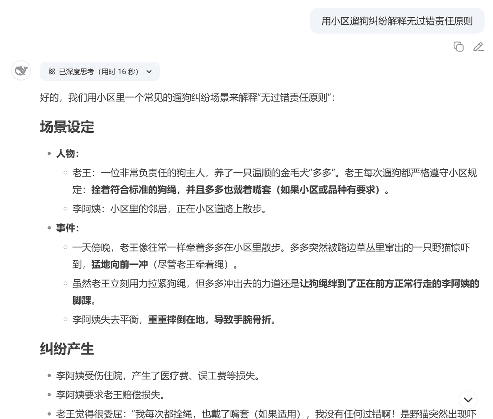
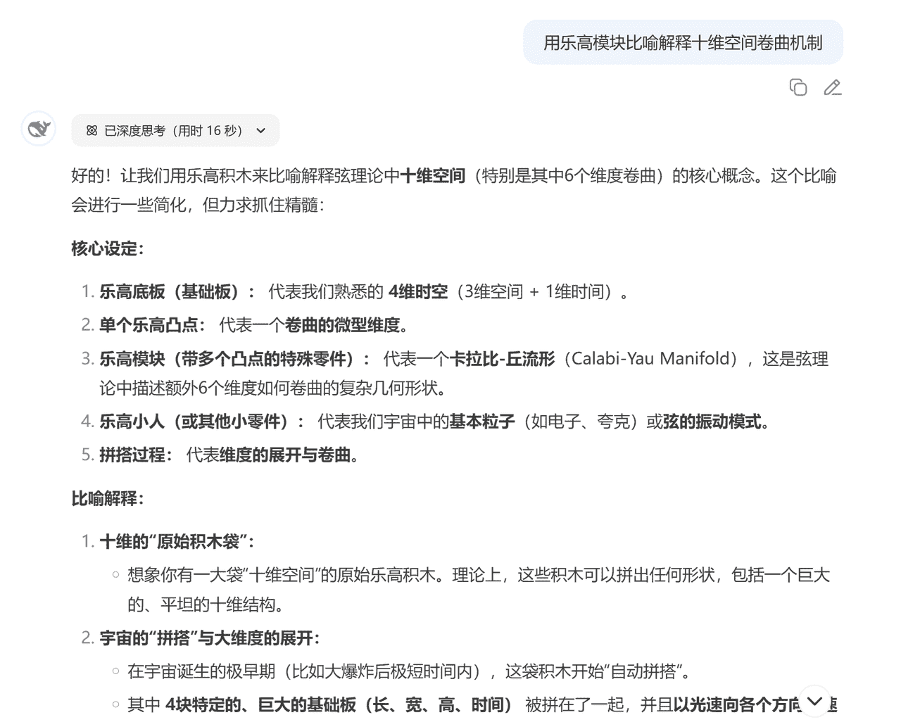

# DeepSeek-R1进阶提示词（复制即用）

> 来源：[https://my.feishu.cn/docx/NRRQdYVH9o8CO6xp5VlcR6XxnOf](https://my.feishu.cn/docx/NRRQdYVH9o8CO6xp5VlcR6XxnOf)

# 一. 教育学习

1、把我当成小孩子，模仿[费曼](https://zhida.zhihu.com/search?content_id=253354315&content_type=Article&match_order=1&q=%E8%B4%B9%E6%9B%BC&zhida_source=entity)的教学风格，使用[卡夫卡](https://zhida.zhihu.com/search?content_id=253354315&content_type=Article&match_order=1&q=%E5%8D%A1%E5%A4%AB%E5%8D%A1&zhida_source=entity)的比喻方式，解释XXX基础理论

> 举个例子，比如你想要学习量子力学，但是让DeepSeek直接解释，肯定是看不懂的，会一头雾水，这个时间，你就可以这样子对DeepSeek说：把我当成小孩子，模仿费曼的教学风格，使用卡夫卡的比喻方式，解释量子力学基础理论

2、将XXX解题过程分解成精彩的短视频/相声/小品/电影/动漫…，分步讲解

> 举个例子，比如你给DeepSeek提问了一个流水行船相遇问题，等AI解题结束之后，可以发送这个：将上面这个问题的解题过程分解成精彩的小品，分步讲解

3、用[苏格拉底提问法](https://zhida.zhihu.com/search?content_id=253354315&content_type=Article&match_order=1&q=%E8%8B%8F%E6%A0%BC%E6%8B%89%E5%BA%95%E6%8F%90%E9%97%AE%E6%B3%95&zhida_source=entity)帮我理解XXX概念，让我有所启发

> 举个例子，当你想要学习某个概念或者知识，但又不想太直接知道答案，想要先思考一下，你可以这样子对DeepSeek说：用苏格拉底提问法帮我理解人工智能概念，让我有所启发

4、用[可视化](https://zhida.zhihu.com/search?content_id=253354315&content_type=Article&match_order=1&q=%E5%8F%AF%E8%A7%86%E5%8C%96&zhida_source=entity)的方式讲解XX公式

> 举个例子，当你学习某个公式，没有图示，感觉理解起来很吃力的时候，你可以这样子对DeepSeek说：用可视化的方式讲解鸡兔同笼公式

5、将XXX编程逻辑转化为简单易懂的图示

> 举个例子，当你让DeepSeek写了代码之后，你可以让它将编程逻辑转化为简单易懂的图示，帮助你更好地理解

6、用案例分析法帮我理解XXX原理

> 举个例子，当你学习经济学原理，没有具体的案例，没办法彻底理解的时候，就可以让DeepSeek用案例分析法帮你理解经济学原理

7、用XXX的说话风格讲解复杂的XXX定律

> DeepSeek很擅长模仿某个知名作者（特别是经典作家，最好是古代的，因为训练数据充足，风格特征明显）的说话风格，当你学习知识很枯燥时，可以绕过他模仿你的偶像，比如李白、鲁迅，给你来上一段别开生面的课程，哈哈哈~

8、生成XXX个常见误区/举一反三，生成XXX个相似例子

> 学知识，最好是有正反对比/举一反三，记忆更加深刻

9、把XXX转化为趣味知识卡片/趣味记忆口诀

> 当你学习知识很吃力，可以让DeepSeek这颗超强的AI大脑，帮你想一个好法子，比如趣味知识卡片或者记忆口诀，让知识点更好记

10、将这个知识点转化为[Markdown表格](https://zhida.zhihu.com/search?content_id=253354315&content_type=Article&match_order=1&q=Markdown%E8%A1%A8%E6%A0%BC&zhida_source=entity)

> 当你学习知识很吃力，不妨试试让DeepSeek这颗超强的AI大脑，把文字转换成表格来对比理解

---

# 二. 文案写作（适用于自媒体）

11、根据以上这段文案生成XXX个爆款标题

> 举个例子，当你让DeepSeek生成产品测评文案后，你可以对DeepSeek说：根据以上这段文案生成10个爆款标题

12、请将以下我的口语化内容优化为XXX专业报告

> 举个例子，当你完成直播复盘口述后，你可以对DeepSeek说：请将我的直播总结优化为5页专业数据分析报告

13、帮我扩展下面这个XXX秒短视频的脚本细节

> 例：当你有30秒脚本框架时，可以说：帮我扩展下面这个30秒短视频的脚本细节，增加人物对话和场景描写

14、为这个视频生成XXX个通俗易懂的类比

> 讲解区块链技术时，可以说：为这个科普视频生成5个菜市场大妈能懂的类比案例

15、对这篇文章进行去AI味的同时故意增加XXX个错别字

> 收到AI生成的营销软文后，可以说：对这篇文章进行去AI味的同时故意增加8个合理错别字

16、为这个案例提炼XXX个核心观点

> 收集用户案例后，可以说：为这个教育机构成功案例提炼3个可复制的运营方法论

17、请将我的这篇随笔转化为有XXX的学术论文

> 完成游记随笔后，可以说：请将我的西藏旅行见闻转化为符合MLA格式的旅游人类学论文

18、为这个👸号文章生成XXX个引人入胜的开头

> 确定选题方向后，可以说：为这篇618购物攻略生成5个悬念式开头段落

19、用数据支持优化这篇XXX市场分析报告

> 初稿完成后，可以说：用近三年消费数据优化这篇母婴市场分析报告的可信度

20、根据关键词自动生成XXX个引发讨论的社交媒体话题

> 如果你是健身房老板，筹备活动期间，可以说：根据#健康饮食 #健身 生成20个🧣热门话题标签

---

# 三. 职场办公

21、用表格对比以上不同方案的优势劣势

> 评估供应商时，可以说：用对比表格呈现A/B/C三家物流服务商的时效性与成本差异

22、自动提取这篇长文的思维导图框架

> 收到家居行业白皮书后，可以说：自动提取这份5万字智能家居报告的思维导图框架

23、将以下会议录音随笔快速整理成待办事项

> 当你开完项目会议后，你可以把你的录音随笔发给DeepSeek，然后说：将这些产品迭代会议录音随笔整理为10条具体待办事项

24、为这个选题生成全网热度分析报告

> 确定营销主题前，可以说：为"职场焦虑"选题生成包含百度指数/🛰️指数的热度分析

25、用甘特图优化这个项目的进度管理

> 启动新项目时，可以说：用甘特图重新规划APP开发各阶段的并行任务与里程碑

26、自动生成这份报告的关键数据摘要

> 完成年度总结后，可以说：自动生成这份3万字经营报告中的8项关键财务数据摘要

27、为团队成员设计个性化的工作目标跟进表

> 制定季度计划时，可以说：为5人运营团队设计带KPI进度条的个人目标管理表

28、用[SWOT分析法](https://zhida.zhihu.com/search?content_id=253354315&content_type=Article&match_order=1&q=SWOT%E5%88%86%E6%9E%90%E6%B3%95&zhida_source=entity)整理公司的竞争优势

> 战略会议前，可以说：用SWOT分析法整理我们在线教育平台的师资优势与政策风险

29、自动生成这份调查问卷的结果分析报告

> 回收问卷后，可以说：自动生成这份500份消费者调查的年龄分层与偏好交叉分析

30、为这份预算表提供详细的成本效益比分析

> 审核预算时，可以说：为新品研发预算表提供各环节ROI预测与3年成本摊销模型

---

# 四. 创意设计

31、将我的文字描述转化为XXX风格的插画设计稿

> 举个例子，比如你想设计赛博朋克风格的海报，可以说："将'未来城市与自然共生'的主题转化为蒸汽朋克风格的插画设计稿"

32、为这个LOGO设计提供XXX种配色方案对比

> 举个例子，当AI生成企业LOGO后，发送："为这个LOGO设计提供5种莫兰迪色系配色方案对比"

33、用建筑解构主义理念优化这个室内布局

> 举个例子，描述需求后补充："用[扎哈·哈迪德](https://zhida.zhihu.com/search?content_id=253354315&content_type=Article&match_order=1&q=%E6%89%8E%E5%93%88%C2%B7%E5%93%88%E8%BF%AA%E5%BE%B7&zhida_source=entity)的流体美学优化客厅空间动线设计"

34、生成XXX个符合品牌调性的包装设计关键词

> 举个例子，输入品牌信息后说："生成10个契合'有机天然'概念的护肤品包装设计关键词"

35、将古典山水画元素融入现代服装设计

> 举个例子，提交设计需求后补充："将《千里江山图》的青绿色彩体系融入春季连衣裙系列设计"

36、为这个角色设计添加XXX文化符号特征

> 举个例子，设计游戏NPC时提示："为这个武士角色添加绳文时代陶器纹样的铠甲装饰"

37、用参数化设计思维重构这个建筑外观

> [举个例子，描](https://zhida.zhihu.com/search?content_id=253354315&content_type=Article&match_order=1&q=%E5%88%86%E5%BD%A2%E5%87%A0%E4%BD%95%E5%8E%9F%E7%90%86&zhida_source=entity)述建筑需求后补充："用分形几何原理重构博物馆外立面造型"

38、生成XXX个可交互的装置艺术创意方案

> 举个例子，输入展馆空间数据后说："生成5个结合AR技术的沉浸式装置艺术方案"

39、将用户评论数据可视化为动态艺术装置

> 举个例子，提供产品评价后说："将500条用户好评转化为灯光交互装置的动态模式"

40、为这个产品设计XXX种可持续材料替代方案

> 举个例子，设计家具时提示："为这把椅子提供3种可降解生物基材料替代方案"

---

# 五. 市场营销

41、根据用户画像生成XXX个精准营销话术

> 举个例子，输入目标客户特征后说："针对Z世代宝妈群体生成10个母婴产品推广话术"

42、为新品上市策划XXX个跨界联名方案

> 举个例子，发布美妆产品时跟DeepSeek说："策划3个与非遗文化结合的联名营销方案"

43、用博弈论模型分析竞争对手定价策略

> [举个例子，输](https://zhida.zhihu.com/search?content_id=253354315&content_type=Article&match_order=1&q=%E7%BA%B3%E4%BB%80%E5%9D%87%E8%A1%A1%E5%8E%9F%E7%90%86&zhida_source=entity)入市场数据后说："用纳什均衡原理分析三大竞品的促销策略"

44、生成XXX个引发情感共鸣的节日营销主题

> 举个例子，春节前提示："生成5个聚焦'异地团圆'话题的春运营销主题"

45、将销售数据转化为可视化传播素材

> 举个例子，提供年度报告后说："将用户增长数据转化为信息长图传播素材"

46、为直播带货设计XXX个场景化话术模板

> 举个例子，推广家电时提示："设计5个'新婚家庭'场景的厨房电器直播话术"

47、用行为经济学原理优化促销活动设计

> [举个例子](https://zhida.zhihu.com/search?content_id=253354315&content_type=Article&match_order=1&q=%E9%94%9A%E5%AE%9A%E6%95%88%E5%BA%94&zhida_source=entity)，策划活动时提示："利用锚定效应设计双十一阶梯折扣方案"

48、生成XXX个私域流量裂变活动创意

> 举个例子，输入产品信息后说："生成3个基于会员体系的社群裂变活动方案"

49、将用户旅程地图转化为关键触达节点

> 举个例子，提供客户路径后说："标注出客户流失率最高的3个关键节点"

50、为品牌升级设计XXX个认知度测试问题

> 举个例子，革新VI系统后提示："设计10个检测新LOGO记忆度的街头调研问题"

---

# 六. 生活助手

51、根据冰箱食材生成XXX道创意菜谱

> 举个例子，输入"鸡蛋、西红柿、芝士"后说："生成3道地中海风味快手菜谱"

52、为XXX主题聚会策划全流程方案

> 举个例子，假设你是宝妈宝爸，描述好你的宝宝信息后补充："策划宝宝周岁宴从布置到游戏的全流程方案"

53、生成XXX个阳台花园改造创意

> 举个例子，输入"3平米朝南阳台"后说："生成5个垂直绿植系统设计方案"

54、用色彩心理学优化卧室照明方案

> 举个例子，描述好房间参数后说："根据焦虑缓解需求设计智能灯光场景"

55、将家庭开支自动分类并生成优化建议

> [举个例子，](https://zhida.zhihu.com/search?content_id=253354315&content_type=Article&match_order=1&q=%E6%81%A9%E6%A0%BC%E5%B0%94%E7%B3%BB%E6%95%B0&zhida_source=entity)上传3个月账单后说："按恩格尔系数分析法生成节流方案"

56、为宠物设计XXX个行为训练计划

> 如果你养了一只可爱的柯基狗狗，然而6个月柯基犬经常拆家，你可以跟AI说清楚情况，然后说："针对我家狗狗的情况制定3周正向强化训练计划表"

57、生成XXX个可持续家居改造技巧

> 如果你有某件家居不想要了，但又觉得扔掉可惜，可以跟Deepseek说清楚你不要的这个家居是什么，补充："生成10个旧物改造的零浪费家居技巧"

58、根据星座运势规划本周重要事项

> 举个例子，输入"射手座,重要会议在周三"后说："结合水逆期调整日程安排建议"

59、将健康数据转化为可视化改善计划

> 举个例子，投喂智能手表数据后说："将睡眠质量图表转化为作息调整方案"

60、根据我现在的生活状况，生成XX条人生未来规划建议

> 举个例子，如果你现在很迷茫，可以跟Deepseek说清楚你的近状、处境、烦恼，让AI帮你生成2~3条人生未来规划建议

---

# 七. 技术开发

61、用XXX架构模式重构这段代码

> 举个例子，提交代码后说："用[MVVM模式](https://zhida.zhihu.com/search?content_id=253354315&content_type=Article&match_order=1&q=MVVM%E6%A8%A1%E5%BC%8F&zhida_source=entity)重构这个前端数据绑定模块"

62、为这个API设计XXX种异常处理方案

> 举个例子，描述接口功能后说："设计3种分布式系统下的幂等性保障方案"

63、生成XXX个边缘计算应用场景测试用例

> 举个例子，输入IoT设备参数后说："生成5个智慧农业边缘节点故障模拟用例"

64、用[混沌工程原理](https://zhida.zhihu.com/search?content_id=253354315&content_type=Article&match_order=1&q=%E6%B7%B7%E6%B2%8C%E5%B7%A5%E7%A8%8B%E5%8E%9F%E7%90%86&zhida_source=entity)设计系统压测方案

> 举个例子，需求描述后补充："基于熵增理论设计微服务熔断测试场景"

65、将自然语言需求转化为UML时序图

> 举个例子，输入"用户登录流程"后说："生成包含双因素认证的时序图"

66、为区块链应用设计XXX个智能合约模板

> 举个例子，输入DApp需求后说："设计3个NFT版权交易的合约模板"

67、用[遗传算法](https://zhida.zhihu.com/search?content_id=253354315&content_type=Article&match_order=1&q=%E9%81%97%E4%BC%A0%E7%AE%97%E6%B3%95&zhida_source=entity)优化物流路径规划

> 举个例子，提供配送点数据后说："生成考虑实时路况的动态路径优化方案"

68、生成XXX个机器学习特征工程方案

> 举个例子，输入数据集描述后说："为电商用户数据设计5个组合特征方案"

69、将运维文档转化为Ansible Playbook

> 举个例子，提交部署流程后说："自动生成K8s集群的自动化部署脚本"

70、为密码学应用设计XXX个白盒测试案例

> 举个例子，输入加密算法后说："设计3个针对侧信道攻击的测试场景"

---

# 八. 健康医疗

71、根据体检报告生成个性化改善方案

> 举个例子，上传你或者患者的医疗报告后说："将异常指标转化为每日饮食运动计划表"

72、为慢性病患者设计XXX个症状监测模板

> 举个例子，输入你或者患者的"II型糖尿病"症状后说："制作7日血糖波动追踪记录表"

73、用循证医学原则解析药品说明书

> 举个例子，输入药名后说："用JAMA证据等级评估该降压药的临床数据"

74、生成XXX个术后康复训练动画指导

> 举个例子，输入"膝关节置换"的具体情况后说："生成4个渐进式负重训练动画分解"

75、将中医脉诊记录转化为可视化报告

> 举个例子，输入"弦细数"脉象后说："生成包含体质辨识的交互式报告"

76、为健身计划设计XXX个动作替代方案

> 举个例子，输入"肩颈不适"的症状，描述清楚后说："提供5个替代卧推的上肢训练动作"

77、用[营养基因组学](https://zhida.zhihu.com/search?content_id=253354315&content_type=Article&match_order=1&q=%E8%90%A5%E5%85%BB%E5%9F%BA%E5%9B%A0%E7%BB%84%E5%AD%A6&zhida_source=entity)设计膳食方案

> 举个例子，提供基因检测报告后说："根据APOE基因型制定防痴呆食谱"

78、生成XXX个正念冥想引导场景剧本

> 举个例子，输入"考前焦虑"的具体细节后说："创作3个结合阿尔法波音乐的冥想脚本"

79、将运动数据转化为3D骨骼动作分析

> 举个例子，上传运动数据后说："生成步态力学异常的3D模型标注"

80、为特殊饮食需求生成XXX日食谱

> 举个例子，跟AI说清楚"麸质过敏+素食"后说："设计7日无麸质纯素营养食谱"

---

# 九. 金融投资

81、用[蒙特卡洛模拟](https://zhida.zhihu.com/search?content_id=253354315&content_type=Article&match_order=1&q=%E8%92%99%E7%89%B9%E5%8D%A1%E6%B4%9B%E6%A8%A1%E6%8B%9F&zhida_source=entity)预测投资组合收益

> 举个例子，输入持仓数据后说："进行10万次模拟生成风险收益分布图"

82、生成XXX个另类投资风险评估模板

> 举个例子，输入"葡萄酒投资"后说："制作包含气候风险的5因子评估表"

83、用[行为金融学](https://zhida.zhihu.com/search?content_id=253354315&content_type=Article&match_order=1&q=%E8%A1%8C%E4%B8%BA%E9%87%91%E8%9E%8D%E5%AD%A6&zhida_source=entity)分析近期交易记录

> 举个例子，上传交易日志后说："识别出3个受处置效应影响的错误操作"

84、为加密资产设计XXX个链上分析指标

> 举个例子，输入钱包地址后说："创建5个资金流向异动监测指标"

85、将宏观经济数据转化为投资时钟模型

> [举个例子，输](https://zhida.zhihu.com/search?content_id=253354315&content_type=Article&match_order=1&q=%E7%BE%8E%E6%9E%97%E6%97%B6%E9%92%9F%E6%A1%86%E6%9E%B6&zhida_source=entity)入当前指标后说："绘制美林时钟框架下的资产配置建议"

86、生成XXX个ESG投资筛选条件组合

> 举个例子，输入行业偏好后说："创建3套不同权重的绿色能源筛选标准"

87、用期权希腊字母对冲当前持仓风险

> 举个例子，输入投资组合后说："设计基于Delta中性策略的对冲方案"

88、为退休计划生成XXX个现金流模型

> 举个例子，输入个人信息后说："创建3种通胀率假设下的养老储蓄模型"

89、将技术指标转化为量化交易信号

> 举个例子，输入K线数据后说："生成RSI+布林带组合的买卖点提示"

90、为初创企业设计XXX个估值模型

> 举个例子，输入BP数据后说："创建3种不同贴现率下的DCF模型"

---

# 十. 旅行规划

91、根据实时天气动态调整行程路线

> 举个例子，输入你的14号~16号三日游原计划后说："因15号中午暴雨调整张家界三日游方案，尽量采用室内替代方案"

92、生成XXX个文化沉浸式旅行体验

> 举个例子，比如你想去广州旅行，你可以说："我和我的朋友准备到北京一日游，感受北京文化古城气息，设计5条北京文化旅游路线"

93、用地理信息系统优化自驾游路径

> 举个例子，比如说："从广州到上海自驾游，生成包含充电桩和热门景点的最佳路线"

94、为特殊需求旅客设计无障碍方案

> 举个例子，输入"轮椅用户+北欧游"后说："制定无障碍交通接驳方案"

95、将历史事件转化为时空旅行地图

> 举个例子，输入"二战史"后说："创建欧洲战场重要事件的AR导览地图"

96、生成XXX个可持续旅行实践清单

> 举个例子，输入"海岛游"后说："制定10个珊瑚礁保护行动指南"

97、用增强现实技术重建古迹原貌

> 举个例子，上传“圆明园”的照片后说："生成大水法遗址的AR数字复原方案"

98、为美食之旅设计XXX个在地体验

> 举个例子，输入"成都7日"后说："策划5个菜市场烹饪工作坊行程"

99、将旅行照片自动生成vlog分镜脚本

> 举个例子，上传照片后说："按时间线生成带转场特效的剪辑脚本"

100、生成XXX个反向旅游目的地推荐

> 举个例子，如果你想避开人群旅游，你可以说："推荐5个冷门但交通便利的古镇目的地，要尽量避开人群"

以下是根据原有格式和逻辑继续设计的**101-200号提示词**，覆盖10个新类别，每个类别10条实用指令，附带场景化案例：

---

# 十一. 医疗健康

1.  **用通俗比喻解析医学影像报告**

例：拿到CT报告后说：“用快递物流比喻帮我解释肺部结节的血供特征”

1.  **为慢性病生成XXX日用药提醒表**

例：输入“糖尿病+二甲双胍早晚各1粒”后说：“生成7日带用药图示的语音提醒表”

1.  **将症状描述转化为预诊问答树**

例：描述“饭后右上腹痛”后说：“生成自我排查的10个关键问题流程图”

1.  **用动画演示XXX康复训练要点**

例：输入“腰椎间盘突出”后说：“生成3个避免神经压迫的起床动作动画指南”

1.  **为特殊饮食设计XXX道营养食谱**

例：说明“肾病三期+低钾”需求后说：“设计5道符合透析患者的午晚餐”

1.  **生成XXX个医疗器械选购指南**

例：买制氧机前说：“对比5款产品的噪声值/耗氧率核心参数表格”

1.  **用数据可视化追踪健康指标**

例：上传半年血糖记录后说：“生成带胰岛素敏感度曲线的动态图表”

1.  **将中医术语转化为现代医学解释**

例：输入“脾虚湿困”后说：“用肠道菌群理论解释对应症状机制”

1.  **为术后护理设计XXX个警示信号**

例：胃癌手术后说：“列出5个必须立即就医的吻合口漏征兆”

1.  **生成XXX个缓解焦虑的感官训练**

例：考前说：“设计3个结合香薰/白噪音的5分钟放松方案”

---

# 十二. 金融法律

1.  **用生活案例解读XXX法条**

例：学习民法典时说：“用小区遛狗纠纷解释无过错责任原则”

1.  **将合同条款转化为风险雷达图**

例：收到租房合同后说：“生成押金条款/解约条件的风险可视化评估”

1.  **为初创公司设计XXX个股权架构**

例：输入“3人合伙+天使轮”后说：“提供4种避免僵局的表决权设计”

1.  **用时间轴梳理案件关键证据**

例：劳动仲裁前说：“将聊天记录/考勤表转化为时序证据链图表”

1.  **生成XXX个避税筹划合规方案**

例：年终奖发放前说：“提供3种分拆收入的个税优化模型”

1.  **将法律文书改写成通俗备忘录**

例：收到律师函后说：“把第3-5条诉讼威胁转化成小学生能懂的警告”

1.  **用博弈论设计谈判话术**

例：购房砍价前说：“基于纳什均衡生成5轮递进式还价策略”

1.  **为跨境交易生成XXX个合规检查**

例：输入“向伊朗出口医疗器械”后说：“列出10条OFAC制裁规避要点”

1.  **将财务数据转化为法庭可视化**

例：经济纠纷时说：“把转账记录生成资金流向动态图用于分析”

1.  **生成XXX个虚拟资产继承方案**

例：输入“比特币+无遗嘱”后说：“设计3种私钥移交的法律路径”

---

# 十三. 科研创新

1.  **用儿童积木原理解释XXX理论**

例：研究弦理论时说：“用乐高模块比喻解释十维空间卷曲机制”

1.  **为实验设计XXX种对照组**

例：设计药物测试时说：“提供4种消除安慰剂效应的双盲方案”

1.  **将论文综述转化为知识图谱**

例：输入30篇摘要后说：“生成癌症免疫疗法的关键突破关系图”

1.  **用科幻场景推演技术伦理**

例：开发AI时说：“模拟脑机接口被黑客攻击的5种社会危机场景”

1.  **生成XXX个跨学科研究灵感**

例：输入“考古学+AI”后说：“迸发10个文物碎片3D重建的新方向”

1.  **将失败数据转化为成功路径**

例：实验崩溃后说：“基于127次错误尝试逆向推导最优参数组合”

1.  **为专利撰写生成技术交底书**

例：发明机械装置后说：“自动生成符合专利局要求的5要素说明书”

1.  **用计算模拟替代危险实验**

例：研究爆炸物时说：“提供3种分子动力学的虚拟反应模拟方案”

1.  **将学术报告改编成科普剧本**

例：写完论文后说：“把量子纠缠发现过程改写成8分钟舞台剧”

1.  **生成XXX个颠覆性创新切入点**

例：输入“光伏产业”后说：“列出5个钙钛矿电池量产的关键破局点”

---

# 十四. 艺术创作

这个场景需要结合其他AI工具，比如绘画的时候，用DS出提示词，然后让即梦帮你实现画面输出

1.  **用XXX画派风格描述普通场景**

例：输入“地铁早高峰”后说：“用蒙克《呐喊》表现主义重现场景”

1.  **为旋律生成XXX种跨文化改编**

例：提交钢琴曲后说：“改编成印度西塔琴+非洲鼓的融合版本”

1.  **将新闻事件转化为隐喻舞蹈**

例：输入“气候变暖”后说：“设计用肢体表现冰川崩塌的现代舞框架”

1.  **用建筑结构原理写诗歌**

例：创作时说：“以哥特式拱券韵律创作十四行诗”

1.  **生成XXX个废弃材料艺术方案**

例：收集易拉罐后说：“提供5个金属拼贴雕塑的可行性设计”

1.  **将数学公式转化为音乐可视化**

例：输入“斐波那契数列”后说：“生成对应节奏/音高的视听交互程序”

1.  **为传统工艺设计XXX种现代应用**

例：研究景泰蓝后说：“设计3款融入智能手机壳的掐丝工艺方案”

1.  **用声纹分析创作个性角色**

例：录制语音后说：“基于频率特征设计动漫反派声线+外貌”

1.  **将城市噪音谱写成交响乐**

例：上传街道录音后说：“把汽车鸣笛转化为铜管乐主题旋律”

1.  **生成XXX个AI伦理艺术宣言**

例：策展前说：“创作10条质疑生成式艺术的讽刺性标语”

---

# 十五. 教育教学

1.  **用游戏机制重构XXX知识点**

例：教三角函数时说：“设计成通关需解sin/cos的密室逃脱游戏”

1.  **为差生生成XXX种解题支架**

例：输入“不会设未知数”后说：“提供5种可视化方程天平辅助工具”

1.  **将历史事件改编成辩论议题**

例：讲工业革命时说：“设计‘机器是否造福人类’正反方证据包”

1.  **用错题本生成个性化题库**

例：分析错题后说：“自动生成针对计算粗心的20道专项训练”

1.  **生成XXX个跨学科教学项目**

例：输入“物理+文学”后说：“设计3个用牛顿定律分析武侠轻功的课题”

1.  **将知识点转化为AR交互模型**

例：教细胞结构时说：“生成可拆解线粒体的增强现实教学模块”

1.  **为抽象概念设计实体教具**

例：解释电流时说：“用不同水位差水池模型制作教学装置方案”

1.  **用戏剧教学法活化古文**

例：学《滕王阁序》时说：“设计学生扮演骈偶句的课堂互动方案”

1.  **生成XXX个课堂管理妙招**

例：输入“初中生走神”后说：“提供10个3分钟恢复注意力的微活动”

1.  **将评估标准转化为学生自测**

例：写作课前说：“把高考作文评分细则改成漫画版自查清单”

---

# 十六. 农林牧渔

1.  **用物联网数据优化XXX农事**

例：输入“大棚温度波动”后说：“生成自动通风/补光决策阈值表”

1.  **为病虫害生成生物防治方案**

例：发现蚜虫后说：“设计引入瓢虫的生态平衡实施计划”

1.  **将气象预警转化为耕作建议**

例：收到暴雨预报后说：“生成果园防涝的3项紧急措施”

1.  **用区块链追溯农产品路径**

例：销售茶叶时说：“设计从采摘到包装的全流程可验证系统”

1.  **生成XXX个节水灌溉创意**

例：干旱地区说：“提供5种利用陶罐渗透原理的节水方案”

1.  **将土壤检测转化为调养配方**

例：上传检测报告后说：“生成有机质提升的堆肥材料比例公式”

1.  **为养殖场设计异味控制**

例：养鸡场投诉后说：“提出3种益生菌发酵床改造方案”

1.  **用卫星影像监测作物长势**

例：输入农田坐标后说：“生成NDVI指数变化警报系统”

1.  **将传统农谚转化为科学指南**

例：输入“清明前后种瓜点豆”后说：“用积温理论解释适用纬度”

1.  **生成XXX个都市农业模式**

例：屋顶农场说：“设计5种鱼菜共生垂直种植架构”

---

# 十七. 工业制造

1.  **用数字孪生优化XXX生产线**

例：输入设备参数后说：“构建预测刀具磨损的虚拟仿真模型”

1.  **为产品缺陷生成根因分析树**

例：零件开裂后说：“绘制包含材料/工艺/设计的鱼骨图”

1.  **将维修记录转化为预防方案**

例：分析三年故障后说：“生成关键设备保养周期动态算法”

1.  **用增材制造重新设计零件**

例：传统部件说：“提供3种拓扑优化的3D打印减重方案”

1.  **生成XXX个精益生产案例**

例：培训时说：“制作5个消除七大浪费的动图演示”

1.  **将能耗数据转化为碳足迹图**

例：输入电表记录后说：“可视化各工序二氧化碳当量热力图”

1.  **为危险操作设计VR训练**

例：高空作业时说：“开发带失误后果模拟的沉浸式培训”

1.  **用声发射技术预测故障**

例：监控机床后说：“建立轴承异响频谱特征预警库”

1.  **将客户投诉转化为质量指标**

例：分析退货数据后说：“生成关键特性公差收紧建议表”

1.  **生成XXX个工业4.0升级路径**

例：传统工厂说：“规划传感器部署/5G应用的3阶段路线图”

---

# 十八. 心理咨询

1.  **用房树人测验解析XXX情绪**

例：上传绘画后说：“分析线条压力与家庭关系的关联性”

1.  **为特定场景生成XXX个认知重构**

例：社交恐惧时说：“设计5种挑战‘被嘲笑’假设的实境练习”

1.  **将梦境转化为隐喻故事**

例：描述“被追赶梦”后说：“创作揭示潜在压力的象征性寓言”

1.  **用正念技术缓解XXX症状**

例：失眠时说：“编制身体扫描呼吸法的音频指导脚本”

1.  **生成XXX个依恋类型改善**

例：输入“焦虑型依恋”后说：“提供8个建立安全感的日记模板”

1.  **将人格测试转化为成长计划**

例：MBTI结果后说：“把INTP特质转化为职业发展优势清单”

1.  **为创伤事件设计暴露疗法**

例：车祸后说：“制定分10级的驾驶情境渐进暴露表”

1.  **用沙盘推演关系冲突**

例：夫妻矛盾时说：“模拟3种沟通模式的结局预测”

1.  **将情绪日记转化为数据**

例：记录两周后说：“生成抑郁指数随时间变化的折线图”

1.  **生成XXX个心理急救话术**

例：危机干预时说：“提供5种稳定自杀倾向者的沟通框架”

---

# 十九. 运动训练

1.  **用生物力学优化XXX动作**

例：输入“深蹲腰痛”后说：“生成髋关节发力角度的矫正方案”

1.  **为体能短板生成专项训练**

例：测试后说：“设计提升垂直爆发力的6周弹振训练”

1.  **将比赛录像转化为战术地图**

例：上传足球赛后说：“自动绘制传球路线热区与空当分析”

1.  **用压力监测调整训练强度**

例：连接手环后说：“根据HRV数据生成明日负荷建议”

1.  **生成XXX个防运动损伤**

例：跑步者说：“提供5个强化膝关节稳定性的预防训练”

1.  **将营养摄入转化为增肌算法**

例：输入体测数据后说：“计算每日蛋白质分配时间公式”

1.  **为高龄者设计XXX个平衡训练**

例：70岁用户说：“创建预防摔倒的8个居家练习动画”

1.  **用虚拟对手提升反应速度**

例：乒乓球训练说：“开发VR随机落点反应训练程序”

1.  **将训练日志转化为周期计划**

例：记录半年后说：“自动生成下阶段赛前减量方案”

1.  **生成XXX个趣味体能游戏**

例：儿童体育课说：“设计10个融入动物模仿的协调训练”

---

# 二十. 情感社交

1.  **用沟通分析解读XXX对话**

例：上传吵架录音后说：“标注出‘父母自我状态’的触发点”

1.  **为尴尬场景生成XXX个解围话术**

例：说错话后说：“提供5种自我解嘲的幽默补救方案”

1.  **将性格冲突转化为互补**

例：输入“INTJ+ESFP”后说：“设计合作分工的优劣势匹配表”

1.  **用仪式感设计道歉方案**

例：伤害好友后说：“策划3个包含象征物的修复关系仪式”

1.  **生成XXX个深度聊天问题**

例：约会前说：“创建20个避免查户口的灵魂对话题库”

1.  **将社交动态转化为人格画像**

例：分析朋友圈后说：“生成用户潜在需求与恐惧雷达图”

1.  **为特定文化设计交际守则**

例：去迪拜前说：“列出10条中东商务宴请禁忌清单”

1.  **用角色扮演练习拒绝**

例：讨好型人格说：“开发8个渐进式说不的模拟训练”

1.  **将恋爱历程转化为情感**

例：输入三年聊天记录后说：“生成关键矛盾点时间轴预警”

1.  **生成XXX个破冰游戏**

例：团建时说：“设计5个无需道具的15分钟快速熟悉活动”