# AI绘画 提示词（产品设计）

> 来源：[https://my.feishu.cn/docx/LwDsdXgrLoJ9aoxlsoZcEpLUnSd](https://my.feishu.cn/docx/LwDsdXgrLoJ9aoxlsoZcEpLUnSd)

生成一个手办和其包装，拉布布，泡泡玛特，卡通风格，拟人化角色，兔子耳朵，浅棕色毛发，大眼睛，黑色瞳孔，瞳孔里星星形状的高光，尖牙齿，粉红色脸颊，白色衬衫，黑色短裤，棕色口袋，金属纽扣，小布标，浅粉色脚掌，玩偶一侧附带LV的手提包、眼镜、帽子、鞋子，艺术氛围感，真实布料构成的，对称构图，自然的光影，包装外空无一物，玩偶和配件全部在吸附的包装内，包装底座设计感硬卡纸，前卫艺术，玩偶和配件凹凸在塑料包装里，电子像素风大自然背景

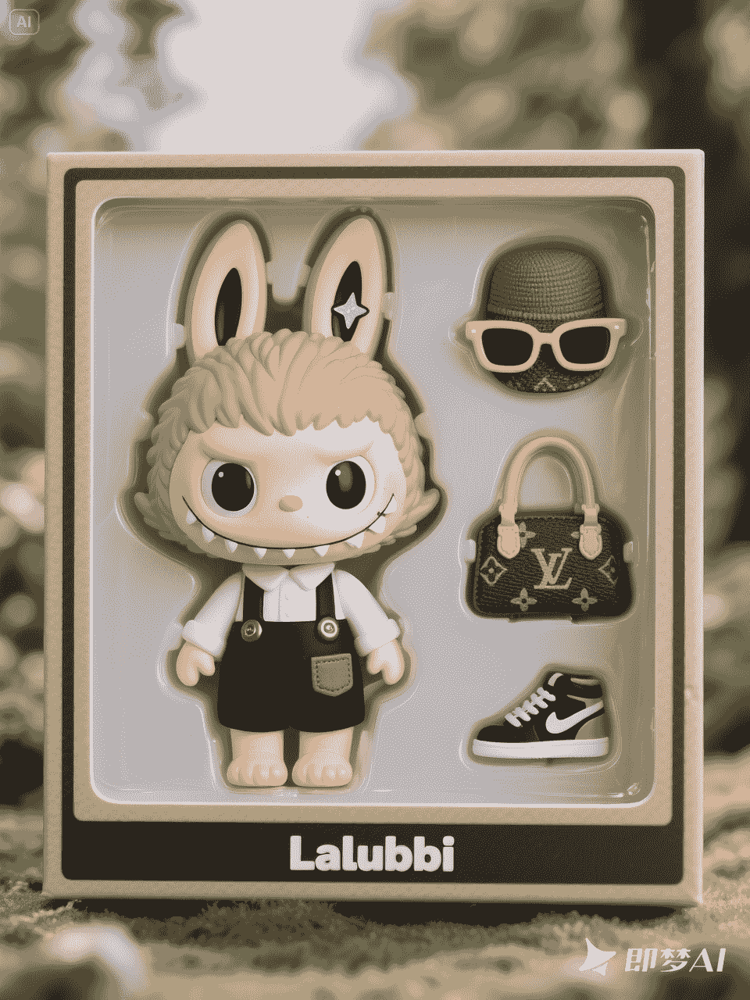

一个透明的水晶月饼，上面雕刻着错综复杂的花朵图案，粉蓝色调，有光滑的玻璃状质地且表面有微妙反射，置于干净白色背景上，柔和灯光营造出柔和阴影，超现实主义风格图片，特写，清新优雅，强调透明度和质感

极简风，一双白色运动鞋，运动鞋子上有手绘可爱卡通的苔藓植物图案，球鞋放在一个苔藓的圆润的岛上，碧绿的水波纹，蓝粉色的渐变天空，苔藓植物多肉植物，柔和光线，静物摄影。微距摄影，白色方形石墙将画面一分为2，镜头聚焦于运动鞋，景深，空间感

简约厨房场景，商业摄影，摆拍，米白色，高科技感，质感金属，磨砂材质，简洁，柔和，有设计感，小巧便携，简约，未来主义，家居风格，设计感好， 商业产品摄影、专业产品摄影、侧视图，正视图，多角度展示、简约背景、柔和灯光，光影

绿色电动车，鲜艳的色彩，可爱，3d设计风格，白色背景，简单背景，3d，鲜艳的色彩，全镜头，3d粘土，OC rednerer，Blender，8k，30兆像素，景深，散景， 衍射分级，体积光，最佳质量，8k

一杯茉绿奶茶，奶油雪顶饮品，被茉莉花包围，茉莉花，绿茶，茶叶漂落，竹筏，水面，倒影，反光，夏日，清爽，新中式，绿色背景有空间感，茶园，产品摄影，商业摄影，高分辨率，商业摄影，环境明亮，8k

一把可爱的彩色果冻沙发，包豪斯风格，在工作室背景上，带有神奇的彩色阴影，等距，前视图，白色背景和简单的灯光细节，带有简单线性细节的白色背景，工作室照明，趋势在多边形，超级平面，3D，布莱斯3D，低多边形，半透明重叠的风格，技术奇迹，柔和的配色，低饱和度，科技感，造型设计，影室灯，产品摄影场景，造型设计、设计、拍照、8k分辨率，高清，照片，摄影，柔光，最佳画质，高画质，高细节，高清，疯狂的细节，超高清画质

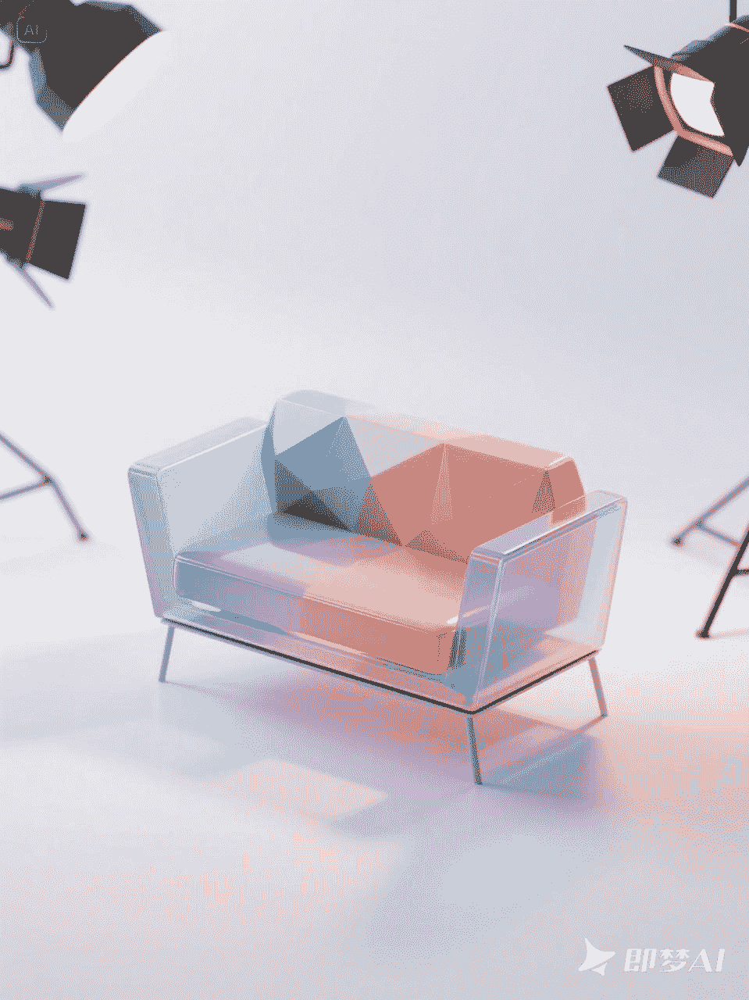

产品摄影，产品设计，王家卫风格，大光圈，特写，一瓶靛蓝色啤酒瓶，放在满是冰块的场景中，一些冰块在啤酒瓶上面，黑底烫金工艺的啤酒瓶标签贴纸上印着“HeiGe”，商业摄影，水珠，景深，高级的光影氛围，画面通透明亮，氛围感，专业拍摄，超高清，超细节，16K

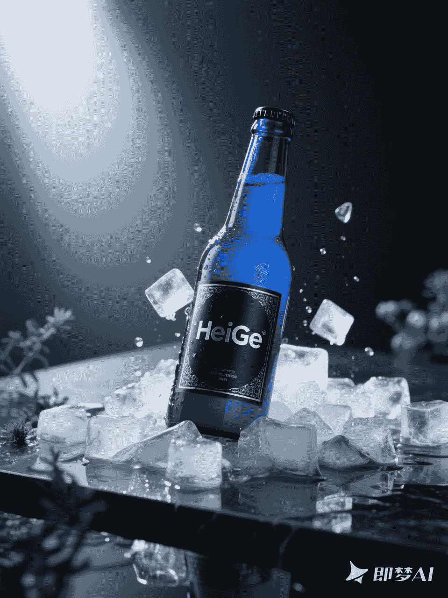

一款蒸汽波风格的机械熊手办及包装的机械熊，金属骨架外露，关节齿轮联动，半透明粉色 PVC 皮肤，左眼像素屏动态爱心，右耳复古收音机天线，爪部发光二极管，镭射幻彩棒球服（左胸 80 年代游戏机图案），荧光绿轮滑鞋（轮子可转动），可拆卸全息投影背包（投射电视雪花屏），透明吸塑盒内嵌黑色海绵，底座激光雕刻赛博霓虹电路图，包装外层烫金铝箔纸印故障艺术熊头剪影，背景 CRT 电视噪点纹理，附带机械零件收藏卡片

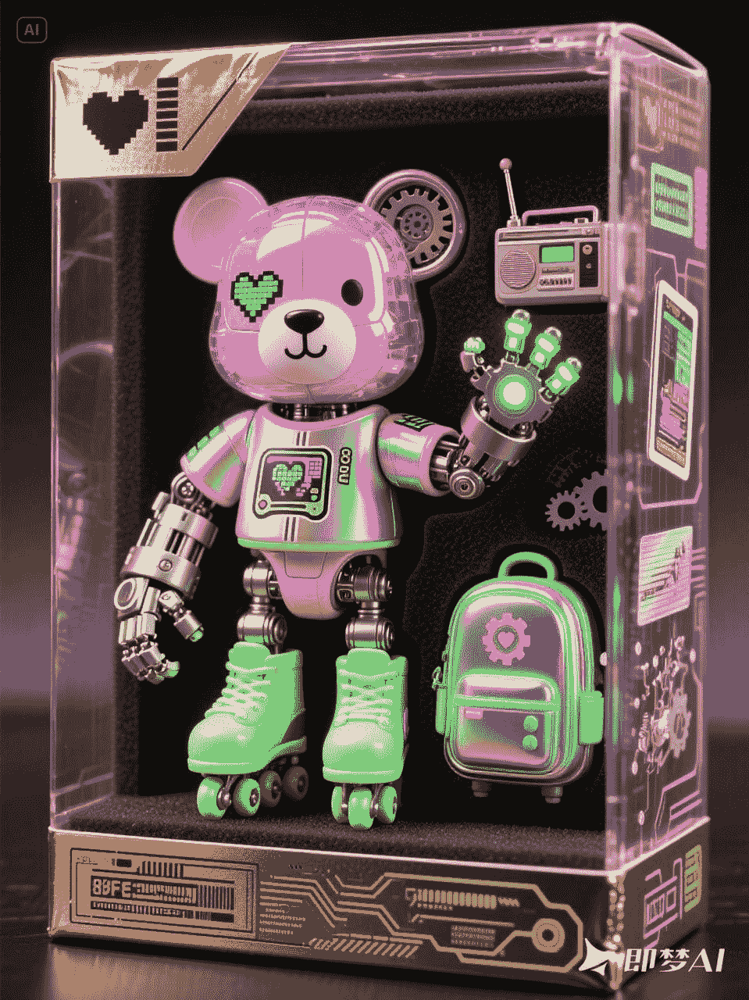

中式桃山皮月饼视觉方案：八边形桃山皮月饼，食品级铂金粉勾勒缠枝莲，中心可食用银箔，流心奶黄 + 乌龙茶冻夹层，切面渐变粉白大理石纹，置于青竹托盘，散落干制桂花与糖艺枫叶，背景水墨宣纸纹理，悬浮糖丝灯笼（内置 LED 暖光），顶光 + 侧逆光，突出桃山皮油润与银箔反射，背景虚化墨色山水，构图扇面三分法

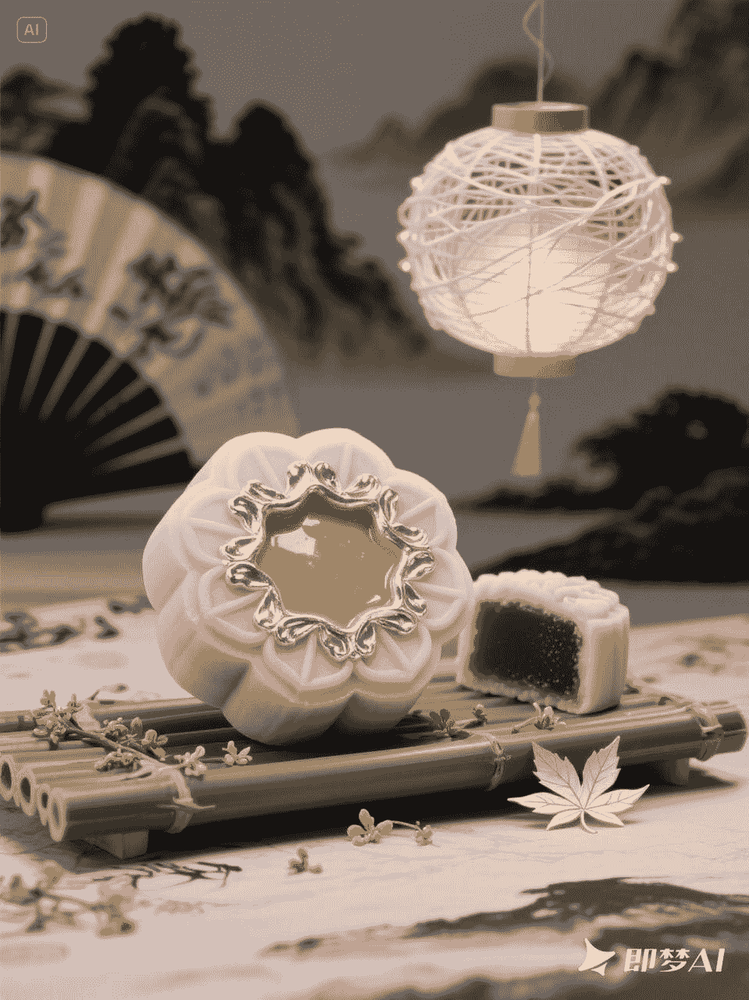

未来感透明蓝牙耳机及充电仓：水滴形透明树脂耳机腔体，内部可见纳米电路板与磁吸电池，渐变极光色硅胶耳塞，三棱柱水晶切割面充电仓，开盖 LED 灯带呼吸式点亮，充电仓表面航天级钛合金膜层（彩虹干涉效果），底部二进制 LOGO，半透明 PVC 包裹荧光绿纤维数据线，耳机悬浮液态金属池上方，背景网格状全息界面，左上角 45° 光线，强调树脂折射与金属质感，输出多角度 C4D 渲染图

设计极简主义陶瓷香薰机，圆柱形哑光白瓷机身，顶部内凹式注水口边缘鎏金描边，侧面隐藏式触控面板带温度湿度指示灯，内置超声波雾化片雾量三档调节，底座嵌入胡桃木圆环配防滑硅胶垫，搭配几何造型陶瓷香薰片可替换香型，拍摄于浅灰色水泥台，侧光突出瓷面冰裂纹理，背景为半透明纱帘树影投影

打造新中式榫卯结构书架，黑胡桃木主体采用明式夹头榫工艺，层板边缘倒圆处理，侧面雕刻云纹镂空图案，底部暗藏抽屉配黄铜拉手，可组合成山字形错落造型，搭配陶瓷书挡青釉冰裂纹，场景设置在竹帘隔断书房，顶光透过窗棂形成几何投影，背景为水墨山水卷轴，输出组装分解爆炸图

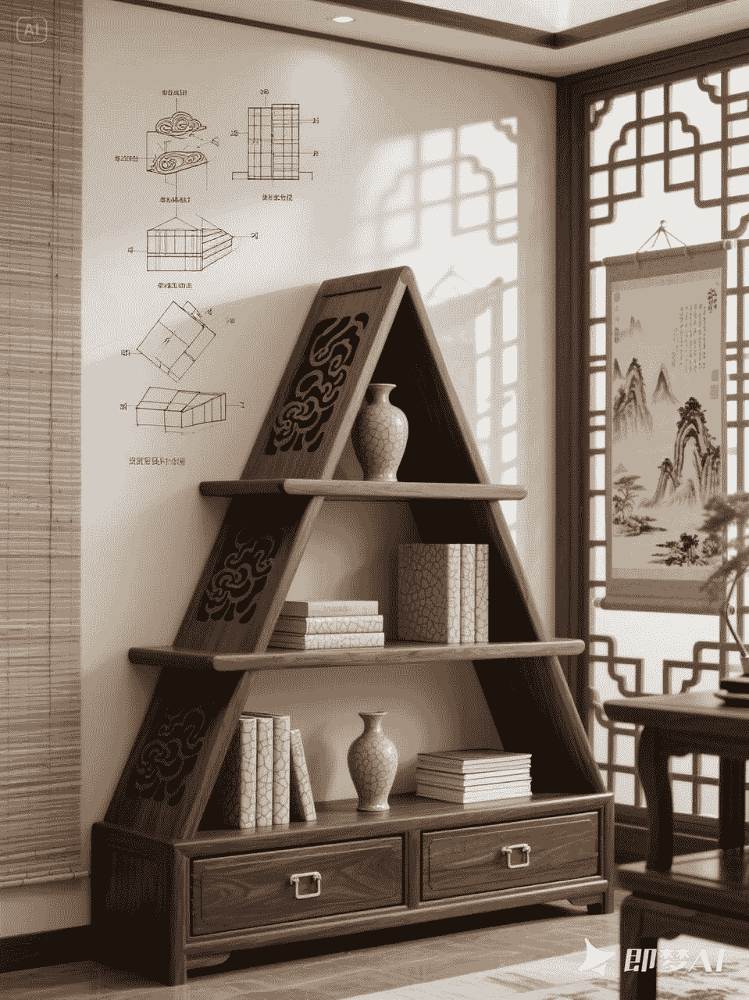

鎏金的珐琅怀表，表盘蚀刻着星轨运转的精密纹路，青金色调，有温润的金属磨砂质感且边缘泛着古铜光泽，悬于深灰丝绒背景前，侧光勾勒出立体轮廓，蒸汽波风格图片，微距拍摄，复古奢华，突出金属氧化痕迹与机械结构

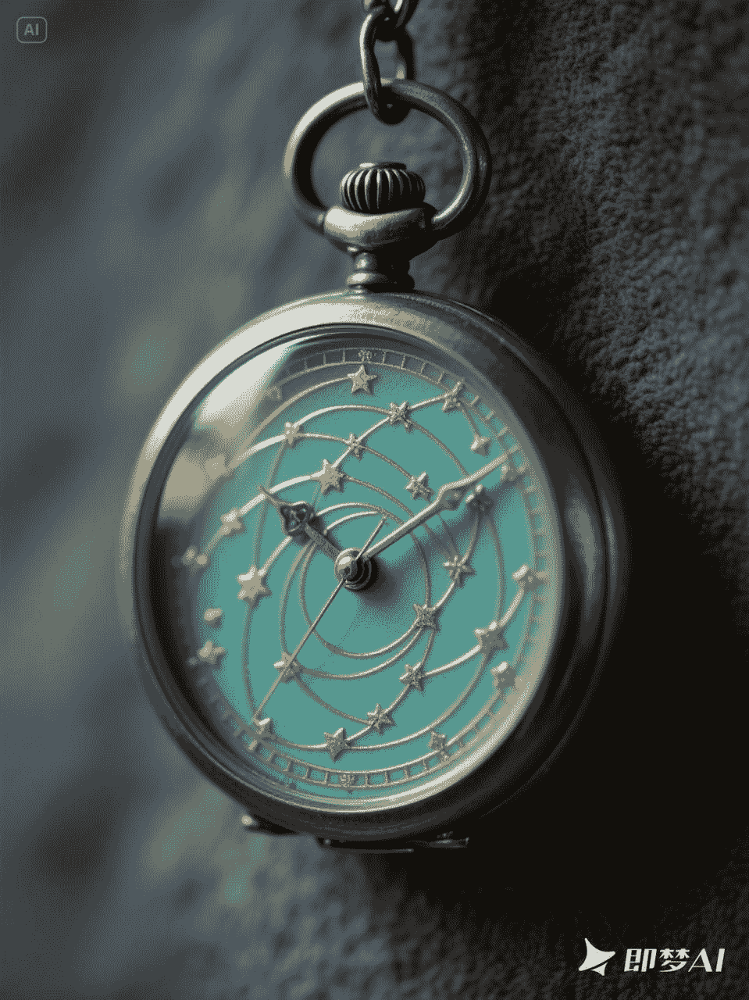

一支悬浮的琉璃钢笔，笔身缠绕着镂空的藤蔓纹样，蒂芙尼蓝色调，有冰裂纹理的釉面质感且笔尖凝着珍珠色墨滴，浮于渐变浅紫背景中，逆光形成光晕效果，赛博朋克风格图片，动态模糊，未来科技感，强化琉璃通透与光影折射

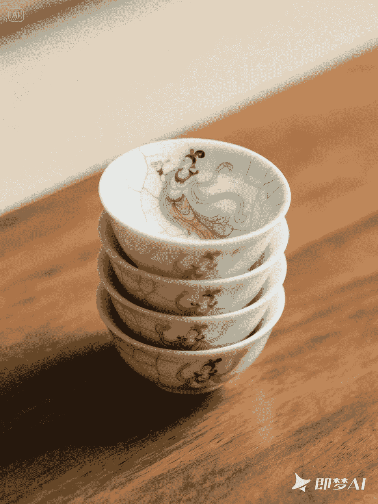

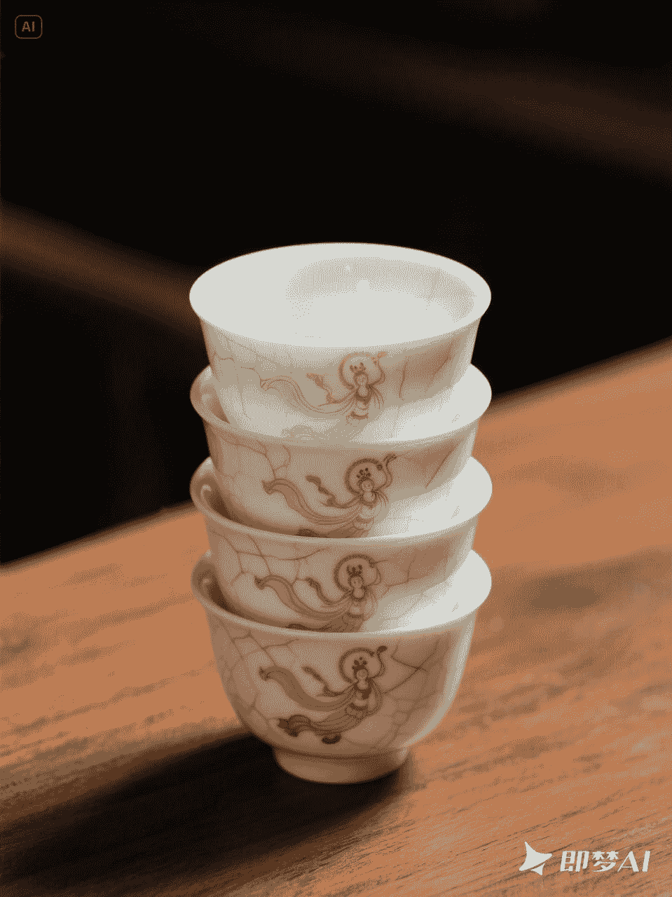

一把透明的树脂吉他，琴身浇筑着深海珊瑚的完整标本，蒂凡尼蓝渐变，有琥珀般的包裹体质感且琴弦泛着冷银光泽，斜靠在水泥肌理墙面上，侧逆光形成轮廓光，复古未来主义风格，中景构图，艺术摇滚感，强调树脂通透与生物标本细节

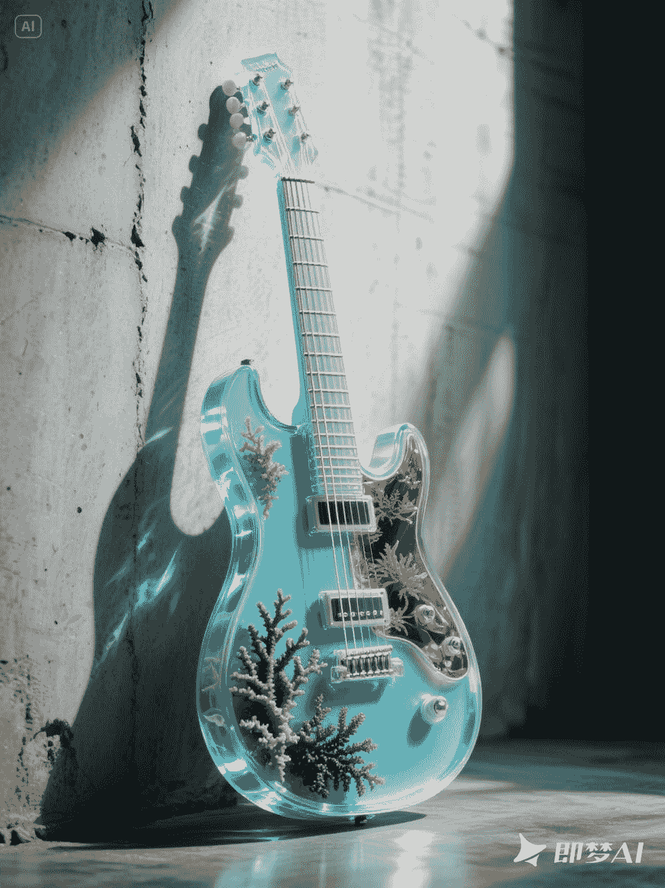

一座微型的玻璃城堡，墙体雕刻着哥特式玫瑰窗的繁复花窗，矢车菊蓝色调，有铅玻璃的重质感且穹顶折射出彩虹光斑，置于苔藓覆盖的岩石底座上，柔焦背景虚化，童话绘本风格，移轴摄影，奇幻浪漫，突出玻璃彩绘与建筑透视

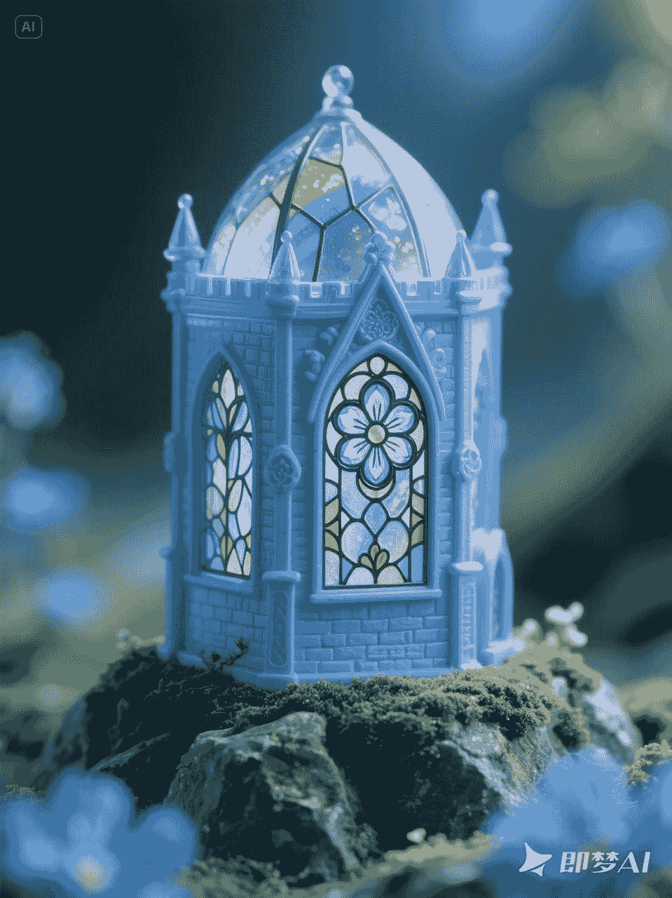

开发模块化户外炊具套装，钛合金材质总重不超 800 克，包含可折叠煎锅锅底蜂窝纹路，分体式茶壶磁吸式滤网，嵌套式餐盒带密封硅胶圈，收纳呈圆柱体适配登山包侧袋，表面喷涂特氟龙防粘涂层，场景设置溪流边岩石上，周围散落露营装备，逆光拍摄突出金属光泽与环境融合度

制作蒸汽波风格霓虹灯牌，亚克力底板雕刻赛博汉字“黑戈”，内置柔性霓虹灯带粉紫渐变呼吸效果，边缘包裹复古收音机旋钮可调节亮度，背面安装磁吸式电池盒支持无线充电，拍摄于老旧街巷墙面，背景为褪色海报与斑驳瓷砖，侧光强化霓虹光晕与亚克力反光

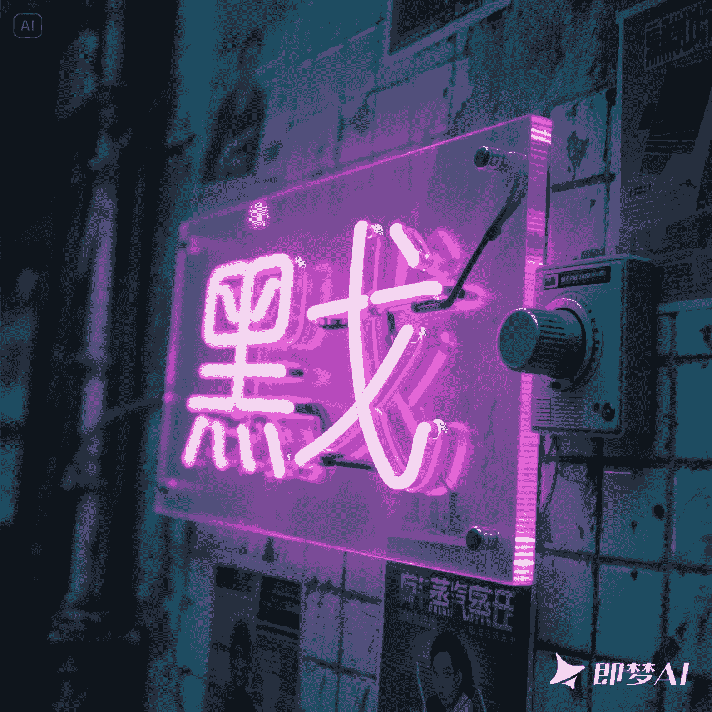

创作故障艺术风格蓝牙音箱，不规则多边形外壳 ABS 塑料与金属拼接，表面做旧处理模拟锈蚀刮痕，正面嵌入式 LED 屏显示故障艺术动态图案，顶部旋钮为废弃硬盘改造，底部橡胶脚垫防滑纹路呈电路板图案，包装为回收纸箱烫金故障艺术 LOGO“黑戈”，拍摄于电子垃圾场景，侧光强调材质对比与光影层次

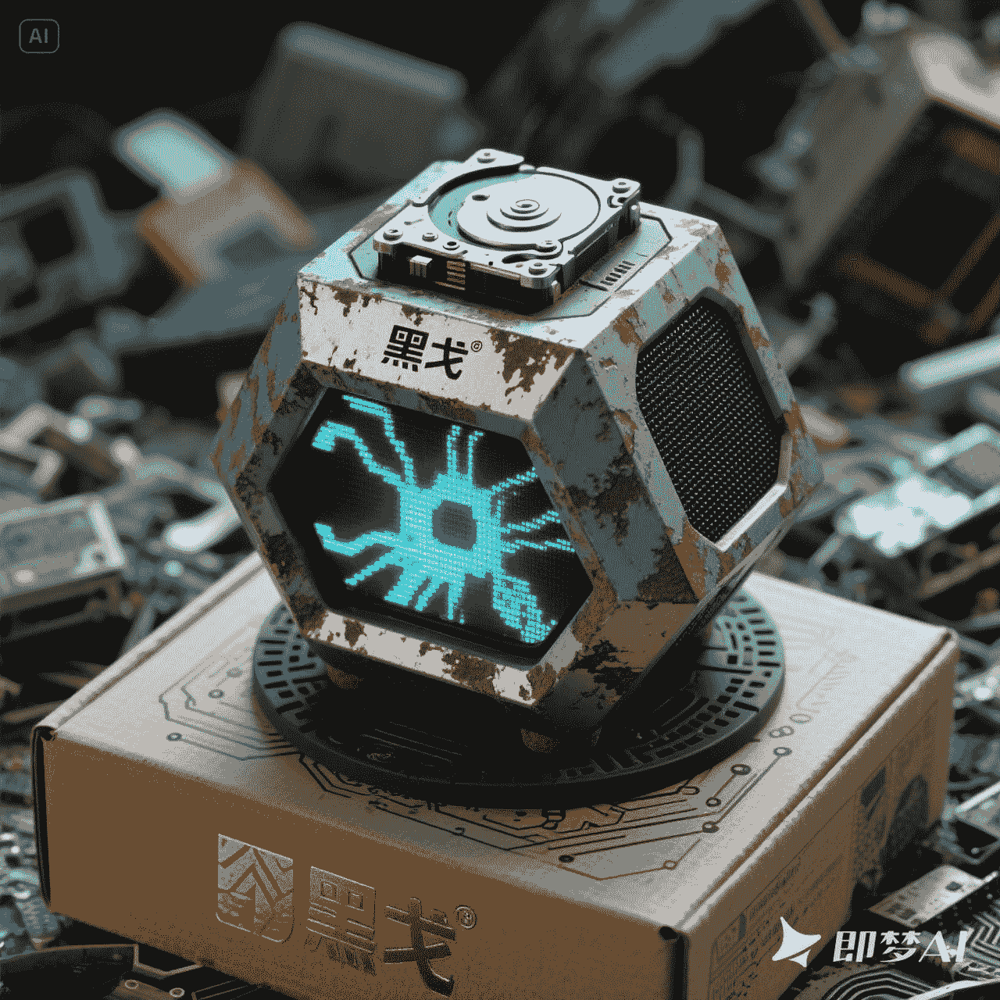