# 最强人工智能网站：已集成全球TOP大模型及AI绘画工具

> 来源：[https://my.feishu.cn/docx/PNKWd0d47oqYjtx9PMvc0bjPnLx](https://my.feishu.cn/docx/PNKWd0d47oqYjtx9PMvc0bjPnLx)

**本**文为喜番AI的功能介绍，工具地址：https://ai.qixinba.com/auth?type=register&invite=NTE

---

# **基础AI大模型应用：**

手机、电脑随时随地，**在任何网络环境**，都可以使用全球领先的大模型，目前已加入以下大模型。

**☑ 喜番免费模型**

**☑ ChatGPT4.0**

**☑ ChatGPT3.5**

**☑ MidJourney绘画**

**☑ 文心一言**

**☑ 讯飞星火**

**☑ 通义千问**

**☑ 腾讯混元**

**☑ 清华智谱**

**☑ 谷歌Gemini**

☑ 必应Chat（Copilot）

**☑ Claude**

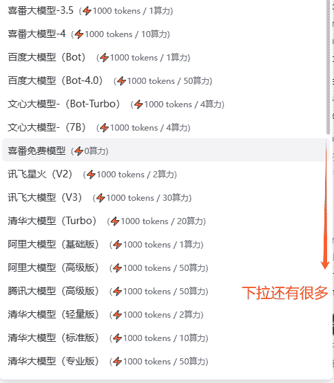

# **定制大模型：**

大量已完成调试的**定制模型**，点开即用，节约创作时间。

**☑ ChatGPT4 联网版**

☑ ChatGPT4 研究助手（论文）

☑ ChatGPT4 研究助手（生物医学、新闻研究等）

☑ ChatGPT4 研究助手（医学专用）

☑ ChatGPT4 自媒体-文案创作

☑ ChatGPT4 自媒体-短视频脚本创作

☑ ChatGPT4 雅思综合写作助手

☑ ChatGPT4 大学论文助手

☑ ChatGPT4 演讲稿写作助手

☑ 及其他30+种（联系站长可免费定制大模型）

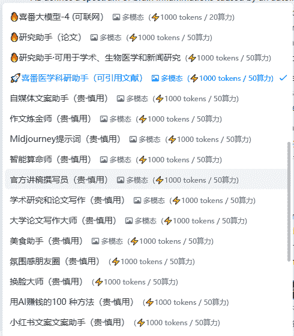

👇大模型选择方式👇

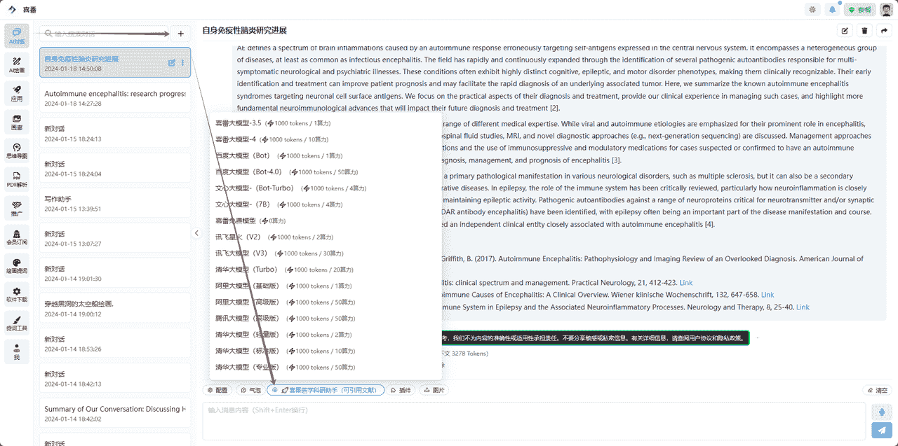

[如何用《喜番医学科研助手》完成一篇论文](https://yw55ojhusnq.feishu.cn/wiki/XTWvwOwwiiWYByklalecfqlRnEa)

# **AI绘画生成：**

接入市面上大部分头部的AI绘画工具：midjourney、dalle·e3，可完成ppt配图、医学专用图像生成及其他绘画需求。成象效果如下：

AI绘画：七彩宇宙

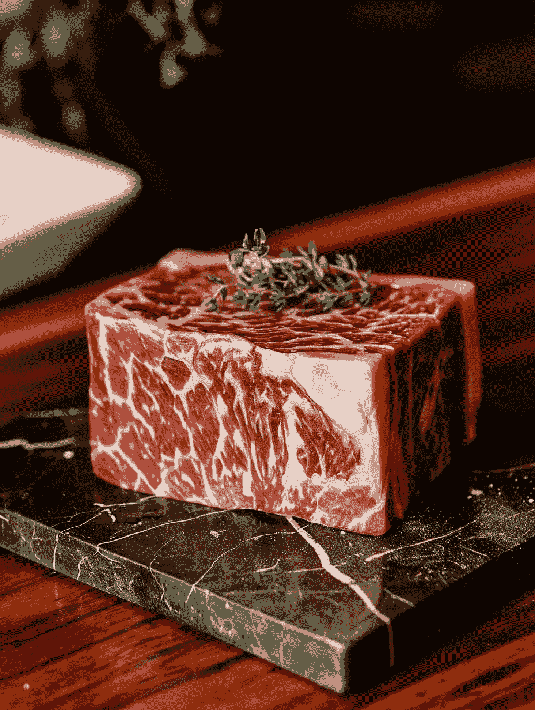

AI绘画：牛肉

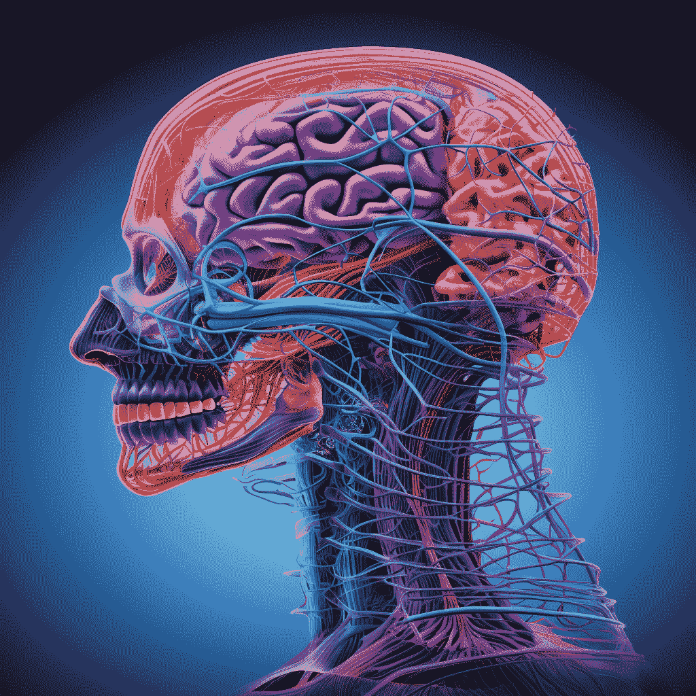

AI绘画：脑脊液循环插图

AI绘画：回家过年

AI绘画：商店设计

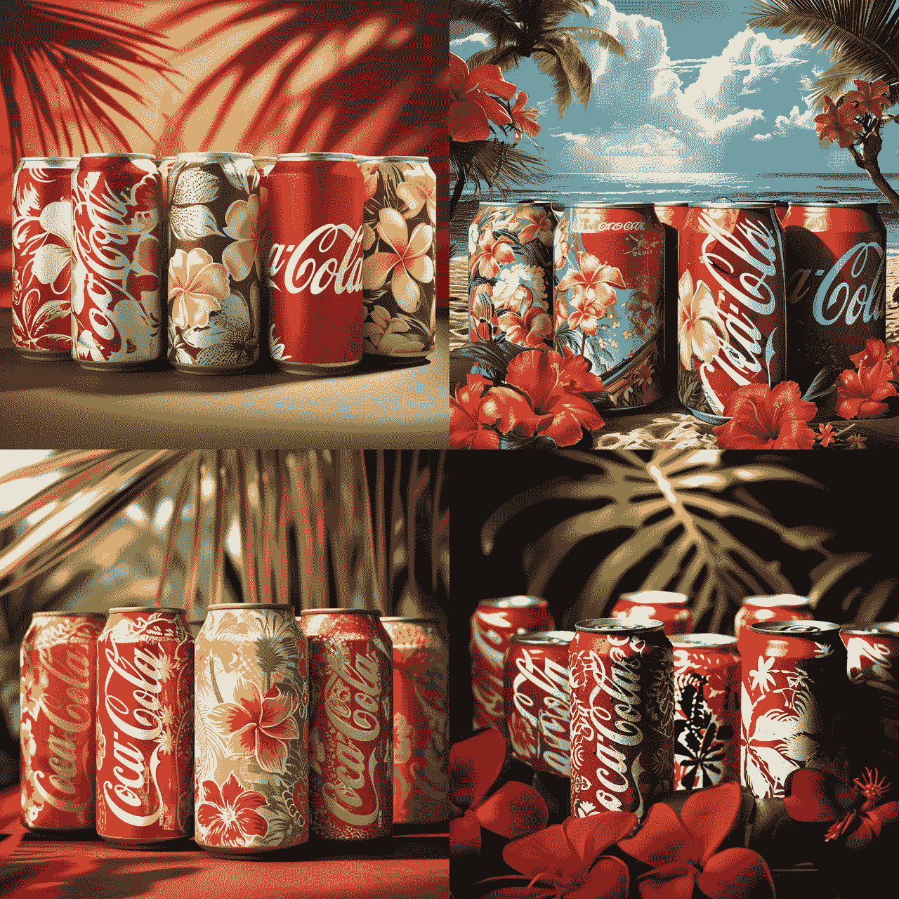

AI绘画：产品设计

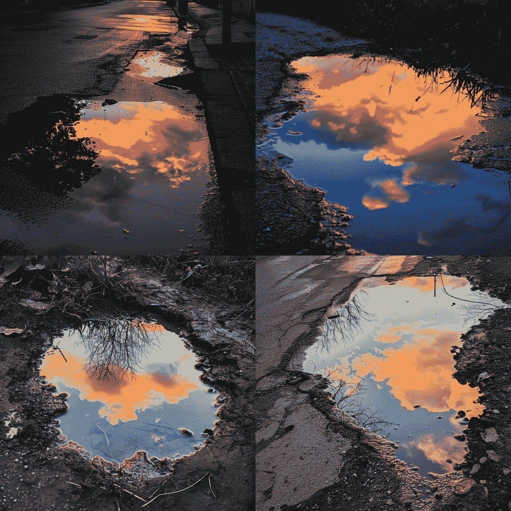

AI绘画：摄影作品

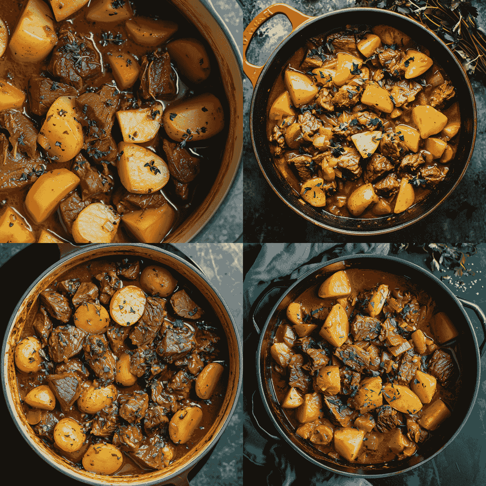

AI绘画：土豆炖牛肉

👇AI绘画界面介绍👇

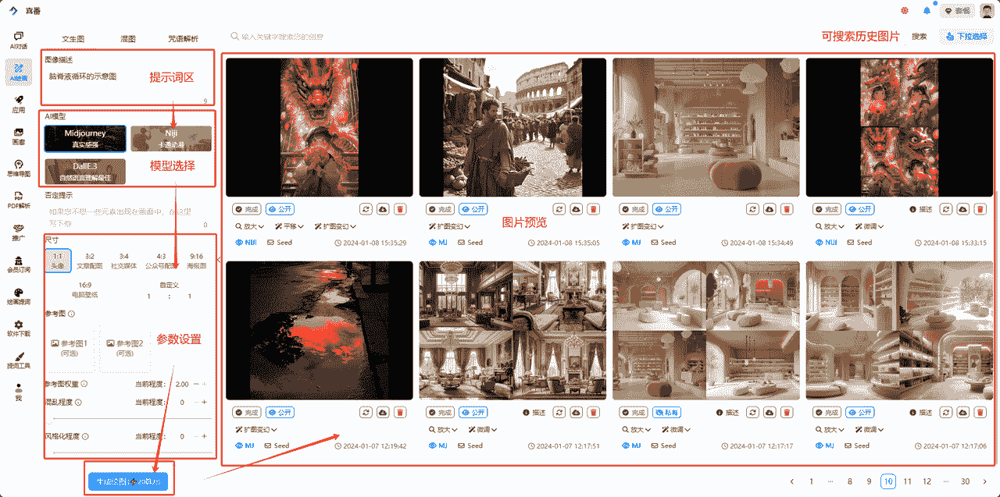

# **思维导图创作：**

一键生成思维导图，可修改生成的内容，可直接下载图片。

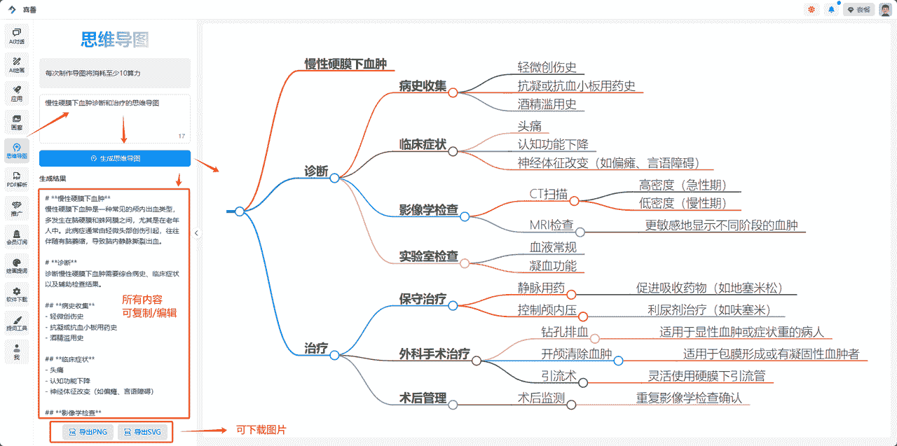

#  **AI小助手：**

1000+轻定制小助手，会写代码能写诗，能做数学还能出食谱，口播视频、短视频脚本也是信手拈来。

可直接搜索使用，能单独使用，也可以与任意大模型组合使用。

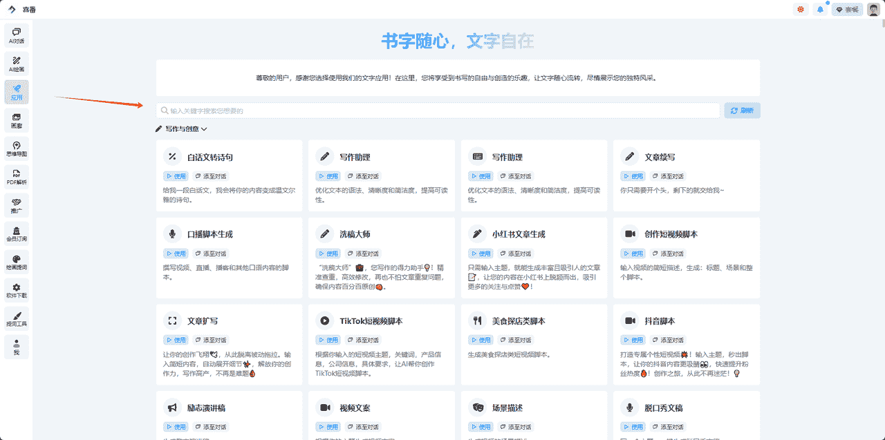

#  **PDF解析：**

论文、报告等PDF文件可以直接上传，AI自动识别文件内容，自动总结，寻找关键数据。

其他文件格式正在开发中，当前在用版本为GPT3.5解析。

开发完成后，支持ChatGPT4.0解析。

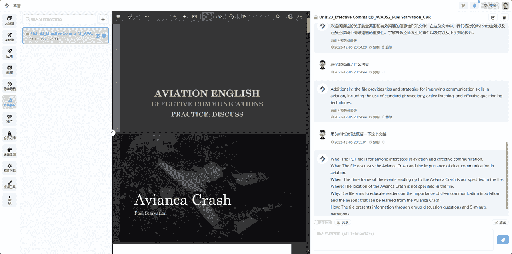

有其他问题，或者想加入喜番AI交流群，可以加我🛰️。（本人不是站长，站长联系方式进群可获取）

