# 别再拼车了！Midjourney也免费了，国内直接用不需要魔法！领取AI绘画工具立省$30/月！

> 来源：[https://my.feishu.cn/docx/NmzxdHqdWoQl4ZxNfI7ct2pinee](https://my.feishu.cn/docx/NmzxdHqdWoQl4ZxNfI7ct2pinee)

工具：：[h](https://ai.qixinba.com/me/;)ttps://ai.qixinba.com/auth?type=register&invite=NTE  记得填写邀请码NTE，领取免费算力。

官方Midjourney原价30美元/月，现在可以免费用了。

本文会简单介绍下Midjourney最新的V6版本，老司机直接拉到底就好。

**新手建议看完，文中放了很多提示词，看完这些提示词，你就掌握m**idjourney出高质量图片的技巧了。

👇像这样相机摄影质量的图片，你也可以一键生成👇

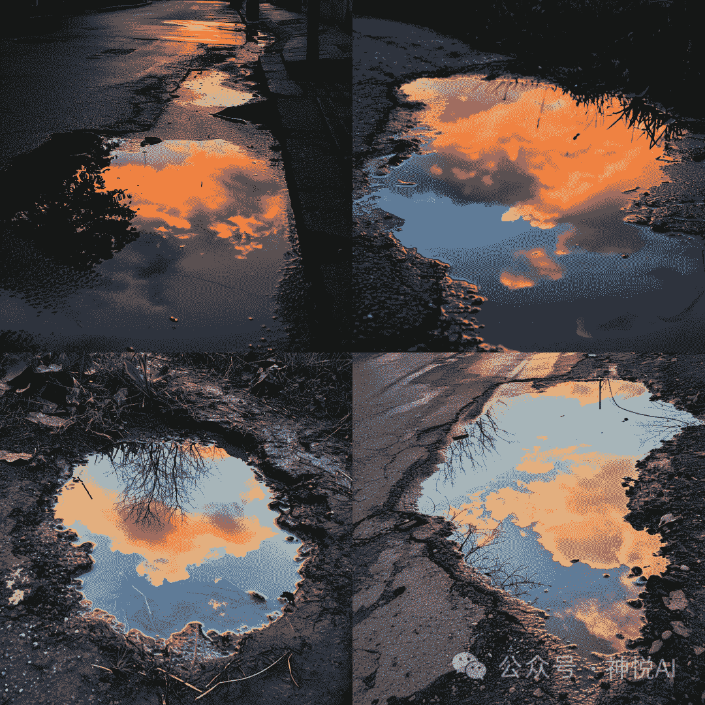

工具我放在文末，大家先看一下生成的图片效果。

---

经**过9个月的**精心训练，Midjourney团队于在Discord平台上推出了其图像生成技术的最新版本——V6测试版。

该**版本在性能**上实现了显著的飞跃，尽管缺少定量的标准测试，但根据网友的实际体验反馈，V6版的生成图像模型堪称目前遥遥领先。

**MJ V6效果图👇**

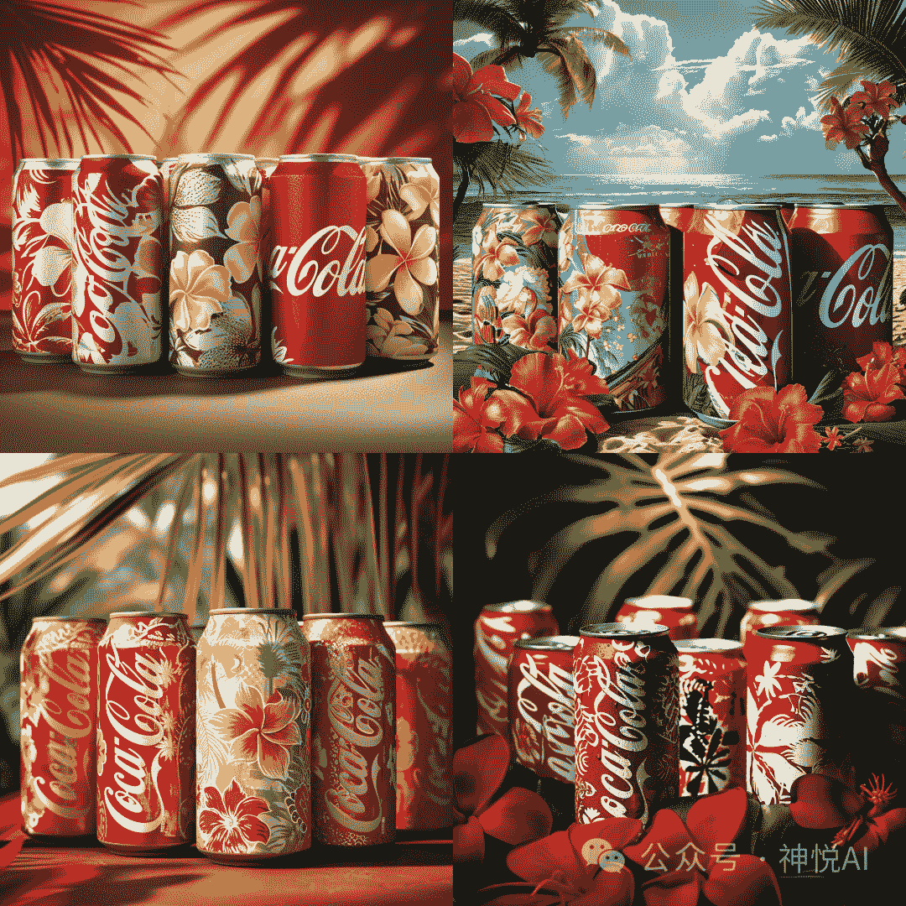

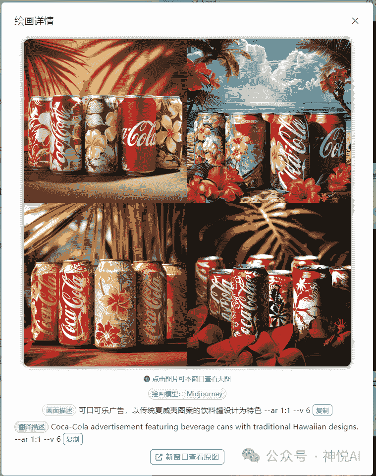

**中文提示词：**可口可乐广告，以传统夏威夷图案的饮料罐设计为特色

--ar 1:1 --v 6

**英文提示词：**Coca-Cola advertisement featuring beverage cans with traditional Hawaiian designs. --ar 1:1 --v 6

本次更新的亮点可以归纳为以下几个方面，相比早先的V5版本有着显著改善：

1.**分辨率**通过升级**提升了一倍**；

2.加强了对精准指令的响应并支持更长指令输入，现在指令长度可以超过300字符；

**3.文图的连**续性和模型的知识存储得到加强，使其更加了解并理解你的描述；

4.图像提示和混合方式经过优化；

**5.增加了对小规模文**字的图像创作功能，实现了图片和文本的联合生成。（简单说就是图片上能加字，比如这个图👇）

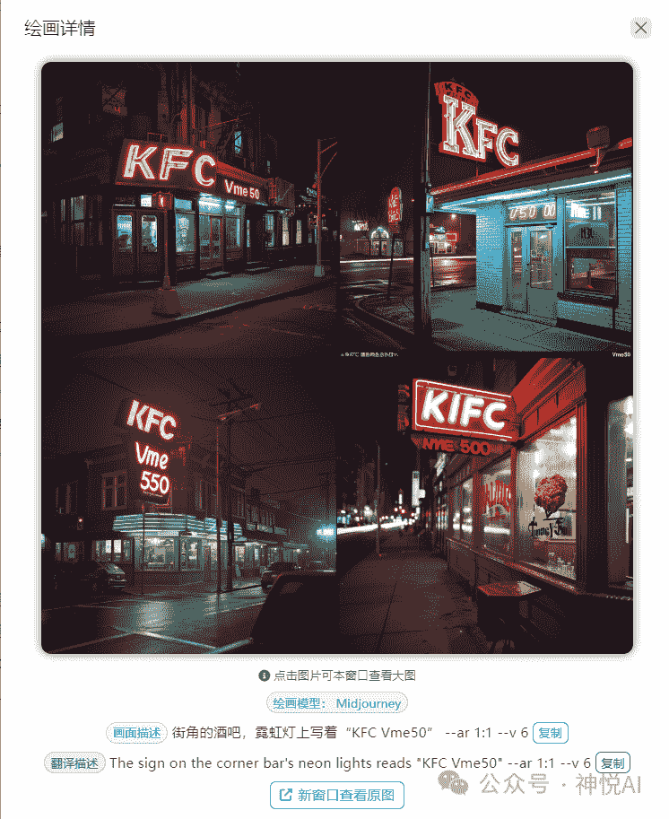

简而言之，V6版本能够处理更多的词汇，对语义有更深刻的理解，生成的图像更加精细和强大，可以进行更个性化的图像编辑，并且在分辨率上实现了倍数增长。

就图像品质而言，与过去的版本相比，Midjourney的V6版显著提高了。通过对V5和V6版本生成的图像进行比对，我们可以看到新版本在质地细节、光影效果以及结构真实性方面均表现出色。

**V6的质量👇**

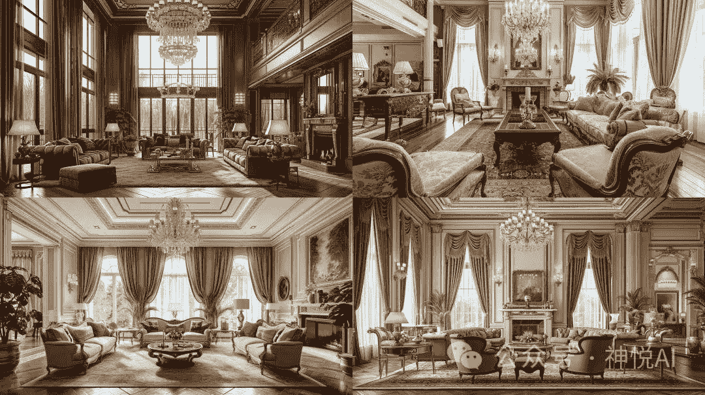

**原图大于10M公众号没法上传**

**压缩后上传质量还是非常高的**

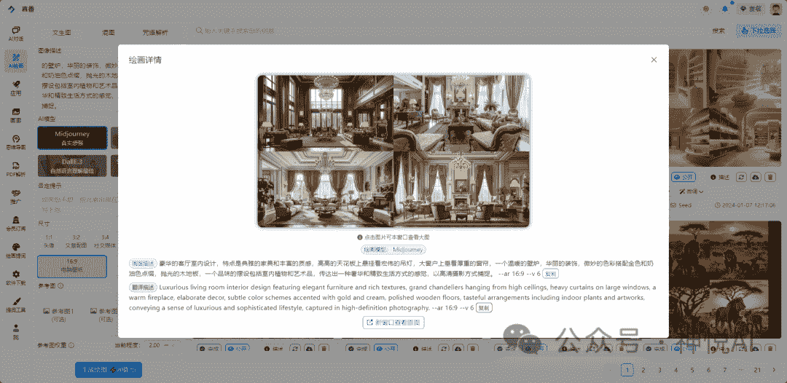

中文提示词：豪华的客厅室内设计，特点是典雅的家具和丰富的质感，高高的天花板上悬挂着宏伟的吊灯，大窗户上垂着厚重的窗帘，一个温暖的壁炉，华丽的装饰，微妙的色彩搭配金色和奶油色点缀，抛光的木地板，一个品味的摆设包括室内植物和艺术品，传达出一种奢华和精致生活方式的感觉，以高清摄影方式捕捉。--ar 16:9 --v 6

英文提示词：Luxurious living room interior design featuring elegant furniture and rich textures, grand chandeliers hanging from high ceilings, heavy curtains on large windows, a warm fireplace, elaborate decor, subtle color schemes accented with gold and cream, polished wooden floors, tasteful arrangements including indoor plants and artworks, conveying a sense of luxurious and sophisticated lifestyle, captured in high-definition photography. --ar 16:9 --v 6

V6在图像生成方面的提升非常明显。与V5.2版相比，V6生成的图片无疑更为丰富且具有细腻的真实感。

**虽然V5.2在细节上已**经令人称赞，但V6所展现的不是仿真的“假”，而是接近摄影作品的“真实”。选用合适的提示词条，得到的图像结果甚至能够达到相机实拍的真实质感。

以下是一些示例图和相关提示词，大家直接复制就能出这些图片了。

图片都因为太大不能上传，我以截图的形式发上来

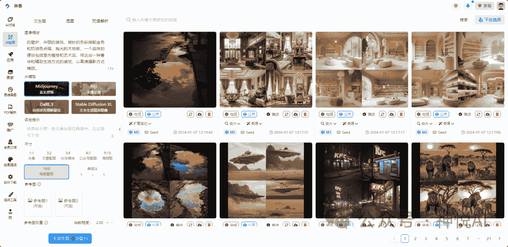

---

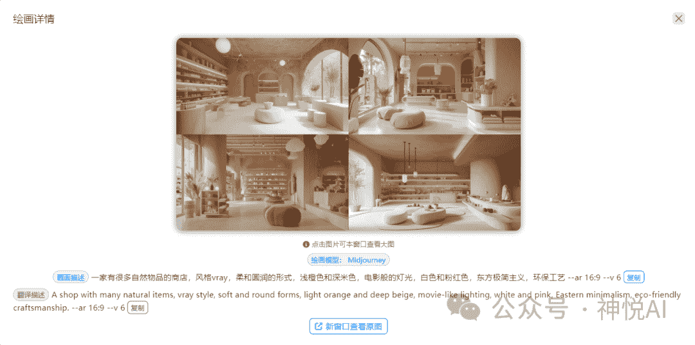

👆一家有很多自然物品的商店，风格vray，柔和圆润的形式，浅橙色和深米色，电影般的灯光，白色和粉红色，东方极简主义，环保工艺 --ar 16:9 --v 6

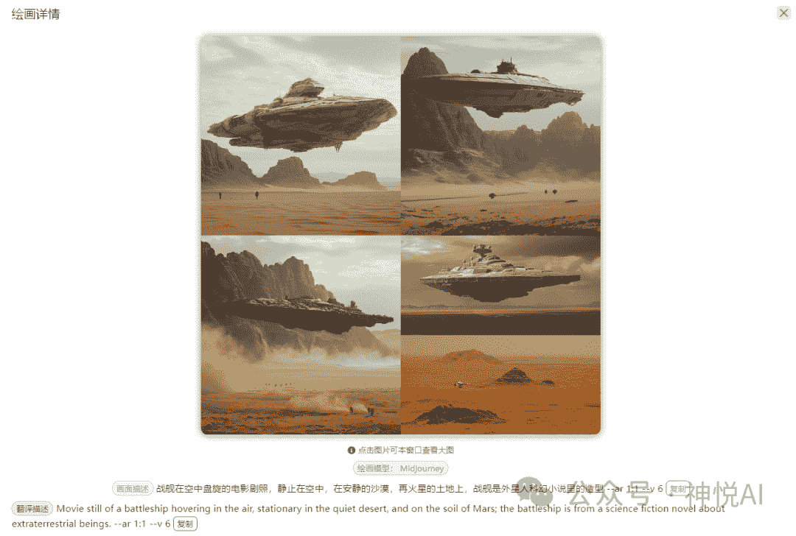

👆战舰在空中盘旋的电影剧照，静止在空中，在安静的沙漠，再火星的土地上，战舰是外星人科幻小说里的造型 --ar 1:1 --v 6

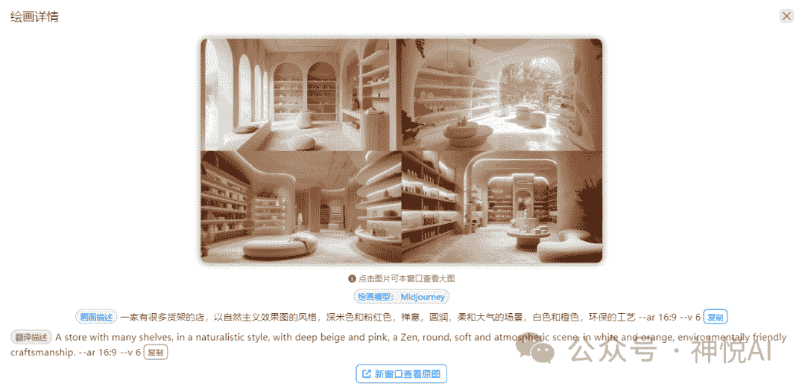

👆一家有很多货架的店，以自然主义效果图的风格，深米色和粉红色，禅意，圆润，柔和大气的场景，白色和橙色，环保的工艺 --ar 16:9 --v 6

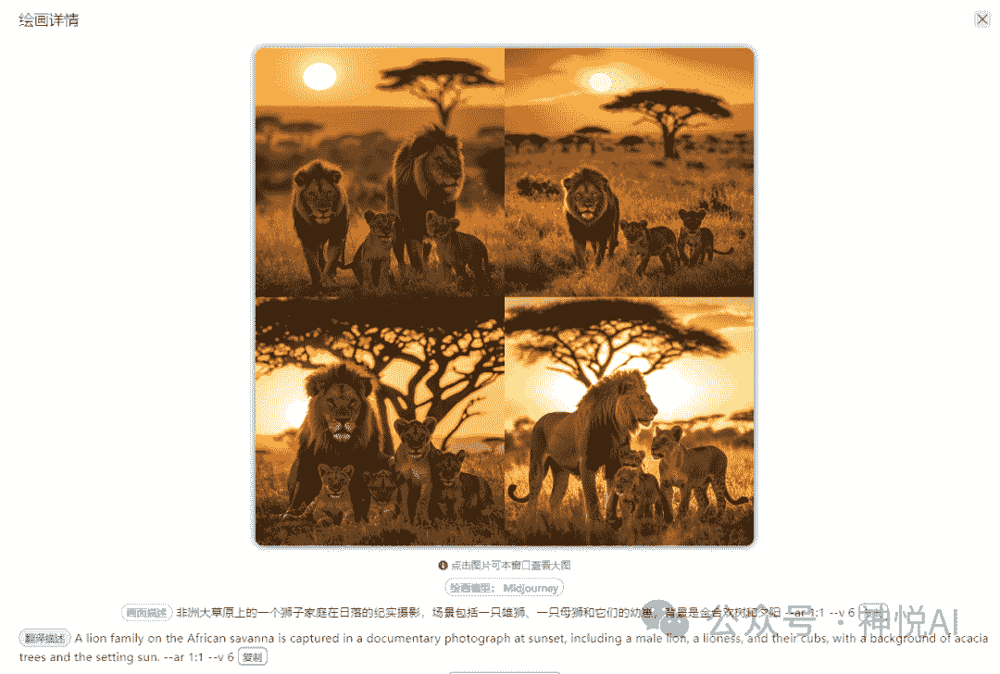

👆非洲大草原上的一个狮子家庭在日落的纪实摄影，场景包括一只雄狮、一只母狮和它们的幼崽，背景是金合欢树和夕阳 --ar 1:1 --v 6

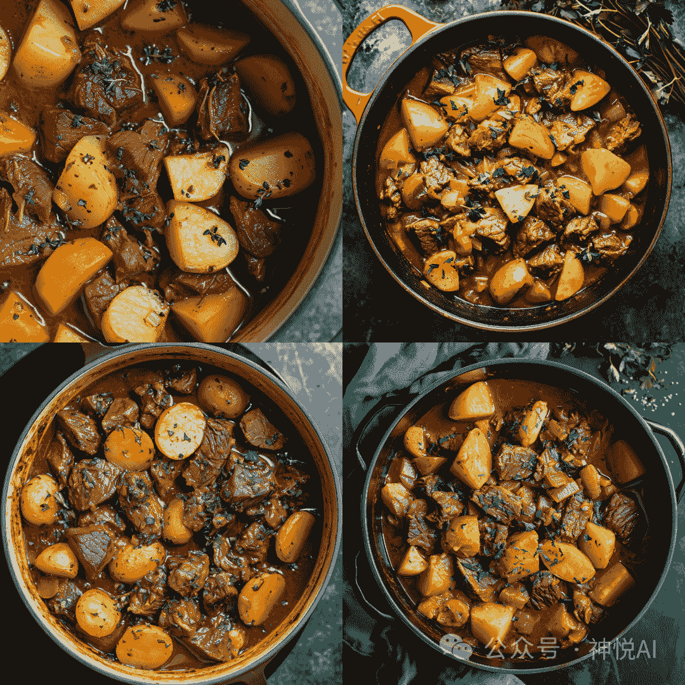

一锅土豆炖牛肉，从上向下看的视角 --ar 1:1 --v 6

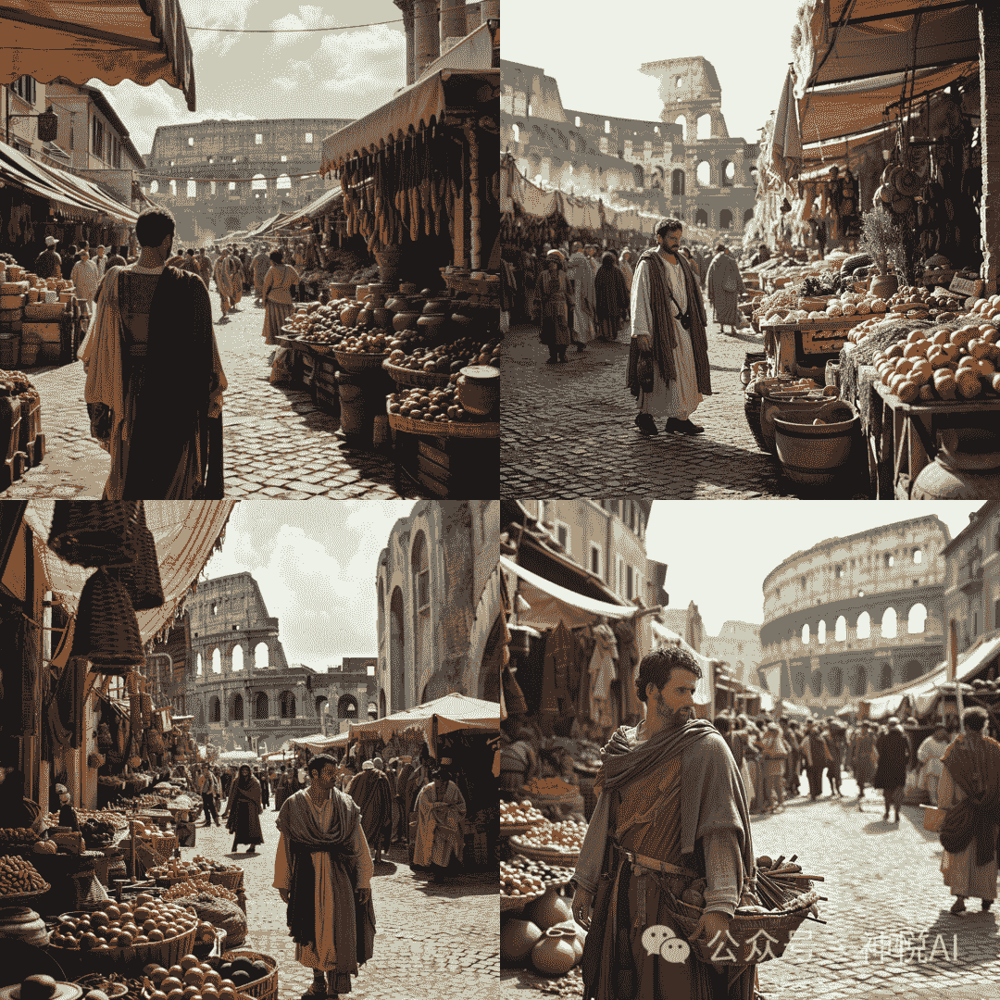

👆白天在罗马市场拍摄的电影剧照，一个男人穿着传统罗马服饰，身后很多人们正在街上穿行，有水果、蔬菜、瓷器摊位，背景的远处是罗马竞技场，中等距离拍摄 --ar 1:1 --v 6

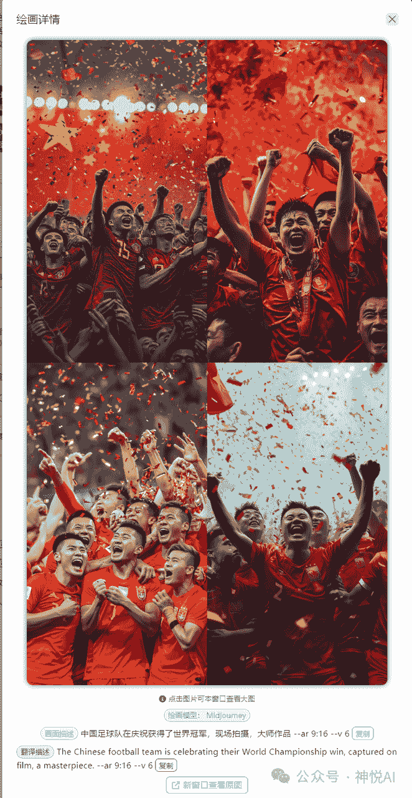

👆中国足球队在庆祝获得了世界冠军，现场拍摄，大师作品 --ar 9:16 --v 6

---

然后是工具领取地址：

https://ai.qixinba.com/auth?type=register&invite=NTE

**注册即****用，中文****提示****词出图质量也非常**好。记得填写邀请码NTE，能领取算力，这样才能免费用

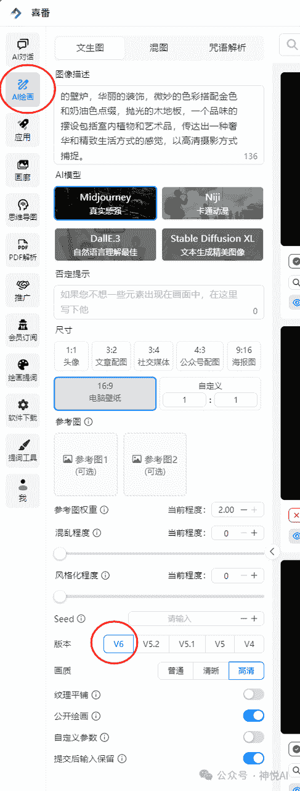

# **更多****AI**工具的教程可以在公众号发送“AI”领取。

# **（免费，还有收录很多****AI****变现案例）**

感觉有帮助的话点个再看吧👇

