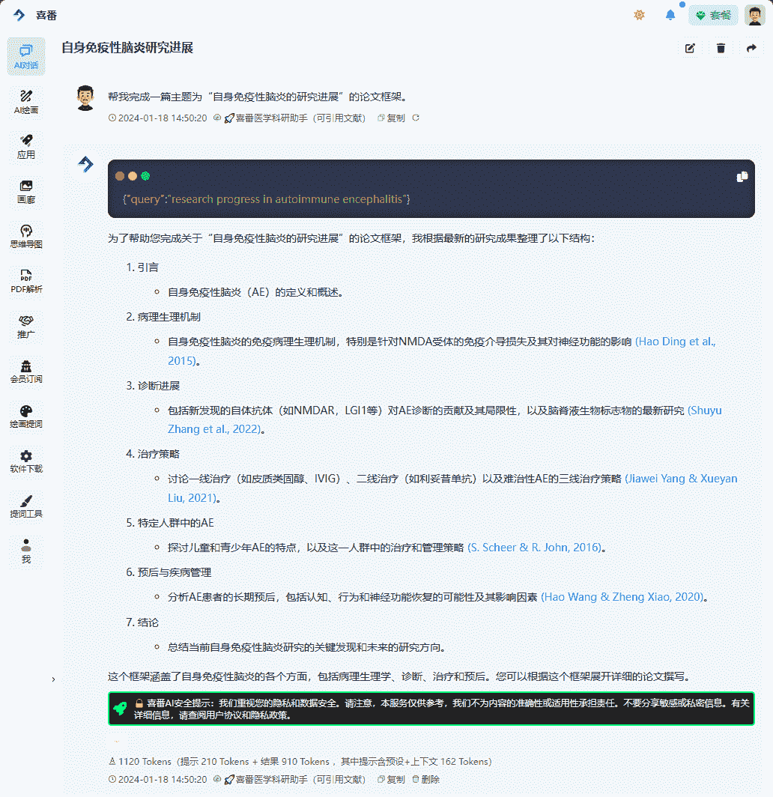
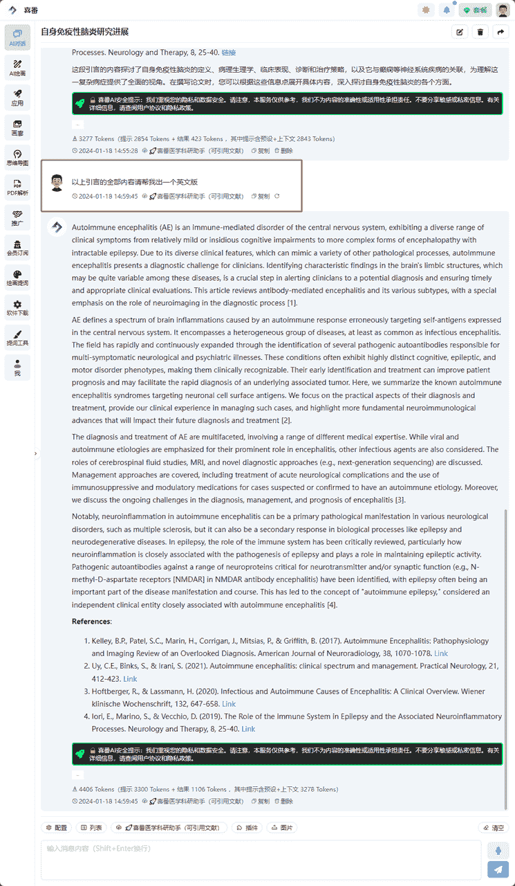
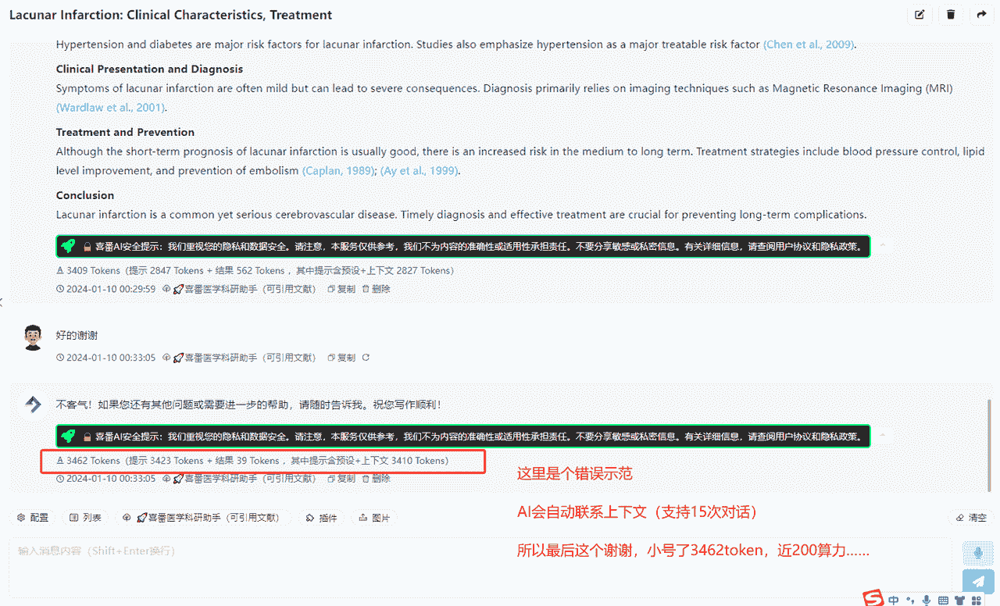
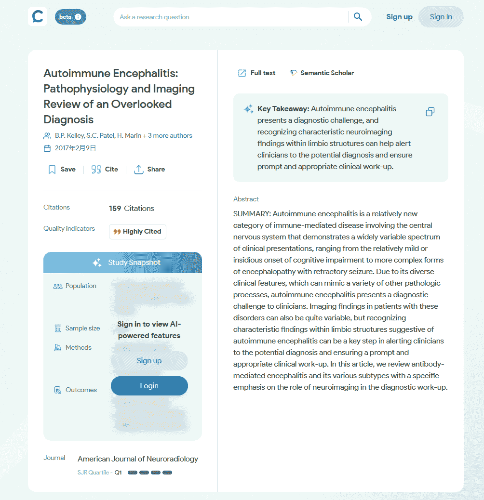
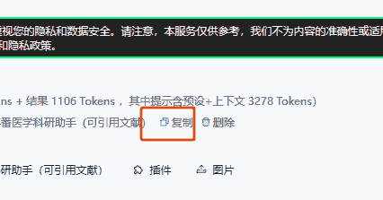
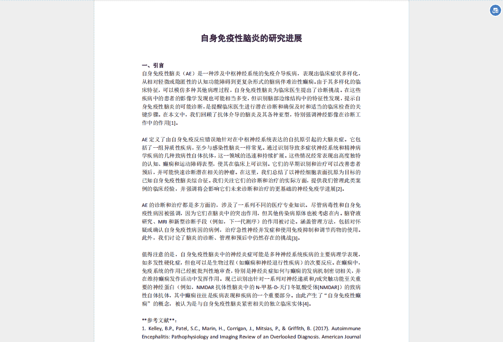
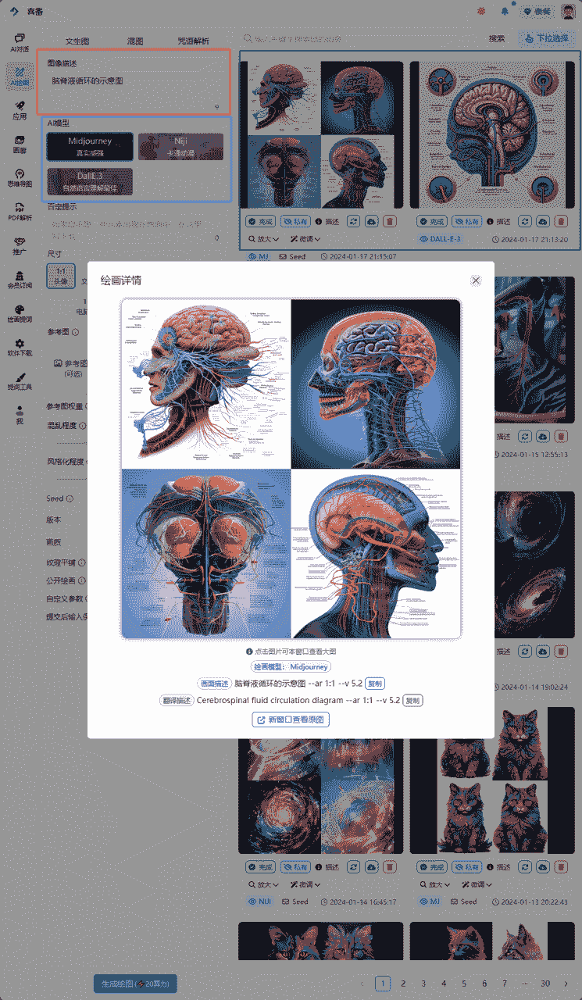

# 如何用《🚀喜番医学科研助手》完成一篇论文

> 来源：[https://my.feishu.cn/docx/ESD6dPlgFoVrsQxJkMkceijZnNc](https://my.feishu.cn/docx/ESD6dPlgFoVrsQxJkMkceijZnNc)

**如何用《🚀**喜番医学科研助手》完成一篇论文，看完这篇文章，你也可以👇一键出论文👇

---

首先打开工**具：****h**ttps://ai.qixinba.com/auth?type=register&invite=NTE

然后选择🚀喜番医学科研助手这个大模型

# 第一段提示词

```
帮我完成一篇主题为“自身免疫性脑炎的研究进展”的论文框架。
```



# 第二段提示词

```
请把以上框架中的 引言 的全部内容生成给我，大约800字。
请引用4篇文献并按以下标准插入文中。
**引用标注**：使用IEEE风格的引用格式，在文中用方括号数字序号标注（如[1]）。
**参考文献格式**：在文章末尾提供完整的参考文献列表。参考文献的格式应包括作者姓名、文章标题、期刊/会议名称、出版年份、链接等信息。
```


# 第三段提示词

❗如果需要翻译英文：

```
以上引言的全部内容请帮我出一个英文版
```

如不需要翻译，就参考第二段提示词，继续对话就好；后续的内容以此类推就可以全部完成了



# 其他补充

## 扩写内容

如果觉得字数不够，就让他扩写，比如扩写到2倍长度，提示词就是：

```
请把以上 引言 内容扩写到2倍长度
```

```
请把以上 XXX  内容扩写到 XXX字以上
```

## **算力消耗**

📢提问/回答的字数越多，消耗的算力（tokens）越多。

📢同一个聊天框对话次数越多，消耗的算力（tokens）越多。

像这里的错误示范，只发了个谢谢，却消耗了3462token👇



## 检查地址

最后要记得检查论文地址，目前AI工具生成的地址是consensus上的搜索结果，如果需要原文出处的地址，需要手动修改。



## 排版与检查

全部内容完成后

点这里的复制，放到word，最终排版导出PDF即可。





## 配图

如果需要配图，可以用AI绘画工具



midjourney图像真实感很强，niji更适合卡通配图，Dall·e3对描述词理解力更强

更多使用技巧可以在我👸号获取👇

