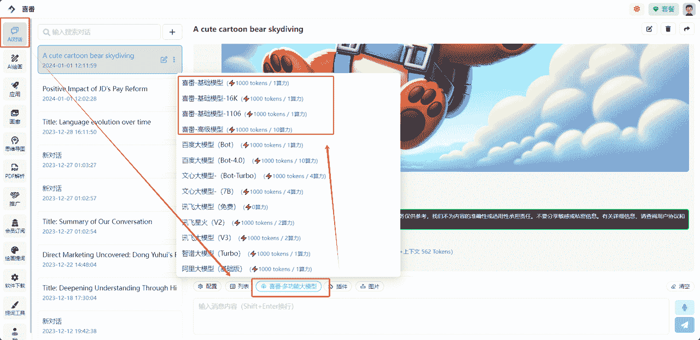
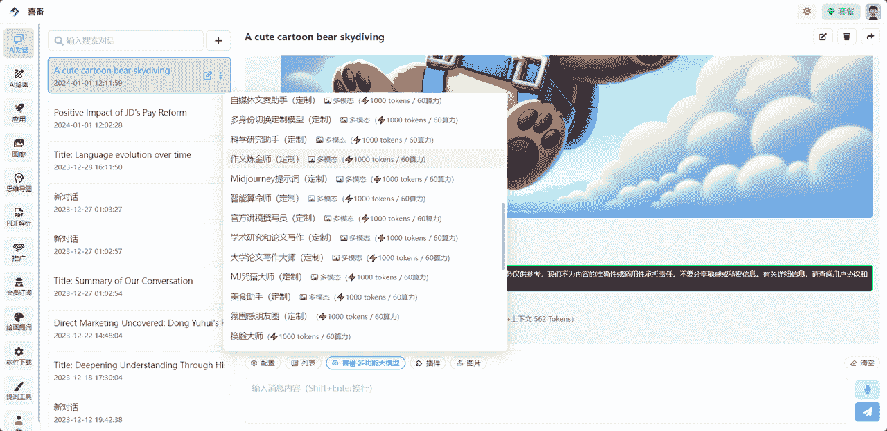
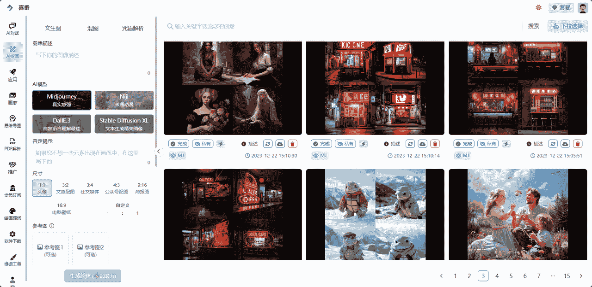
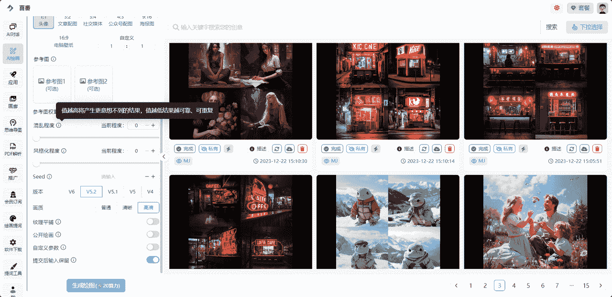
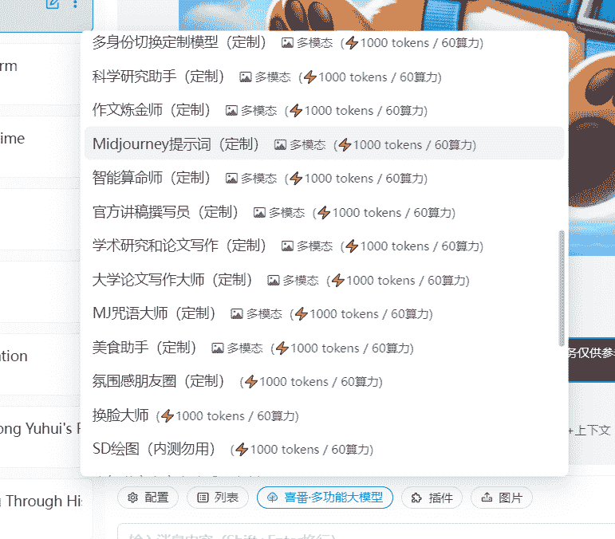
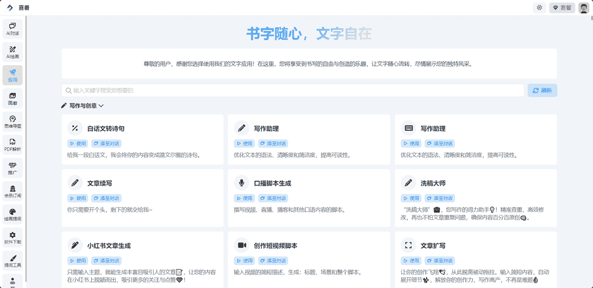

# 最强Ai工具免费用💥不需要魔法（喜番AI使用教程）

> 来源：[https://my.feishu.cn/docx/T3Kod21VnoPWbexV930ce2LKnlc](https://my.feishu.cn/docx/T3Kod21VnoPWbexV930ce2LKnlc)

网址：https://ai.qixinba.com/auth?type=register&invite=NTE

邀请码NTE，注册记得填写，能领免费算力

---

# 1、AI对话

**网站是****有备案的，所以****因为某些**原因，你看不到ChatGPT这个词。

在这里，大模型选择的时候我们将**ChatGPT****替换成了喜番**。

**其中基础模型就是GPT3.5，高级模型**就是GPT4.0，使用的是官方正版接口。

喜番=GPT

开箱即用的大模型（内置prompt）

## 2、AI绘画

AI绘画界面比较简单，左边输入提示词（中文可以识别），然后在下方选择参数，就可以一键生成图像了。

AI绘画工具默认的是midjourney，算AI绘画工具中的天花板了。

如果有不同的工具需求直接在AI模型这里更换就好。

所有参数的说明已经在网页端说明，这里就不多介绍了。

如果不会写提示词，可以用AI**工****具帮你写提示词，z第一个A****I**对话界面选择 midjourney提示词 模型即可。

AI绘画

参数说明

AI帮写

# 3、应用

应用界面是一些调教好提示词的小助手，不怎么会写提示词，可以直接在这边开箱即用。

### 4、其他使用技巧

其他PDF阅读、思维导图等工具，都是开箱急用的，大家直接用就好。

有其他问题可以加我微信，记得说明一下来源。这里是飞书教程。

> 用内容与创意拆掉AI的门槛，向世人传递AI的知识与美好！大家好，我是神悦！