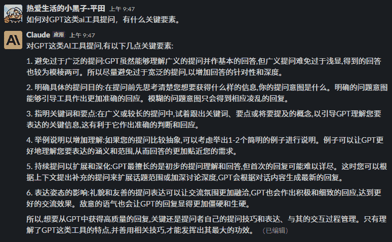
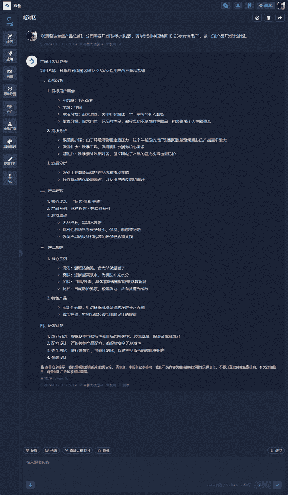
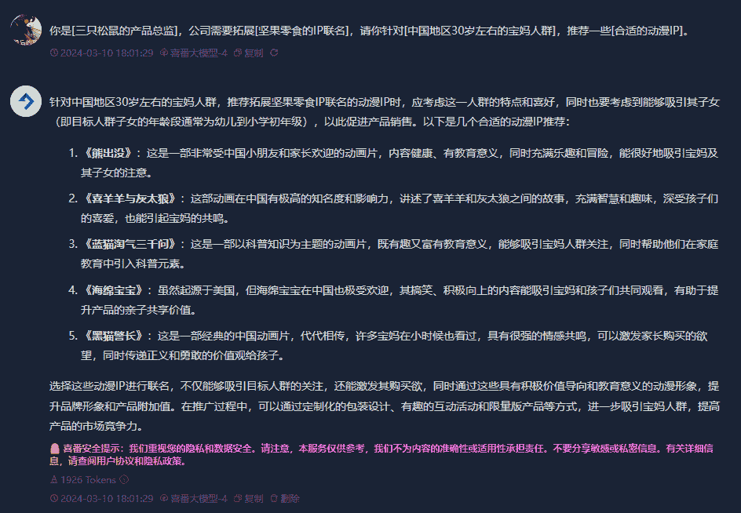
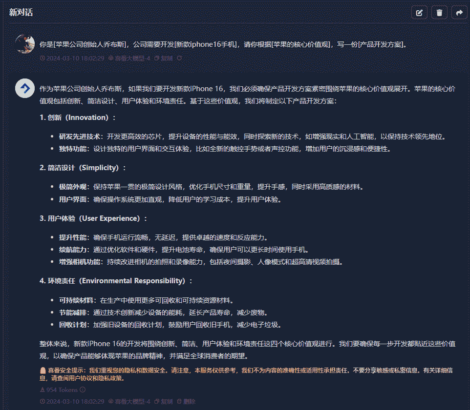
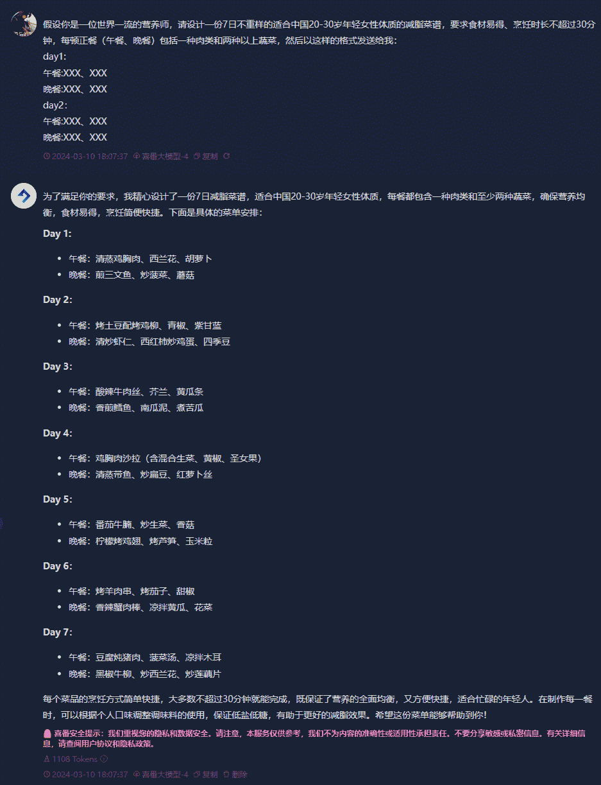
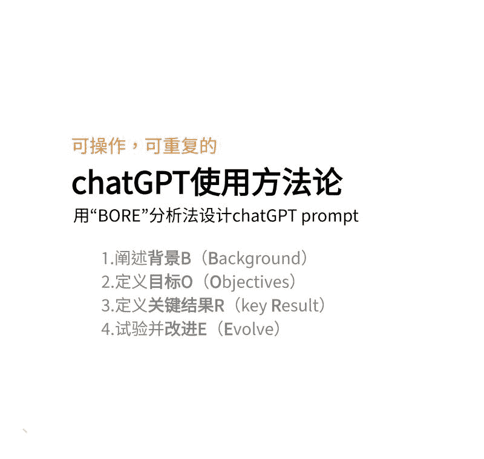
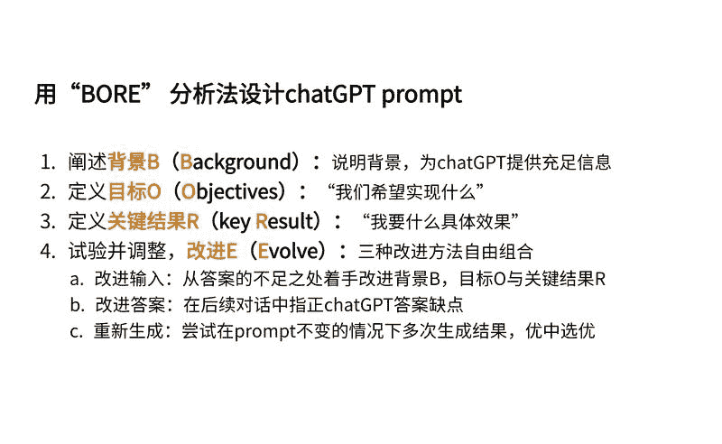
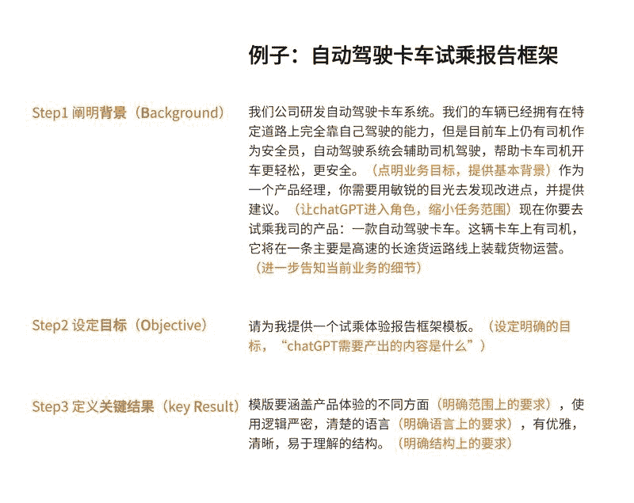
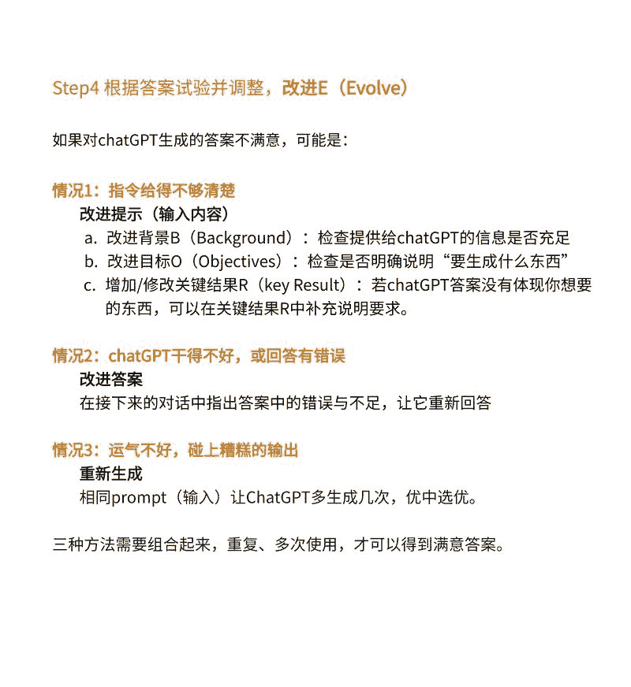

# NO.01👉学会这招让Ai秒变专家！

> 来源：[https://my.feishu.cn/docx/FYtBdMnGvoyG1gxzFvWclBWxnxb](https://my.feishu.cn/docx/FYtBdMnGvoyG1gxzFvWclBWxnxb)

不论是gpt还是claude这类ai工具，相信大家都遇到过这样的场景👇

**“老是答非所问”**

“为什么胡言乱语，完全不理解我的问题”

“一点都不像人工智能，跟人工智障一样”

**👆如**果你有以上的困扰，那么我们看完这一篇，立马让你的“人工智障”进化！

### **学会《怎么提问》**

比如你发给他：给我一份[产品开发计划书]，这种情况下一般得不到想要的答案（只能满足你一部分好奇心，并不能解决工作中遇到的问题）

接下来，我们来简单学习一下使用技巧，先让AI来给自己写个使用方法。

### **问一下****ai****，我们该如何提问**

对GPT这类AI工具提问，有以下几点关键要素:

#### **避免过于广泛的提问**:

GPT虽然能够理解广义的提问并作基本的回答，但广义提问难免过于浅显，🤷‍♀️得到的回答也较为模棱两可。所以尽量避免过于宽泛的提问，😎以增加回答的针对性和深度。

#### **明确****具体****的提问****目的**:

在提问前先思考清楚您想要获得什么样的信息，🤔你的提问意图是什么。明确的问题意图能够引导工具作出更加准确的回应。🤷‍♂️模糊的问题意图只会得到相应凌乱的回复。

#### **指明****关键词和要点**

在广义或较长的提问中，试着跟出关键词、要点或将要提及的概念，👉以引导GPT理解您要表达的关键信息，这有利于它作出准确的判断和回应。

#### **举例说明****以增加理解**

如果您的提问比较抽象，🤏可以考虑举出1-2个简明的例子进行说明。例子可以让GPT更好地理解您要表达的涵义和范围，😸从而回答的更加贴近您的需求。

#### **持续提问****以扩展和深化**

GPT最擅长的是初步的提问理解和回答，✔但首次的回复可能难以详尽。这时您可以根据上下文提出补充的提问来扩展话题范围或加深讨论深度，GPT会根据对话内容生成最新的回复。

#### **表达姿态的影响**

礼貌和友善的提问表达可以让交流氛围更加融洽，😁GPT也会作出积极和细致的回应，达到更好的交流效果。🙁敌意的语气也会让GPT的回复显得更加僵硬和生硬。

所以，想要从GPT中获得高质量的回复，👀关键还是提问者自己的提问技巧和表达、与其的交互过程管理。只有理解了GPT这类工具的特点，并善用相关技巧，才能发挥出其最大的功效。

**避免过于宽泛（可以限定****ai****角色****、把需要ai完成的****任务****说清楚）**

**具体目的（把任务****背景****交代清楚）**

**关键词和要点（把****条件****准确传达）**

举例说明（主要目的是避免过于抽象，与避免过于宽泛的意思相同）

**最后是持续提问和礼貌沟通。**

所以需要交代清楚现在GPT是哪个**角色**、在什么样的**背景**下、根据什么**条件**、做什么样的**任务**，如果有模板，可以**举例**让他理解，最后通过**持续对话**，用更深度的提问来获取想要的结果；

这样才能得到满意的答案，**然后根据****GPT**的回复内容，有针对性的提问并继续深入对话，往往能得到满意的结果。

### **示例【提示词与生成效果】**

#### 1.雅诗兰黛

你是[雅诗兰黛产品总监]，公司需要开发[秋季护肤品]，请你针对[中国地区18-25岁女性用户]，做一份[产品开发计划书]。

#### 2.三只松鼠

你是[三只松鼠的产品总监]，公司需要拓展[坚果零食的IP联名]，请你针对[中国地区30岁左右的宝妈人群]，推荐一些[合适的动漫IP]。

#### 3.苹果公司

你是[苹果公司创始人乔布斯]，公司需要开发[新款iphone16手机]，请你根据[苹果的核心价值观]，写一份[产品开发方案]。

#### 4.其他**复杂场景**

假设你是一位世界一流的营养师，请设计一份7日不重样的适合中国20-30岁年轻女性体质的减脂菜谱，要求食材易得、烹饪时长不超过30分钟，每顿正餐（午餐、晚餐）包括一种肉类和两种以上蔬菜，然后以这样的格式发送给我：

day1:

午餐:XXX、XXX

晚餐:XXX、XXX

day2：

午餐:XXX、XXX

晚餐:XXX、XXX

如果你看到这里，已经学会提问方式了！快去试一下吧！

还有更高阶一些的 BOKE方法论（方法论作者: 陈财猫 ）

适合所有人，所有任务，所有场景！

> 感觉有用的话**点个免费的赞吧**，有疑问欢迎在评论区交流！

> 我是神悦，热爱当下生活，永远忠于自己。