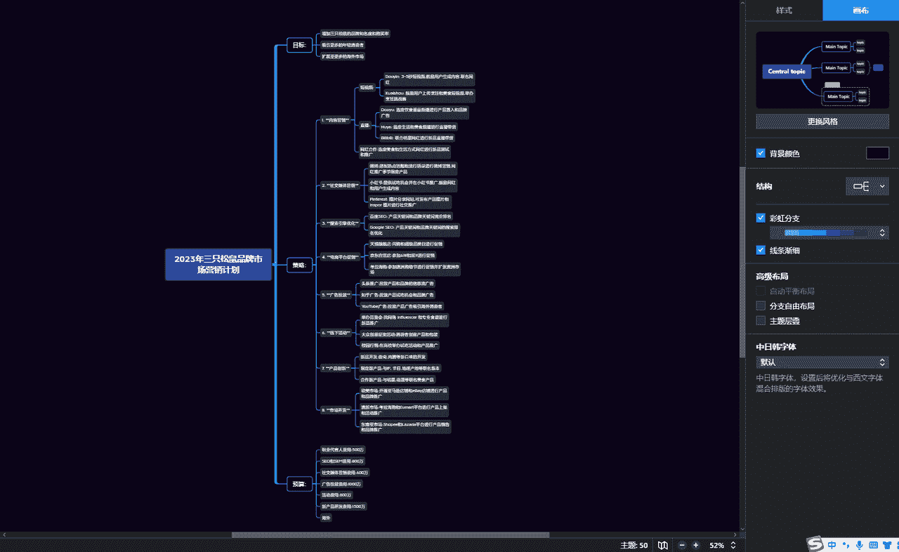
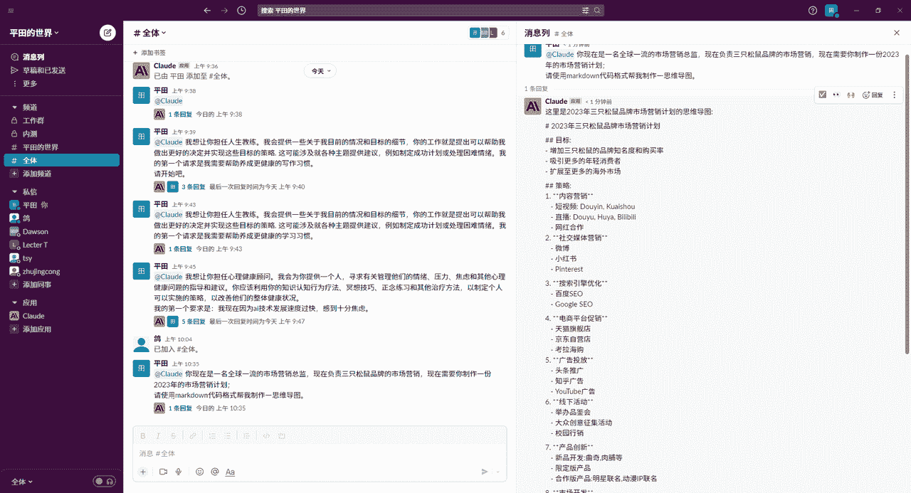
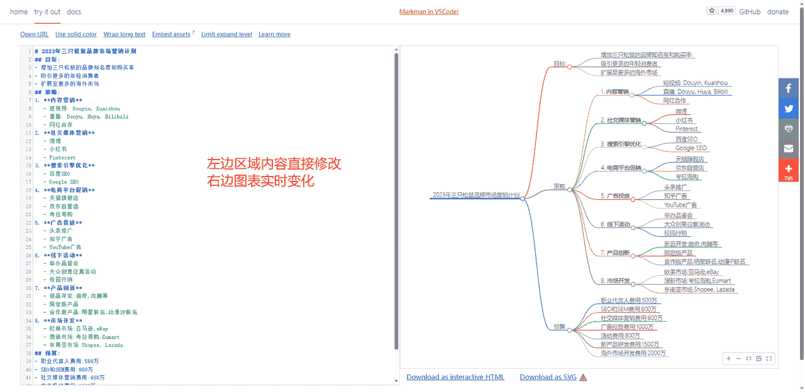
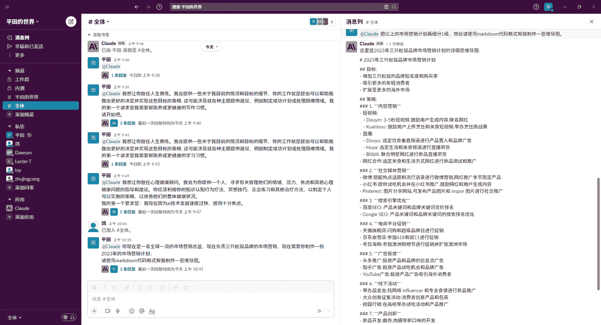
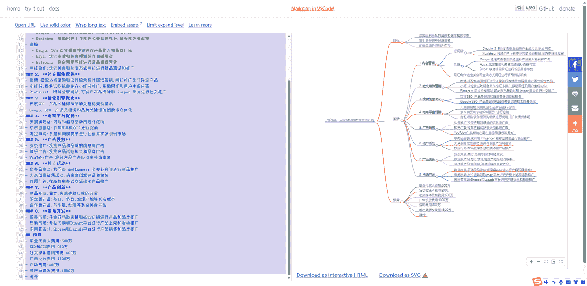
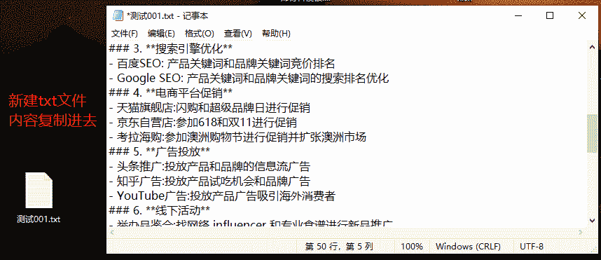

# NO.02👉1分钟搞定思维导图！

> 来源：[https://my.feishu.cn/docx/K1MVdz2ndo5poFx5Q1Sc348wnic](https://my.feishu.cn/docx/K1MVdz2ndo5poFx5Q1Sc348wnic)

平时想破头做的思维导图，它只需要1分钟就能搞定✔

🧧工具我放在最后面，大家自行获取🧧

🌹首先记住这套提问关键词：markdown

”请使⽤markdown代码格式帮我制作⼀思维导图。“

💒好了！咱们开始测试：

### 第1步：提问

你现在是一名全球一流的市场营销总监，现在负责三只松鼠品牌的市场营销，现在需要你制作一份2023年的市场营销计划；

请使⽤markdown代码格式帮我制作⼀思维导图。

### 第2步：复制粘贴到markmap

🤗思维导图工具markmap：https://markmap.js.org/repl（不用魔法！不用下载！真香！）

### 第3步：提问（细化你的需求，完善思维导图）

### 第4步：复制粘贴，完工

以上3→4步骤可以一直循环，直到你对结果满意

💝如果你自己用，到这步就行了！

若是用于文件or图片形式的分享。比如发思维导图文件给其他人，继续往下走🎅🏾

---

### 补充：思维导图转化成本地文件

1：桌面新建TXT文件夹，复制粘贴之前生成的内容

2：TXT文件的格式改成MD，然后导入XMIND，收工

😸Xmind下载：https://pan.baidu.com/s/1PqfIrZ_UaN6cXjrgLOxWkw?pwd=1234

提取码：1234

---

**🉑以上就是应用方**式，大家提升效率的同时还是要保留思考的习惯，别过于依赖Ai工具！

⛔工具很强大，我们要学会使用他的同时有自己的思考！

💯工具我用的是Claude克劳德（亲测各类Ai工具claude、gpt3.5、gpt4等都能输出markdown）

我演示选了claude主要是因为他免费🔴

而且，不用魔法🔴不用魔法🔴不用魔法🔴

还支持win、ios、安卓三端！太香了！

（比GPT4差了点，做思维导图够用）

### 免费的不用魔法的Ai工具下载地址

**Slack！**

官方首页（🐧和163邮箱不能注册）：https://www.anthropic.com/index/claude-now-in-slack

阿里邮箱官网（阿里邮箱可以注册）：https://mailsso.mxhichina.com/aliyun/register?lang=zh_CN

机器人加载到频道：https://w1681392339-tho299582.slack.com/apps/A04KGS7N9A8-claude

win/IOS/安卓应用下载：https://slack.com/intl/zh-cn/downloads/windows

不会添加机器人or没有魔法的话，可以直接加我的频道（平田的世界）使用：

https://join.slack.com/t/w1681392339-tho299582/shared_invite/zt-1syjsirg7-uWbKPIX87jONNyonmQy3OQ

> 我是热爱生活的小黑子，热爱当下生活，永远忠于自己。