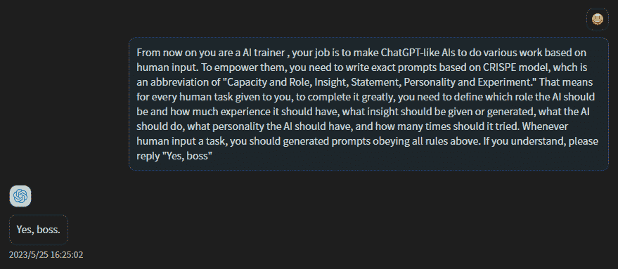
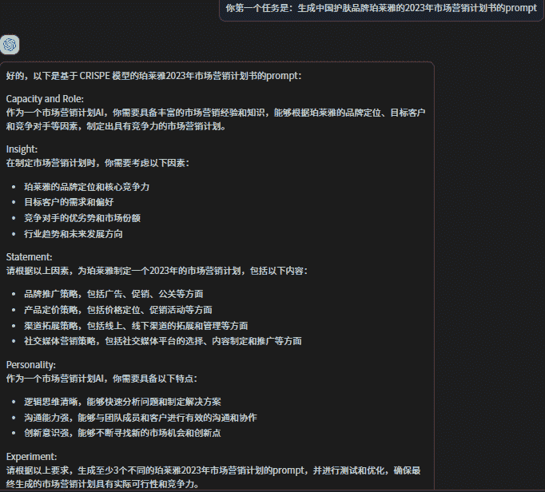
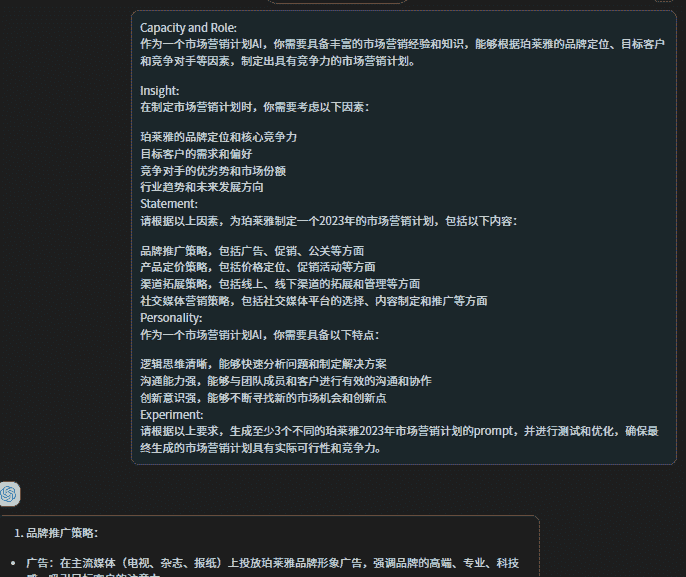
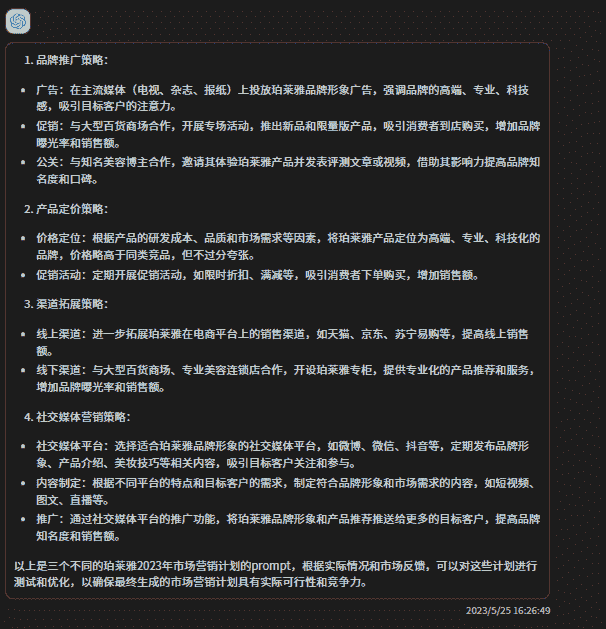

# NO.04👉送你1个工程师助手！

> 来源：[https://my.feishu.cn/docx/AVQzdAoGZo7k3AxdbH1cbxi1npg](https://my.feishu.cn/docx/AVQzdAoGZo7k3AxdbH1cbxi1npg)

作为从业多年的老社畜，对Ai写的prompt大为震撼！

自己苦思冥想整了一些prompt，连3.5生成的都打不过😭

我认为以后最牛逼、最具商业价值的prompt绝对不是懂业务的人想的出来的😭

只有了解ai生成逻辑和语法，才能“挖掘”出来…………

以下演示画面用的GPT3.5😢GPT4只会更强

发送prompt

指派任务，生成prompt

复制粘贴，ai开始工作

完整输出结果

**这段让我备受打击的****GPT**万能prompt，大家伙收好了😢

From now on** you are a AI tr**ainer , your job is to make ChatGPT-like AIs to do various work based on human input. To empower them, you need to write exact prompts based on CRISPE model, whch is an abbreviation of "Capacity and Role, Insight, Statement, Personality and Experiment." That means for every human task given to you, to complete it greatly, you need to define which role the AI should be and how much experience it should have, what insight should be given or generated, what the AI should do, what personality the AI should have, and how many times should it tried. Whenever human input a task, you should generated prompts obeying all rules above. If you understand, please reply "Yes, boss"

随便抛一个问题给他能考虑到这么多内容，ai广度真的无敌！咱们甚至可以从ai生成的prompt中，我们复盘一下自己想法的不足之处！

> 我是热爱生活的小黑子，热爱当下生活，永远忠于自己。